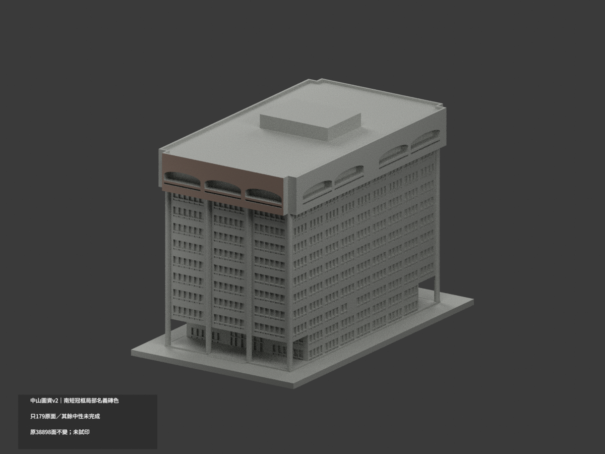
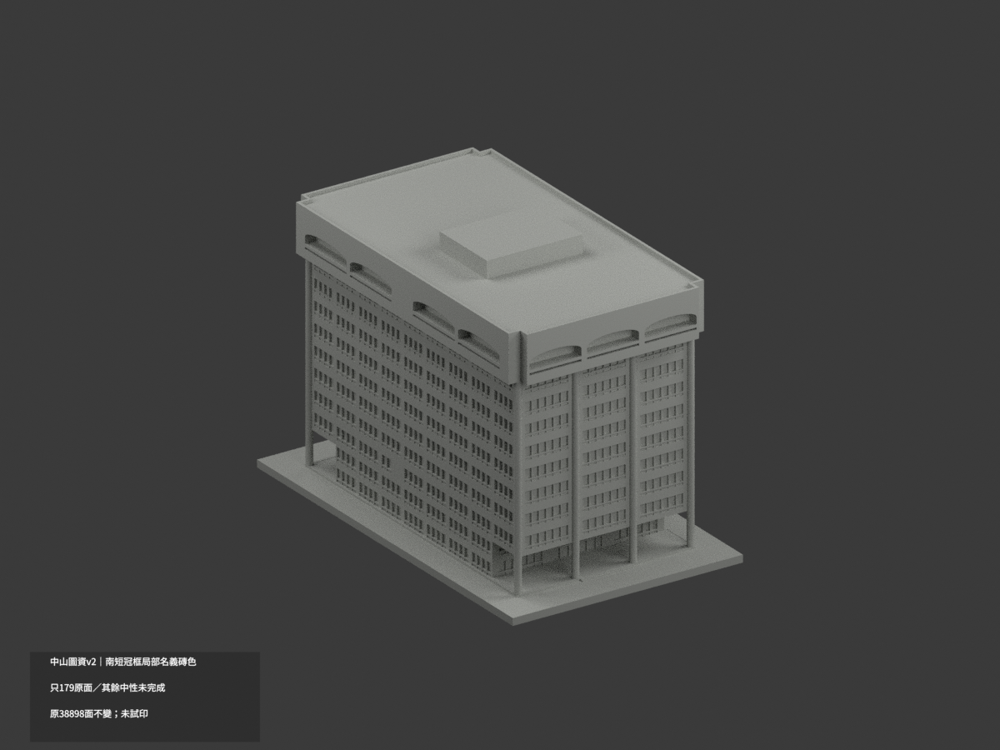
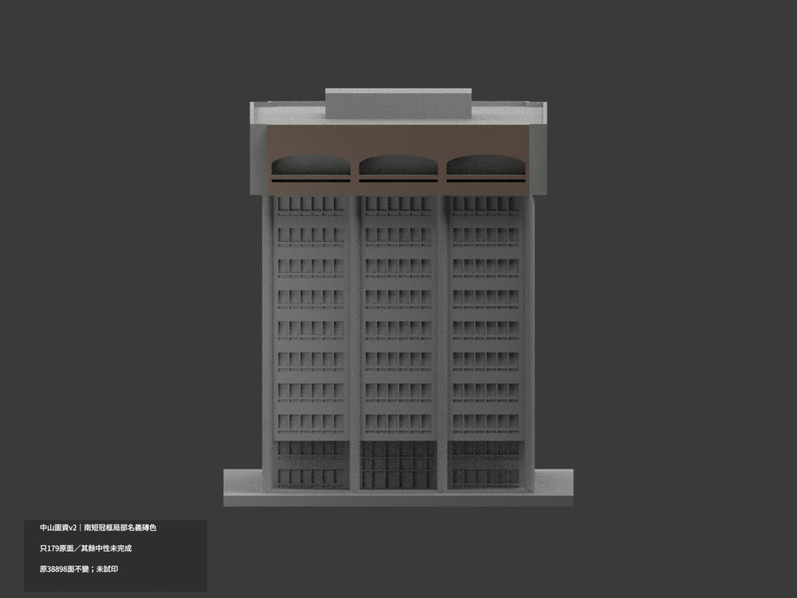
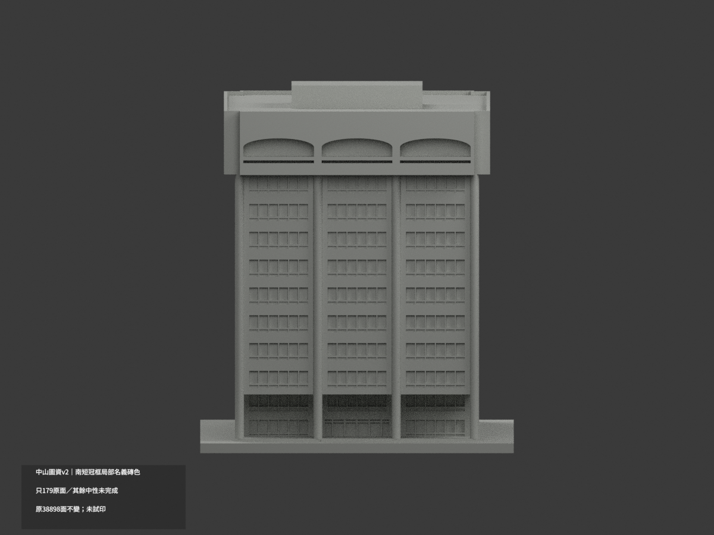
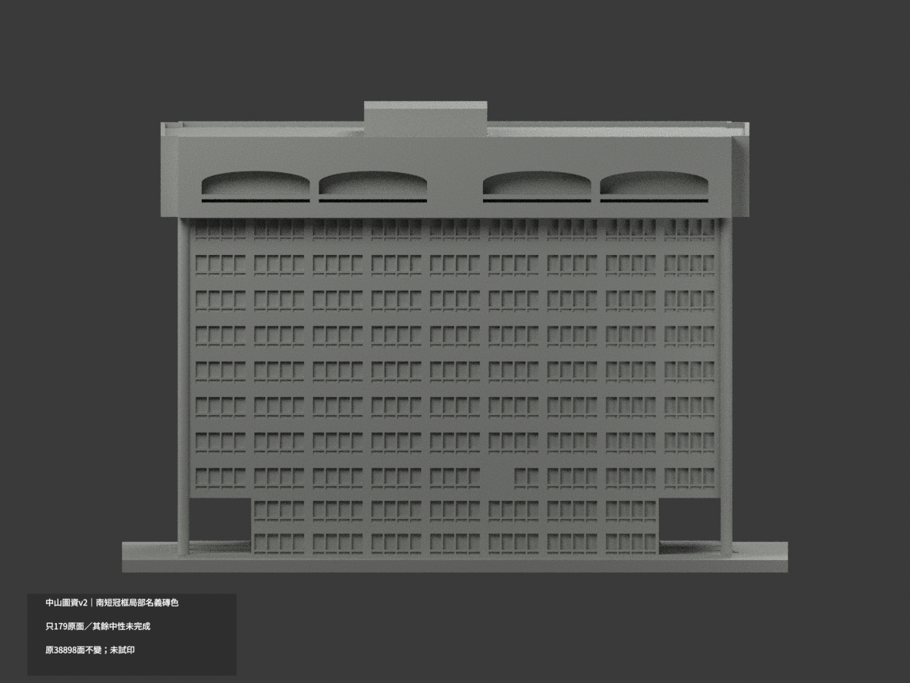
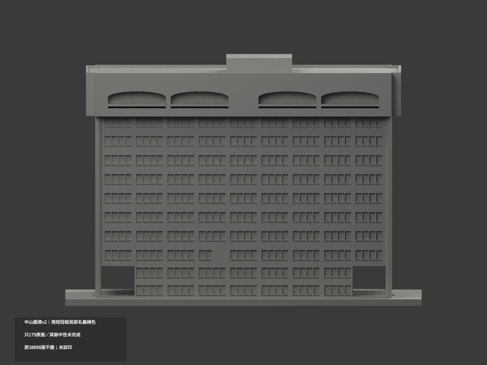
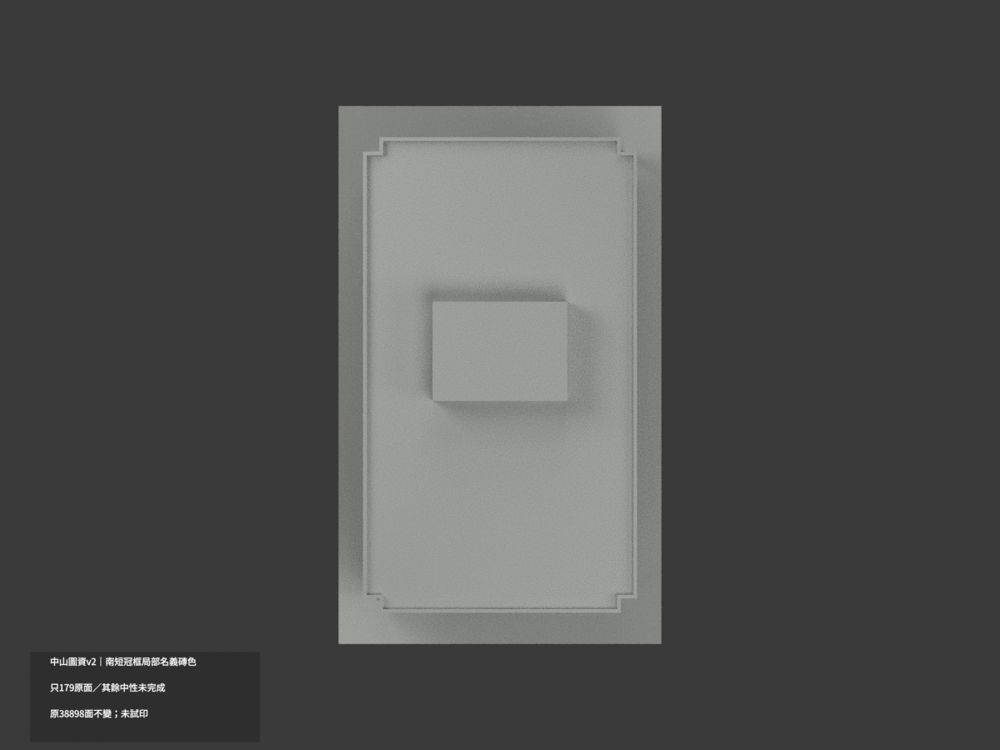
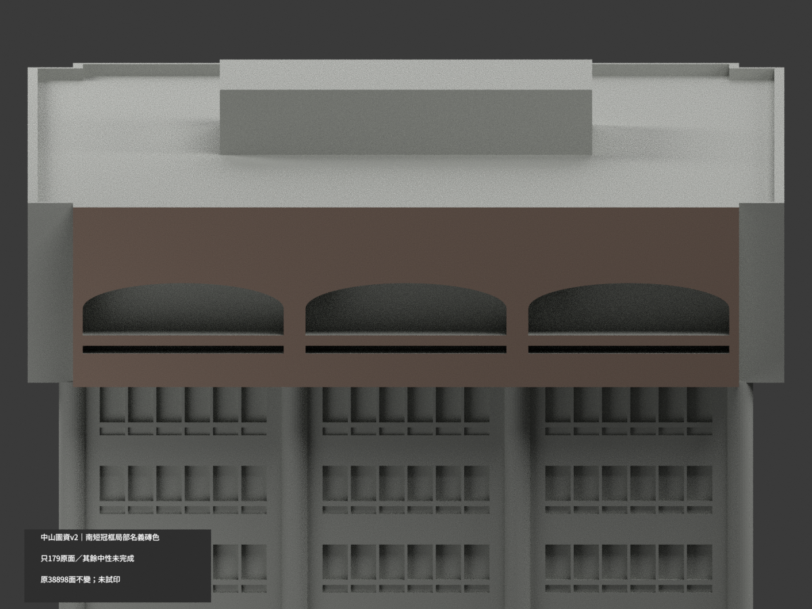
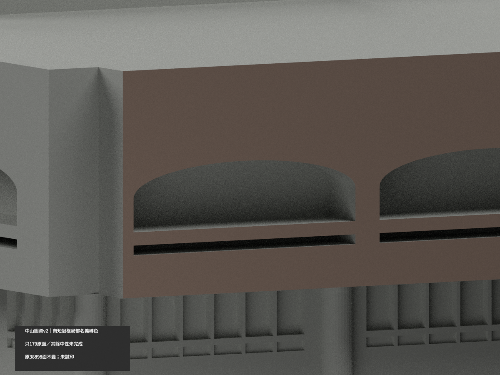
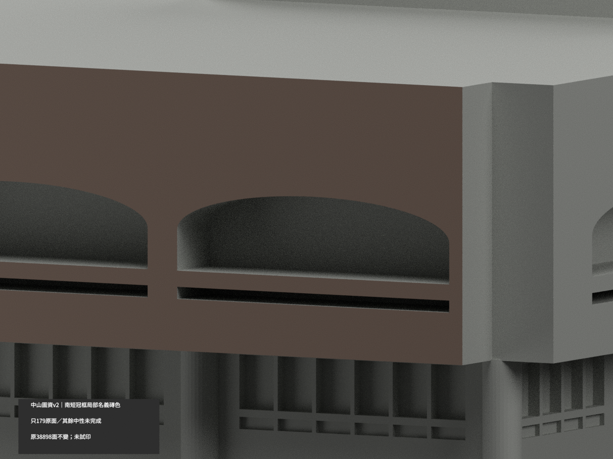

# 中山圖資主棟幾何v2｜南短冠框局部名義磚色

**局部補色未完成：只幾何v2主網格南短面冠框完整179三角採名義灰粉棕磚基材，其餘面尚未分色，38719面維持未知中性。未定年官照非2026現況；不復原字樣、污斑或光照。色審不追認全幾何或列印QA。** partial_color_incomplete=true、fully_colored_exterior=false。nsysu-library-information/count_delta=0；NSYSU Library Information v2 partial color。

| 前斜視 | 後斜視 | 南短面 |
|---|---|---|
|  |  |  |
|  |  |  |
|  |  |  |
|  | | |

## 材色範圍

只有原geometry/v2/model.stl主網格38898面，不用root舊15126面或隱藏平面QAclip4876面。先選whole y−66.3原無限plane全部179面、一完整共享邊component，再依原crown_short_panel_volume參數核所有三頂點x±33.63/z79.61..97.87有限域，whole==finite。保原三扁弧洞與下窄槽Boolean碎面，不填洞、不以normal閾漏片。179名義#A58F82／38719未知#B8BAB5，11701共面域uniform。

官照可見基材灰粉棕，光照/風化/污斑不作三角分界。原省略凸金屬字，不造字也不把字影當基材；不是整白字牌誤染。南為圖面與入口相對稱呼，不是實測世界方向。只外正面，凹弧內壁、背襯、下縫內壁、頂底與轉角、北冠/長面/窗柱/屋面機房均中性。中性不是已證灰，色值非量測色票。

## 原版本與QA作用域

完整61原件逐byte保original-version/，包含舊root15126模型、現行geometry/v2主38898及其QAclip4876/九舊圖/原3MF/scene/全部參數來源與QA；另原件私存。根新model.stl/build_model.py/params.json/requirements.txt精確複製原geometry/v2版本，無原OBJ不新增聲稱。舊QA只綁原子包，不綁新十圖/scene/3MF，不把舊root與clip算入新主體面數。新scene僅主體，不加隱藏clip或另外建築。PREVIEW-TRANSITION.md記同項局部更新。

原獨立展示尺度2mm/圖面m加原底座平移，含底座90×150×103.29mm；非同比例校園、非測繪/BIM/竣工或2026現況。兩短面各3扁弧、兩長面各4分2+2、完整圓柱、單偏心機房皆原樣。3F接點人工中性封閉切口不是真獨立外牆，不延鄰低館或橋。前圓亭/地下室/坡道花台/屋頂細設備未建，不因色審補。

主要原圖編目1984及後修訂，「76.6變更前」不證竣工；官方平面2022-07-29為匯出時間。原包引用2024/2026照片的歷史原文保留，但本次2024 Commons原像素GET403已停且未使用，2026照片只有引用未新讀，不作本次色證。唯一採已取得未定年官照，原圖與照片私存不公開、不將可見視為開放授權。

原v2水密、517個0.2mm截面、0.8mm形態篩檢、射線/圓柱/自交控制等歷史QA原樣保，色審不重簽全printability。0.3–0.4mm窗稜、約0.44mm入口格與1.0mm邊框需真機切片；門廊/冠出挑需支撐，未實印無免支撐保證。新QA僅原bytes/全38898三角identity、隔離v2build+color重建、兩材3MF/reopen/身份/十圖；不是四色AMS實測專案。

NSYSU Library Information v2 partial color. Only the complete southshort crown outward plane179originaltriangles receives nominal #A58F82 substrate color;38719unknownneutral. Whole y−66.3 plane equals oneconnected179domain within originalfinite x±33.63/z79.61..97.87; arc andslitBooleanopenings remain. No lettering, stains, photographiclighting or newgeometry.

The target is geometry/v2 main38898, not oldroot15126 or hiddenplanQAclip4876. All61originalfiles remain byte-identical under original-version/ with nestedv2 nineviews andalloldQA. NewrootSTL/build/params are exactv2copies, no originalOBJ. OldQA scopedto originaltree only; newscene containsmainmesh only. Independent2mm/drawingmetre display, oneexistingmainblock,count0.

Undatedofficialphoto only; not2026/asbuilt. Commons403image not used,2026originalcitation not newlyread. Originalboundedconnectorcaps, oneoffsetroofmass, material/geometrysimplifications andprintlimitations retained. No globalgeometry/printabilityrecertification or physicalprint. Sourcephotos private,rights unchanged.
