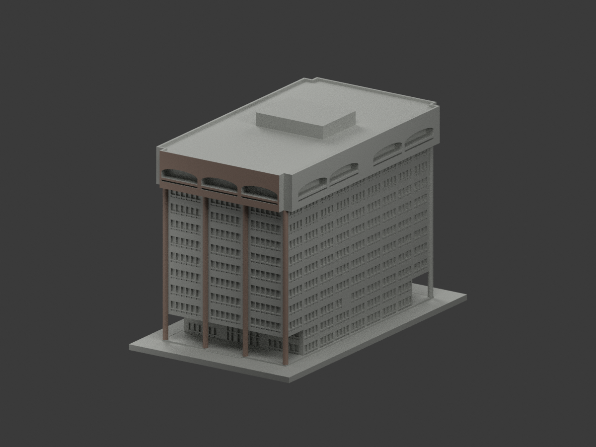
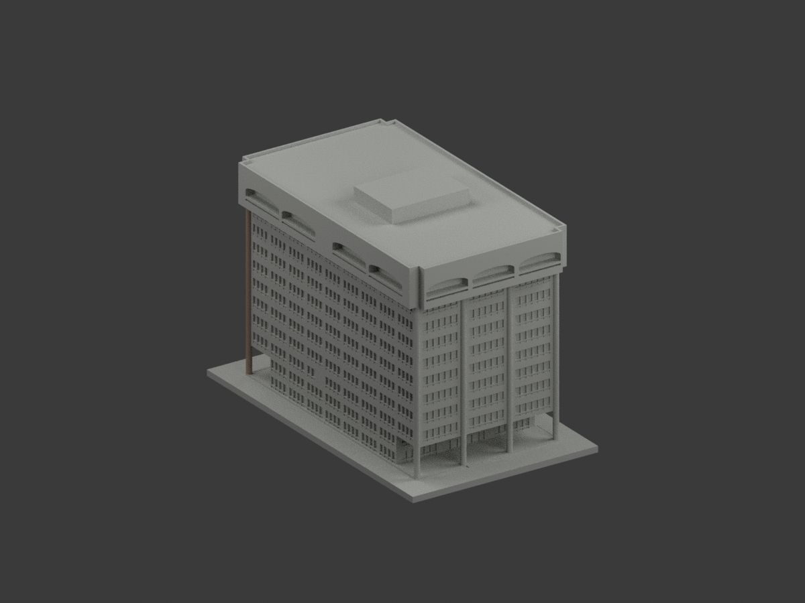
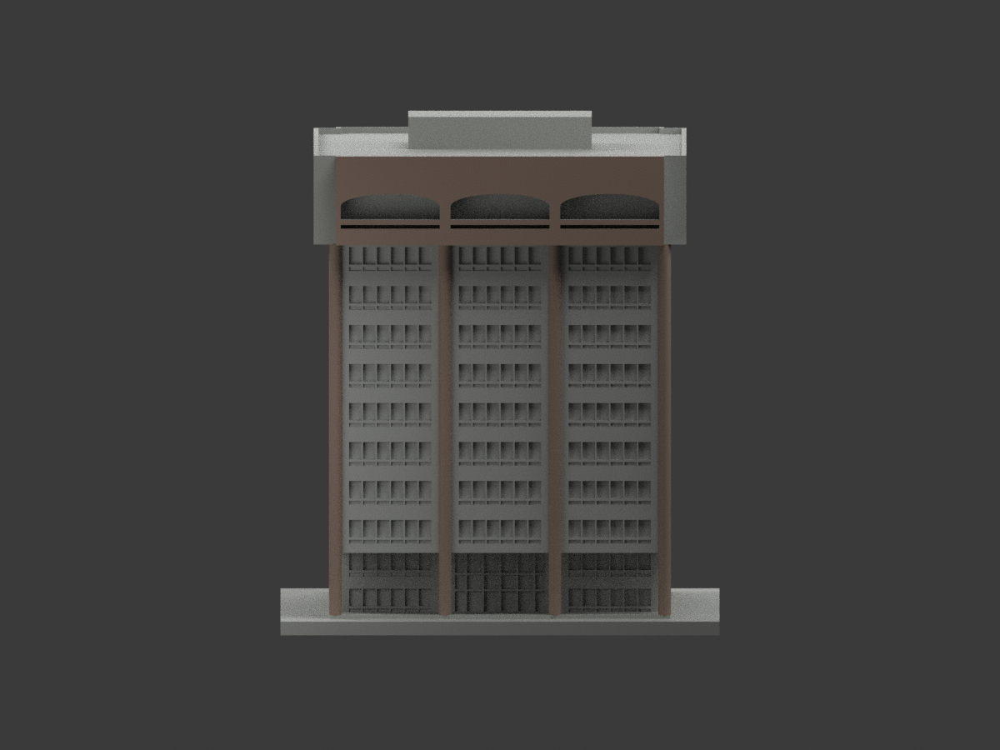
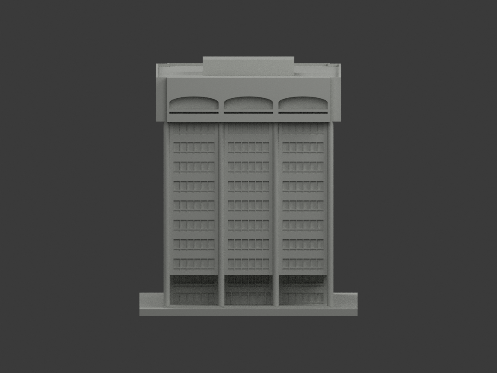
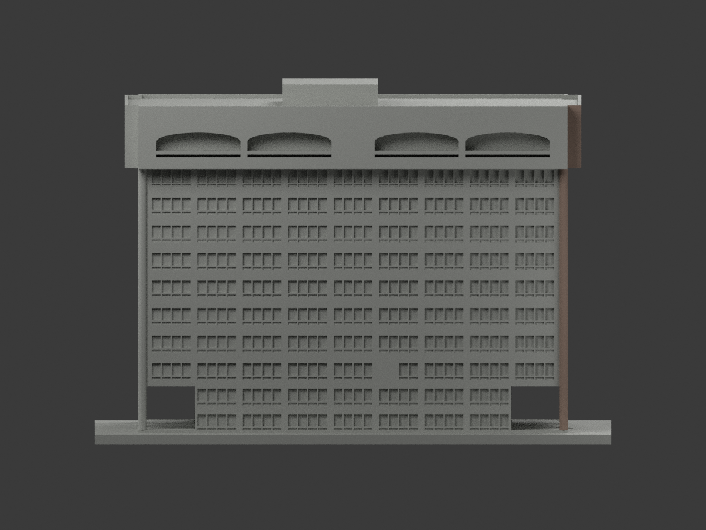
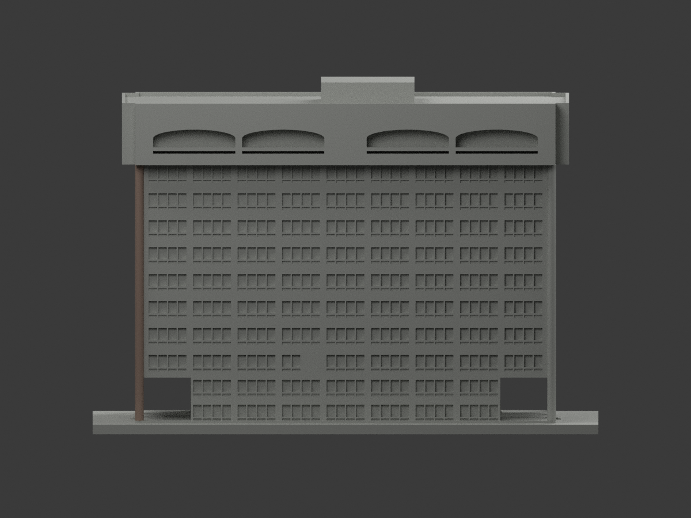
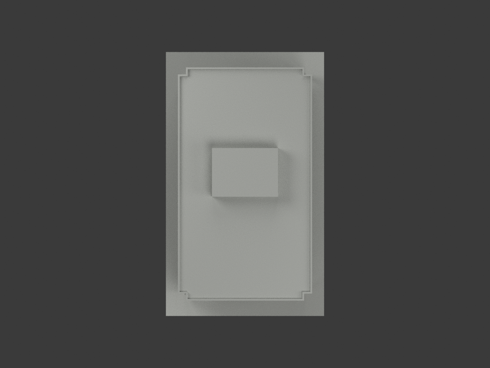
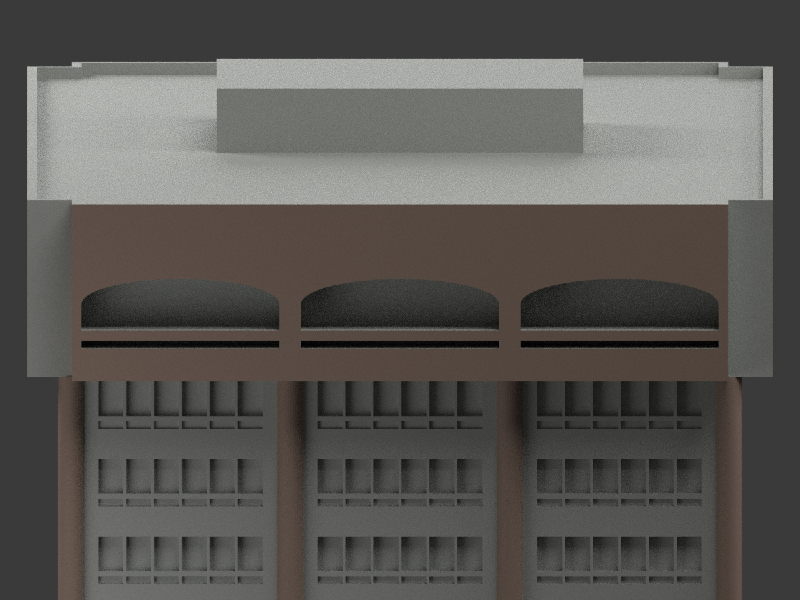
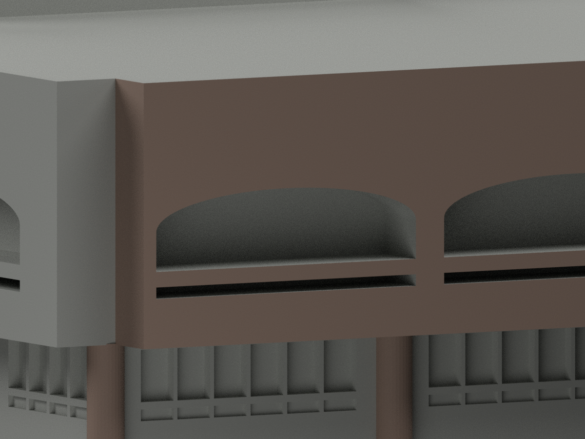
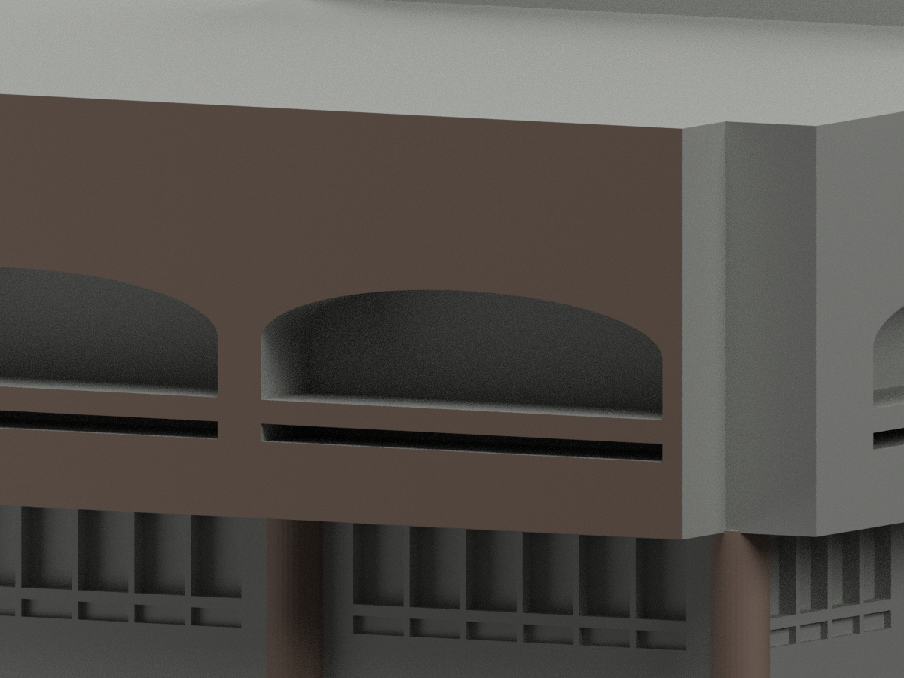

# 中山圖資主棟幾何v2｜南冠框與前圓柱局部名義磚色

> **目前色版（2026-11-18 模型）**：本次只改 4 個原三角面的材質；現版共 38,898 面。面數以模型實際指派為準（材質索引／面數：0: NSYSU south crown and front columns nominal gray brown substrate = 511、1: UNVERIFIED main walls entrance windows roofs neutral = 38,387）。舊統計及舊 QA 為前版歷史，不能作為現版驗證。現版檔案核對請用 [PUBLIC-MODEL-SHA256SUMS](PUBLIC-MODEL-SHA256SUMS)。


**局部補色未完成：保留幾何 v2 主網格南短面冠框原 179 面名義灰粉棕磚色，新增正面四根圓柱的 328 個原側面，共 507 面配色；38,391 面維持未知中性。四柱背向面延續色屬合理推定。未定年官照非2026現況；不復原字樣、污斑或光照。色審不追認全幾何或列印QA。** partial_color_incomplete=true、fully_colored_exterior=false。nsysu-library-information/count_delta=0；NSYSU Library Information v2 partial color。

| 前斜視 | 後斜視 | 南短面 |
|---|---|---|
|  |  |  |
|  |  |  |
|  |  |  |
|  | | |

## 材色範圍

只有原geometry/v2/model.stl主網格38898面，不用root舊15126面或隱藏平面QAclip4876面。先選whole y−66.3原無限plane全部179面、一完整共享邊component，再依原crown_short_panel_volume參數核所有三頂點x±33.63/z79.61..97.87有限域，whole==finite。保原三扁弧洞與下窄槽Boolean碎面，不填洞、不以normal閾漏片。原冠框 179 面與新增前柱 328 面採名義 #A58F82，38,391 面未知 #B8BAB5，11701共面域uniform。

官照可見基材灰粉棕，光照/風化/污斑不作三角分界。原省略凸金屬字，不造字也不把字影當基材；不是整白字牌誤染。南為圖面與入口相對稱呼，不是實測世界方向。冠框仍只保留原外正面，凹弧內壁、背襯、下縫內壁、頂底與轉角、北冠、長面、其他窗柱及屋面機房均中性。中性不是已證灰，色值非量測色票。

## 本次前圓柱補色

官方未定年照片可見入口短面四根圓柱呈灰棕磚色。本次逐一使用原 params.json 的圓心、半徑、高度與 32 段側面平面，檢查每個三角形的全部頂點，選取 84、80、80、84 面。僅材料索引改變，沒有改動曲面或切割三角形；所有相鄰共面域保持一致。背向柱面沿用同構件名義色，屬推定，並非新照片證據。後側四柱、端蓋、其他牆面與玻璃不改。

[來源與推定範圍](FRONT-COLUMN-SOURCE-QA.json) · [獨立審核](FRONT-COLUMN-INDEPENDENT-QA.json) · [原局部配色說明](qa/front-column-previous/README.md)

## 原版本與QA作用域

完整61原件逐byte保original-version/，包含舊root15126模型、現行geometry/v2主38898及其QAclip4876/九舊圖/原3MF/scene/全部參數來源與QA；另原件私存。根新model.stl/build_model.py/params.json/requirements.txt精確複製原geometry/v2版本，無原OBJ不新增聲稱。舊QA只綁原子包，不綁新十圖/scene/3MF，不把舊root與clip算入新主體面數。新scene僅主體，不加隱藏clip或另外建築。PREVIEW-TRANSITION.md記同項局部更新。

原獨立展示尺度2mm/圖面m加原底座平移，含底座90×150×103.29mm；非同比例校園、非測繪/BIM/竣工或2026現況。兩短面各3扁弧、兩長面各4分2+2、完整圓柱、單偏心機房皆原樣。3F接點人工中性封閉切口不是真獨立外牆，不延鄰低館或橋。前圓亭/地下室/坡道花台/屋頂細設備未建，不因色審補。

主要原圖編目1984及後修訂，「76.6變更前」不證竣工；官方平面2022-07-29為匯出時間。原包引用2024/2026照片的歷史原文保留，但本次2024 Commons原像素GET403已停且未使用，2026照片只有引用未新讀，不作本次色證。唯一採已取得未定年官照，原圖與照片私存不公開、不將可見視為開放授權。

原v2水密、517個0.2mm截面、0.8mm形態篩檢、射線/圓柱/自交控制等歷史QA原樣保，色審不重簽全printability。0.3–0.4mm窗稜、約0.44mm入口格與1.0mm邊框需真機切片；門廊/冠出挑需支撐，未實印無免支撐保證。新QA僅原bytes/全38898三角identity、隔離v2build+color重建、兩材3MF/reopen/身份/十圖；不是四色AMS實測專案。

NSYSU Library Information v2 partial color. The original 179 south crown faces retain nominal #A58F82. This update adds 328 side faces of the four entrance-facing cylindrical columns, for 507 colored and 38,391 unknown-neutral faces. All faces are selected from the exact finite original 32-facet cylinder boundaries without changing geometry. Back-facing continuity of the same columns is inferred. Rear columns, caps, glazing and other walls are unchanged. Whole y−66.3 plane equals oneconnected179domain within originalfinite x±33.63/z79.61..97.87; arc andslitBooleanopenings remain. No lettering, stains, photographiclighting or newgeometry.

The target is geometry/v2 main38898, not oldroot15126 or hiddenplanQAclip4876. All61originalfiles remain byte-identical under original-version/ with nestedv2 nineviews andalloldQA. NewrootSTL/build/params are exactv2copies, no originalOBJ. OldQA scopedto originaltree only; newscene containsmainmesh only. Independent2mm/drawingmetre display, oneexistingmainblock,count0.

Undatedofficialphoto only; not2026/asbuilt. Commons403image not used,2026originalcitation not newlyread. Originalboundedconnectorcaps, oneoffsetroofmass, material/geometrysimplifications andprintlimitations retained. No globalgeometry/printabilityrecertification or physicalprint. Sourcephotos private,rights unchanged.


## 2026-11-18 南冠左外窄端有界材色延伸

僅將原三角面 **35934、35935、35936、35965** 由未知中性 1 改為既有冠部名義磚色 0（#A58F82）。現為 **511 面名義磚色、38,387 面未知中性**，其餘 38,894 面完全不改。上文 507 面為本次之前歷史版本，不代表現版統計。

來源為原先已登錄、未定年的官方照片。照片左側外冠端與前冠同屬褐磚材料家族；受陰影及未校準色彩影響，不聲稱逐像素同色或精確材料鑑定。本次只有此左端，不對稱推廣到右端、北冠、長翼、冠洞、窗、柱或橫向淡色底面。南是原圖面／入口相對方位，非實測地理方向。

選域是 x≈−33.63、y≈[−66.3,−62.3]、z≈[79.61,97.87] mm 的完整原共面連通區，共 4 三角面、6 條外邊界、面積約 73.0290233 mm²。它不是完整矩形：下後緣保留原圓柱交接造成約 0.08 mm 高微缺口。這是原簡化幾何，並非照片可辨或實測的細節；不填缺口、不切三角、不改幾何，也不把柱或水平底面混入。

保留全部原材質與 node、燈光、相機、world、transform、隱藏 caption/backdrop。隱藏歷史 caption 仍記 507 面且維持不渲染，現版統計以本節及資料檔為準。僅另同步物件的來源網格 SHA 與 scope；孤立原 Material 啟用 fake_user 防止保存時被丟棄，顏色與節點未改。

3MF 保留原座標小數字串及面序，只改四個 p1；p2/p3 原本繼承 p1，未另加。物件新增既有中性材的 pid=1/pindex=1 預設值，供 SDK 編修保存，所有三角已有明確 p1，因此不改任何額外面。NPZ、STL 與場景全三角座標和順序核對；嚴格 SDK 讀取零警告、私人改材往返、Blender 私人頂點與面材編修保存重開、乾淨重建均通過。未重新認證整體幾何、切片或列印安全。

十張預覽沿用原 renderer 的七個全景與三個局部視角、原 1200×900、Cycles 48 samples、原光照材質。局部細節圖本來就是裁切，不冒充全景留白。官方原照片與私人前後比較不附公開包。

### 精確基準重建

固定來源 commit：`8f90ae2478f00cce6832a07de537f7d333f6dbc0`。`source/baseline` 保存已公開的原 STL、NPZ、3MF、Blend、palette、appearance-materials 與 README，wrapper 逐檔核 SHA-256。Blender 4.3.2 內需 numpy。以下由本目錄執行，輸出須為獨立目錄，不可覆寫基準：

```
blender -b -t 1 --python-exit-code 1 -P source/rebuild_crown_return.py -- source/baseline rebuilt
cp render_crown_return_views.py rebuilt/
blender -b -t 2 --python-exit-code 1 -P rebuilt/render_crown_return_views.py
```

可另下載 `rebuild-source.zip`。重建不依賴私人照片或網路。原與現版都有界，依然不是全外牆完成、竣工／現況證明或實體試印結果。
