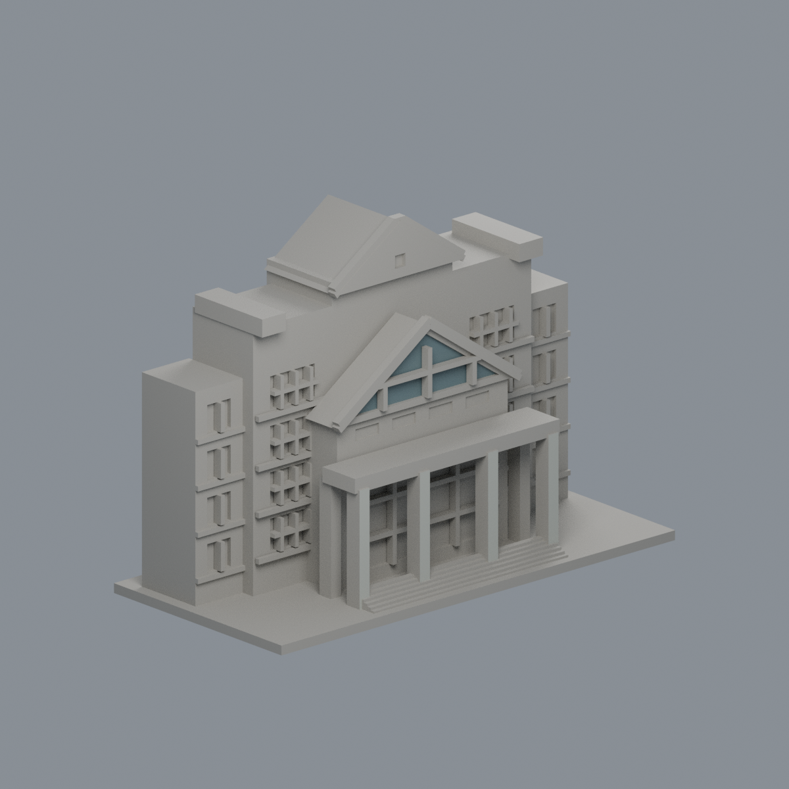
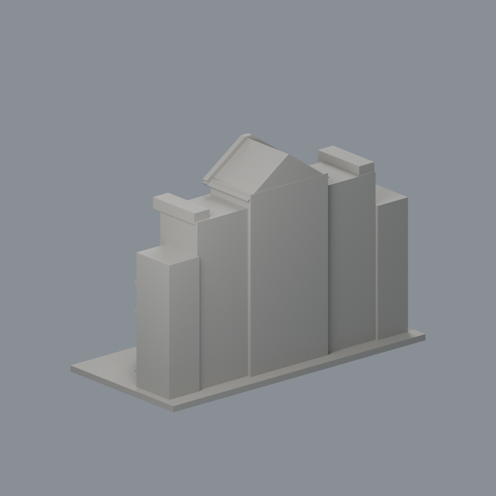
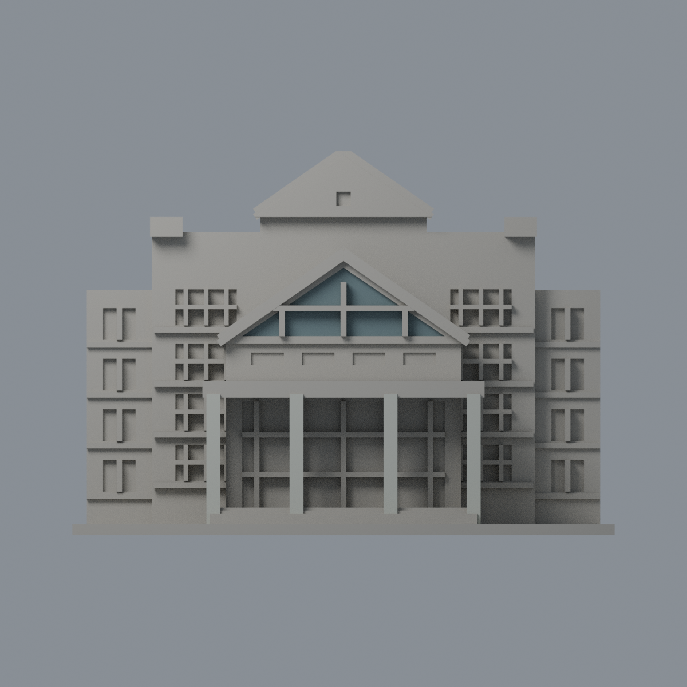
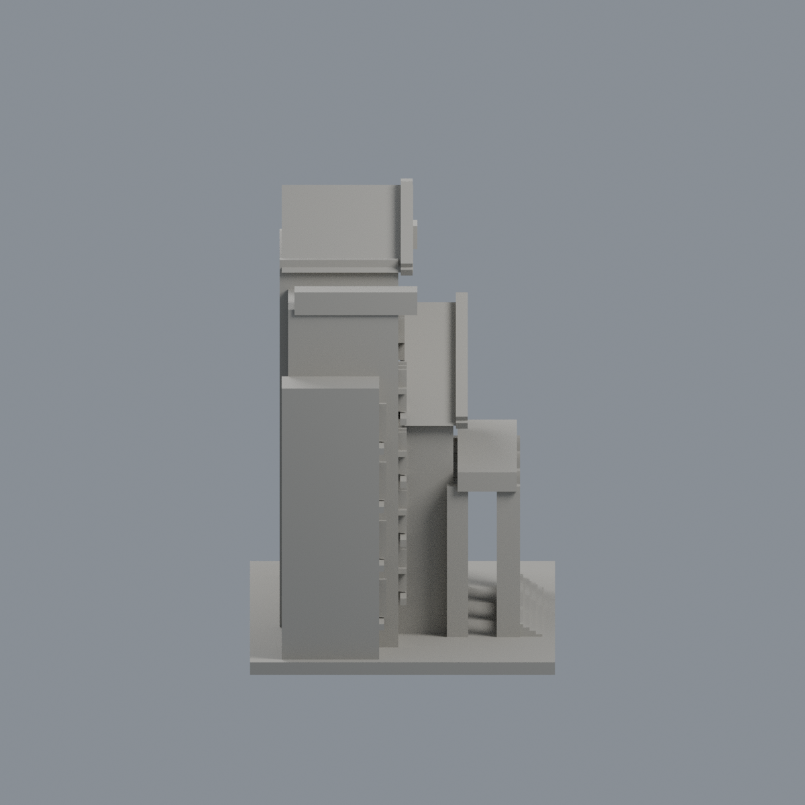
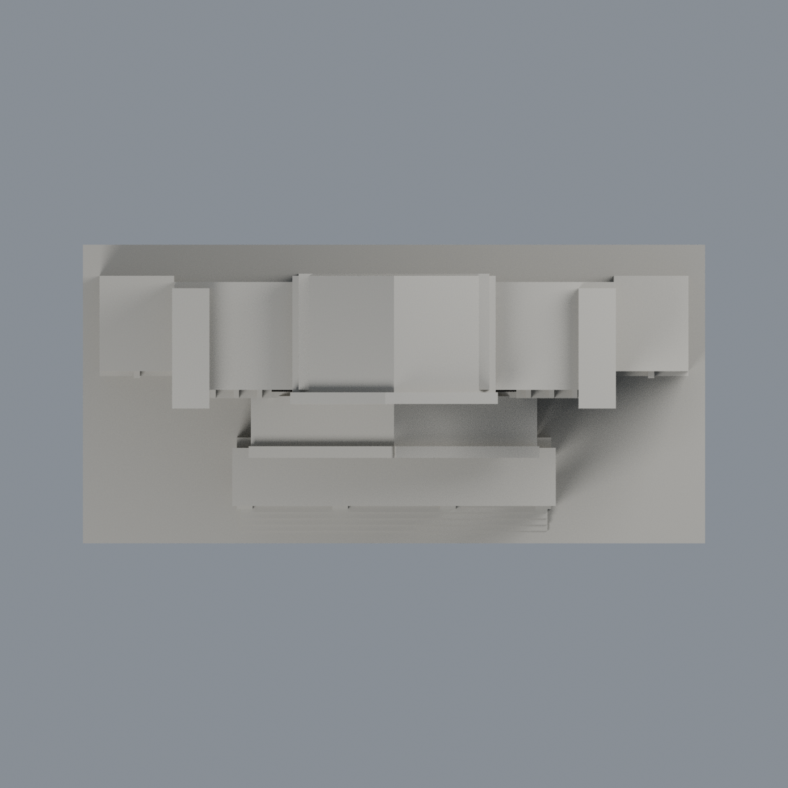

# 國立中正大學大禮堂前門廊段：三角玻璃限域外觀代理

[彩色3MF](ccu-auditorium-front-section-appearance.3mf) · [可編輯Blend](scene.blend) · [面材質對照](face-materials.json) · [色盤](palette.json) · [來源](SOURCES.md) · [重建原始碼包](rebuild-source.zip)

| 模型預覽 | 模型預覽 | 模型預覽 |
| :---: | :---: | :---: |
| 正面  | 背面  |  |

[正立面](previews/elevation.png) · [側面](previews/side.png) · [俯視](previews/top.png)

| 模型預覽 | 模型預覽 | 模型預覽 |
| :---: | :---: | :---: |
| 正立面  | 側面  | 俯視  |

## 範圍與限制
這是大禮堂**前門廊段**，不是完整大禮堂。官方頁未標攝影日期的正前照支持中心下層山牆的灰藍分格玻璃。本次只將既有三角背板一個完整大三角（STL face725、532 mm²）指定灰藍 #687C80 不透明代理，其餘3521面中性 #AAA79F。三根竪框與橫框在前方另有幾何，全部中性，不染玻璃色。白亮反光不另造白材料。磚牆與灰色帶未有可安全分隔的完整面，因此不擴塗；其他窗、石框、柱廊、屋頂與背部截面皆中性。

斜側官方照只見柱廊、磚牆及窗，**不含所選三角玻璃，不是該玻璃側背補證**。官方頁未標日期；正前原JPEG EXIF DateTimeOriginal/Digitized列2003:08:09 17:18:21，側照列2003:10:25 12:17:24。兩者無時區offset，未獨立核對相機時鐘，不轉UTC。2026-10-22僅存取日，不宣稱2026現況。色值為未校準目視近似，非真實玻璃成分、透色或精確測色；使用不透明表面不犧牲列印實體。原截面/粗近似、未知後立面限制保留。

原STL 3522三角、1603頂點、150 × 72 × 約106.2 mm；原bytes、三角座標/繞序/面序不變，不切面、不新增面、不重拓撲。所有三頂點須位於 y=-12.15 mm 與 xz三角(-28,55),(28,55),(0,74)邊界內（0.0002 mm容差），不是只測bbox或中心。[完整面邊界QA](qa/material-boundaries.json)。未做實際切片/試印，不承諾最小壁厚或免支撐，歷史製造QA未重算。

## 重建
Python安裝 source/requirements.txt，同層上級放原model.stl。執行 python source/build_appearance.py、python source/verify_material_boundaries.py、python source/verify_exchange.py；Blender執行 blender -b -t 2 -P source/render_appearance.py，再 blender -b -t 2 -P source/verify_scene.py。交換strict零warning並真edit-save-reopen；Blend可編輯材質。乾淨第二目錄3MF/maps/palette/五PNG逐bytes一致，Blend語義一致，不宣稱二進位一致。

[交換QA](qa/exchange-validation.json) · [Blend QA](qa/scene-validation.json) · [獨立重建QA](qa/rebuild-validation.json) · [校驗碼](SHA256SUMS) · [權利說明](LICENSE-NOTICE.md)

## 2026-11-14 有限外觀修正（重新建置交付版）

# Bounded front-column background approximation

Fresh reconstruction, not recovery. Only12 originally neutral triangles on four front columns use new material2 front_column_gray_stone_background_approximation #B9BDB3/.88. Original2 shaders including glazing .48 and other3510 indices, STL/geometry/order unchanged.

Only four complete original front-column domains at y=-27.75; twelve neutral triangles. Column boxes minus every intersecting original stair: top39, central lower edge6, outer small ears down to3. Do not extend sides, backs, canopy, stairs or walls.

Original four rectangular columns are coarse proportional proxies. Real enlarged sloping plinths and granular surface texture are not modeled. Small exposed ears arise from original stair intersection, not assertions of real ears. Gray stone-like background family only, not measured hue or material certification.

New original-STL full-plane shared-edge domains and original boxes minus stairs checked triangle-wise and reverse union. Total area507.000160217mm2, outside0.000210571 and missing0.000050354 nonzero float32, each domain tolerance0.001mm2. Not exact-zero coverage claim.

Only auditorium front porch section, not complete auditorium. Original thin-feature maximum loss1.342%/two layers above1%, original supports/point truncation and no physical print limitations retained. Original QA/README historical bytes retained. No original OBJ. ZIP10 has historical appearance README difference, remaining9 members exact.

Historical QA/root README preserved, not re-certified as current. Install source/requirements-current.txt; run build_current.py, verify_current.py, Blender render_current.py. Five native1200² CPU48 views unchanged.

# Public reference links

- https://ccu-navigation.ccu.edu.tw/var/file/253/1253/img/1556/637202457.jpg
- https://ccu-navigation.ccu.edu.tw/var/file/253/1253/img/1556/629279318.jpg
- https://ccu-navigation.ccu.edu.tw/p/426-1253-4.php?Lang=zh-tw

Official source0 frontal photograph primary; source1 side-colonnade family corroboration only. EXIF camera self-reports 2003-08-09 and 2003-10-25 without offset, unverified; modification dates not capture dates. No current condition claim or redistributed private photographs.

現版共 3 個顯示材質（含未知中性色）。上方原材質數、面域與QA描述為歷史版本，僅由本節有限範圍更新。本版是重新建置，不是尋回遺失草稿；不新增幾何或擴充補色範圍。

本節提及原ZIP/QA/校驗數目屬歷史記錄，不是現版ZIP清單。現版ZIP僅含原STL、必要舊建置與渲染程式、三支現版包裝／驗證程式、requirements-current.txt與本README及授權說明（如原有）。完整來源研究、照片、私人審核與廣泛校驗清單不公開。PUBLIC-MODEL-SHA256SUMS僅核當前交付產品；原QA不替代當前驗證。

現版命令：`python -B appearance/source/build_current.py`、`python -B appearance/source/verify_current.py`、`blender -b -t 4 --python-exit-code 1 --python appearance/source/render_current.py`。依requirements-current.txt安裝必要依賴。直接執行舊builder會重建歷史配色。包裝程式僅執行固定本地舊程式，新增材質時只替換新材質粗糙度運算；寫模型、材質、場景、原視角PNG與當前本地QA。歷史報告先保存再還原；原不存在時只刪該次產生的舊名報告。不進行網路或憑證操作。

### 歷史證據與粗糙度文字限制

早期建置綁定程式的原始版本未保留，只有記錄雜湊，不能宣稱該歷史程式已完整驗證或恢復。現版程式、產品與隔離重建可核對，此缺口仍保留。早期私人描述曾把玻璃粗糙度記為0.4，文字附錄已更正為0.48；原與現版shader實際均為0.48，新柱材為0.88，未因此更改產品或覆寫歷史報告。
