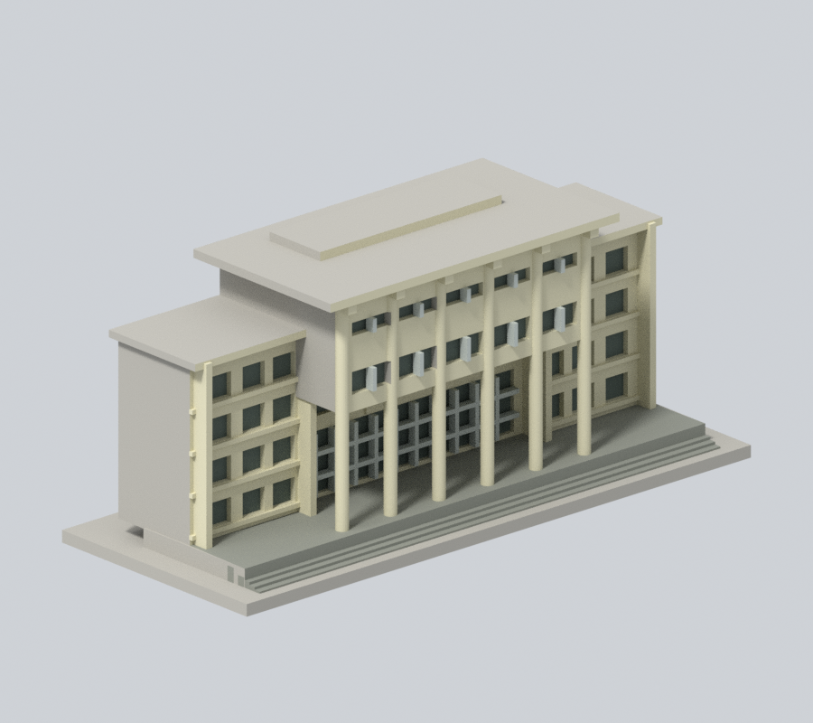
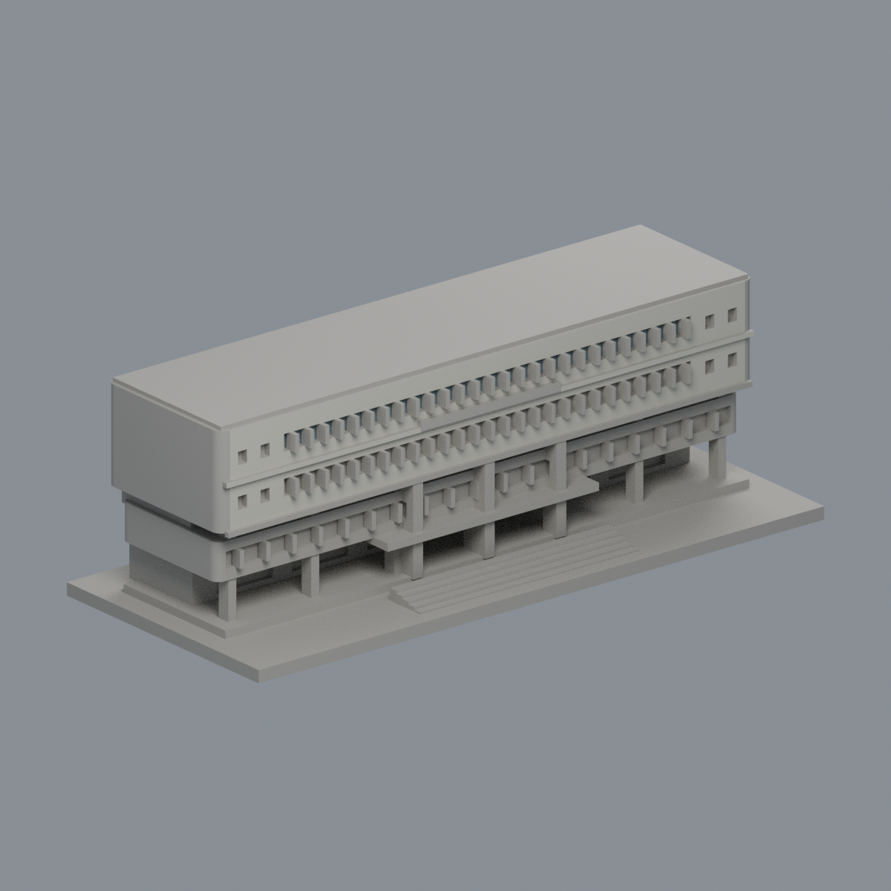
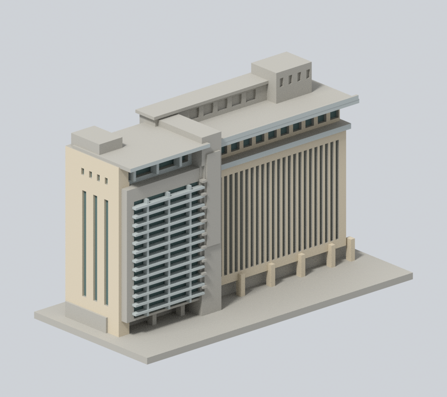
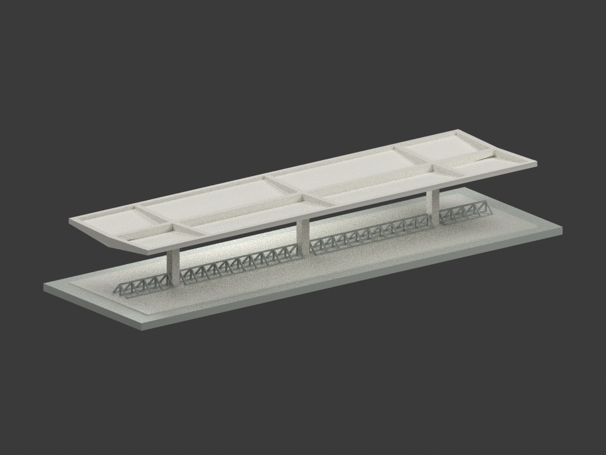

# 國立中興大學｜校園建築外觀模型

## 模型圖鑑

| 建築模型 | 建築模型 | 建築模型 |
| :---: | :---: | :---: |
|  **[行政大樓前棟與柱廊段](校本部/buildings/nchu-administration-front/)** |  **[惠蓀堂西向前棟段](校本部/buildings/nchu-huisun-front/)** |  **[圖書館臨湖前翼與轉角段](校本部/buildings/nchu-library-lakeside/)** |
|  **[國立中興大學小禮堂：重建後主廳外觀研究](校本部/buildings/nchu-small-hall-rebuilt-main-hall/README.md)** |  **[國立中興大學雲平樓｜2024中央正立面截段](校本部/buildings/nchu-yunping-central-front-2024/README.md)** |  **[停車棚｜1985年修訂原設計](校本部/buildings/nchu-bicycle-shelter-1985-design/README.md)** [STL](校本部/buildings/nchu-bicycle-shelter-1985-design/model.stl) · [彩色3MF](校本部/buildings/nchu-bicycle-shelter-1985-design/model.3mf) · [Blender](校本部/buildings/nchu-bicycle-shelter-1985-design/scene.blend) |

現行收錄 **6 套模型包**；數量不等於完整建築棟數，亦非全校／校區完成。新件與既有件的年代、截段範圍及未試印限制請閱各模型頁。

### 既有批次來源與列印限制（數量為各批歷史範圍，非現行總數）

當批3座建物各完成一個公開外觀局部段，尚未完成任何全館測繪式重建，也未完成整校。所有模型底座最長150mm、各件獨立比例。

## 校區及待續範圍
[校本部模型](校本部/README.md)。南投校區（中興新村）、中科研發創業育成中心、向上獸醫醫院、四處實驗林場及霧峰/烏日農牧園藝場仍待逐建築研究。[逐項續接與來源](continuation.json)；此表是研究候選清單，不是已完成或最終棟數清冊。

校區範圍依据[官方校區及校產](https://www.nchu.edu.tw/about/mid/27)、[校本部圖入口](https://www.nchu.edu.tw/about/mid/869)、[南投圖入口](https://www.nchu.edu.tw/about/mid/956)。相簿項目、使用單位與建築棟數不一一相等。

全部以公開外觀資料自建，無第三方3D網格。來源照片不隨公開包重新散布。數位QA不等於實體試印或真正切片器驗證；列印需自行檢視支撐、橋接與細節可解析性。

## 停車棚歷史設計研究

陳其寛／C. K. Chen & Associates 體育館新建工程 A40、A41 的未劃除三柱短棚；1983原題欄、1984停車棚變更、1985取消柱內落水管修訂分別保留。18.48×5.00m、三柱、開放車架；RG1型號與剖面歧義以線性變深解讀但不聲稱確定。不是體育館、游泳池或被劃除五柱長棚；實際興建及現存狀態未知。比例1:100，細杆加粗、排水與表面細部簡化、中性配色，未試印。
