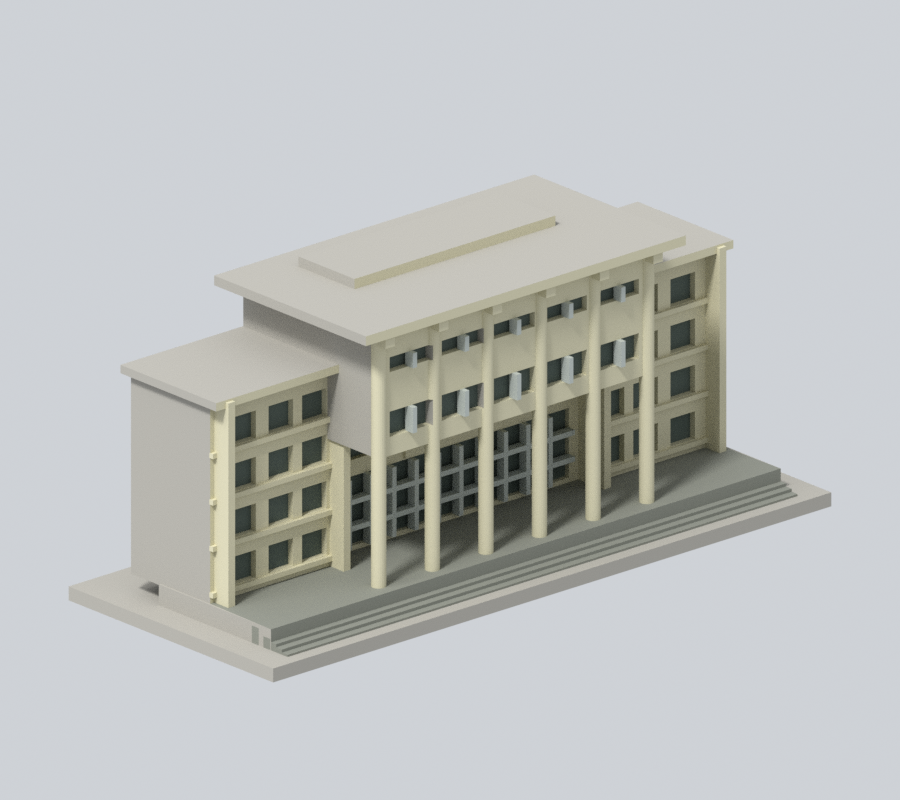
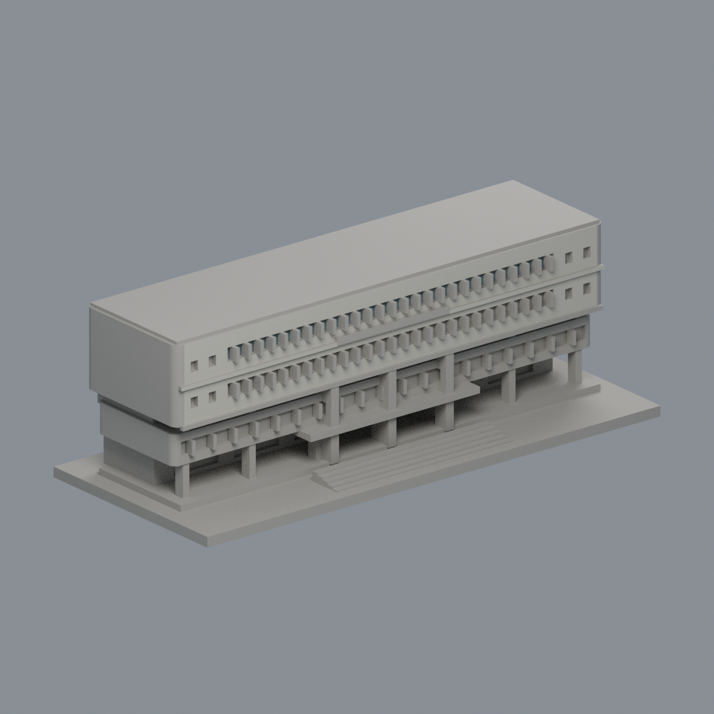
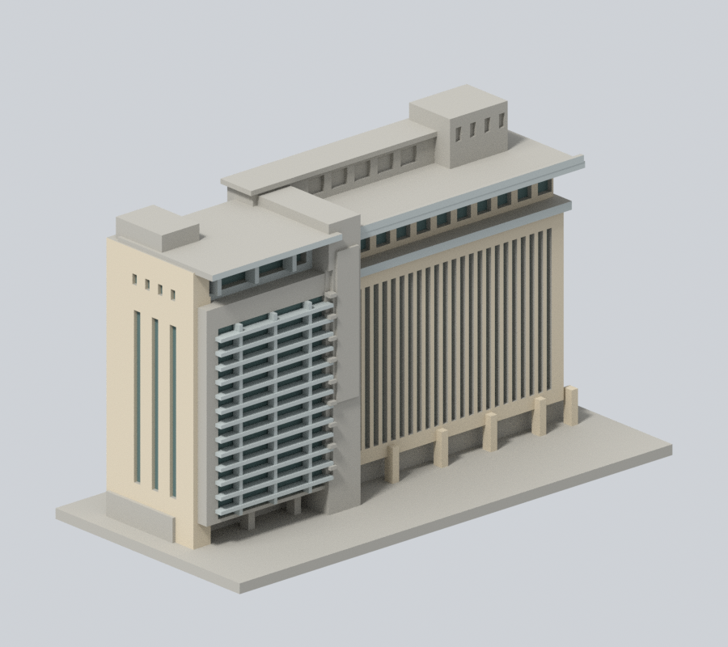
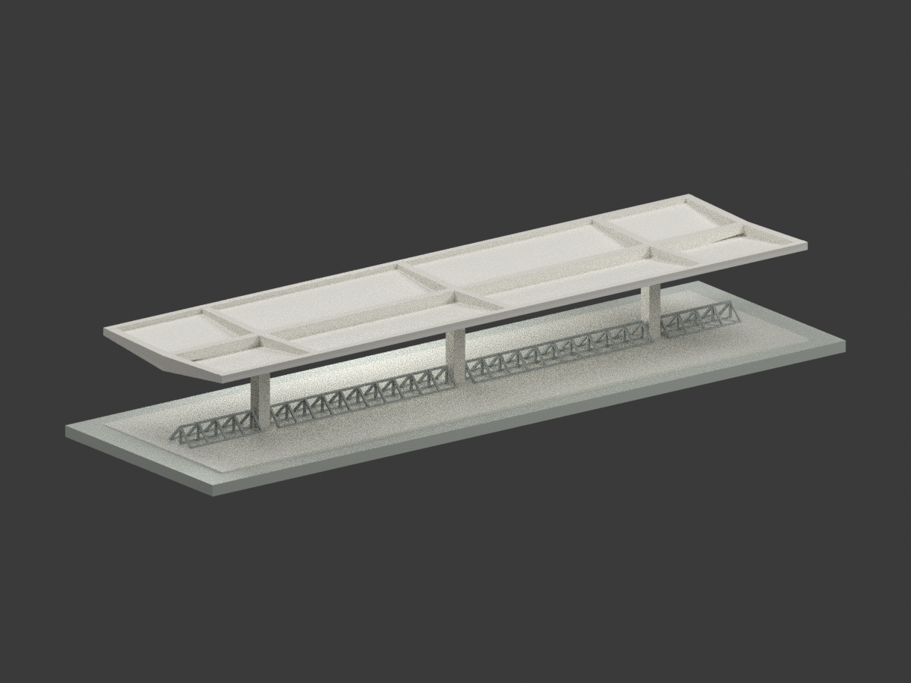
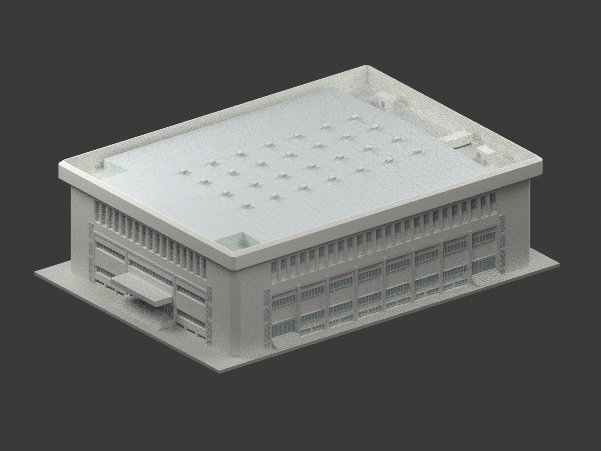

# 校本部｜國立中興大學

## 模型圖鑑

| 建築模型 | 建築模型 | 建築模型 |
| :---: | :---: | :---: |
| [行政大樓前棟與柱廊段](buildings/nchu-administration-front/)  | [惠蓀堂西向前棟段](buildings/nchu-huisun-front/)  | [圖書館臨湖前翼與轉角段](buildings/nchu-library-lakeside/)  |
|  **[國立中興大學小禮堂：重建後主廳外觀研究](buildings/nchu-small-hall-rebuilt-main-hall/README.md)** |  **[國立中興大學雲平樓｜2024中央正立面截段](buildings/nchu-yunping-central-front-2024/README.md)** |  **[停車棚｜1985年修訂原設計](buildings/nchu-bicycle-shelter-1985-design/README.md)** [STL](buildings/nchu-bicycle-shelter-1985-design/model.stl) · [彩色3MF](buildings/nchu-bicycle-shelter-1985-design/model.3mf) · [Blender](buildings/nchu-bicycle-shelter-1985-design/scene.blend) |
|  **[體育館主館｜1985年3月修訂設計圖版](buildings/nchu-gym-main-hall-1985-design/README.md)** [STL](buildings/nchu-gym-main-hall-1985-design/model.stl) · [彩色3MF](buildings/nchu-gym-main-hall-1985-design/model.3mf) · [Blender](buildings/nchu-gym-main-hall-1985-design/scene.blend) |  |  |

現行收錄 **7 套模型包**；數量不等於完整建築棟數，亦非全校／校區完成。新件與既有件的年代、截段範圍及未試印限制請閱各模型頁。

### 既有批次來源與列印限制（數量為各批歷史範圍，非現行總數）

當批3座建物各完成一個公開外觀局部段，尚未完成任何全館測繪式重建，也未完成整校。所有模型底座最長150mm、各件獨立比例。

[學校入口](../README.md) / [逐項續接與来源](../continuation.json)

## 停車棚歷史設計研究

陳其寛／C. K. Chen & Associates 體育館新建工程 A40、A41 的未劃除三柱短棚；1983原題欄、1984停車棚變更、1985取消柱內落水管修訂分別保留。18.48×5.00m、三柱、開放車架；RG1型號與剖面歧義以線性變深解讀但不聲稱確定。不是體育館、游泳池或被劃除五柱長棚；實際興建及現存狀態未知。比例1:100，細杆加粗、排水與表面細部簡化、中性配色，未試印。

## 體育館主館設計研究

1982年原圖及截至1985年3月修訂之體育館主館歷史外觀研究，非現況、竣工保證或2024年後翻修外觀。不含泳池、短停車棚、惠蓀堂、室內看台與設備、地下室內部或真實地形。屋頂標高±0.15m及梯屋頂高協調推定明示，中性配色、細部簡化；未實際列印或切片驗證。
