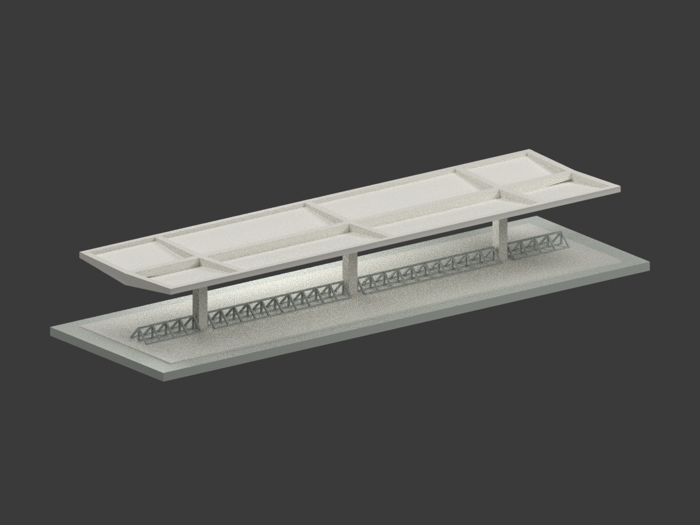
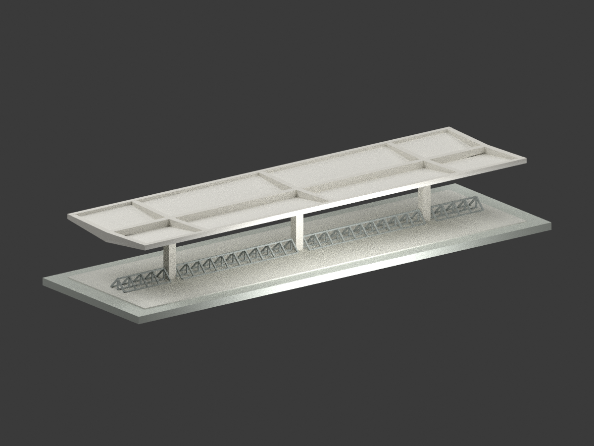
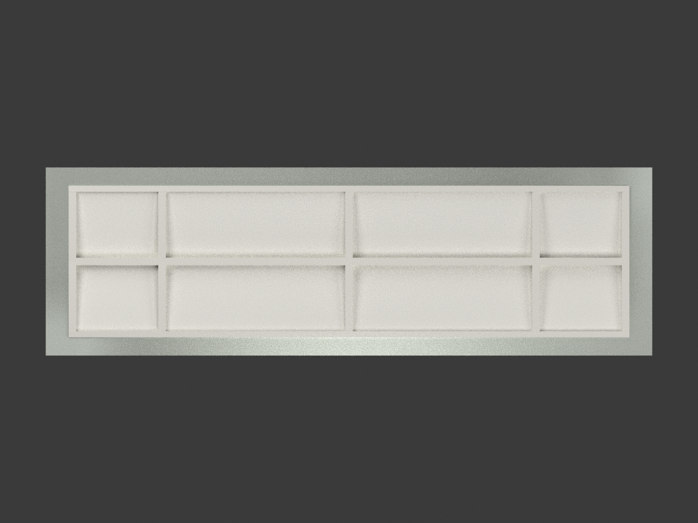
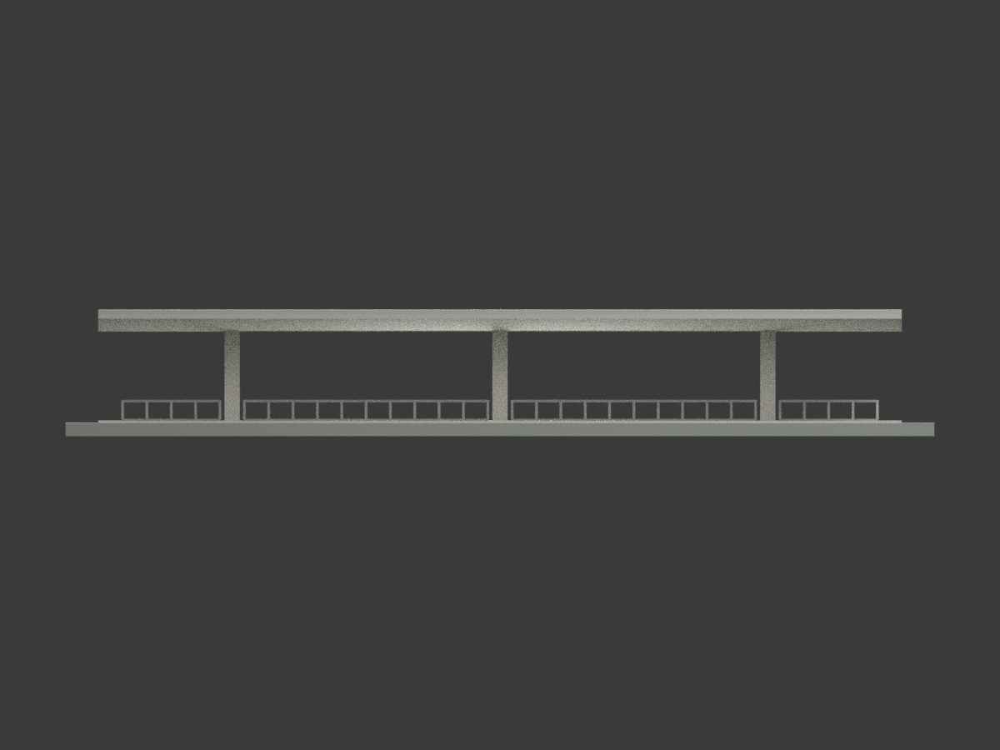
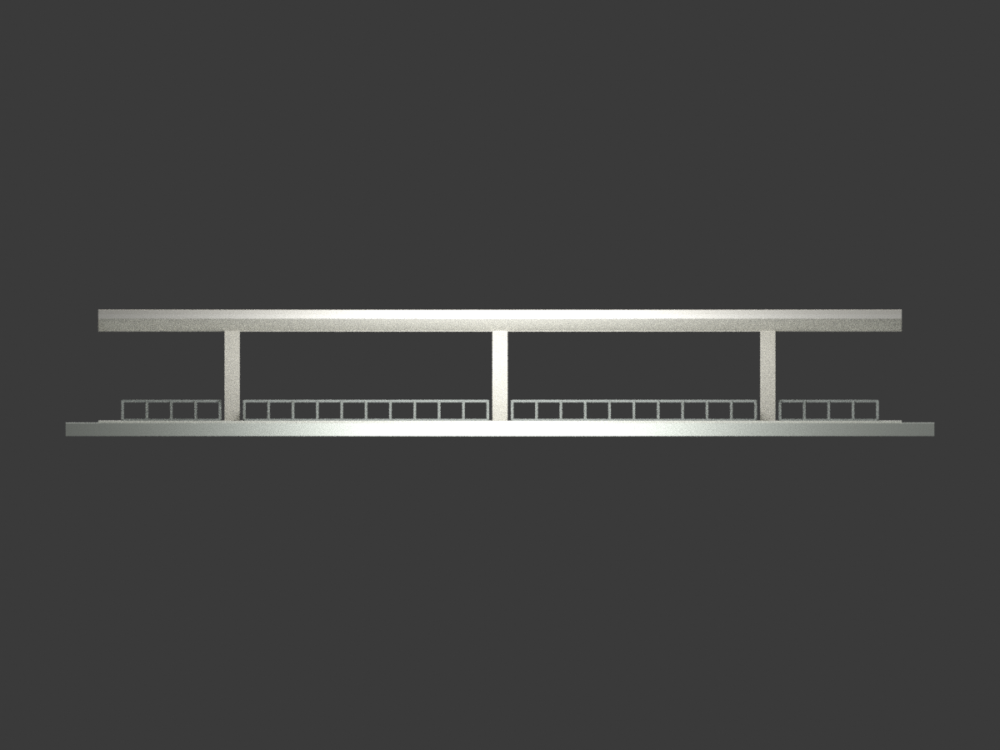
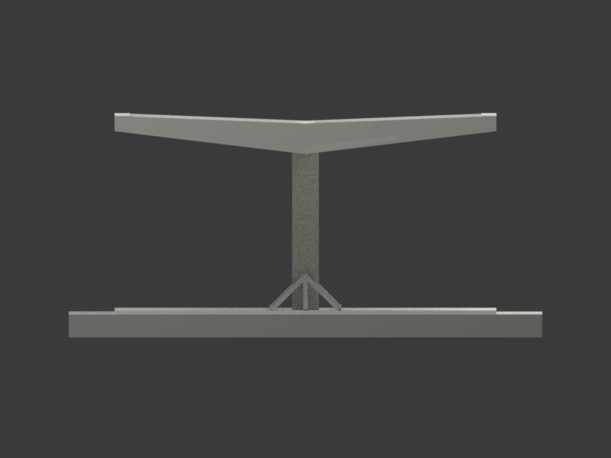
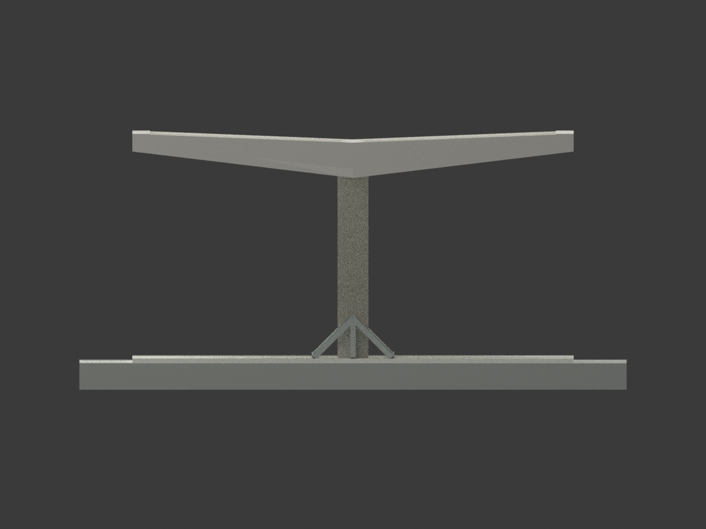
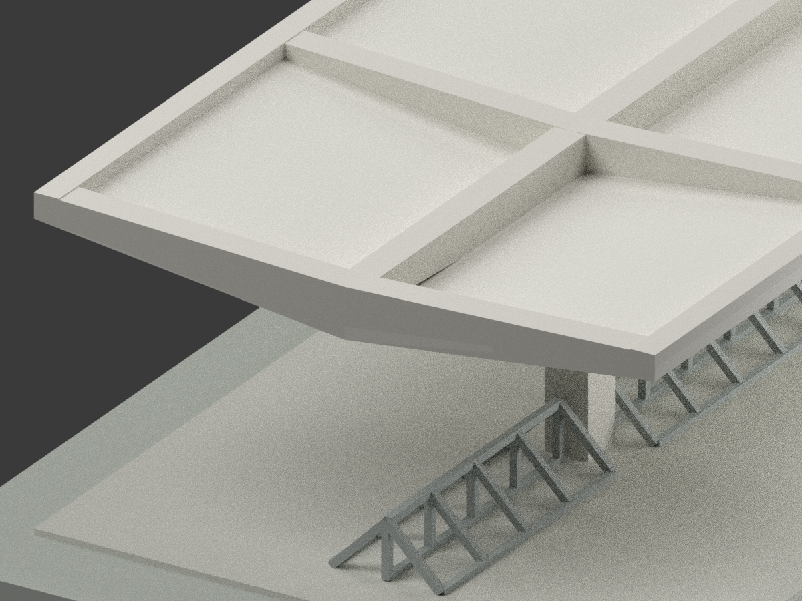
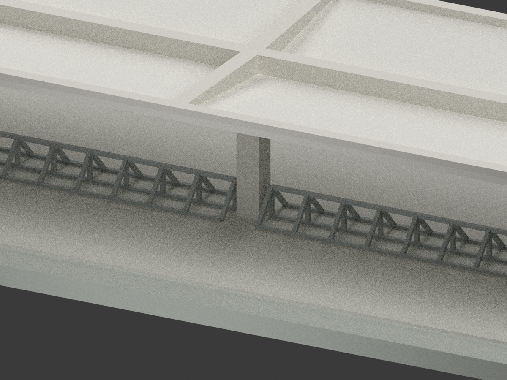
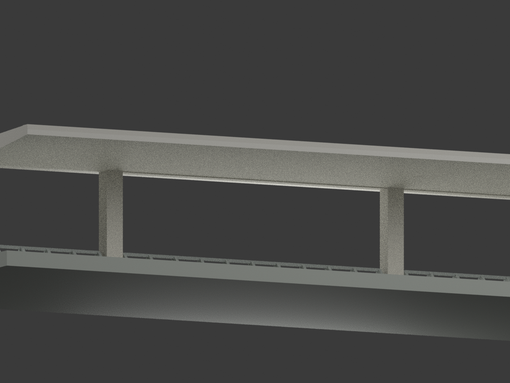

# 中興大學停車棚｜1985 年修訂設計模型

## 模型圖覽

| 全貌／立面 | 全貌／立面 | 全貌／細部 |
|---|---|---|
|  |  |  |
|  |  |  |
|  |  |  |
|  | 細部圖為刻意局部取景 | 中性色示意，非現況照片 |

## 建築身分與版本

本件為陳其寛／C. K. Chen & Associates「國立中興大學體育館新建工程」圖說中的**單座開放式停車棚**。採 A40 右側未劃除的三柱短棚，以及 A41 配套屋頂／剖面；不包含體育館、游泳池、全校區，也不拼接被劃除的五柱長棚。

原題欄日期為民國 72.5（1983-05）；A40 修訂欄列 73.6 停車棚變更及 **74.3（1985-03）取消柱內落水管、改直接排水至地面，共三處**。因此命名為 1985 年修訂設計，不將 1983 原題欄誤當最後版本。A38 只提供工程與位置背景，不用來猜測精確現地座標。

**這是歷史設計圖解讀，未確認實際興建、現存狀態、今日外觀或原始選色。**

## 來源控制與建模判讀

- 棚外輪廓 **18.48×5.00 m**，長向 3.08＋6.16＋6.16＋3.08 m。三根柱心 x＝3.08／9.24／15.40 m，y＝0，柱截面 35×35 cm。端梁與側邊梁向輪廓內配置，不將半個梁寬額外加到建築總尺寸。
- GL＝0；棚內鋪面名義＋0.05 m；中心最低板底＋2.10 m、外側板底＋2.40 m、外緣最高＋2.60 m。剖面高度鏈為 5＋205＋30＋20＝260 cm。
- **屋面不是等厚 20 cm 的 V 形整塊板。**RS1／RS2 為 10 cm 薄斜板；板頂由中央＋2.20 m 升至兩側＋2.50 m。RG2 中央縱梁寬 25 cm、高 40 cm，底＋2.10／頂＋2.50 m；RG4 兩側邊梁為 20×20 cm，底＋2.40／頂＋2.60 m。
- RG5 橫梁位於兩端與三柱位置，寬 25 cm；底由中央＋2.10 升至側端＋2.40 m，頂由＋2.50 升至＋2.60 m，深度 40→20 cm。薄板、中央突出梁與邊梁分別建置，保留開放下方空間。
- **RG1 有來源歧義：**型號文字寫 25×40～20 cm，但縱剖輪廓近似等深，端部另有 40 cm 註記。本模型採型號導向的「柱端 40 cm、懸挑盡端 20 cm」線性變深解讀，保持梁頂＋2.50 m；**不宣稱原圖已明確證實這條斜底線**。最外端 RG5 局部仍可下達＋2.10 m，並非把整段 RG1 改為等深。此差異在獨立來源審核中保留。
- 停車架是開放三角方鋼架，不是實心三角柱；不添加自行車。底杆中心 y＝±0.438 m，上頂中心較底杆中心高 0.438 m，模數 0.56 m。四段 x 範圍為 0.56–2.80、3.36–8.96、9.52–15.12、15.68–17.92 m，對應 4／10／10／4 個模數，與柱心各留 28 cm 避讓。
- A41 的 43.8 cm 是杆中心距；底杆中心約在鋪面上 1.25 cm。模型取鋪面＋5 cm、底杆中心＋0.0627 m、頂杆中心＋0.5007 m。三條底部縱杆、頂部縱杆、斜杆及中豎杆均保留；雙杆輪槽與細部焊接分格簡化。

## 模型檔案與製作限制

- `model.stl`：毫米、單一連通封閉網格，開放棚下與車架孔隙並未填實。
- `model.3mf`：與 STL 同幾何、毫米、逐面基本材料；`scene.blend` 為實際渲染場景。
- `mesh.npz`、`palette.json`、`components.json` 保留幾何、材料與來源構件追蹤。
- 比例 **1:100**；棚自身約 184.8×50.0×26.0 mm，含作者展示底座的檔案外框約 **199.8×62.0×29.0 mm**。模型 z＝0 在底座底，不是歷史 GL。
- **列印版加粗已明示：**原 1 吋（2.54 cm）方鋼在 1:100 僅 0.254 mm；本模型改為 6 cm 方杆，即模型 0.60 mm，保留名義中心線位置，外緣因而略增加。中線高度不等於加粗後最外高度，底杆局部併入鋪面以連通。這不是原圖實際杆徑。
- 未實體列印；水密與單一連通不代表不用支撐或保證成功。大面積懸挑屋面、細杆與小孔仍需依材料、切片及機器評估；可能需調整比例或分件，但本包未提供已驗證分件方案。
- 鋪面以＋5 cm 平面取代原剖面微拱；表面防水砂漿、滴水細溝、馬賽克紋理、架車杆錨板／螺栓／焊縫省略或簡化，色彩採中性近似。下方 150×250×35 cm 隱藏基礎與級配不外露，也未誤建為地上柱墩。
- 1985 年已取消的柱內排水管不重建。修訂後三處直接排水的完整孔位／收邊尺寸未充分確定，因此排水孔與管件省略，**模型不具排水功能，不是施工或結構安全設計**。
- 展示底座不是測量地形，四向圖名僅表示模型觀看方向，不保證對應地理北向。

## 重建與 QA

Python 套件版本見 `requirements.txt`；Blender 4.3.2 實測。

```bash
python build_model.py
python export_3mf.py
python validate_model.py
blender -b -t 4 -P render_model.py
blender -b scene.blend -P verify_scene.py
```

測試分別檢查水密、單一連通、面向、非零面積、有限頂點；STL 讀回與 3MF 頂點／面／材料／毫米單位一致；獨立目錄重建幾何雜湊；Blender 場景重開；七個完整模型視角與三個細部視角。結果見 `*-QA.json`，獨立來源及視覺審核見 `SOURCE-VISUAL-QA.json`，檔案雜湊見 `SHA256SUMS`。尺寸／判讀檢查不是法規、結構或列印認證。

## 來源與權利

原圖：國立臺灣博物館／臺灣現代建築圖說資料庫，陳其寛建築師事務所，CCCK24023017（A40）、CCCK24023018（A41）、CCCK24023015（A38）。逐張館藏頁連結見 [SOURCES.md](SOURCES.md)，原檔雜湊見 `SOURCE-REGISTER.json`。

館藏頁原圖標示 **CC BY-NC**（所檢頁面未指明版本）。原圖、裁圖只存私人參考備份，**未附於公開模型包**。本包模型、程式與渲染為本次製作的解讀成果；這不表示原圖或建築設計的權利已消失，也不推導本模型可任意採寬鬆授權或不受限制商用。原圖授權與本次成果的權利分開說明，再利用須確認適用條件、署名與必要許可。
