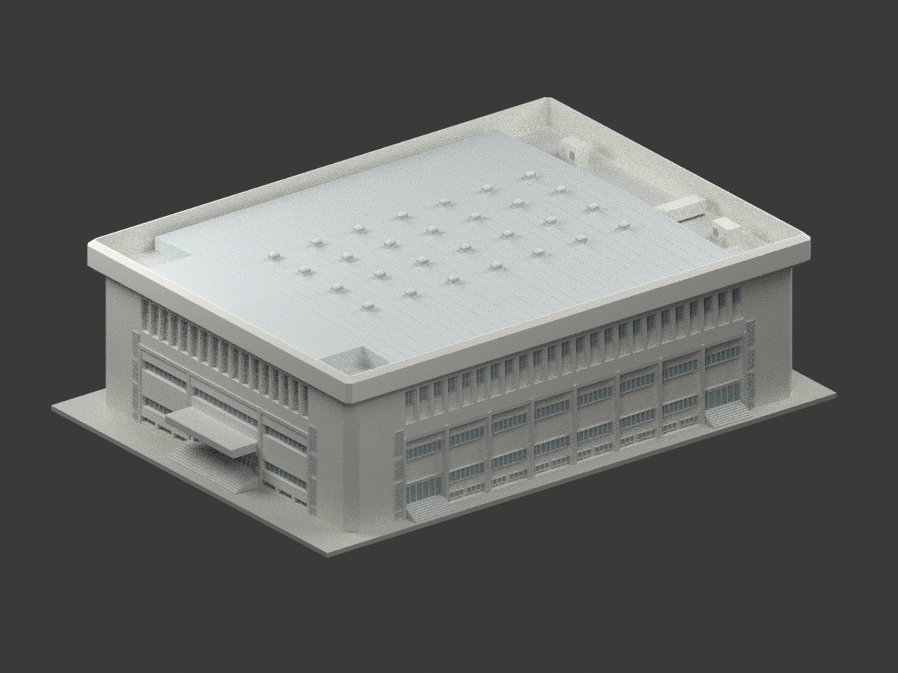
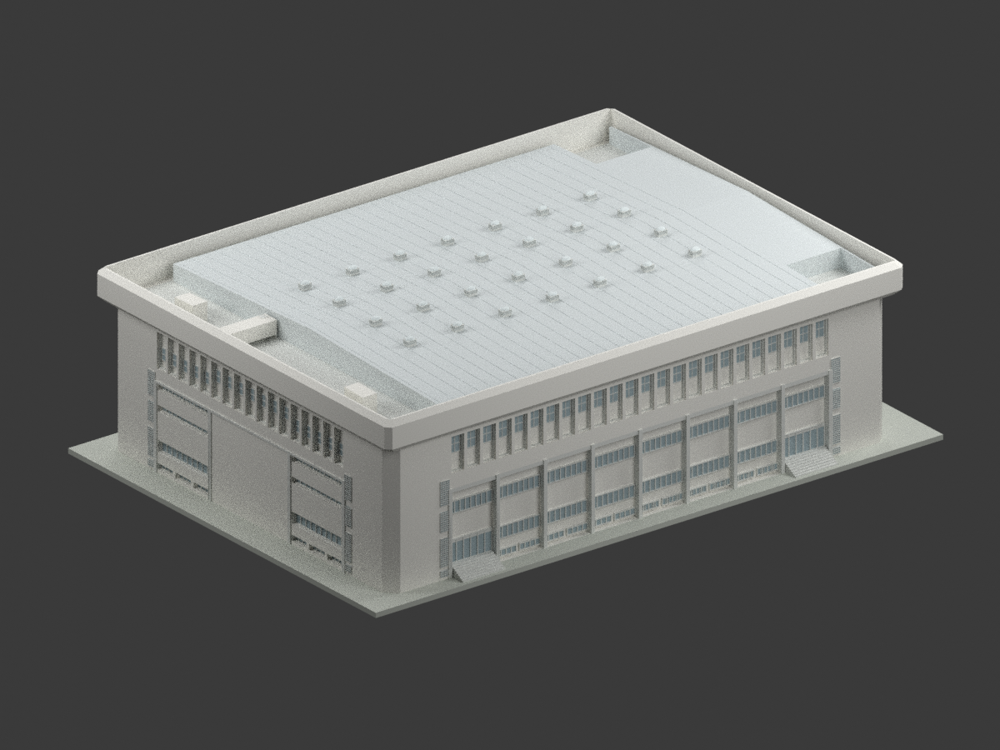
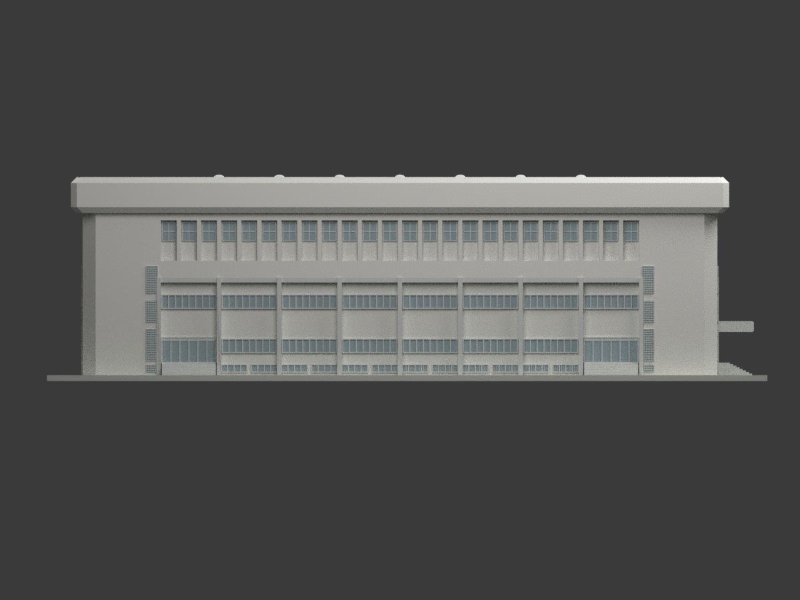
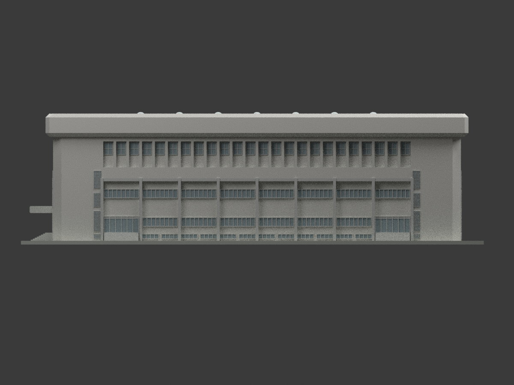
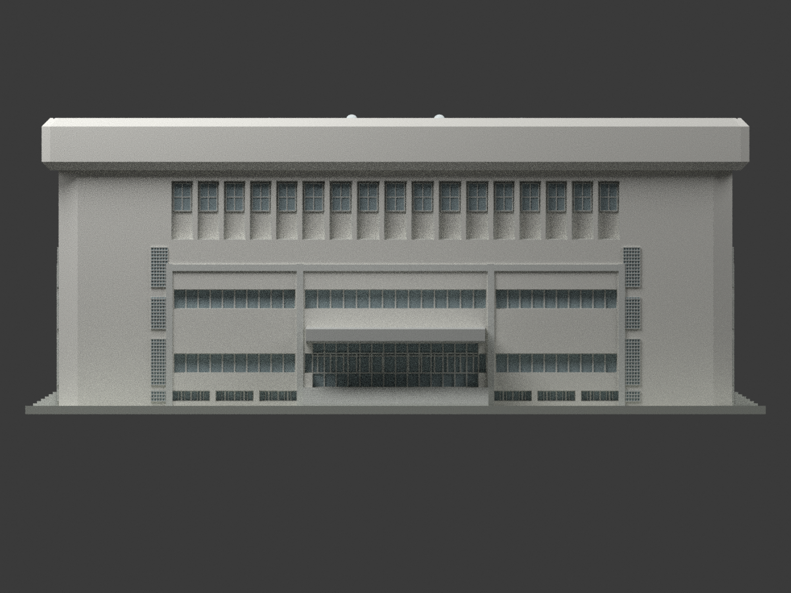
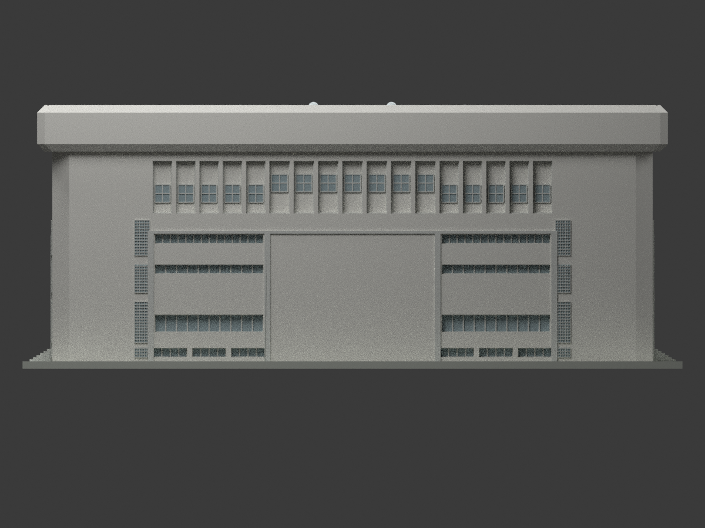
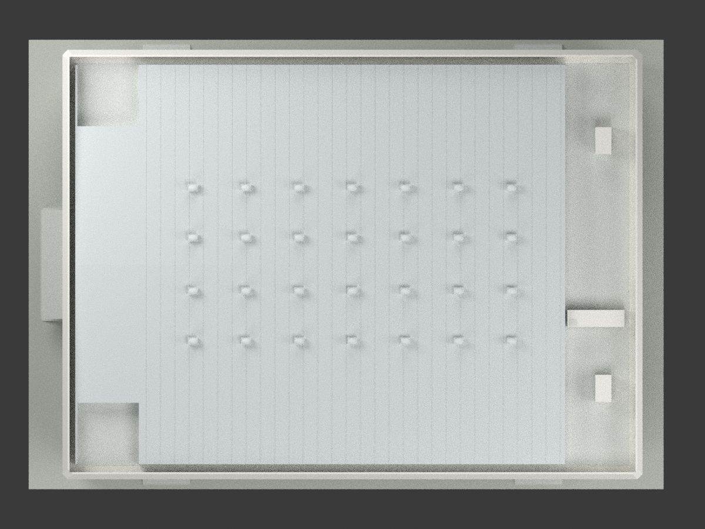
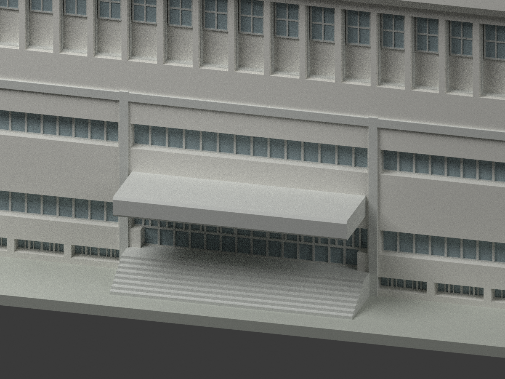
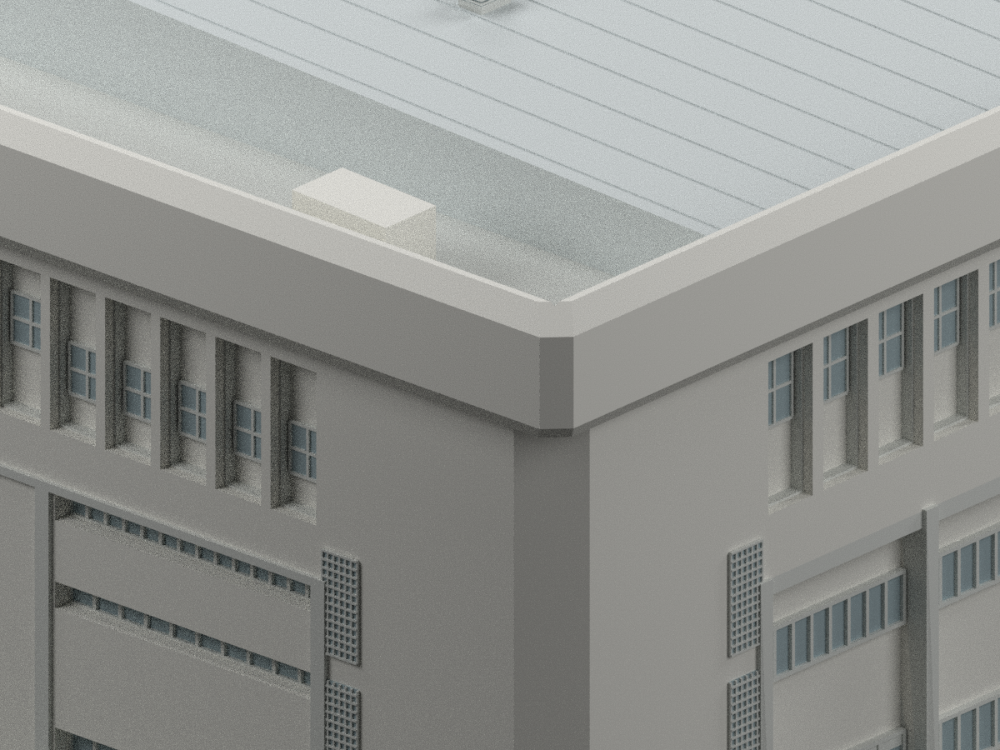

# 國立中興大學體育館主館｜1985年3月修訂設計模型

## 模型實際渲染

| 前側透視 | 後側透視 | F側立面 |
|---|---|---|
|  |  |  |
| A側立面 | 前正立面（1軸） | 後立面（11軸） |
|  |  |  |
| 屋頂 | 主入口細節 | 採光罩細節 |
|  |  |  |
| 角部與屋簷細節 |  |  |
|  |  |  |

## 範圍

本件依1982年原圖及截至1985年3月的修訂，重建主館歷史外觀；不是現況測繪、竣工保證或2024年後翻修外觀。**不含泳池、停車棚、惠蓀堂、室內看台與設備、地下室內部或真實地形。** 原圖私存，不含在本公開包。

封閉式可列印外殼，玻璃與玻璃磚皆以不透明背板、色彩及表面浮雕表示；不是穿透玻璃或室內建築模型。色彩僅中性示意，不能作為歷史塗裝證據。檔名 north/south/east/west 按模型座標命名，正式方向以圖紙A/F及1/11軸標示為準。

## 來源控制與不確定性

- 軸網 **69.60 × 50.60 m**，不是外牆外緣；屋簷最大外包 **73.10 × 54.10 m**。C–D為14.60 m，非14或15 m。
- 圖紙GL=EL50.0；1F=GL+1.40、2F+6.00、看台+9.10。四層區域有+13.60與+12.70之差，不混成同高。RF+18.20是鋼架底面基準，**不是屋面頂**。
- 外包邊頂GL+22.00；65+270+65=400 cm是底板下表面至頂，RF高於該底面20 cm，所以RF至頂380 cm。外形保留上下折角，內側構造厚度作封閉列印簡化；平面角部原標90 cm斜邊，以約65 cm直角邊近似（斜邊約91.9 cm），不是新的精確尺寸。
- S27/S28屋架中心深3 m、端深2 m、半跨25.16 m，A45坡25.16∶1；採名義屋面脊+21.35、屋架端+20.35 m。**±0.15 m是明示的歷史重建不確定範圍，非實測精度、統計信賴區間或施工公差。** 檁條、工作點、座板及修訂面層的數公分基準差未強作精確值。金屬肋與泛水以簡化浮雕表示。
- 10–11軸整條右側帶及四角為RF層RC露台，主鋼屋面止於10軸，不延伸覆蓋該帶。水塔外形7.20×2.15 m、箱頂RF+2.30 m，人孔蓋另6 cm；其Y定位按A7估讀約±0.10 m。箱體封閉、支承簡化，不含內水或管線。
- 兩個梯屋突平面依A7為2.03×3.40 m，位置估讀約±0.15 m。局部頂高未有唯一標註：A9有2.05～3.05 m範圍但不能確證分派；本件採**跟隨名義主屋面坡度的協調推定**，非原圖精確屋突標高。D6依表為90×180 cm、門檻13 cm；W10為90×100 cm，小窗窗台位置簡化。
- 28個採光罩為7×4；列距屋脊±3.35/±9.65 m。每個底座25＋百葉45＋拱罩35＝105 cm，罩平面83.5×120 cm。近脊罩會超過包邊22 m，不能以包邊頂宣稱全館最高。
- 前端中央有DW1入口與雨庇；後端中央是實牆。A/F四個側入口DW2有上方40 cm實板。上部窄框下段保留實牆：前及長面玻璃高210 cm，後面150 cm且中央比兩側高約90 cm，不能整框填玻璃。
- 後端兩翼另保留二、三層W8窄水平帶，分別GL+7.50..8.30與+10.10..10.90、高80 cm；不把這條額外窗帶鏡射到前端與長側。
- 低窗W6/W7依A12為GL+.35..1.15；長面僅3–9軸每跨2扇，短端兩翼每跨3扇；F側指定區及前端鐵網僅作背網浮雕，不增列窗洞。
- 角旁直條原註**砌玻璃磚**，不是開放百葉。格網簡化；寬約1.275 m、三段標高依立面估讀。窗框位置、凹框深度、倒角、雨庇/階梯細部與未標出的小框尺寸均為圖量或列印簡化，非製造級CAD。
- 16處空調預留通氣口與局部W10衛浴小窗未充分定位，未任意製成外窗；原圖後續設備、落水管、欄杆細件及基礎亦未臆補。

完整控制記錄見 `ROOF-CONTROLS-REVIEW.json`、`SOURCE-CONTROLS-REVIEW.json`；來源、作者與原圖權利見 [SOURCES.md](SOURCES.md)。原圖的CC BY-NC標示與新製幾何/程式/渲染分開，**不作全包NC推定，也不提供商用權保證**。

## 格式、比例與列印限制

- 含顯示底座約 **266.7 × 188.7 × 76.4 mm**；名義幾何最高點約GL+22.27 m，仍受屋面重建不確定性影響。
- STL、3MF：毫米、**1:300**；3MF含中性色材料索引。Blender場景使用相同數值與網格。
- `mesh.npz`保存可復算三角網格、材質索引；`components.json`保存建模分件控制。
- 顯示底座為作者新增，厚0.65 m原尺度；GL在檔案底面以上2.167 mm，底座非實際基地。封閉內部及屋面背襯為列印用途，不表示實際實心建築。
- 小框、玻璃磚接縫、網格與金屬肋採簡化表面浮雕；縮尺後部分細節小於0.4 mm，可能無法由一般FDM重現。入口雨庇有懸挑，需依設備評估支撐、方向或縮放。
- **尚未實際列印或切片驗證**，網格通過不等同任何機器可直接成功列印。

## 重建與檢查

Python依 `requirements.txt` 安裝；Blender4.3.2。於此目錄執行：

```sh
python build_model.py
python export_3mf.py
python validate_model.py
blender -b --python render_model.py
blender -b --python verify_scene.py
```

QA檔分別記錄連通/封閉/法向、STL與3MF重新讀取、另目錄重建、Blender重開、全景邊界及獨立來源/視覺複核。三個細節畫面刻意裁切，不宣稱包含全館。重建以幾何與材質雜湊核對，不要求Blender檔案或ZIP時間戳相同。
