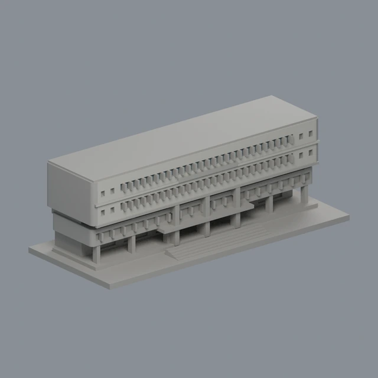
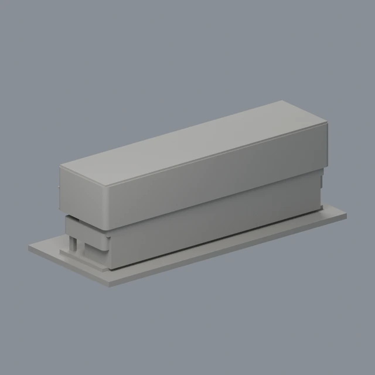
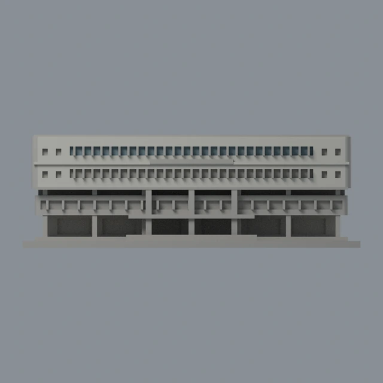
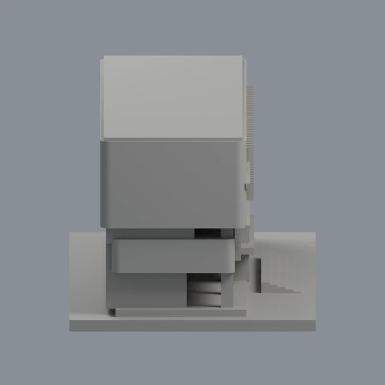
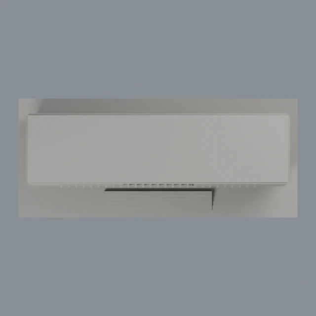

# 國立中興大學惠蓀堂西向前棟段｜現版五視角

| 正面斜視 | 背面斜視 | 正立面 |
| :---: | :---: | :---: |
|  |  |  |
|  |  | |

由現版三材質 Blender 依原相機重繪，大圖為無損 WebP。沿用既有正面限域配色，未新增材質；只包含西向前棟段，背視所見截面不是實際後立面，也不是完整建築或現況紀錄。

[現版 Blender](../appearance/scene.blend) · [現版彩色 3MF](../appearance/nchu-huisun-front-appearance.3mf) · [原 STL](../model.stl) · [模型及技術資料](../README.md) · [原外觀證據](../appearance/README.md) · [渲染證據](render-proof.json) · [展示校驗](SHA256SUMS)
