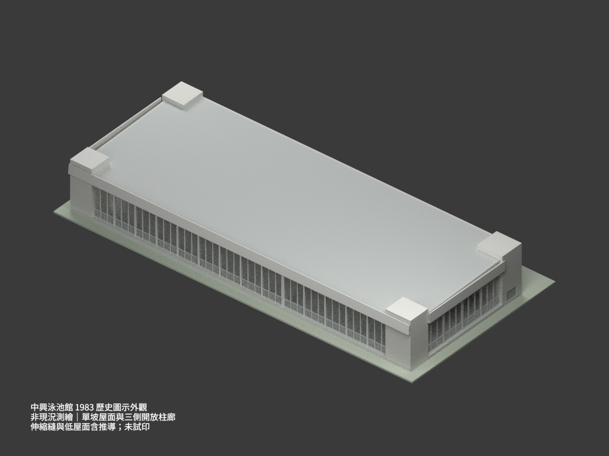
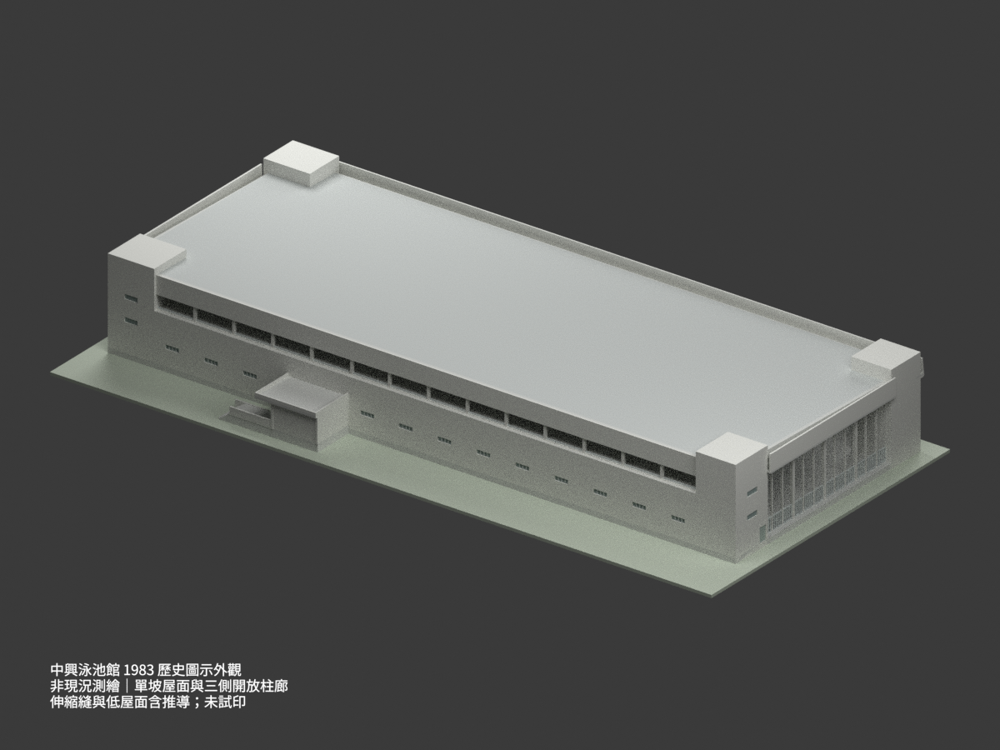
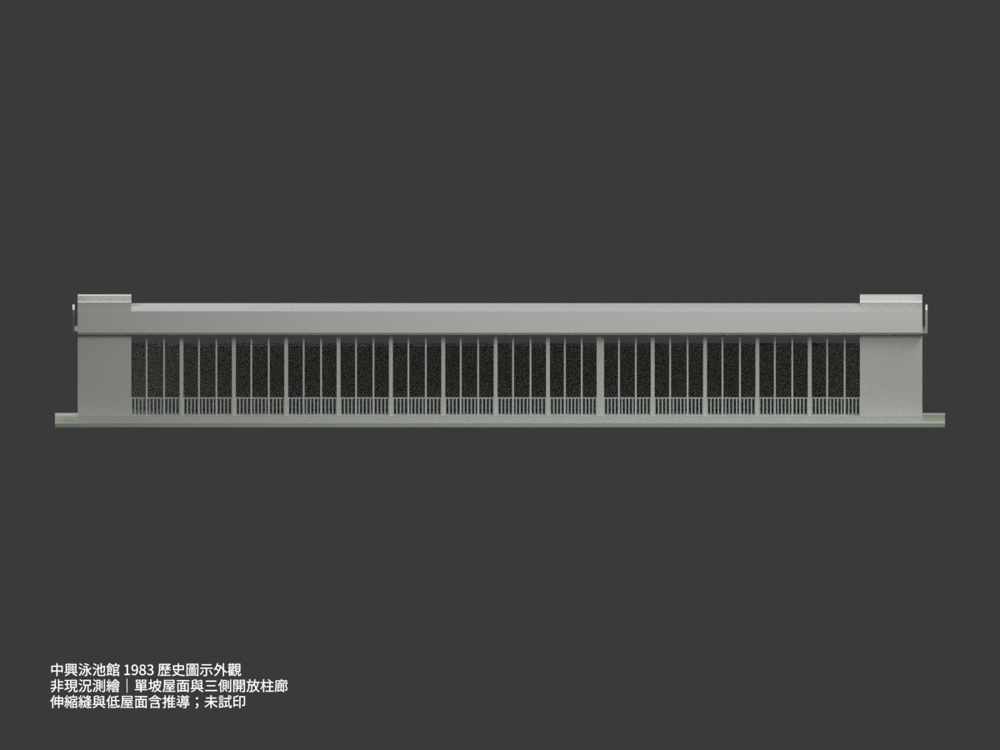
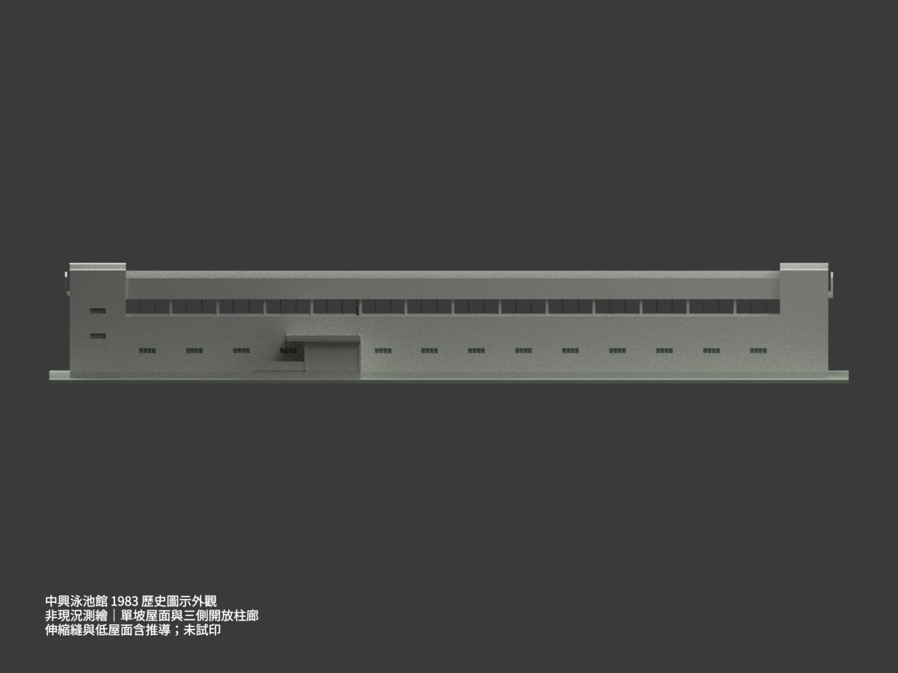
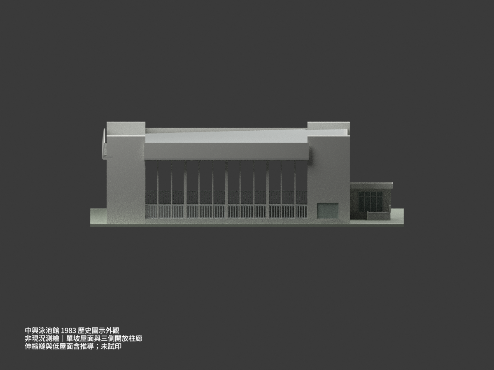
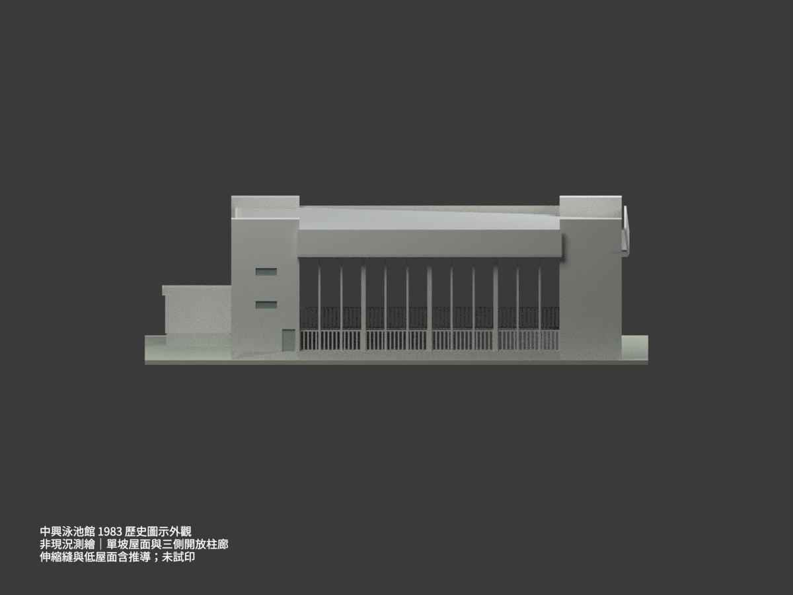
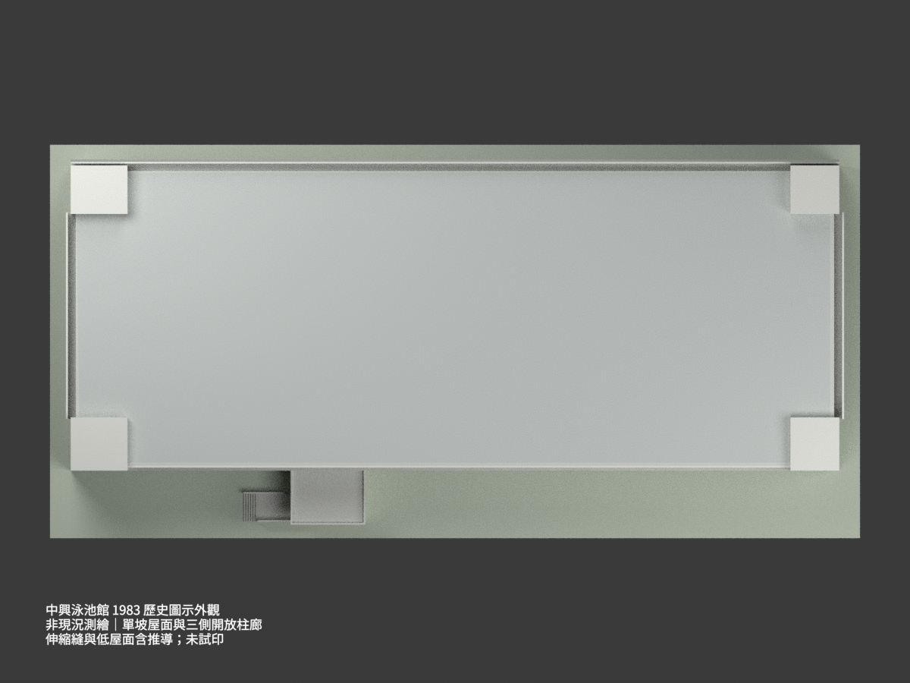
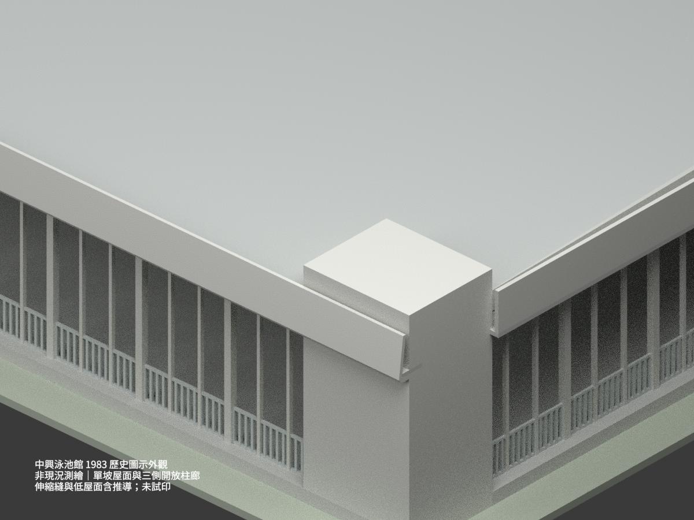
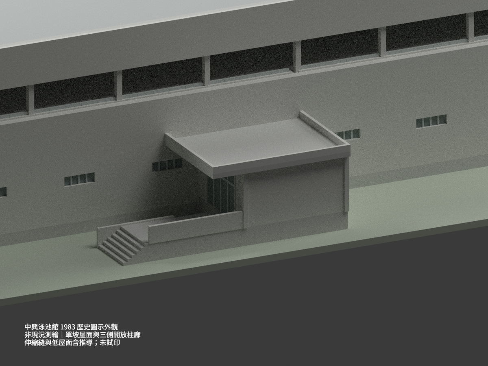
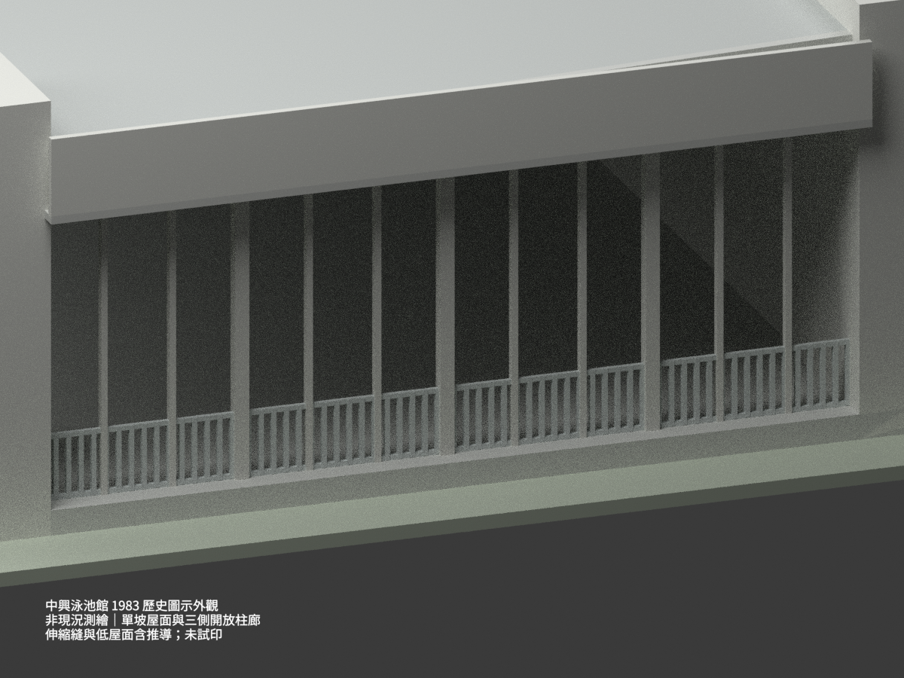

# 中興大學游泳池館｜1983 歷史圖示外觀

## 模型預覽與範圍

**依 1983 年 7 月「第一期未完成部分工程」圖示重建，不是現況測繪、竣工認證或泳池內部完整模型。** 一棟覆蓋兩座泳池的館舍，不拆成兩棟；與體育館主館及停車棚不同。原圖未標的 G/H 短縫、低端屋面高程採明示推導；未試印。

| 東北鳥瞰 | 西南鳥瞰 | 東向開放柱廊 |
|---|---|---|
|  |  |  |
| 西向看台外牆 | 北立面 | 南立面 |
|  |  |  |
| 屋頂俯視 | 單坡與檐帶細節 | 入口細節 |
|  |  |  |
| 開放柱廊細節 | 歷史外觀，不代表現況 | 原圖不隨公開包發布 |
|  | 局部尺寸圖量約 ±0.15 m，非全案測量精度 | 細節及權利見下文 |

## 尺度及原始控制

- 來源為 A2 首層、A3 二層、A4 看台層／南北立面、A5 東西立面、A6 兩向主剖，同題、同 72.7 圖面日期。二層並非滿鋪樓板，三側為開放柱廊與不鏽鋼欄杆，**沒有補成大型玻璃幕牆**。
- 長向直接尺寸和為 94.60 m 加 G/H 短縫；短縫無直接數字，以 5.80＋0.40＋5.80＝12.00 m 節奏推導工作值 0.40 m，故工作軸長 95.00 m。兩端牆心各外移 0.90 m，外牆控制長 96.80 m；不是實測長度。
- 橫向軸鏈 5＋6.5＋6.5＋6.5＋6.5＋5.7＝36.70 m；兩側外移 0.90／0.80 m，外牆控制寬 38.40 m。挑檐、入口及展示底座不包含在這個牆體尺寸內。
- 主池廳 1FL＝GL＋0.80 m，四角塔頂 GL＋13.80 m；入口局部 1FL＝GL＋1.20 m，入口 RF＝GL＋5.20 m，檐頂＋5.65 m、下緣＋4.88 m。**兩個首層標高分開保留，隱蔽的 40 cm 內部銜接沒有捏造。**
- A6 低端梁底 0.80＋9.80＝10.60 m；高端梁底 0.80＋6.00＋4.80＝11.60 m。其中 6.00 已包括 0.40＋2.80＋2.80，不能再重加 0.40。高端加直接標示 1.20 m 梁深，得屋面頂 12.80 m；按上下平行線及等深推導低端屋面頂 11.80 m。低端頂高不是另一筆直接尺寸。
- 屋面為短向緩單坡、長向水平；四角塔另高出。A4/A5 外檐帶底 GL＋10.10 m、頂＋12.80 m、高 2.70 m，與 A6 主梁 1.20 m 深分開建模，低側外檐遮住低屋面。
- A2 入口首層為 5.10／3.20／7.00 m 分段、6.40 m 深的折線區域；A3 上部 9.40×6.80 m，未誤用同一矩形。兩組雙扇門在北向 x＝29.2 m 面，不是西向外牆。

## 重建限制與已做的修正

- 原圖的「未完成部分工程」是工程圖題名，不據此宣稱建築一直未完成，亦不據圖面日期推定竣工年。沒有套入現在泳館的改造外觀。
- 沒有獨立主屋頂平面，但兩向剖面及四立面足以支持基本單坡外形；沒有補造屋頂設備、天窗，也沒有套用另一體育館的 A45 金屬屋面細部。20 cm 屋面皮厚、局部外檐厚度／挑出、窗框、門扇及未標尺寸輪廓為約 ±0.15 m 圖量與顯示解讀，不是結構施工厚度保證。
- 南西塔西面按 A5 保持空白，只有北西塔西面兩條高窗；南、北端門窗不鏡射。端柱頂依斜梁底收束，未穿出屋面。原圖 x 向南／y 向西是左手平面編碼，輸出時反轉 Y 成右手座標；北立面入口在右、西立面入口在左，避免方位鏡像。
- 原欄杆的細鋼條為縮尺適應加粗至約 15 cm（1:300 約 0.50 mm），間距放寬約 42 cm，局部連接互穿 1–2 cm 消除共面裂縫；不是原尺寸還原。
- 地上入口短階依 A2 可見六條踏線，以六級共 1.20 m 的圖量示意，分級 20 cm **不是直接標示階高**。地下長梯、池槽深度、機房、基礎及隱蔽室內未重建；閉合入口及西側房間採實心外觀，池廳內部採簡化樓面。這不是可用於內部設計的精確模型。
- 材質色調為展示近似；文字標示水泥漆／不鏽鋼不等於核實現況色票。綠色底板只是作者展示支座，不是調查地形。

## 檔案與列印

- `model.stl`、`model.3mf`（mm）、`scene.blend`、`mesh.npz`、可重現程式、10 張原創渲染及來源／測試紀錄。
- 比例 **1:300**；含支座外框約 **340×165×47.5 mm**。主檐下長跨、大面薄屋面與細欄杆需支撐／分件策略；單一水密網格**不等於免支撐或已可成功列印**。未切片、未試印，可能超出一般小型列印床。
- 3MF 有材料分區，STL 不攜帶顏色；Blender 場景包含相同網格、燈光及不屬於列印幾何的歷史範圍字幕。

## 重建方式

```bash
python -m venv .venv
. .venv/bin/activate
pip install -r requirements.txt
python build_model.py
python export_3mf.py
python validate_model.py
blender -b -t 4 --python render_model.py
blender -b scene.blend --python verify_scene.py
```

幾何建模使用公尺，輸出按 1:300 轉毫米。程式從參數建構，不需讀取私人原圖。數位檢查分別記錄格式、拓樸、重建 hash、場景重開、畫面邊界與來源視覺審核；不得把任一 PASS 解讀成結構安全或實體製作驗證。

## 來源、作者及權利

原圖題名「國立中興大學體育館第一期未完成部分工程」，圖署陳其寬建築師事務所（C. K. Chen & Associates），館藏 CCCK240。逐圖連結及用途見 [來源登錄](SOURCE_REGISTER.md)。原圖影像權利為 CC BY-NC，與元資料的 CC BY 不同；原圖與裁圖只作私人研究，不在公開包內。

本包為獨立重建幾何、程式、原創渲染與檢查文字；保留來源建築及圖面作者的既有權利。這不是來源作者背書，也不承諾所有商業使用權已清理；未將原圖授權直接變成整包一律 NC 的授權聲明。
