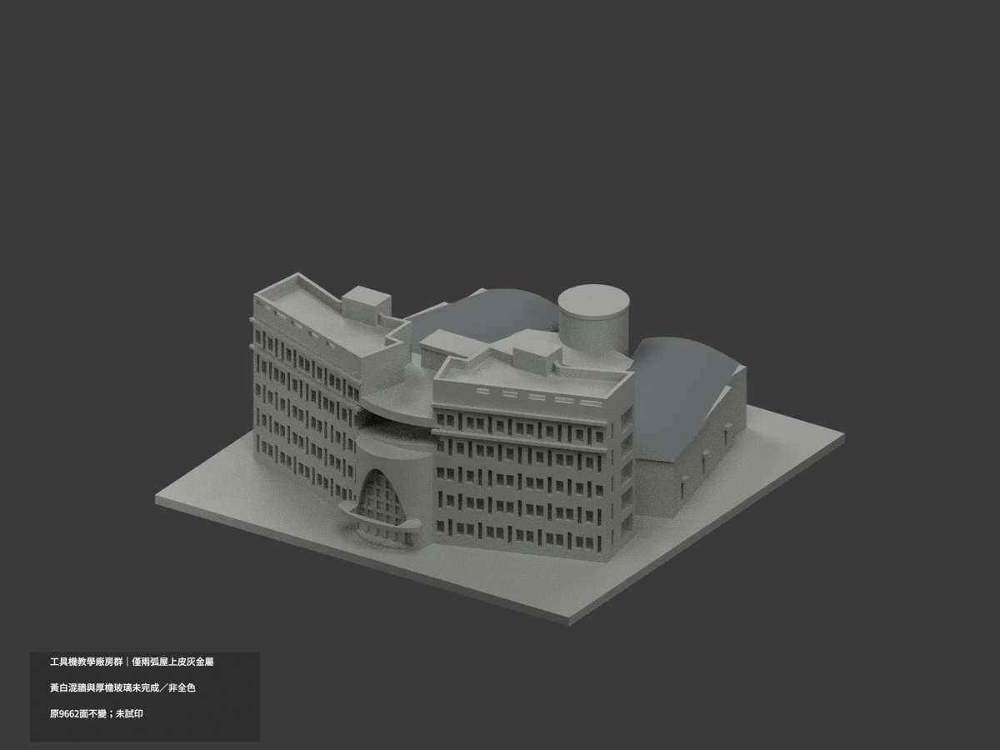
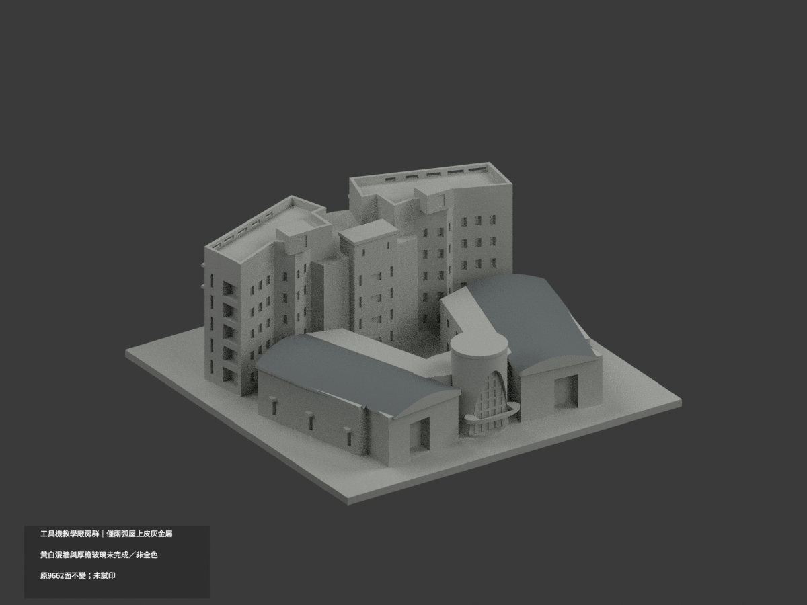
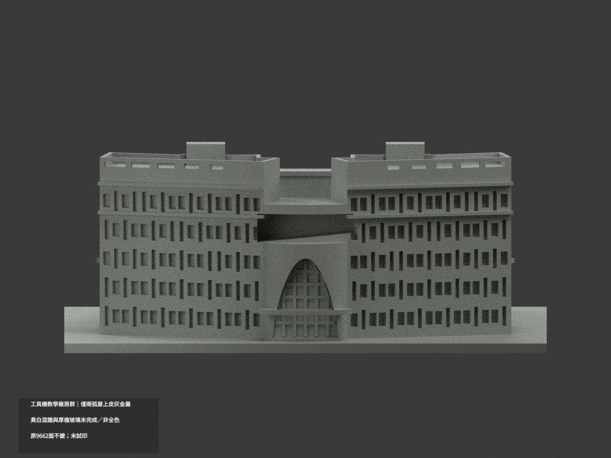
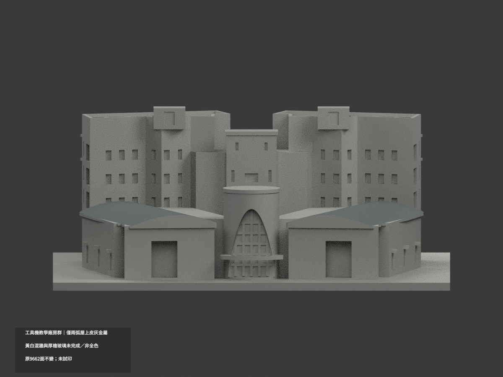
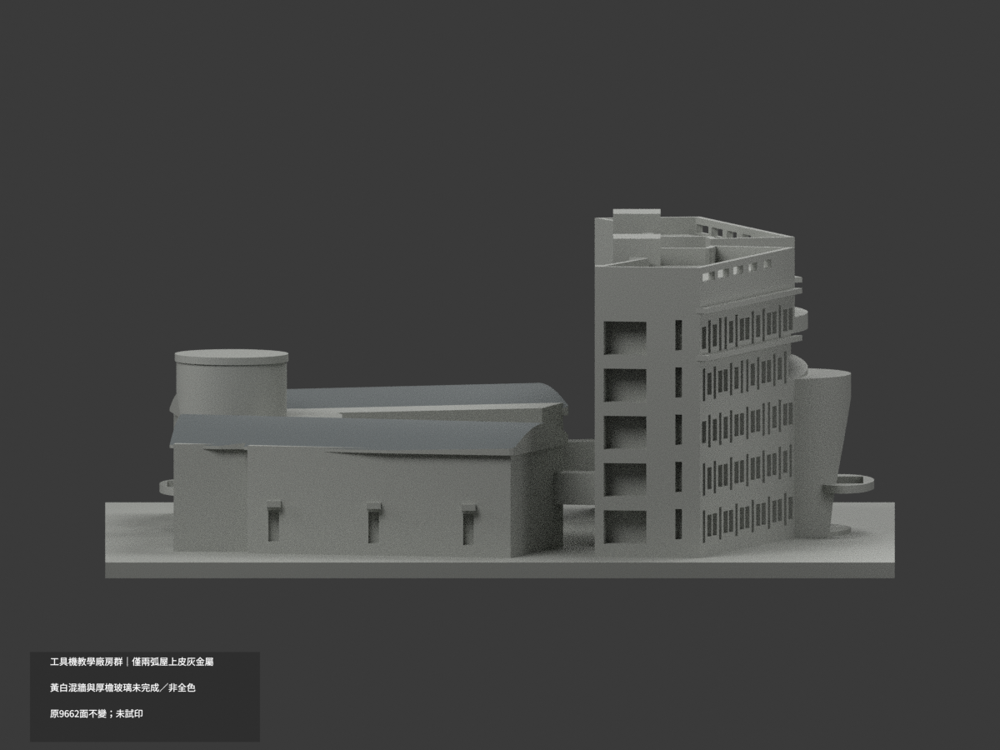
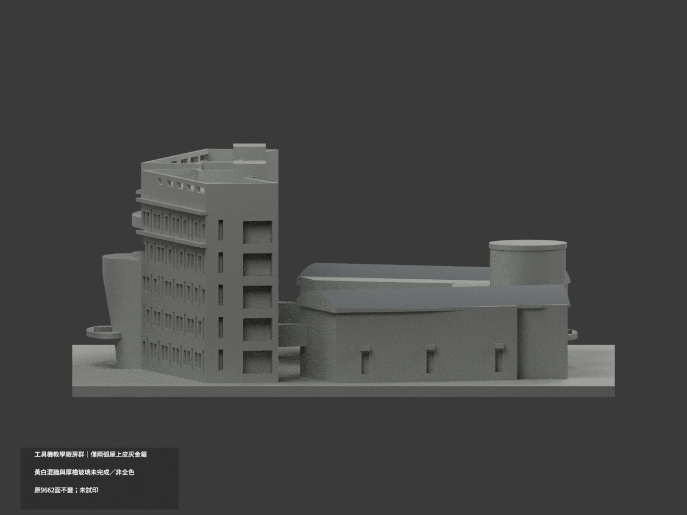
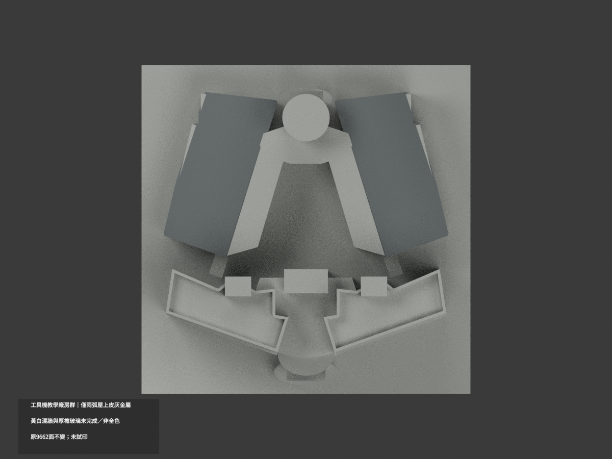
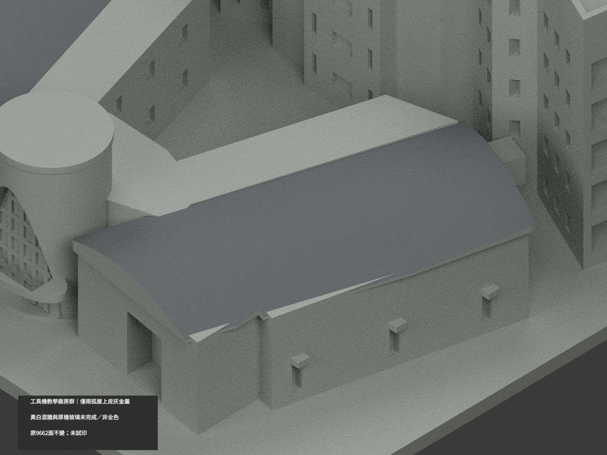
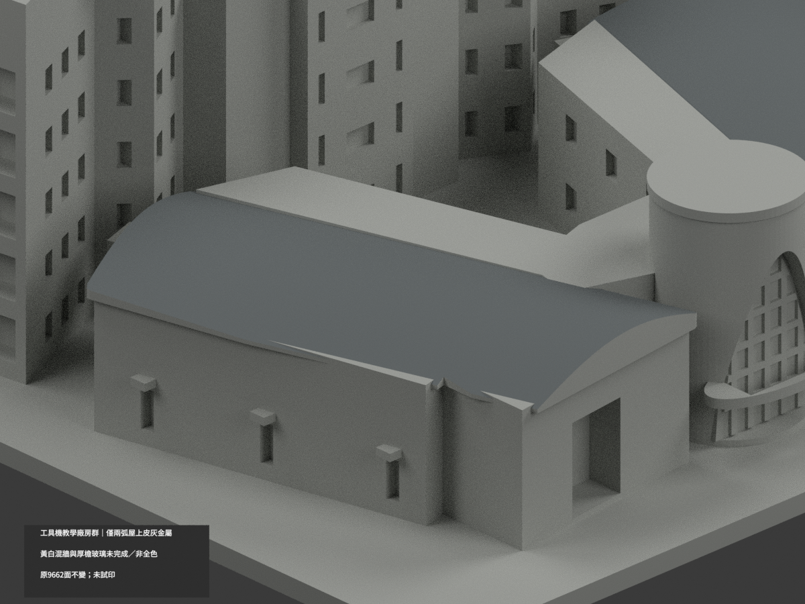
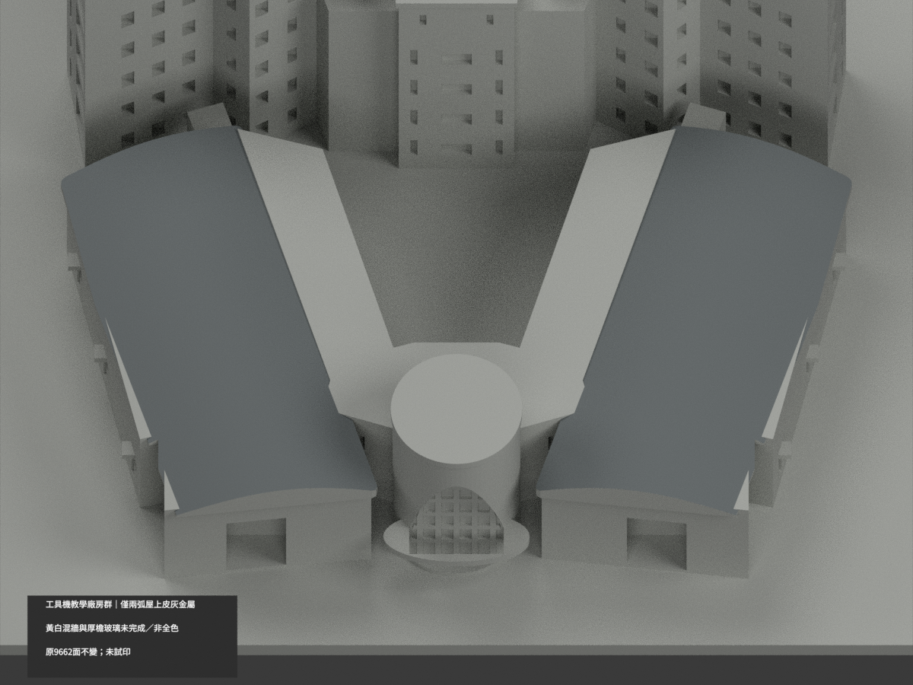

# 工具機教學廠房群｜僅兩弧屋上皮局部灰金屬

**局部補色未完成：只兩廠房弧屋上皮 260 原面灰金屬；黃白混牆與厚檐玻璃未完成。不是全群完成補色。** `partial_color_incomplete=true`、`fully_colored_exterior=false`。同項 `ncut-machine-tool-complex`／`count_delta=0`，太平校本部。一個相連教學廠房群，不拆成三棟/三套。處理日期不是拍攝日期。

| 前斜視 | 後斜視 | 正面 |
|---|---|---|
|  |  |  |
|  |  |  |
|  |  |  |
|  | | |

## 材色範圍

只沿原構造兩弧屋上皮：原側別平移(side×39,26)、反旋side×18°，局部x取−18到18的49點/48原折面，z=23.2+4.4cos(xπ/36)。逐原三角全部頂點符合相鄰取樣的有限線段外推平面、x段界及y±47.5；不是按面心或寬鬆朝上normal整片挑選。各130原Boolean裁切三角，共260灰金屬；9402中性。每屋45原折面有實露片，保留原union遮擋形狀，不補不存在部分。全共面連通域一致，無新增面/切割材界。

廠房垂直屋端、厚檐、底面不染灰金屬；教學長牆跨黃白階梯色帶及灰基腳沒有原材界，全部中性。全長遮陽檐起訖與實照不同不硬黃；圓塔、玻璃背板混框/百葉/反光、實板雨庇、院落、工廠牆與未知域皆中性。**中性不是實景灰證明；來源覆蓋界線不是真實不同材料接縫。**

原9662三角與原STL/build字節、150×150×61.8mm含底座尺寸不變；沒有可確認的統一1:n實測比例。鄰近復通樓/舊綜合實習與焊工工廠不納入；內角、下層窗、進深與設備維持原近似/部分對稱，玻璃浮雕及框簷加厚限制不撤。不改輪廓、窗孔、弧屋波紋或群體位置，不以補色追認原照片近似幾何為精測/現況。

## 來源、日期與權利

親看四張AHA實景：200001520俯視同時涵兩灰金屬屋上皮，200001038後側交證屋面類型，200001024/1050顯教學黃白混牆及原模型欠缺材界。拍攝日期未獨立確立，網頁/下載日期不能當拍攝年，不宣2026完整現況。來源URL與hash在register，參考照片只私人保存，原圖不公開/不貼材質，未見CC不沿repo license推商用。HEX為名義色族非測色色票。

## 檔案與 QA

`appearance.3mf`兩展示材，`scene.blend`實際原面材索引，`color-mesh.npz`原三角。STL無色原件/build保留字節。**Immutable原包無OBJ，原build亦只輸出STL；不得冒稱原OBJ存在。**

原包只有README.md，逐字保留為`ORIGINAL-MONOCHROME-README.md`（沒有原README.zh-TW.md），舊previews/QA仍為原單色歷程，非此次補色QA。依原requirements執行build及`colorize_model.py`/`export_appearance.py`/`validate_color.py`；Blender執行render/verify。原build+color在隔離目錄重建保留不刪；3MF/STL三角座標、閉合正體積、重開scene及10張1200×900見QA。精確原依賴shapely2.1.2需獨立target環境，不能改共享環境或原build適配新版本。

**未實際列印。** 兩展示材不是已驗四色切片工程，薄部/支撐另核。

## English limitations

Partial roof-only update:260original upper-skin triangles (130 per factory) nominal gray metal;9402neutral. Inverse original +/-18-degree transforms and all-vertex finite 48-chord roof-facet tests; no centroid selection or infinite-plane extension. Original Boolean clipping retained. Thick eaves, vertical ends, undersides, mixed yellow/white teaching walls and gray bases, window backs mixing mullions/reflections, towers, solid canopy proxies and unknown surfaces neutral. Neutral is not observed gray; evidence boundaries are not real material seams. One connected teaching/factory group, not three deliveries.9662originaltriangles, STL/build bytes and dimensions unchanged/count_delta0. No immutable OBJ exists. Four actual reference photographs viewed privately; capture dates unknown, no2026current or surveyed accuracy claim. No photo textures/public source images/commercial rights assumption. Not test-printed; two display materials are not a validated four-filament project.
