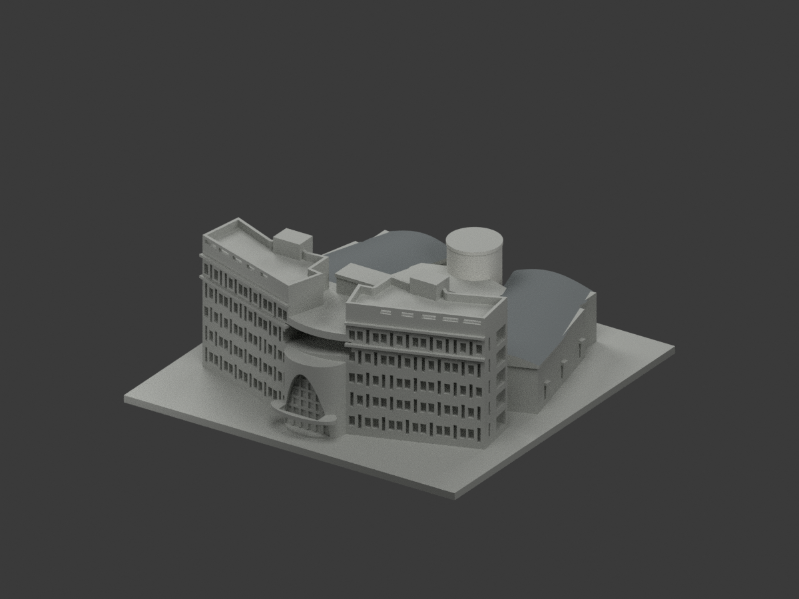
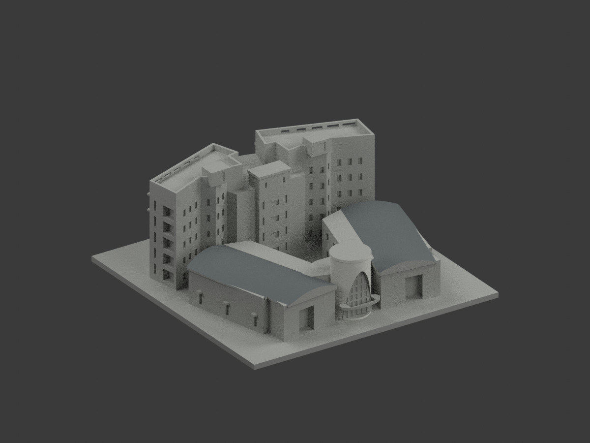
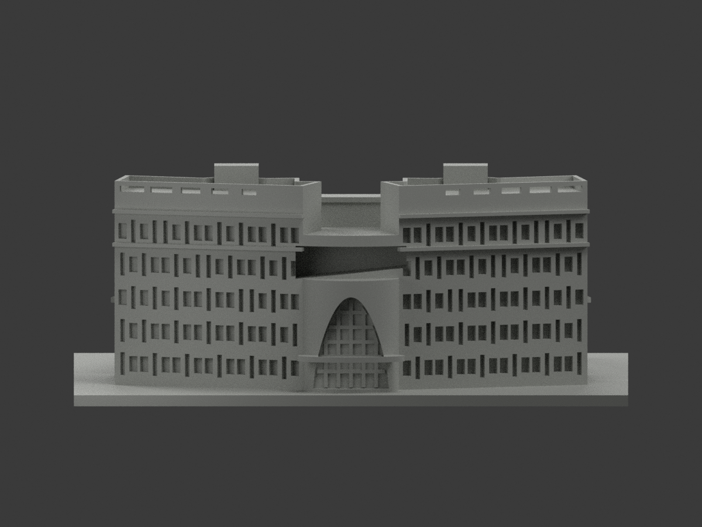
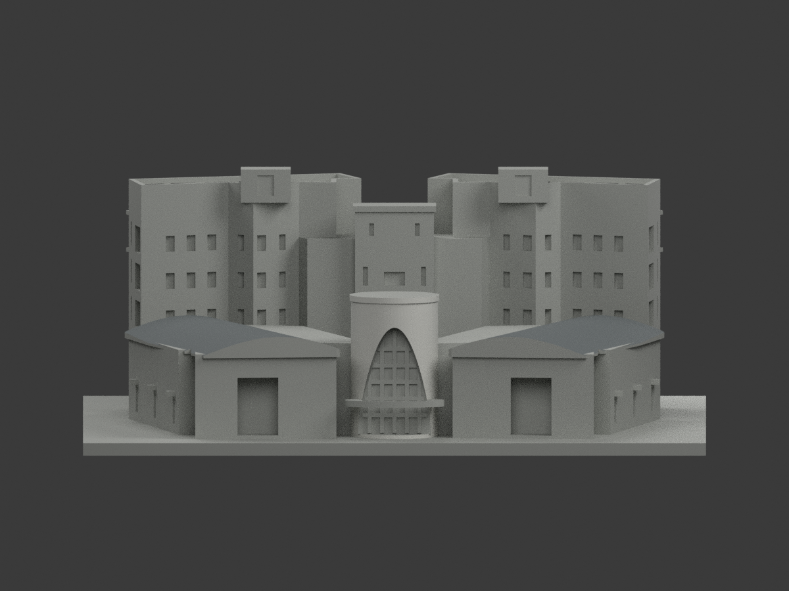
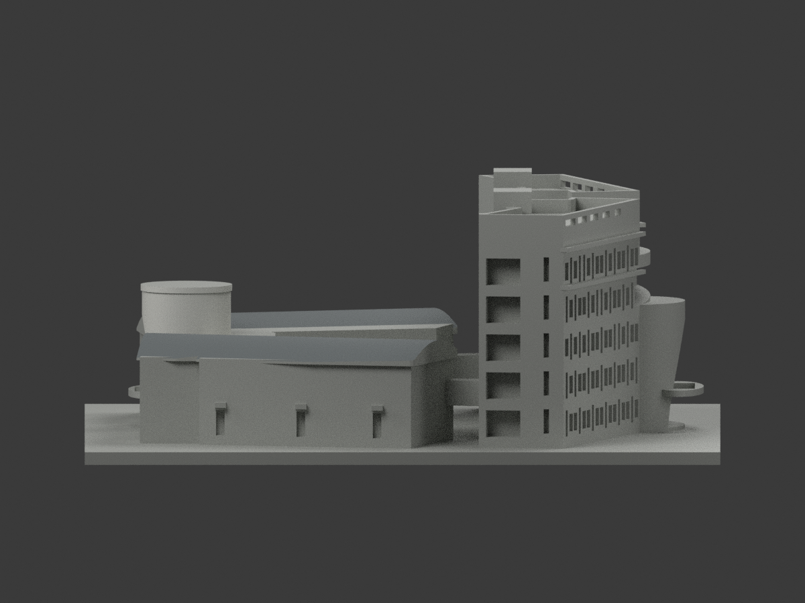
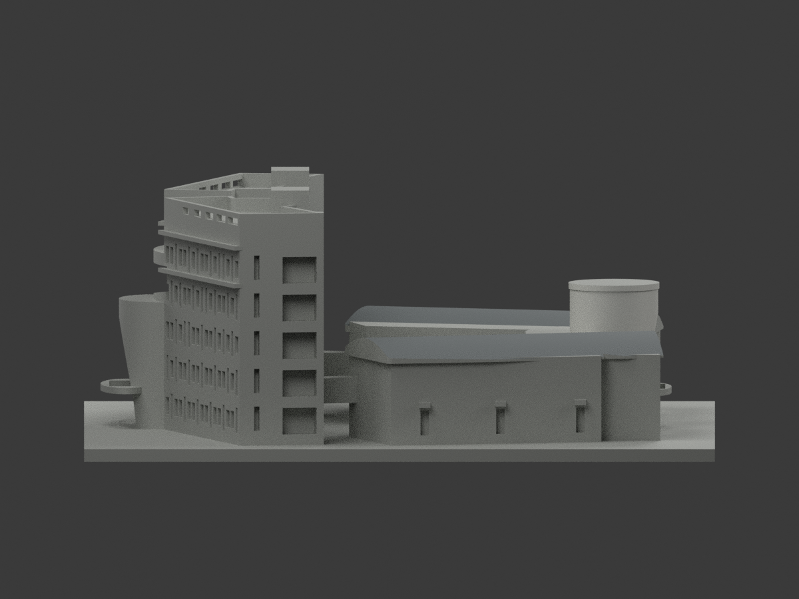
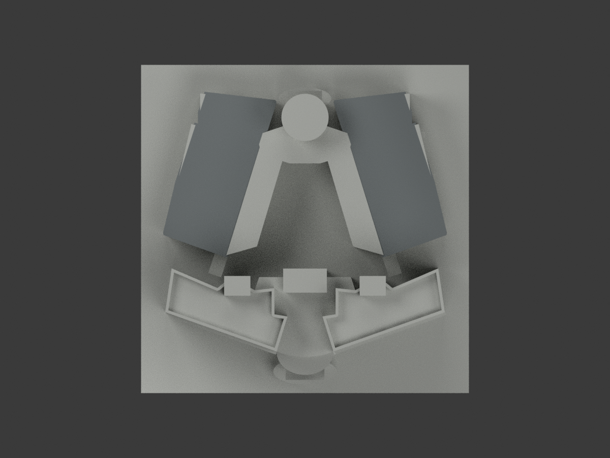
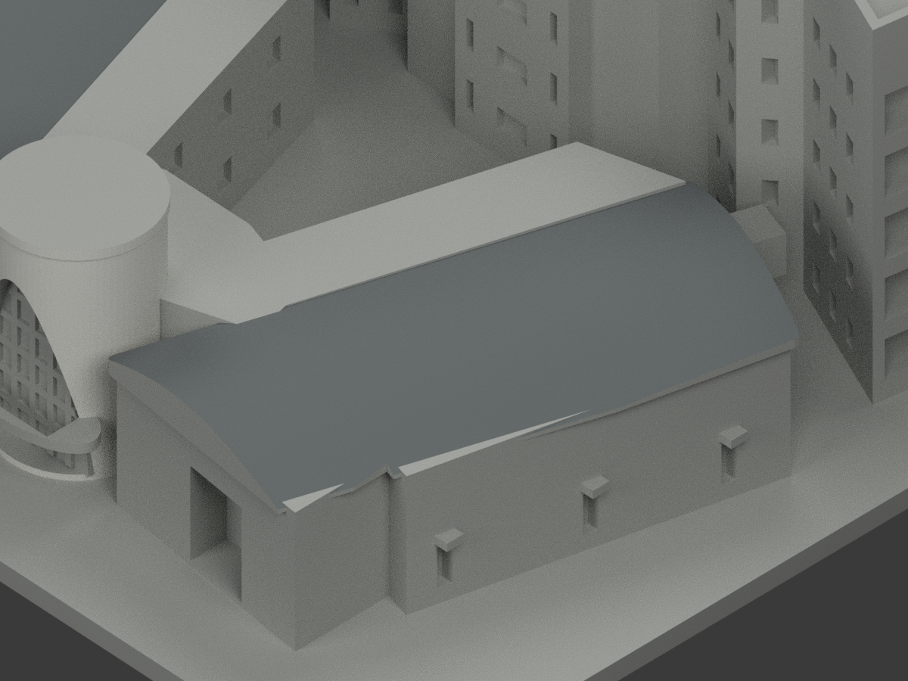
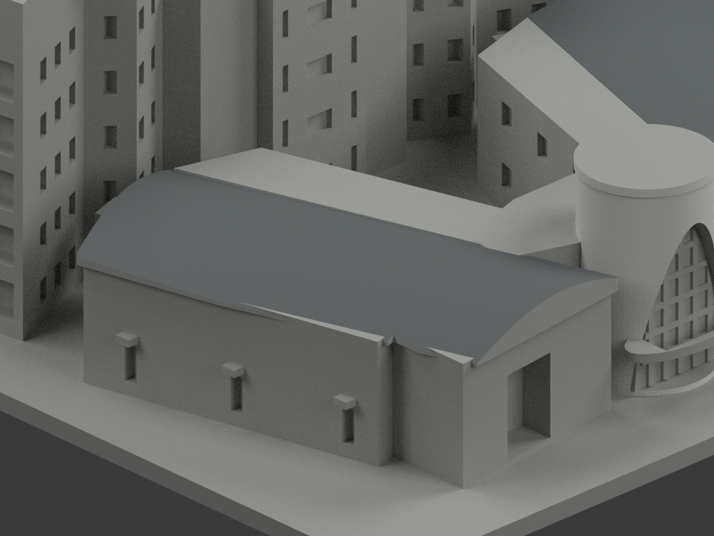
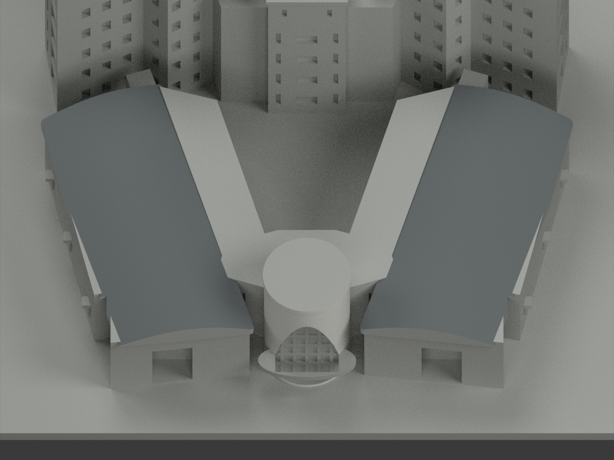

# 勤益工具機教學廠房群｜後圓塔帽外垂直環邊同材質延續

## 模型預覽

| 前斜視 | 後斜視 | 正面 |
|---|---|---|
|  |  |  |
|  |  |  |
|  |  |  |
|  | | |

## 本次後圓塔帽外側垂直環邊同材質延續

本版只把後圓塔帽外側垂直環邊的 160 個完整原三角，延用原塔身乳白材料 2；既有灰金屬雙屋頂 260 面及乳白塔身 276 面全部不動。現有三槽材料及 696 已色面、8,966 未確認中性面，仍是局部補色，不是全群完成。9,662 面／4,809 點、150×150×61.8 mm 外包尺寸、原 STL bytes、面序、繞向與全原色精確保留。一個相連群，不拆新棟，count_delta=0。

有限域中心 (0,51) mm、原半徑 10.8 mm 的 80 段弦面，z=35.7…37.1 mm。每段都是原兩三角／四角完整有界矩形，逐全部頂點、弦面法向、切向與高度核對，沒有切三角或只選面心。總原網格面積 94.9771923756 mm² 對解析 94.9773462843 mm²，誤差來自既有 float32。水平風化灰頂、深色內邊、下方環狀底面、玻璃、雨遮、混色教學牆、灰金屬屋端及底面都不染白。帽在模型內的厚度為既有近似，並非實景測量或同厚保證。

親看建築師事務所來源 008.jpeg 與 003-1.jpeg，支持白色塔身／外垂直帽邊與灰色水平屋頂、深色內側的區分。此處不是整個屋頂塗白；隱藏方位僅是同一外環構件材料連續性推論，不是每一弦面都有獨立相機標定。拍攝日期未確認，不宣稱 2026 現況；HEX 是名義色族、非測色色票，照片只私人參考，不入公開包。來源 URL 及私人檔 hash 見新獨審 JSON，原來源檔與歷史 QA 保留 bytes。

原群體及所有工程限制不撤：幾何為照片近似、無統一實測比例，玻璃浮雕、框簷加厚、部分對稱與內角／設備簡化仍存在。原薄部抽樣不是切片或全方向最小壁厚保證，細屋頂／環邊／角部與支撐需另核；未實體試印，三個展示材不等於多材料實印已驗。本次僅材料延續，不修幾何、不補建物、不重認證舊工程結果。

現版資料為根 `color-mesh.npz`、`appearance.3mf`、`scene.blend`、十視角 PNG；新驗證在 `qa-continuous-caprim/`，現檔 hashes 在 `CONTINUATION-SHA256SUMS`。3MF 使用原 float32 精確座標與合法物件材料預設，零 strict 警告。Blender 保留一個建築網格及原隱藏說明／背板（非列印幾何）。原 `COLOR-*`、`REAR-TOWER-*`、`appearance-materials.json`、source、舊 checksum/manifest 及下面舊說明全為歷史記錄，包含較早只有 260 屋頂面版本的過時數量，不作現版配色判定，沒有覆寫。

重建 `python continuous-caprim-source/build_continuous.py`，交換驗證 `verify_exchange.py`；Blender 執行 `render_continuous.py`，再執行 `strip_previews.py` 和 Blender `verify_scene.py`。`rebuild-continuous-source.zip` 可隔離精確重建網格、3MF、原色盤且重新交換驗證，不含私人照片。此為新增局部色延續，不聲稱已上傳。

場景僅同步更新 source_mesh_sha256 以對應本次含材質指派的 color-mesh.npz，並更新 scope，明示保留原 536 色面、160 外帽垂直環邊面同乳白推論，水平屋頂與內邊不變。原照片近似／簡化幾何與未知建築後側中性限制保留；不代表整頂染白、逐面照片證實、2026 現況或實體試印保證；其餘原屬性、全部材質定義與幾何不變。三槽 palette.json 原 bytes 完全保留。

本頁為現行說明；根 README.zh-TW.md、CHECKSUM-SCOPE.md、PUBLICATION-SUPPLEMENT-MANIFEST.json、SHA256SUMS 與 SHA256SUMS.txt 均保留歷史 bytes，其中「當前」僅指其原發布版本。本輪完整現行校驗以 CONTINUATION-SHA256SUMS 為準。

## 前版說明與保留限制（完整歷史文字）

# 工具機教學廠房群｜兩弧屋上皮及後圓塔局部配色

**局部補色未完成：保留兩廠房弧屋上皮 260 原面灰金屬，新增後圓塔 276 原側面名義白色；黃白混牆與厚檐玻璃未完成。不是全群完成補色。** `partial_color_incomplete=true`、`fully_colored_exterior=false`。同項 `ncut-machine-tool-complex`／`count_delta=0`，太平校本部。一個相連教學廠房群，不拆成三棟/三套。處理日期不是拍攝日期。

## 本次後圓塔補色

建築師官方照片 200001038 可見後圓塔白色外牆，俯視圖 200001520 交證構件身分。本次僅選取原圓柱（中心 0,51、半徑 10.5、高度 2.8 至 36）的 80 段側面平面，全部頂點符合有限邊界才入選，共 276 面。保留原 Boolean 開口，不更改或切割三角形。同構件不可見部分延續名義 #E4E4DE 是推定，不是測色色票。端蓋、塔頂、玻璃、門框、雨庇、前教學圓塔及混色牆不改。共 536 面配色、9,126 面中性，仍未完成。

[範圍與來源](REAR-TOWER-SOURCE-QA.json) · [獨立審核](REAR-TOWER-INDEPENDENT-QA.json) · [原配色說明](qa/rear-tower-previous/README.md)。舊 FREEZE-MANIFEST 及 INDEPENDENT-COLOR-VISUAL-QA 保留歷史用途，不代表此次檢核；本次使用 REAR-TOWER 開頭 QA 與清單。

## 材色範圍

原有屋面範圍沿原構造兩弧屋上皮：原側別平移(side×39,26)、反旋side×18°，局部x取−18到18的49點/48原折面，z=23.2+4.4cos(xπ/36)。逐原三角全部頂點符合相鄰取樣的有限線段外推平面、x段界及y±47.5；不是按面心或寬鬆朝上normal整片挑選。各130原Boolean裁切三角，共260灰金屬；9126中性。每屋45原折面有實露片，保留原union遮擋形狀，不補不存在部分。全共面連通域一致，無新增面/切割材界。

廠房垂直屋端、厚檐、底面不染灰金屬；教學長牆跨黃白階梯色帶及灰基腳沒有原材界，全部中性。全長遮陽檐起訖與實照不同不硬黃；其他圓塔、玻璃背板混框/百葉/反光、實板雨庇、院落、工廠牆與未知域皆中性。**中性不是實景灰證明；來源覆蓋界線不是真實不同材料接縫。**

原9662三角與原STL/build字節、150×150×61.8mm含底座尺寸不變；沒有可確認的統一1:n實測比例。鄰近復通樓/舊綜合實習與焊工工廠不納入；內角、下層窗、進深與設備維持原近似/部分對稱，玻璃浮雕及框簷加厚限制不撤。不改輪廓、窗孔、弧屋波紋或群體位置，不以補色追認原照片近似幾何為精測/現況。

## 來源、日期與權利

親看四張AHA實景：200001520俯視同時涵兩灰金屬屋上皮，200001038後側交證屋面類型，200001024/1050顯教學黃白混牆及原模型欠缺材界。拍攝日期未獨立確立，網頁/下載日期不能當拍攝年，不宣2026完整現況。來源URL與hash在register，參考照片只私人保存，原圖不公開/不貼材質，未見CC不沿repo license推商用。HEX為名義色族非測色色票。

## 檔案與 QA

`appearance.3mf`三展示材，`scene.blend`實際原面材索引，`color-mesh.npz`原三角。STL無色原件/build保留字節。**Immutable原包無OBJ，原build亦只輸出STL；不得冒稱原OBJ存在。**

原包只有README.md，逐字保留為`ORIGINAL-MONOCHROME-README.md`（沒有原README.zh-TW.md），舊previews/QA仍為原單色歷程，非此次補色QA。依原requirements執行build及`colorize_model.py`/`export_appearance.py`/`validate_color.py`；Blender執行render/verify。原build+color在隔離目錄重建保留不刪；3MF/STL三角座標、閉合正體積、重開scene及10張1200×900見QA。精確原依賴shapely2.1.2需獨立target環境，不能改共享環境或原build適配新版本。

**未實際列印。** 三展示材不是已驗四色切片工程，薄部/支撐另核。

## English limitations

Partial roof-and-rear-tower update:260original upper-skin triangles (130 per factory) nominal gray metal;276 original rear round tower side faces nominal offwhite; 9126 neutral. Unseen cylindrical-wall continuity inferred. Inverse original +/-18-degree transforms and all-vertex finite 48-chord roof-facet tests; no centroid selection or infinite-plane extension. Original Boolean clipping retained. Thick eaves, vertical ends, undersides, mixed yellow/white teaching walls and gray bases, window backs mixing mullions/reflections, other towers, solid canopy proxies and unknown surfaces neutral. Neutral is not observed gray; evidence boundaries are not real material seams. One connected teaching/factory group, not three deliveries.9662originaltriangles, STL/build bytes and dimensions unchanged/count_delta0. No immutable OBJ exists. Four actual reference photographs viewed privately; capture dates unknown, no2026current or surveyed accuracy claim. No photo textures/public source images/commercial rights assumption. Not test-printed; three display materials are not a validated four-filament project.
