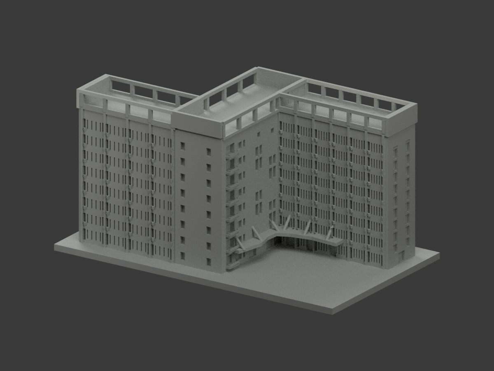
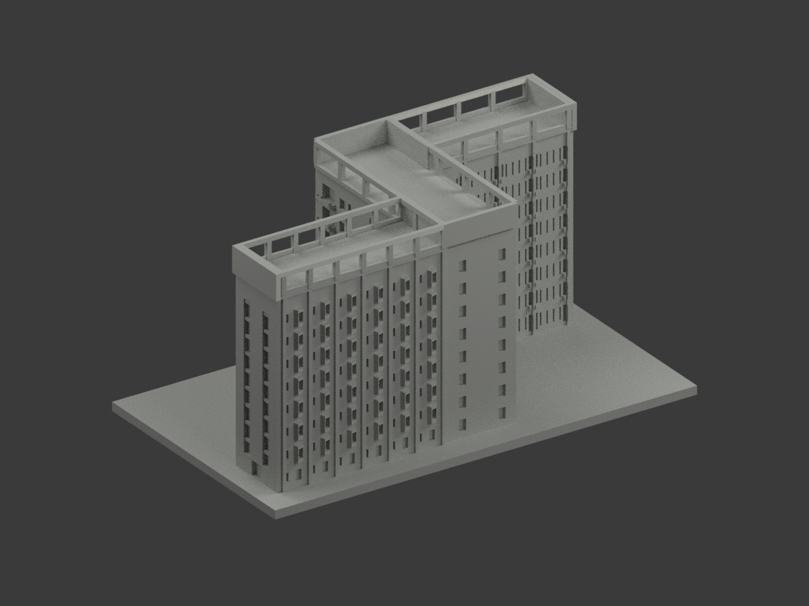
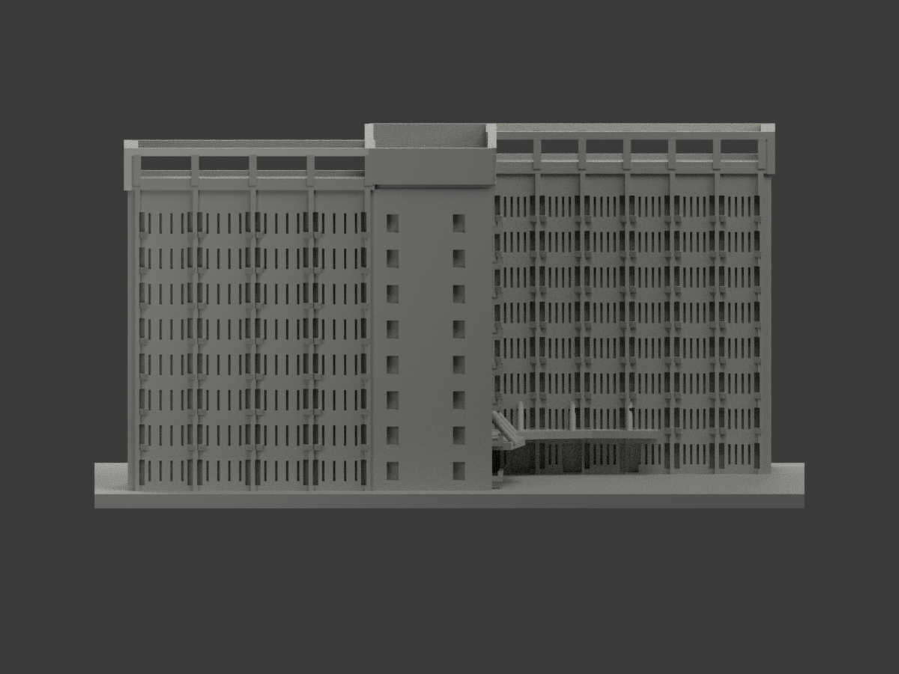
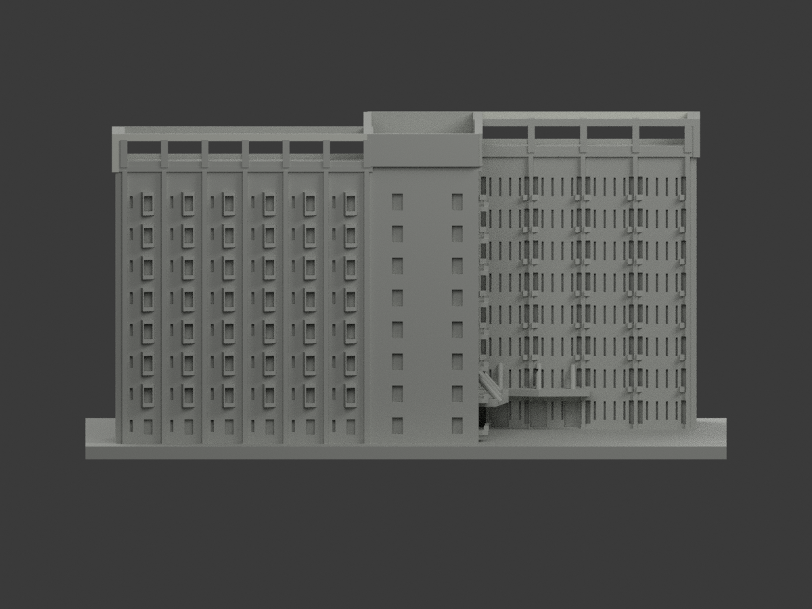
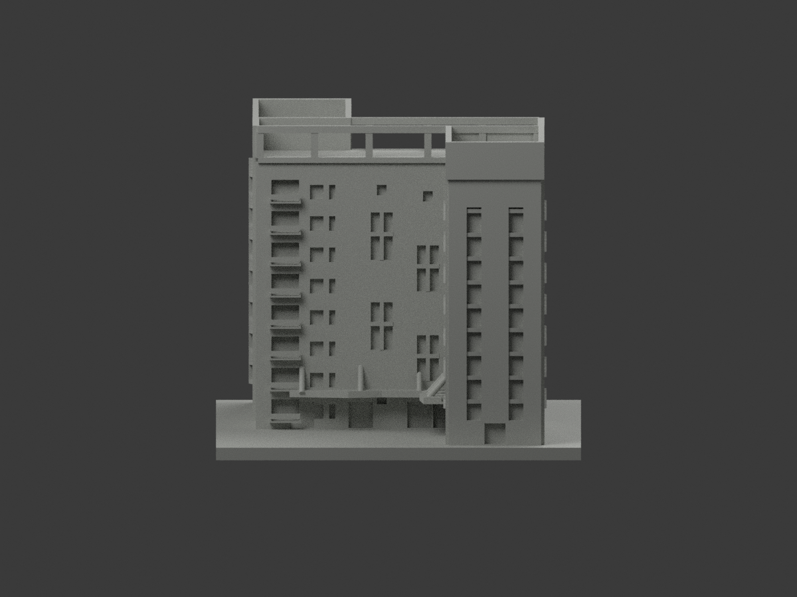
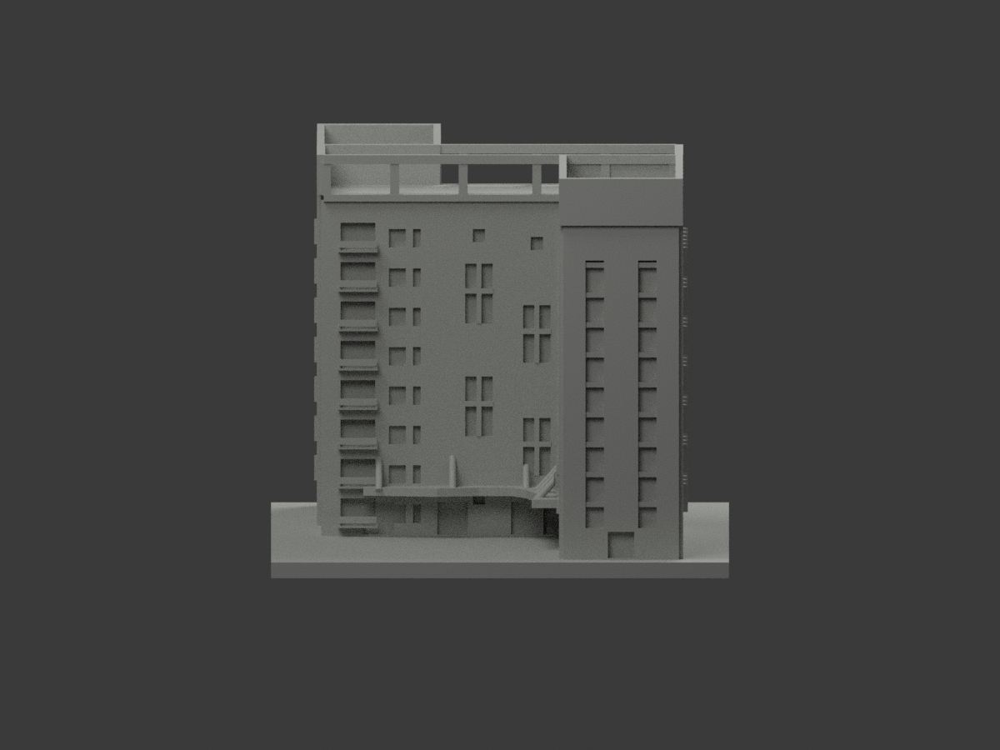
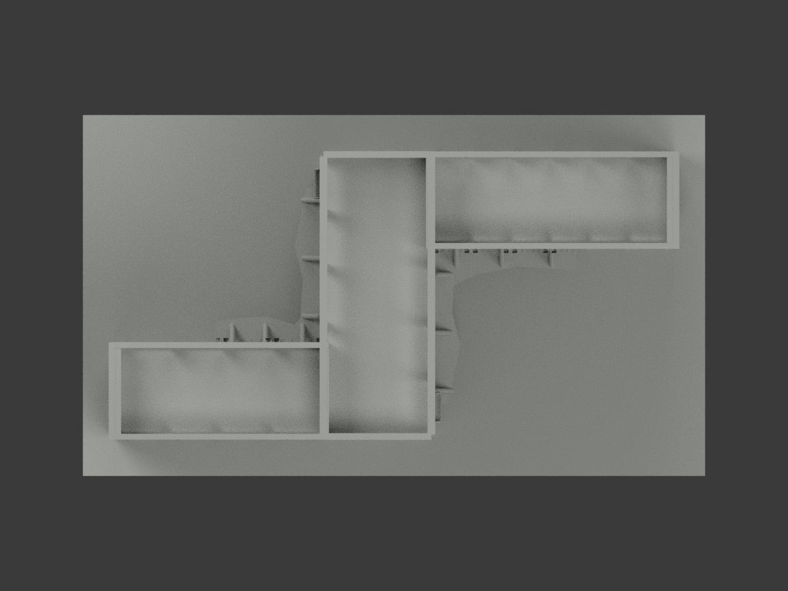
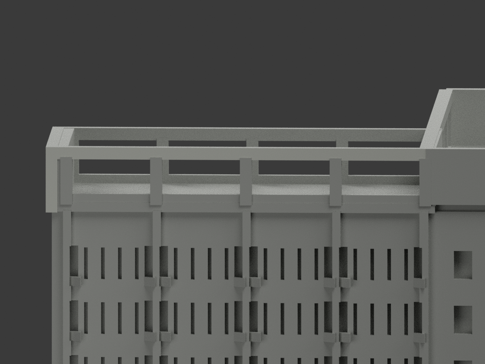
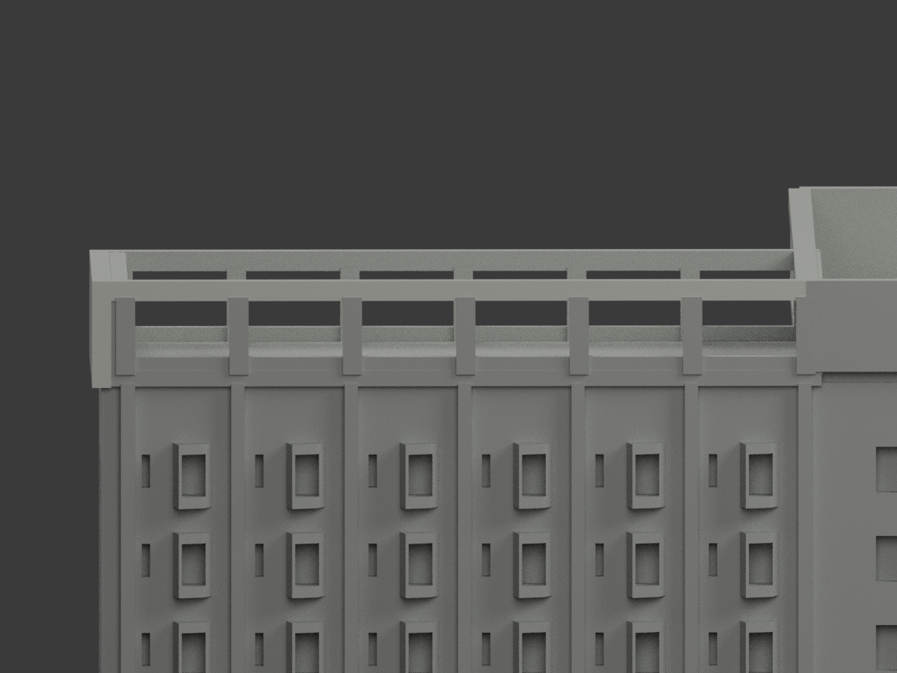
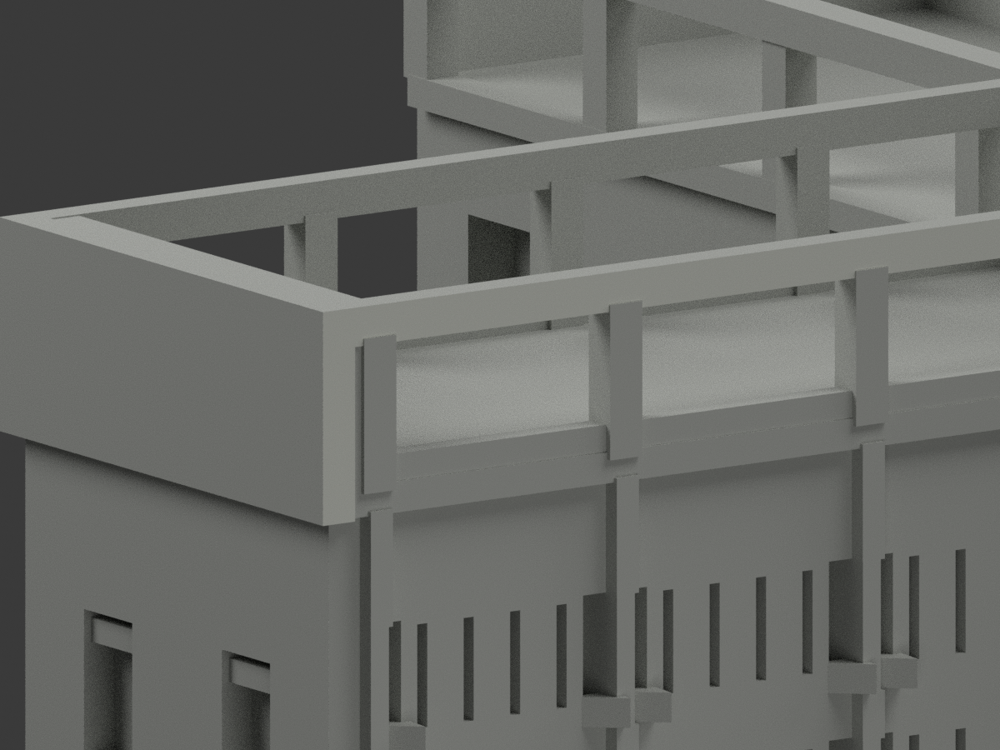

# 勤益養浩學舍 C／D 相連 Z 群｜兩外高橫梁內向面同材質延續

## 模型預覽

| 前斜視 | 後斜視 | 正面 |
|---|---|---|
|  |  |  |
|  |  |  |
|  |  |  |
|  | | |

## 本次兩外高橫梁內向面同材質延續

僅將短翼與長翼既有外側屋頂高橫梁的內向垂直面，分別 18／26 個完整原三角，延用既有乳白材質 0。原 54 個已色面不變，現合計 98 白面、27,192 未確認中性面；原兩槽色盤、27,290 原面／原頂點、STL bytes、座標、面序、繞向皆保留，不切三角、不改厚度，不再次翻轉原本已匯出的 Y 軸。

有限域為 y=−33.35／+33.35mm，z=74…75.65mm，各梁 x 有界，包含這兩平面上全部原面而非挑選大三角的一部分。完整扣除端框、柱頭與中央核心接觸，短／長梁解析面積 77.44375／89.68375mm²，網格 77.44381466／89.68381701mm²；各投影域對稱差小於 0.00015mm²，無三角內部重疊。頂底面、柱身、端板、另一側內庭梁、屋頂露台、核心、牆窗、紅雨遮、底座與其他表面維持原樣。不恢復先前退回的 1,240 面廣泛框架候選。

本輪親看校方《養浩學舍新建工程之施工前後照片》第 2 頁兩張相反方向施工後空拍，支持屋頂開放框架的白色材料族；個別網格面並未相機標定，內向／隱藏部分明示為同梁材質延續推論，不是逐面獨立照片證實。照片攝影日期未知，PDF 2023-10-16 建檔不等於拍攝日或 2026 現況。未校正色值不是材料規格，私人 PDF／照片不加入公開包。

原模型及製造限制、原工程 QA 與來源皆保留，不因補色取得新的實體試印、切片、支撐、全方向最小壁厚或測繪保證。原三類歷史示意不是本輪配色基準，本輪只承接 54 已核對白面版本。原隐藏的展示說明／背板保留且不進列印網格。新 3MF 使用原 float32 座標的精確十進位表示及合法物件材料預設，修正格式欄位而不改原幾何或面材質。

新版 QA 在 `qa-continuous-beam/`；根舊 `appearance-materials.json`、`COLOR-*`、`SCENE-QA.json`、舊 SHA／MANIFEST、原 source 代表原版本，全部保留 bytes，不作新版驗證。現版請讀 `qa-continuous-beam/selection.json` 及 `CONTINUATION-SHA256SUMS`。新重建 `python continuous-beam-source/build_continuous.py`，嚴格交換驗證 `verify_exchange.py`；Blender 使用 `render_continuous.py`，再執行 `strip_previews.py` 及 Blender `verify_scene.py`。`rebuild-continuous-source.zip` 可孤立精確重建網格、3MF 與材料，不含照片。

場景僅同步更新 source_mesh_sha256 以對應本次含材質指派的 color-mesh.npz，並更新 scope，明示保留原 54 白面、兩外高橫梁 44 內向面同乳白推論及其餘 27,192 面中性。原簡化幾何與未知建築後側中性限制保留；不恢復先前退回的 1,240 面廣泛框架候選，不宣稱逐面照片證實、2026 現況或實體試印保證；其餘原屬性、全部材質定義與幾何不變。palette.json 原 bytes 完全保留，既有槽名不代表新增內向面有獨立逐面照片證據。

本頁為現行說明；根 README.zh-TW.md、CHECKSUM-SCOPE.md、PUBLICATION-SUPPLEMENT-MANIFEST.json、SHA256SUMS 與 SHA256SUMS.txt 均保留歷史 bytes，其中「當前」僅指其原發布版本。本輪完整現行校驗以 CONTINUATION-SHA256SUMS 為準。

## 前版說明與保留限制（完整歷史文字）

# 勤益養浩學舍 C／D 相連 Z 群｜兩外高框局部白

**局部補色未完成：僅短翼23＋長翼31完整外高框與端白板共54原面白，其餘面尚未分色。** partial_color_incomplete=true、fully_colored_exterior=false。同項 ncut-yanghao-dormitory／count_delta=0，國立勤益科技大學太平校本部。身份 NCUT Yanghao Dormitory partial color。

**原版已是三類展示材，不是真單色；本輪是有據材色校正，撤去未驗證藍窗等展示材，改54白／27236未知中性，並保留原展示版本。不是新增建築或重拆 C／D。** 請見 PREVIEW-TRANSITION.md。

## 完整原材域與歷程

以已輸出的STL為準，不再次 Y 反轉。全三點無限平面 y−34.75 得23面、y＋34.75得31面；全原平面先枚舉，再記範圍短翼x−68.800003..−17、長翼x9..68.800003，兩域z66.699997..75.650002。完整高屋框包含短竪框、相接端白板，不只是z74薄橫梁，不截z、不按normal或centroid漏碎面。

兩張完工對向航拍直接支持整個外高框白色族；不是由一翼鏡射另一翼、不是已校準塗料。初1240候選含上底內域已正式撤回，v2狹義薄梁HOLD歷史保留，v3重新看對向源後接受整54外域。只這54名義白，其餘27236中性；屋框上底內側、玻璃背板、紅裙雨庇、主混牆及未知域全中性。資料覆蓋界線不是真實材界，中性不是實景灰。

## 原群與日期限制

維持原C／D相連Z群，非H形或封閉院，不拆兩套。不改八排窗、原玻璃格/欄代理/估測加厚簡化，不因補色追認測繪。原碼末尾Y反射已在原STL完成。兩完工照日期未獨核，不以PDF或上傳日期當拍攝日，不稱2026現況；照片只私存不公開/貼圖。

## 檔案與QA

原27290三角座標拓撲、STL/build字節不變，immutable22件無OBJ，不新增OBJ。原README.md另存ORIGINAL-PREVIEW-README.md，原render_preview.py與previews保持原字節；原scene公開另存ORIGINAL-PREVIEW-scene.blend及私人original-remote/scene.blend，新scene.blend明確有據局部色。另有ORIGINAL-PREVIEW-render_preview.py原展示別名，所有原QA不冒當新檢核。

兩展示材appearance.3mf與scene.blend、四腳本身份 NCUT Yanghao Dormitory partial color。精確依賴隔離原build+color，原三角multiset、共面域一致、3MF/reopen、十張1200×900檢核，保留重建不刪；未試印/驗多料切片，STL本身無色。

## English limitations

NCUT Yanghao Dormitory partial color. Existing preview has3assigned visualization classes,not a truly monochrome model. This source-gap correction retains original preview/render/scene publicly under explicit original aliases and privately; only54verified offwhite faces replace prior unsupported assignments,27236unknown neutral. Same connected C/D Z group,count_delta0,no new building.

Whole exported y=-34.75 plane23 andy=+34.75 plane31 include complete outer upper frames and adjoining white endpanels,z66.699997..75.650002. Original final Y flip already applied; no additional reflection,zclipping or geometrychange. Opposing completed aerials directly support both outerdomains; uncalibrated photo colorfamily. Withdrawn1240selection and initialv2HOLD retained privately. Tops/undersides/interior frames,glass/redcanopies/mixedwalls neutral. Original27290triangles,22files/noOBJ retained. Captureunknown/no2026claim; private sourcephotos,no testprint.
