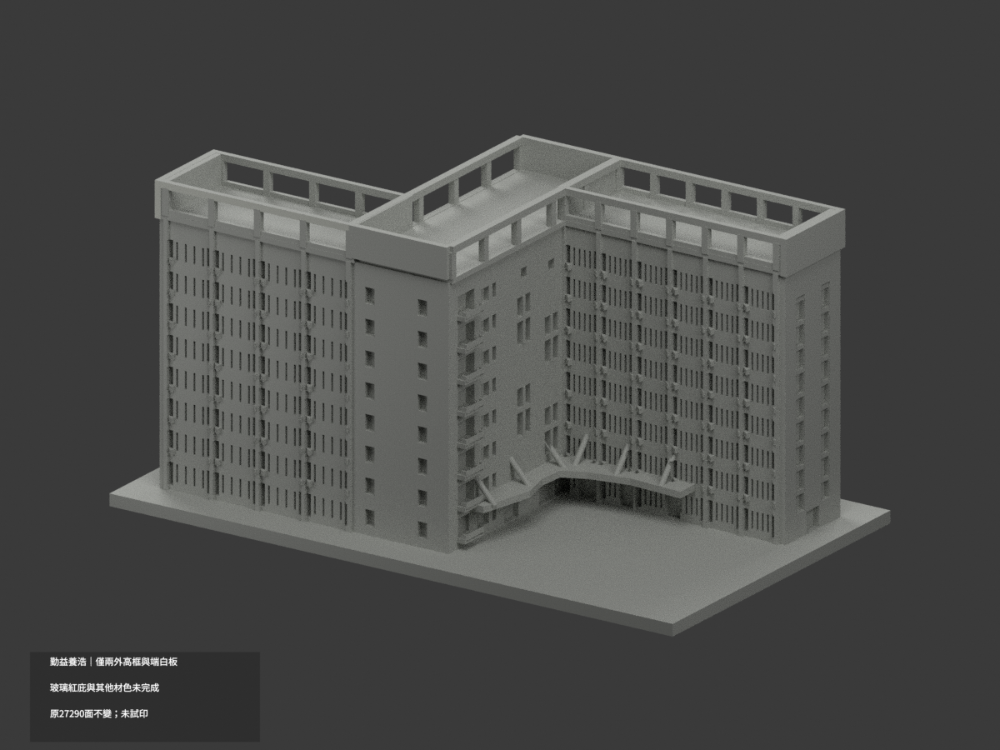
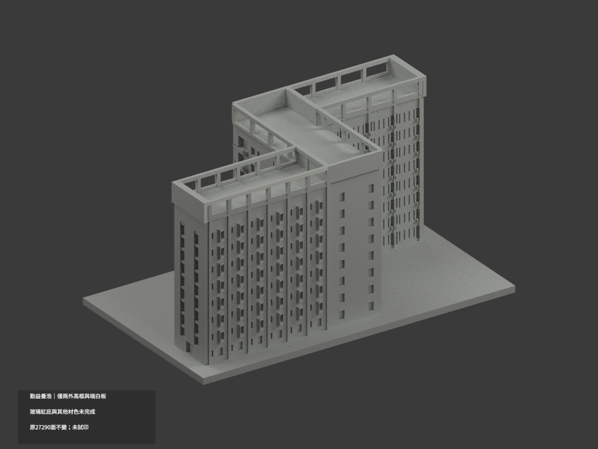
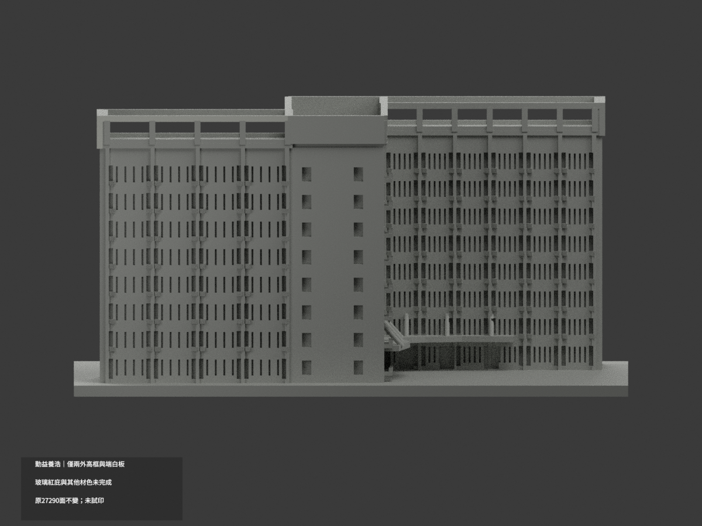
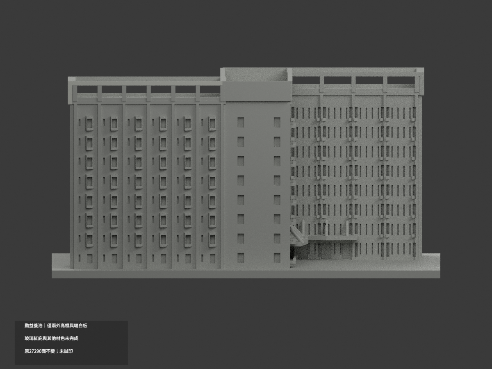
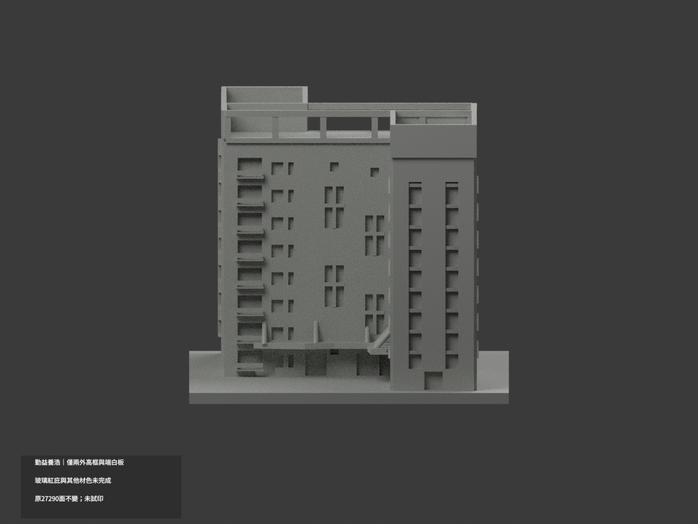
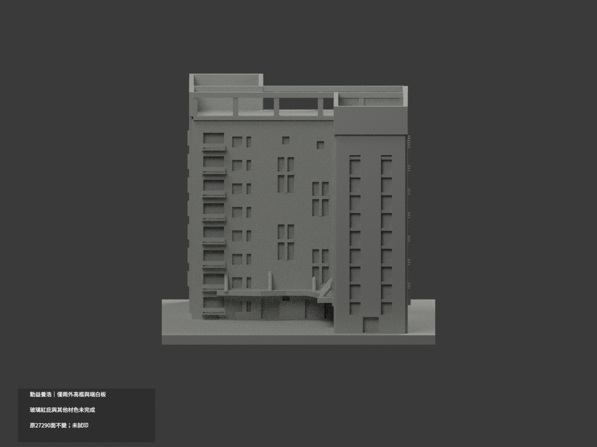
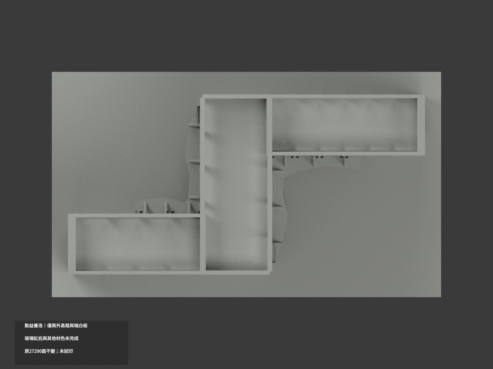
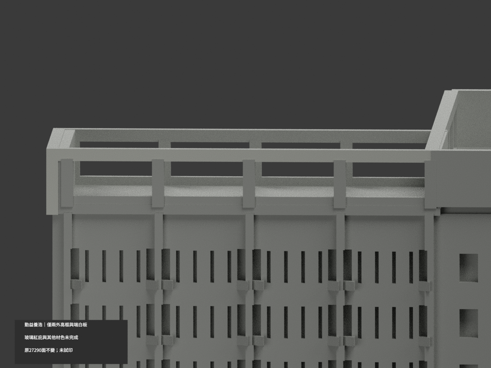
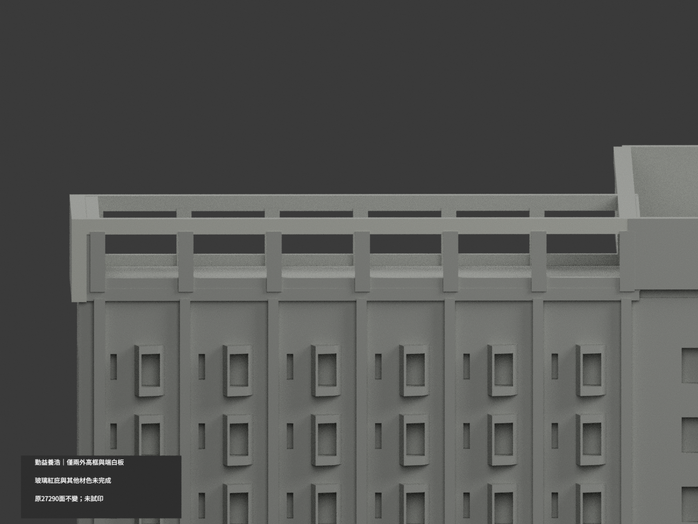
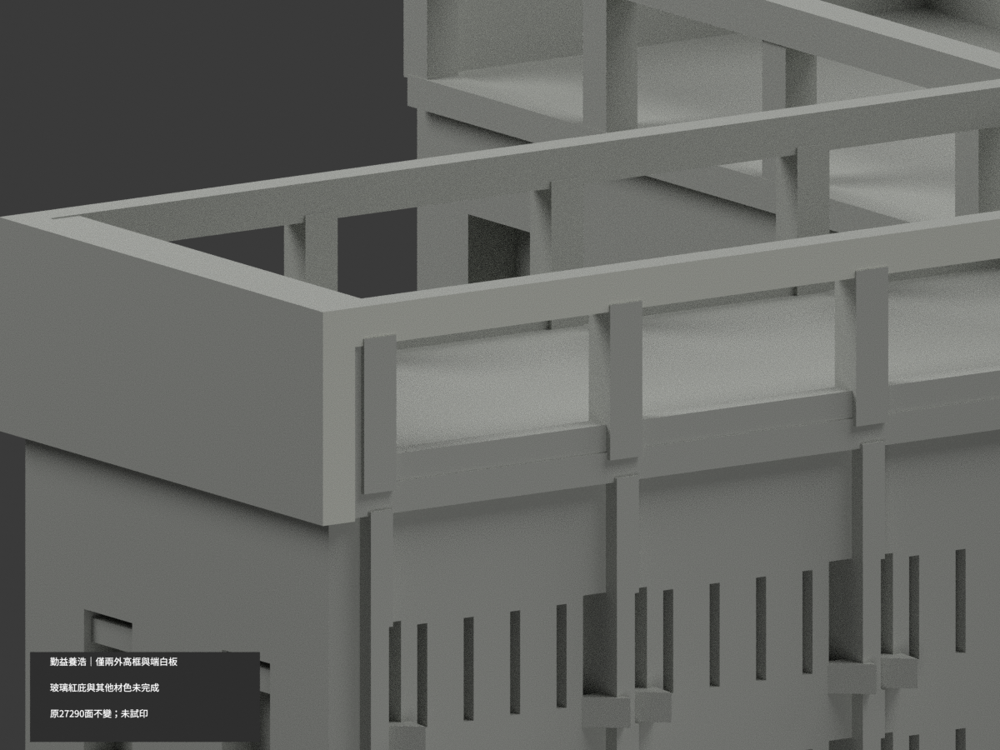

# 勤益養浩學舍 C／D 相連 Z 群｜兩外高框局部白

**局部補色未完成：僅短翼23＋長翼31完整外高框與端白板共54原面白，其餘面尚未分色。** partial_color_incomplete=true、fully_colored_exterior=false。同項 ncut-yanghao-dormitory／count_delta=0，國立勤益科技大學太平校本部。身份 NCUT Yanghao Dormitory partial color。

**原版已是三類展示材，不是真單色；本輪是有據材色校正，撤去未驗證藍窗等展示材，改54白／27236未知中性，並保留原展示版本。不是新增建築或重拆 C／D。** 請見 PREVIEW-TRANSITION.md。

| 前斜視 | 後斜視 | 正面 |
|---|---|---|
|  |  |  |
|  |  |  |
|  |  |  |
|  | | |

## 完整原材域與歷程

以已輸出的STL為準，不再次 Y 反轉。全三點無限平面 y−34.75 得23面、y＋34.75得31面；全原平面先枚舉，再記範圍短翼x−68.800003..−17、長翼x9..68.800003，兩域z66.699997..75.650002。完整高屋框包含短竪框、相接端白板，不只是z74薄橫梁，不截z、不按normal或centroid漏碎面。

兩張完工對向航拍直接支持整個外高框白色族；不是由一翼鏡射另一翼、不是已校準塗料。初1240候選含上底內域已正式撤回，v2狹義薄梁HOLD歷史保留，v3重新看對向源後接受整54外域。只這54名義白，其餘27236中性；屋框上底內側、玻璃背板、紅裙雨庇、主混牆及未知域全中性。資料覆蓋界線不是真實材界，中性不是實景灰。

## 原群與日期限制

維持原C／D相連Z群，非H形或封閉院，不拆兩套。不改八排窗、原玻璃格/欄代理/估測加厚簡化，不因補色追認測繪。原碼末尾Y反射已在原STL完成。兩完工照日期未獨核，不以PDF或上傳日期當拍攝日，不稱2026現況；照片只私存不公開/貼圖。

## 檔案與QA

原27290三角座標拓撲、STL/build字節不變，immutable22件無OBJ，不新增OBJ。原README.md另存ORIGINAL-PREVIEW-README.md，原render_preview.py與previews保持原字節；原scene公開另存ORIGINAL-PREVIEW-scene.blend及私人original-remote/scene.blend，新scene.blend明確有據局部色。另有ORIGINAL-PREVIEW-render_preview.py原展示別名，所有原QA不冒當新檢核。

兩展示材appearance.3mf與scene.blend、四腳本身份 NCUT Yanghao Dormitory partial color。精確依賴隔離原build+color，原三角multiset、共面域一致、3MF/reopen、十張1200×900檢核，保留重建不刪；未試印/驗多料切片，STL本身無色。

## English limitations

NCUT Yanghao Dormitory partial color. Existing preview has3assigned visualization classes,not a truly monochrome model. This source-gap correction retains original preview/render/scene publicly under explicit original aliases and privately; only54verified offwhite faces replace prior unsupported assignments,27236unknown neutral. Same connected C/D Z group,count_delta0,no new building.

Whole exported y=-34.75 plane23 andy=+34.75 plane31 include complete outer upper frames and adjoining white endpanels,z66.699997..75.650002. Original final Y flip already applied; no additional reflection,zclipping or geometrychange. Opposing completed aerials directly support both outerdomains; uncalibrated photo colorfamily. Withdrawn1240selection and initialv2HOLD retained privately. Tops/undersides/interior frames,glass/redcanopies/mixedwalls neutral. Original27290triangles,22files/noOBJ retained. Captureunknown/no2026claim; private sourcephotos,no testprint.
