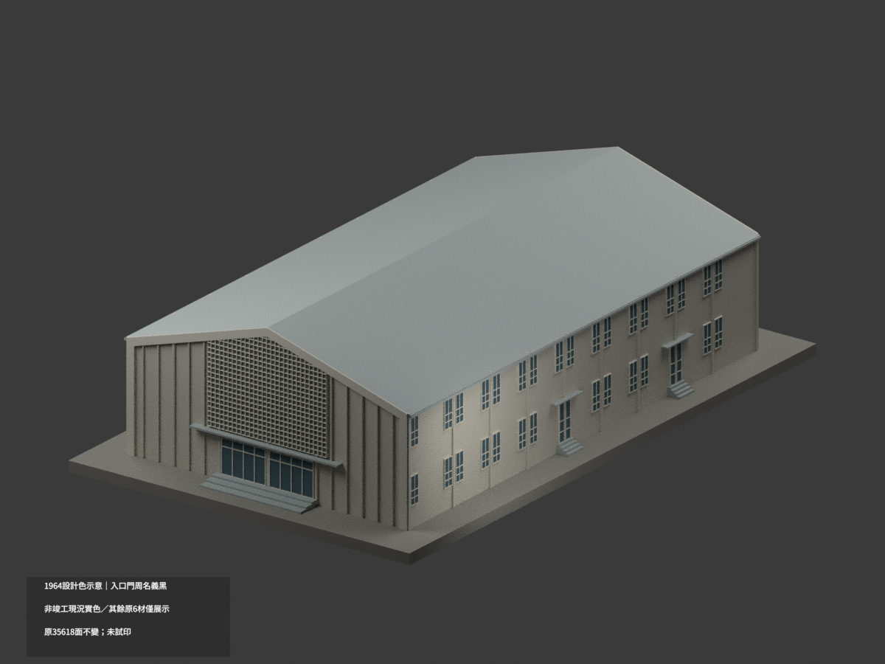

# 國立南投高級中學建築研究模型

現行收錄 **1 套模型包**，不是完整校園／建物盤點。校本部為本資料庫入口分組，不聲稱另有官方具名校區；舊校名歸入同校，不重複計校。

陳其寛／中國建築師事務所工號5218、1964年4月原設計圖；尚未證實同形實際建成，不直接稱中正堂，不混1989中正大樓或1990活動中心，非現況測繪。

設計者、典藏來源與原圖CC BY-NC標示保留，來源頁未明示版本；原圖像權利與自行編寫程式／重建模型分開說明，不因來源標示而一概將整包模型限制為非商業，也不宣稱已取得原建築設計或原圖的無限制商用權利。原照片、圖紙、PDF與私人參考資料不隨公開包配送；所有模型未實體試印。

| 建築模型 | 建築模型 | 建築模型 |
| :---: | :---: | :---: |
|  **[南投中學綜合禮堂｜1964原設計圖版](校本部/buildings/nantou-school-hall-design-1964/README.md)** [STL](校本部/buildings/nantou-school-hall-design-1964/model.stl) · [彩色3MF](校本部/buildings/nantou-school-hall-design-1964/model.3mf) · [Blender](校本部/buildings/nantou-school-hall-design-1964/scene.blend) [設計色局部3MF](校本部/buildings/nantou-school-hall-design-1964/appearance.3mf) · [範圍與限制](校本部/buildings/nantou-school-hall-design-1964/README.md) · [校驗版本與原檔說明](校本部/buildings/nantou-school-hall-design-1964/CHECKSUM-SCOPE.md) |  |  |

[校本部圖鑑](校本部/README.md) · [回總目錄](../README.md)
