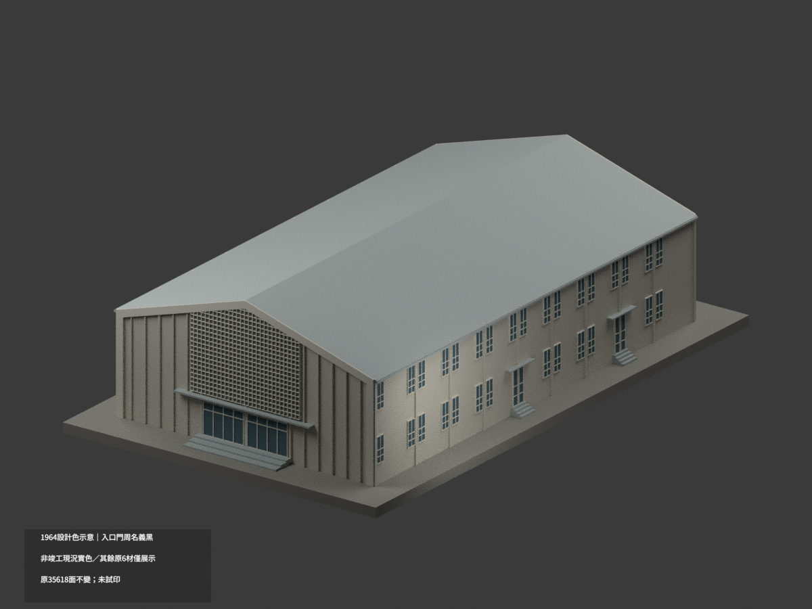
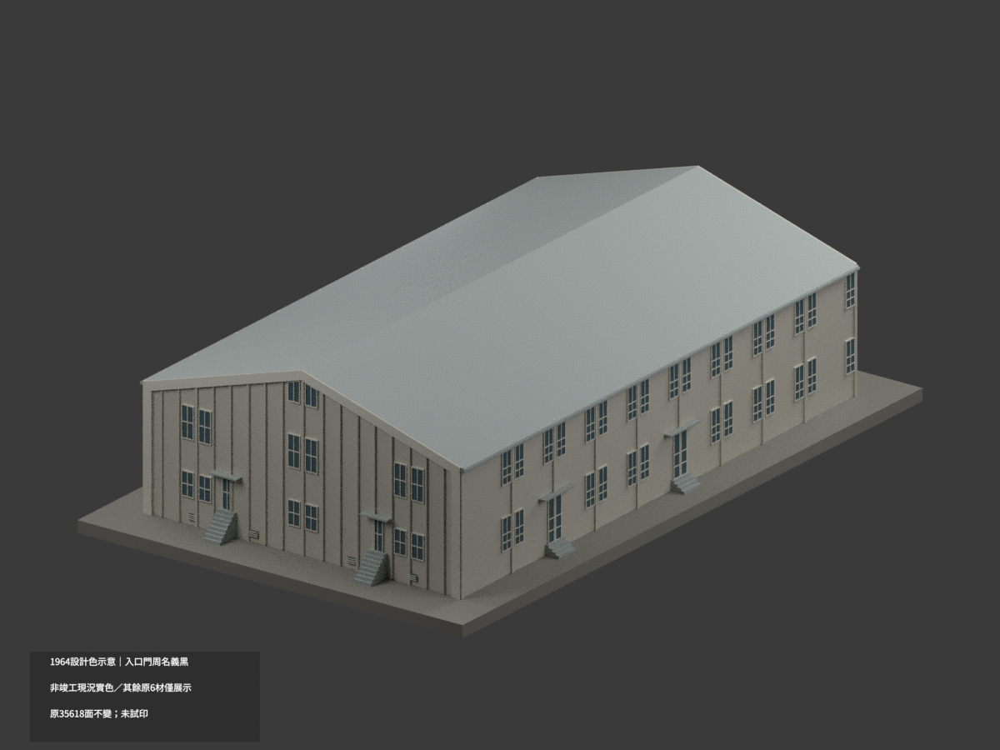
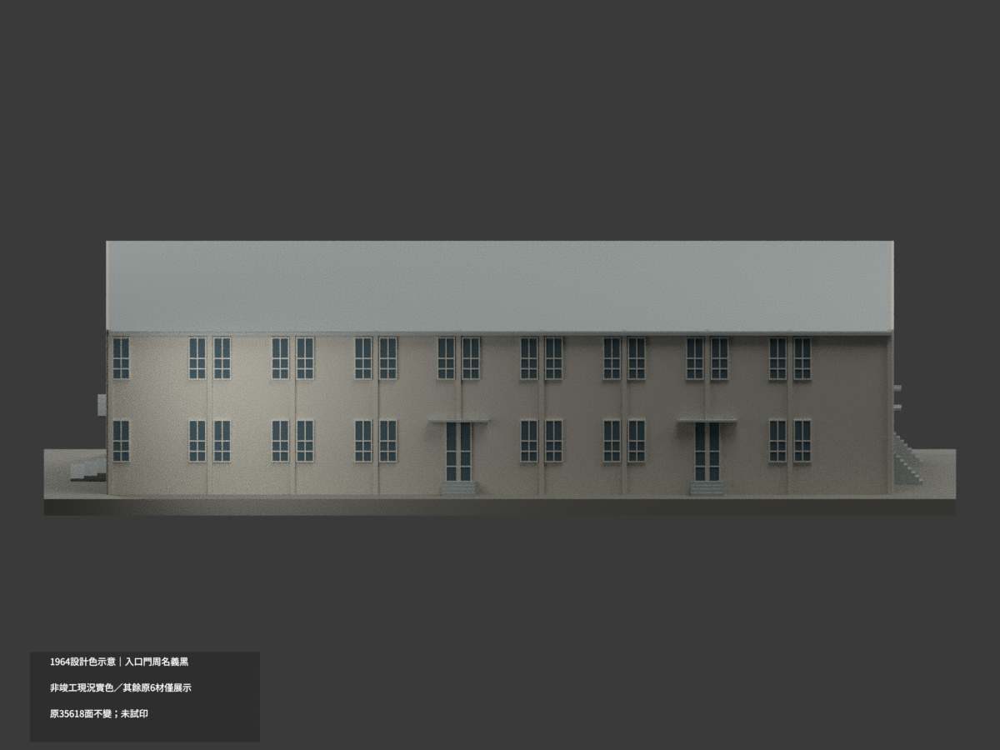
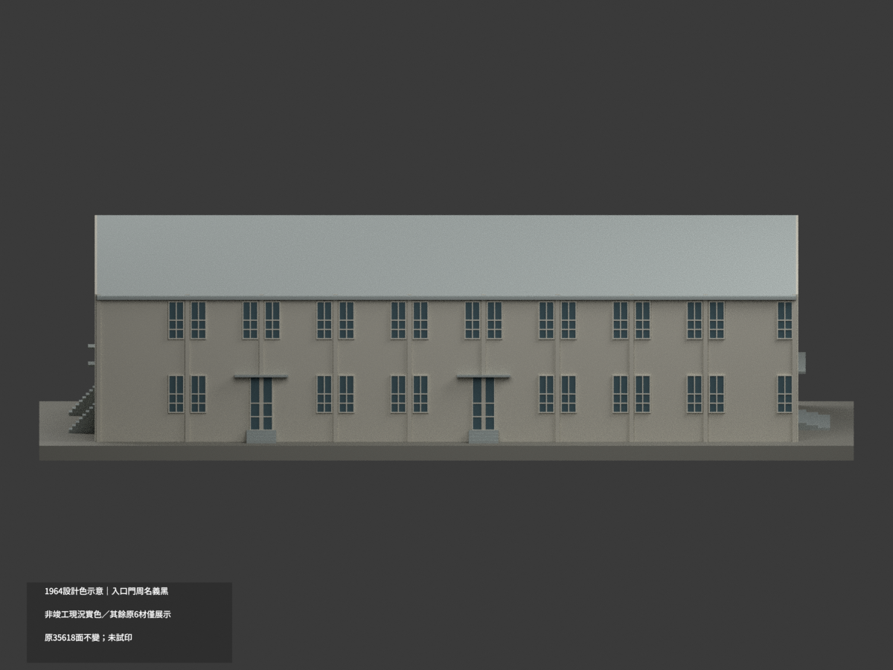
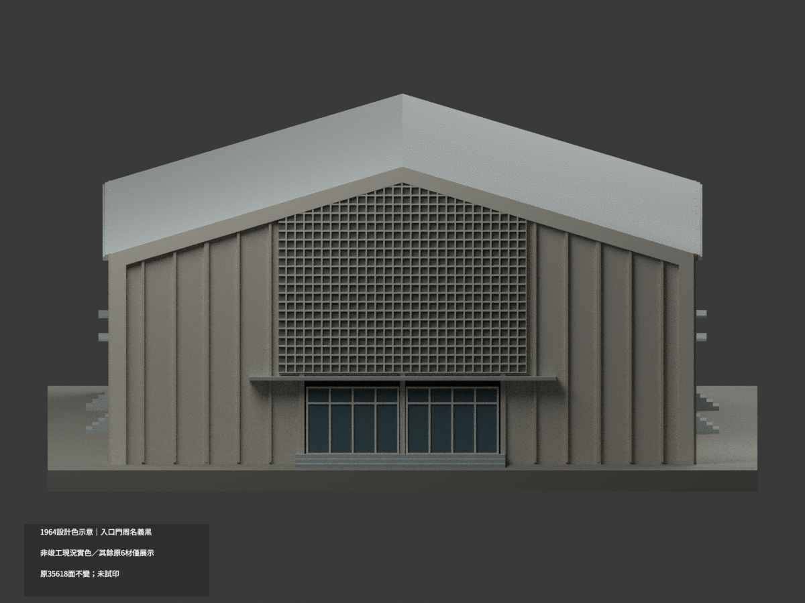
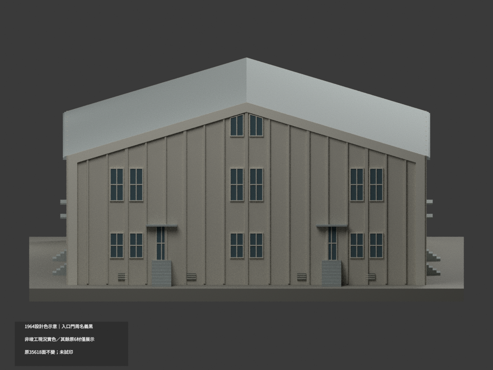
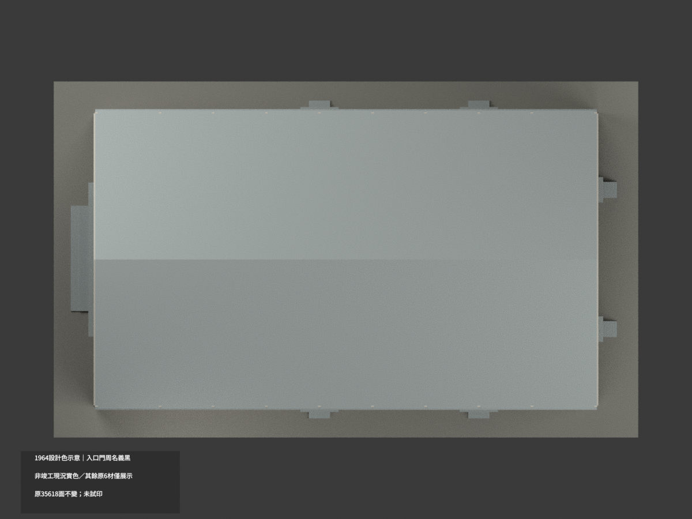

# 南投中學綜合禮堂 — 1964 年原設計圖版

> **本地模型與數位 QA 完成。**
> 依陳其寛／中國建築師事務所工號5218、圖框民國53年4月的原設計圖重建。**不是竣工測繪，也不是現況模型。**

## 身分範圍

國立臺灣博物館典藏案名為「南投中學大禮堂圖書館綜合建築工程」，圖組CCCK428。官方校史另記1965年中正堂落成、原日本神社拆除；其時序與用途相符，**但尚未取得同形竣工照片或紀錄確認工號5218就是該堂實際建成版本**，因此不直接以「中正堂」作模型名稱，不混入1989年中正大樓或1990年活動中心。

## 幾何與限制

- 原圖47.00×27.50m雙坡大禮堂、教室與圖書館外包，保留正面花磚屏位置、兩組各四扇入口、長側1單＋8雙聯窗、背面三窗帶與外門。
- 以GL=0：1F+.50m、2F4.35m、3F7.93m、檐10.00m、屋脊14.12m。以1F為0則分別為0、3.85、7.43、9.50、13.62m；不可混用datum。
- A12側窗型高2.50m有明標；A5圖估A窗GL+2.00～4.50m、B窗GL+7.00～9.50m，圖估誤差約±0.10m。A11局部地坪與全館立面高程差未完全解，不拿局部鏈硬套全館。
- A11側門淨高與A12總高有15cm差異，模型優先採A12窗門型式與A5整體立面比例。
- 前後山牆斜框深約0.75m、細直肋與背牆四個小通風格按A5比例簡化；背面最高中央雙窗保留順屋坡梯形上緣。這些比例讀值不冒充逐項標註。
- 花磚屏以**封背格網低浮雕簡化**，不聲稱逐塊還原原花紋；細框、屋面波紋、配筋、室內觀眾席與設備不逐一表現。玻璃不透明封背。
- 基座、地坪和局部外階承托為展示示意，不是精確地形；材料色為中性辨識色，不冒充原建物色票。
- 比例1:200，STL／3MF單位mm；含底座約275×167.5×75.6mm。未實體試印，須自行檢查機台範圍及支撐設定。

## 已完成的數位檢查

七視角由同源網格實際渲染並獨立對圖；全頂點相機取景、單一連通水密網格、STL／3MF回讀、壓縮BLEND真實重開，以及另一乾淨目錄的逐位元重建均通過。來源比對是明示範圍的外觀設計重建檢查，不等於實測或實體試印。檢查結果見各`*-QA.json`。

## 來源與權利分開說明

原圖作者：**陳其寛／中國建築師事務所**；典藏：**國立臺灣博物館／臺灣現代建築圖說**。圖像頁標CC BY-NC，版本未確認；這是原圖像標示，不自動等於整包模型授權。本包保留設計者與來源，不把原圖像標示概括成整包模型僅限非商業，也不宣稱取得不限用途商用權利。原圖、PDF及含token的HTML均不隨成果包附送。

- [地盤配置A1](https://collections.culture.tw/docomomo_collectionsweb/Collection?GID=M8MAMZMHMD)
- [首層A2](https://collections.culture.tw/docomomo_collectionsweb/Collection?GID=MLMAMZMHMD)
- [正、背、側立面A5](https://collections.culture.tw/docomomo_collectionsweb/Collection?GID=MCMAMZMHMD)
- [縱斷A6](https://collections.culture.tw/docomomo_collectionsweb/Collection?GID=M7MAMZMHMD)
- [橫斷A7](https://collections.culture.tw/docomomo_collectionsweb/Collection?GID=MHMAMZMHMD)
- [門窗A12](https://collections.culture.tw/docomomo_collectionsweb/Collection?GID=MLM6MZMHMD)
- [南投高中官方校史](https://www.ntsh.ntct.edu.tw/ischool/widget/main_menu/show.php?cid=1292)

完整URL與圖檔雜湊見sources.json；原圖查讀日期2026-11-01，不等於圖面年代。

## 其他視角

## 下載與重建

[單色 STL](model.stl) · [彩色 3MF](model.3mf) · [可編輯 Blender 場景](scene.blend) · [建模程式](build_model.py) · [渲染程式](render_model.py) · [3MF 匯出程式](export_3mf.py)
