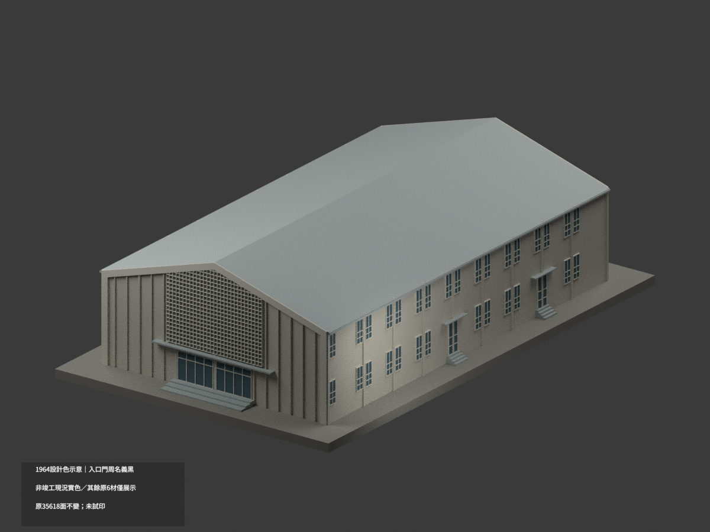
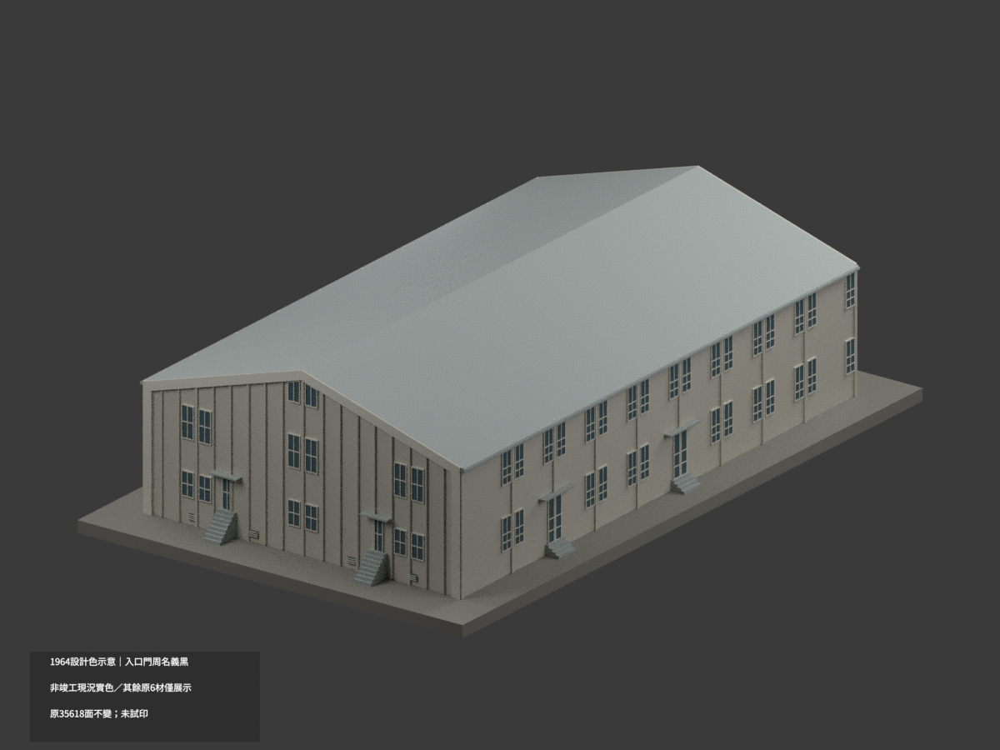
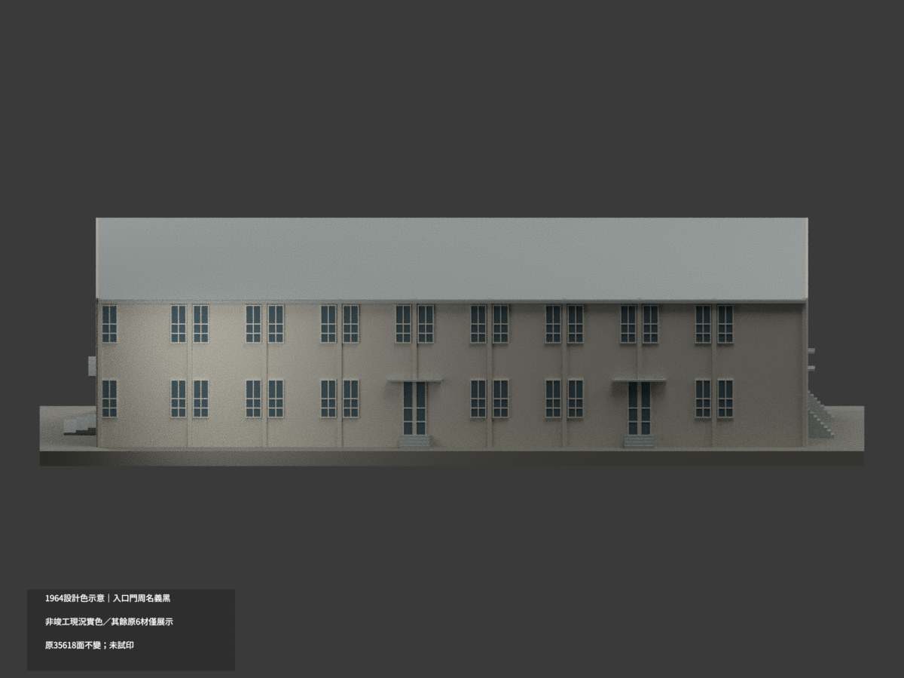
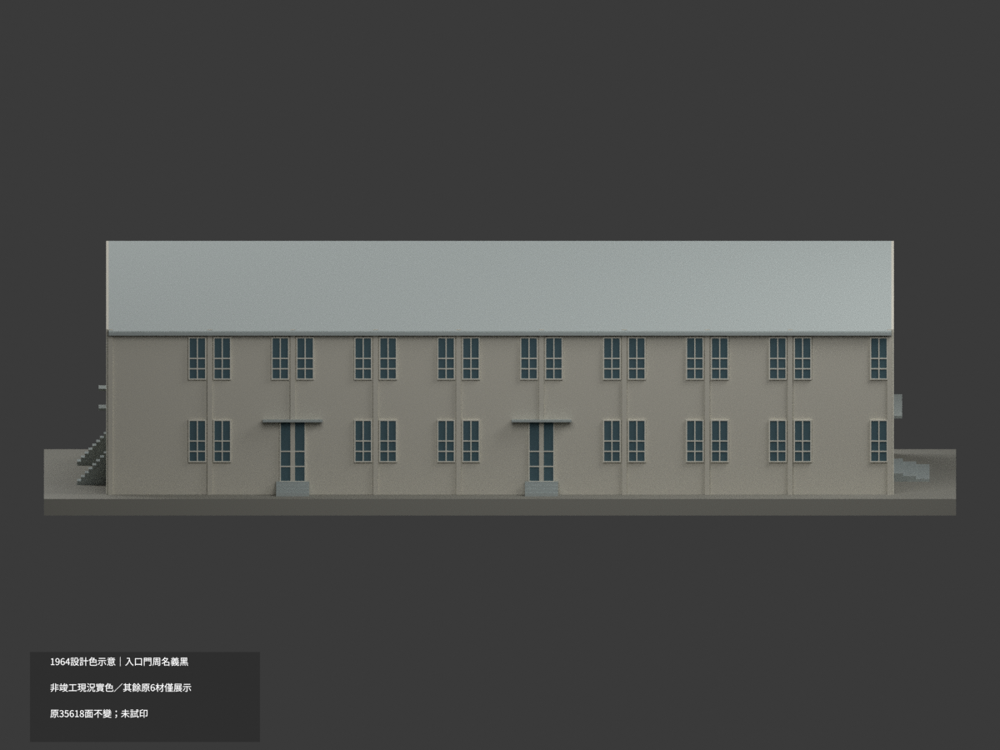
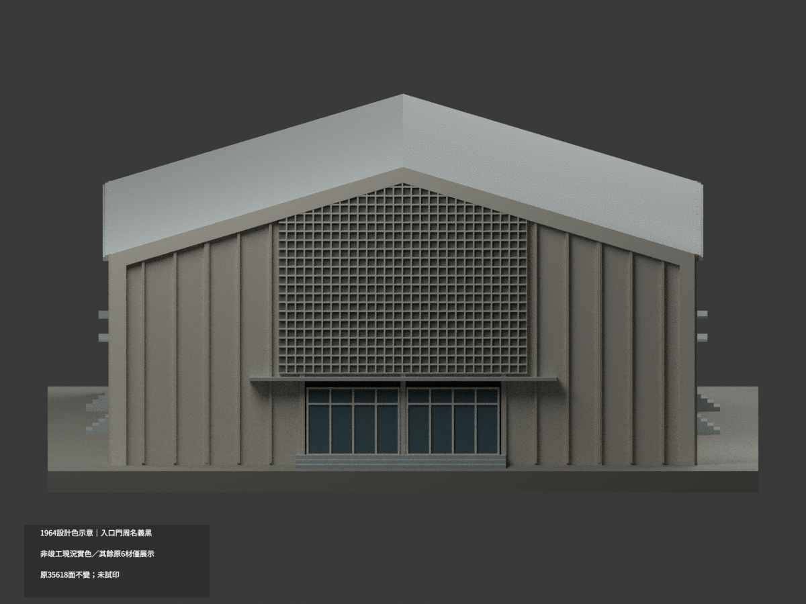
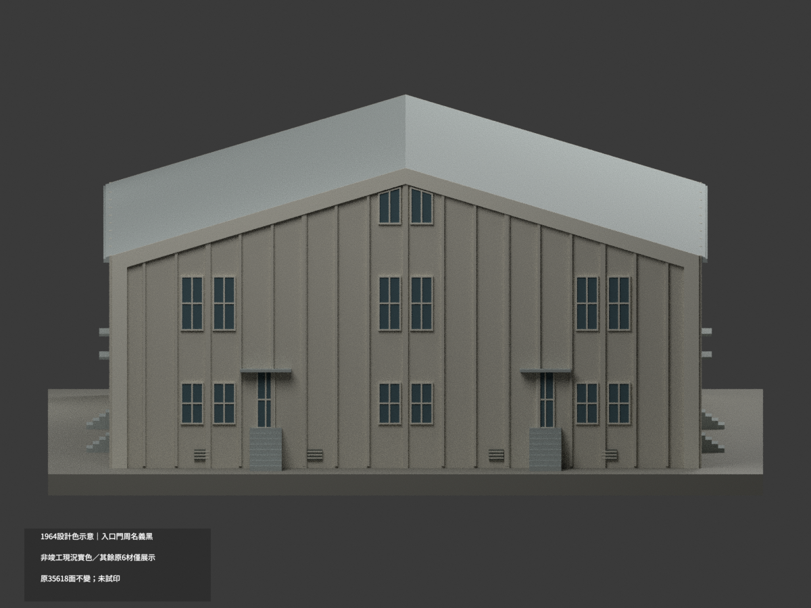
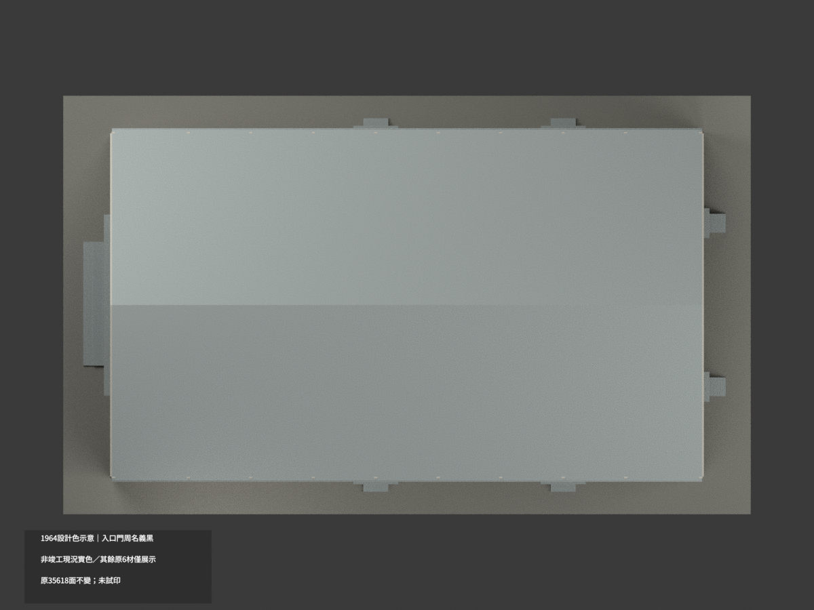
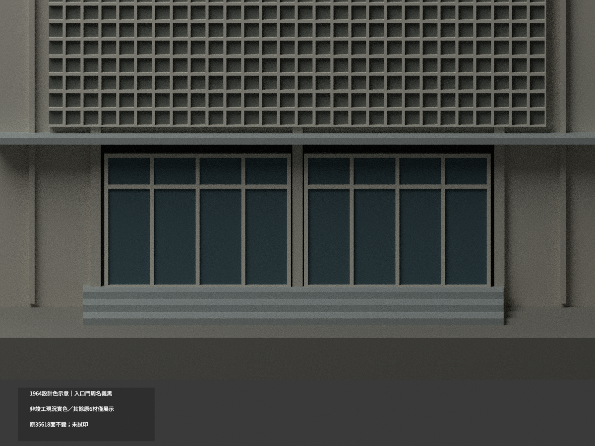
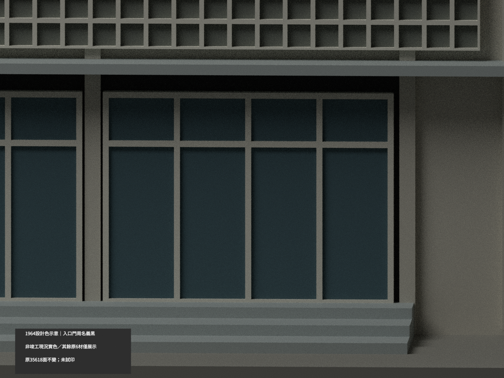
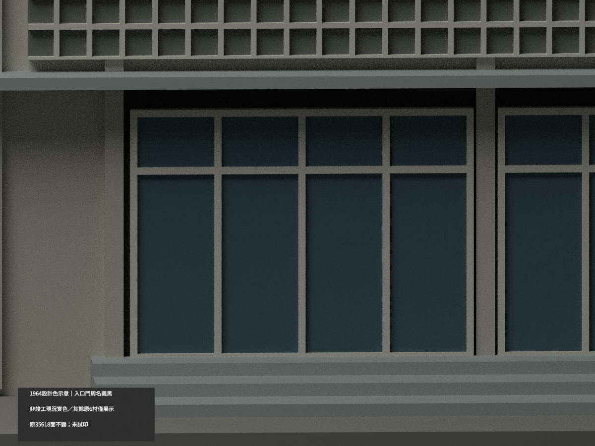

# 南投中學綜合禮堂｜1964 原設計入口門周名義黑

**1964 設計色示意，非竣工或現況實色。原 LOCAL_READY_PUBLICATION_HOLD 保留為歷史狀態；來源色域GO不解原身份或幾何QA限制，也不作新的發布授權判斷。** 僅兩完整入口門周20面採A5明寫黑色族 #333333；其他35598面保持原六材指派/RGB，仍是歷史展示示意，不是新增實景證據。partial_color_incomplete=true、fully_colored_exterior=false。原版非單色，未試印。

| 全館原設計 | 背側 | 長側 |
|---|---|---|
||||
||||
||||
||||

## 材色範圍與年代
同 nantou-school-hall-design-1964，35618原三角/原STL與原NPZ坐標及面次序不改，count_delta=0；只x−117.5平面88面中兩完整10面門周改新增mat6，其他68同平面未改。門柱/門背/階/棚體及棚上4.18..4.35帶不染；外側黑區與其他牆同域不可切面湊色。
A5門周引線明寫黑色與磨石子詞，中間工法字未清，不硬轉確切工法；圖面紅色鋪繪不是紅色材質。僅名義設計黑色族，非校準色票，不加顆粒/門圖案。
1964-04/工號5218/CCCK428，不是已證1965中正堂竣工版本；原身份關聯仍缺同形照片/紀錄，不混1989中正大樓、1990活動中心或2026現況。

## 全部原版與限制保留
原immutable32件在original-classification-version/完整逐byte保留，包括原六材scene/mesh/palette/model.3mf/七圖/QA；原README/scene另有ORIGINAL-SOURCE-GAP alias，render_model.py原bytes不變。更早local31件私有原封保留，當中LOCAL_READY_PUBLICATION_HOLD README公開ORIGINAL-LOCAL-README.md原bytes保留。既有出版修文差別不冒稱兩版本相同。
舊QA在original-classification-qa-aliases/只綁歷史子包；PUBLICATION-DOC-QA的更早sanitization前hash若不同，不改舊hash或追認原QA。新十圖與appearance.3mf是新增設計色variant。
原47×27.5m外包、GL0/1F+.50/2F4.35/3F7.93/檐10/脊14.12m控制維持；不可混以1F為0的datum。A11/A12門型15cm差與局部高程疑義保留，A5窗估讀±.10m不冒實測。花磚屏封背格網低浮雕代理、玻璃封背、框/山牆簡化與展示基座均不改；不追認全域壁厚、支撐或實體列印。
比例1:200/mm，含基座約275×167.5×75.6mm。原NPZ雙精度與STL float32串列化有既有微差；新NPZ原坐標與面完全不變，另按float32串列化精確比原STL，不重造替代STL。

## 來源與格式
[A5典藏](https://collections.culture.tw/docomomo_collectionsweb/Collection?GID=MCMAMZMHMD)，陳其寛／中國建築師事務所；臺博館CCCK428。原圖像CC BY-NC版本未確認，不保證商用或自動套repo授權；圖像/裁圖私人研究，不公開作貼圖。
[原STL](model.stl) · [新增逐面設計色3MF](appearance.3mf) · [新scene](scene.blend)。原無OBJ不新增。實物件 Nantou School Hall 1964 Design partial color；七材不是已測試四色切片。隔離原build及color重建只證本variant數位一致性，不替原工程身份/列印作背書。

## English scope
1964 DESIGN black only,not current/asbuilt.20 complete entrance surround faces from originalmat0 to appendedmat6;35598 original six illustrative assignments/RGB EXACT.35618 original triangles/count0/noOBJ.Original32 publishedfiles and earlier31localfiles retained separately;historical LOCAL_READY_PUBLICATION_HOLD not erased or interpreted as current permission.1965built hall identity unconfirmed;no1989/1990mix.Original15cm door/datum conflicts,±.10m estimates,backed screen and untested manufacturing limits retained.Only clear black family used,not uncertain finish-method transcription or red rendering ink.
