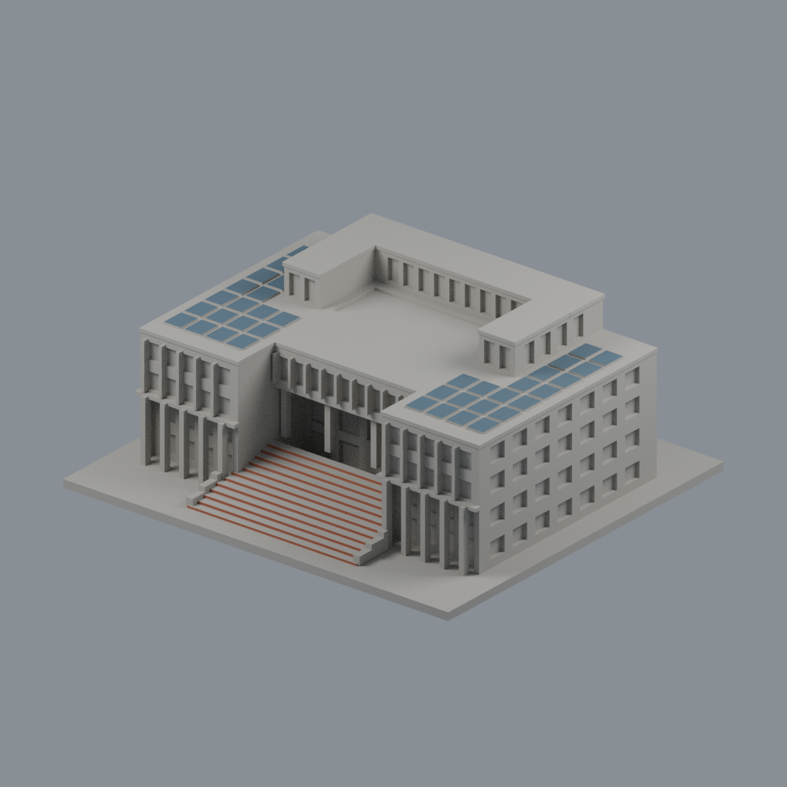
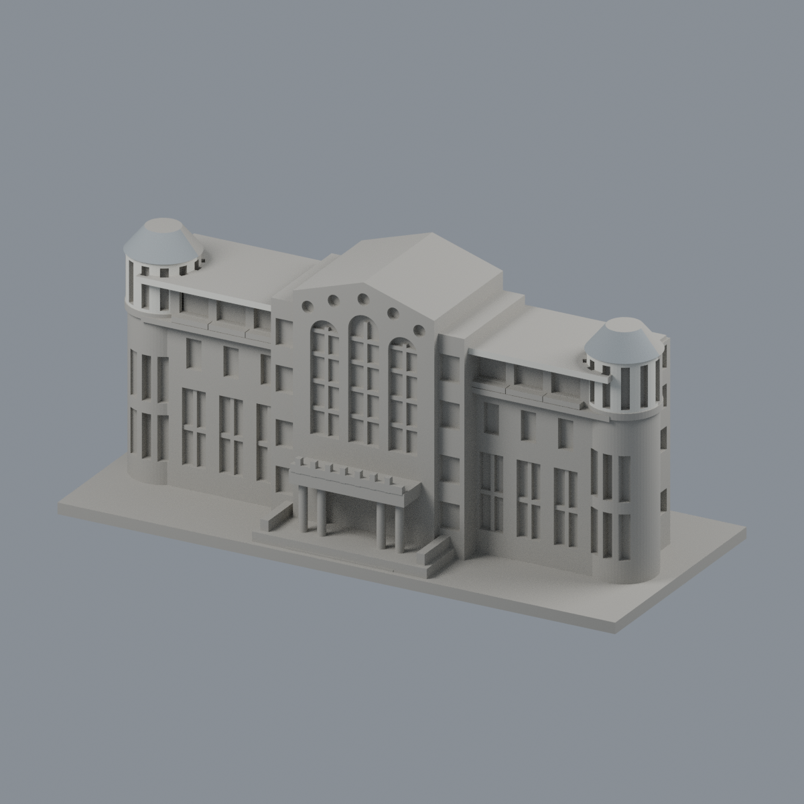
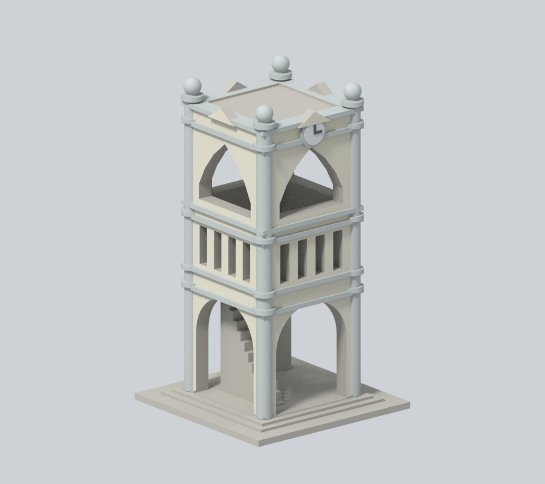
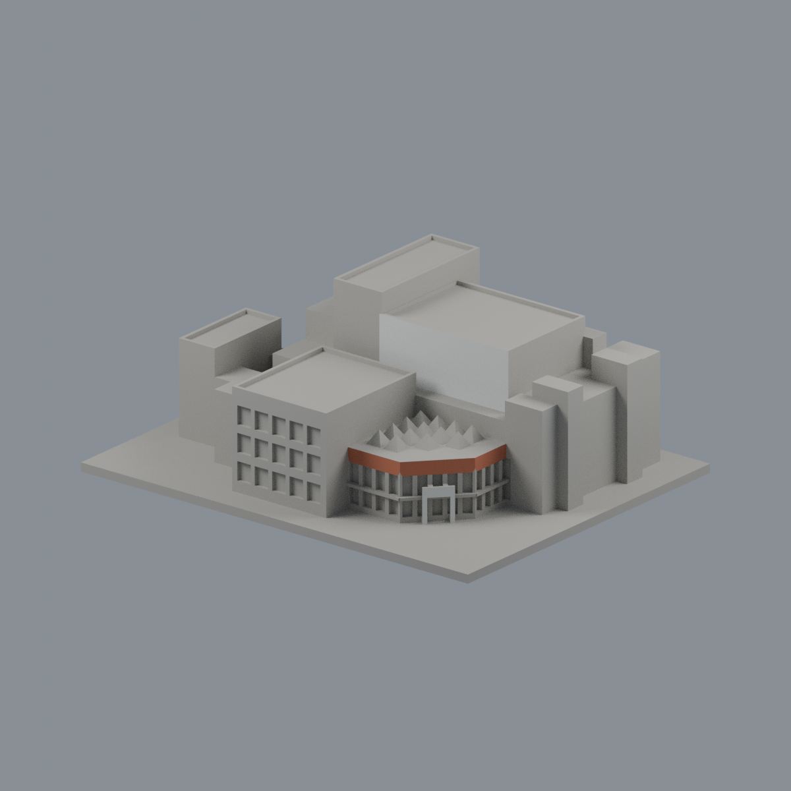
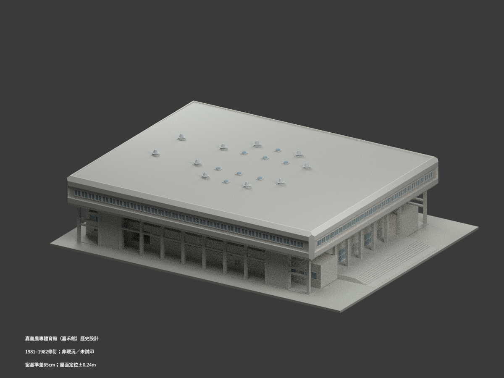

# 國立嘉義大學｜校園外觀3D列印模型

## 模型圖鑑

| 建築模型 | 建築模型 | 建築模型 |
| :---: | :---: | :---: |
|  **[行政中心（中正樓）](蘭潭校區/buildings/ncyu-lantan-administration/)** 全外殼近似；後立面簡化 |  **[圖書資訊館前棟段](蘭潭校區/buildings/ncyu-lantan-library-front-section/)** 僅前棟截段，不含完整後部 |  **[嘉農鐘樓](蘭潭校區/buildings/ncyu-jianong-clock-tower/)** 附屬地標構造物，非教學館 |
|  **[國立嘉義大學｜民雄校區大學館](民雄校區/buildings/ncyu-minxiong-university-hall/README.md)** |  **[嘉禾館｜1981–1982修訂歷史設計](蘭潭校區/buildings/ncyu-lantan-jiahe-gymnasium-historical-design/README.md)** [STL](蘭潭校區/buildings/ncyu-lantan-jiahe-gymnasium-historical-design/model.stl) · [彩色3MF](蘭潭校區/buildings/ncyu-lantan-jiahe-gymnasium-historical-design/model.3mf) · [Blender](蘭潭校區/buildings/ncyu-lantan-jiahe-gymnasium-historical-design/scene.blend) |  |

目前提供5件：嘉禾館1981–1982修訂歷史外觀，以及既有4件：行政中心外觀近似、圖書資訊館前棟截段、嘉農鐘樓附屬地標，以及民雄校區大學館外殼近似。這不是全校完成，也不是精密測繪；既有4件含底座最長150mm；新增嘉禾館1:250、278×214.4mm占地，比例各自獨立。

每個資料夾包含STL、參數重建來源、可編輯Blend、actual STL正背／頂視圖、來源URL及數位驗證。原照片／PDF不隨包散布。

## 範圍

[蘭潭校區](蘭潭校區/)已有4件，[民雄校區](民雄校區/)已有1件。兩校區其他建物、新民與林森校區，以及校外宿舍、農林場域，仍須持續逐棟查核、建模與驗證。

[範圍清單](coverage.json)記錄的是校圖條目、用途及場域，不是建築總棟數。已把未研究、找到部分實拍、局部建模、群場域待拆分、歷史拆除與未建成分開；「未研究」不表示公開資料不足。

[續接說明](SOURCE-CONTINUATION.md)列出別名、棟界陷阱、新建拆除和下一步。

## 使用前

STL單位mm，底座朝下。柱廊、挑簷等須自行在切片器檢查支撐。原STL拓樸、重建與Blend一致性、0.2mm轮廓和0.8mm参考寬度輔助篩檢是數位QA，不等於Cura／Prusa工具路徑或實體試印，不保證可印／免支撐。

## 嘉禾館歷史設計研究

陳其寬建築師事務所嘉義農專體育館（嘉禾館）1981–1982修訂歷史外觀，採CCCK226整組，不建舊CCCK238已取消高背梯，保留低丙梯與開放外廊；不是A08瑞穗館或民雄大學館，非今日現況、測繪或已證實竣工版本。W2採空間剖窗底10.67／頂11.97m，窗表FL基準尚未協調，最大65cm解讀差明記。屋面高線14.53m為協調約定，1/100向兩側下降，整體±0.24m不確定，局部階梯圖量、隱蔽室內機電不重建。1:250含底座278×214.4mm，名義細框0.4mm，未試印且須核印床。原圖私人保存，不作商用權利保證。
