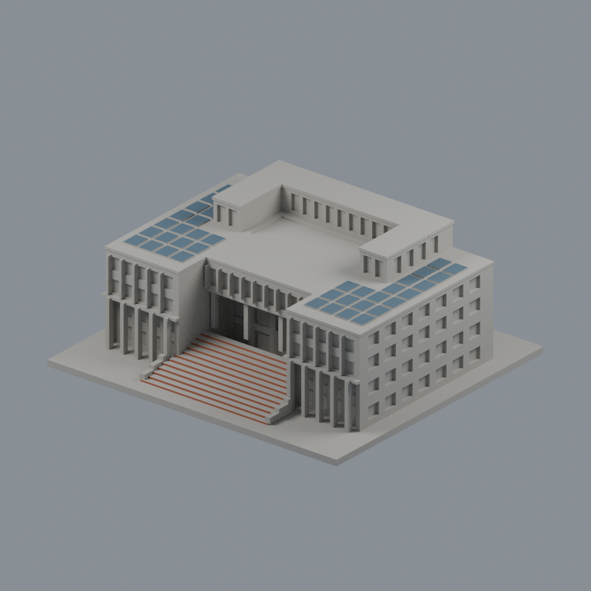
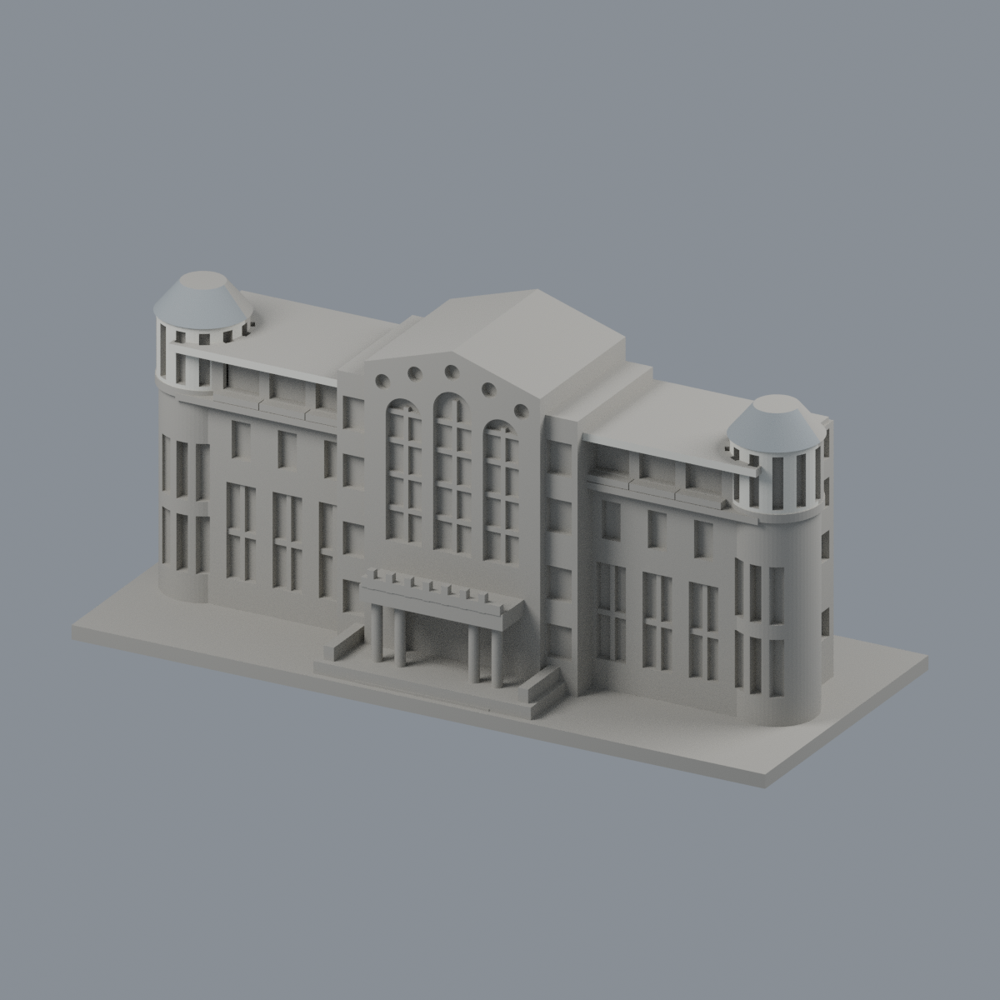
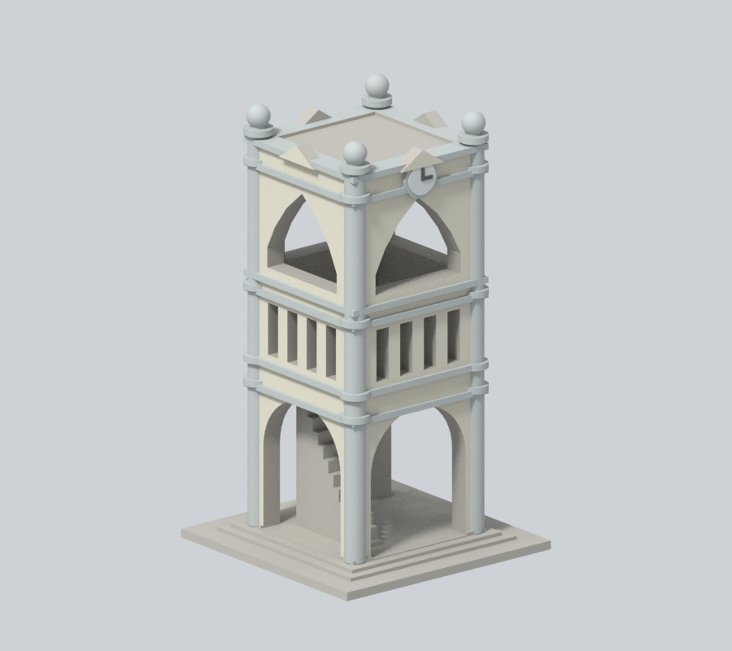
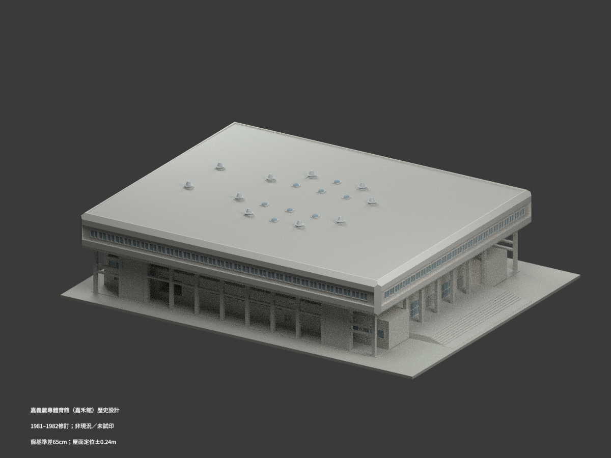

# 國立嘉義大學｜蘭潭校區

## 模型圖鑑

| 模型預覽 | 模型預覽 | 模型預覽 |
| :---: | :---: | :---: |
| A01 行政中心（中正樓）  | A31 圖書資訊館前棟段  | 嘉農鐘樓  |
|  **[嘉禾館｜1981–1982修訂歷史設計](buildings/ncyu-lantan-jiahe-gymnasium-historical-design/README.md)** [STL](buildings/ncyu-lantan-jiahe-gymnasium-historical-design/model.stl) · [彩色3MF](buildings/ncyu-lantan-jiahe-gymnasium-historical-design/model.3mf) · [Blender](buildings/ncyu-lantan-jiahe-gymnasium-historical-design/scene.blend) |  |  |

這是分批外觀建模，未完成全校區。官方校圖代碼按用途或场域整理，不能直接當實際棟數。

- [A01 行政中心（中正樓）](buildings/ncyu-lantan-administration/)：全外殼近似，保留前庭階梯、柱廊與後部高U屋頂凹庭；後立面簡化。 [光電頂面限域配色／五視角](buildings/ncyu-lantan-administration/appearance/README.md)（原40群組80頂面，不是實景板片數）。
- [A31 圖書資訊館前棟段](buildings/ncyu-lantan-library-front-section/)：前立面與近側轉角截段；圖書館與電算中心同館，不重算。 [雙端上圓筒與錐頂前半限域配色／五視角](buildings/ncyu-lantan-library-front-section/appearance/README.md)（其餘中性，非完整館舍）。

- [嘉農鐘樓](buildings/ncyu-jianong-clock-tower/)：附屬地標構造物，不是教學館；拱口與欄孔貫通。

既有3件含底座最長150mm、獨立縮尺；新增嘉禾館1:250、278×214.4mm占地，須核印床。來源、列印注意與驗證請讀各件README。[回學校圖鑑](../README.md)

## 嘉禾館歷史設計研究

陳其寬建築師事務所嘉義農專體育館（嘉禾館）1981–1982修訂歷史外觀，採CCCK226整組，不建舊CCCK238已取消高背梯，保留低丙梯與開放外廊；不是A08瑞穗館或民雄大學館，非今日現況、測繪或已證實竣工版本。W2採空間剖窗底10.67／頂11.97m，窗表FL基準尚未協調，最大65cm解讀差明記。屋面高線14.53m為協調約定，1/100向兩側下降，整體±0.24m不確定，局部階梯圖量、隱蔽室內機電不重建。1:250含底座278×214.4mm，名義細框0.4mm，未試印且須核印床。原圖私人保存，不作商用權利保證。
