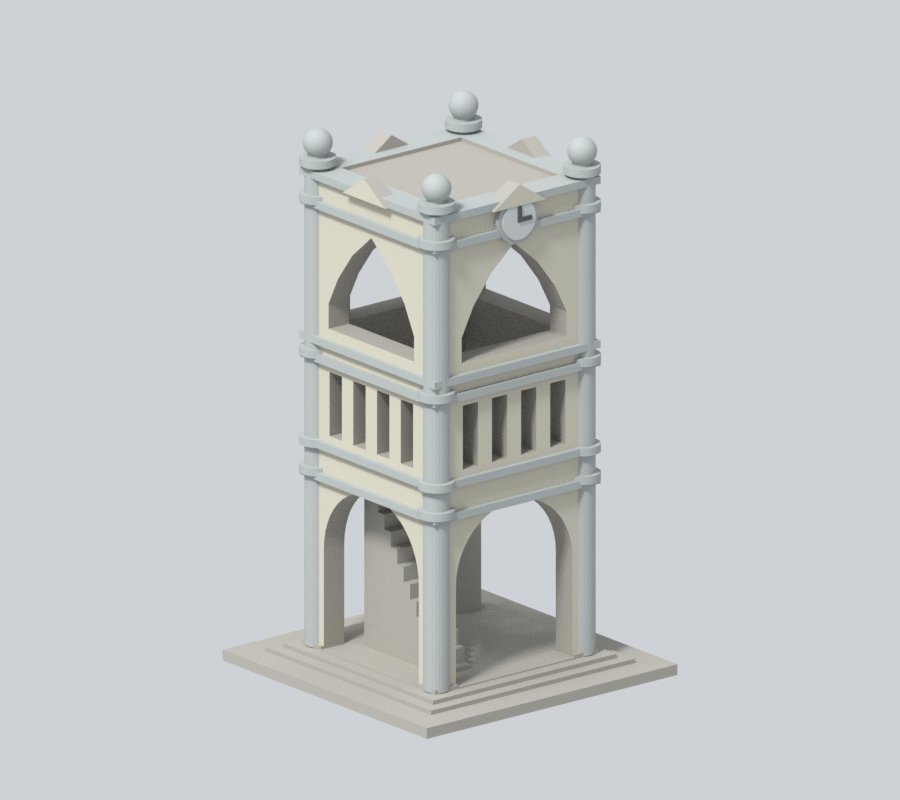
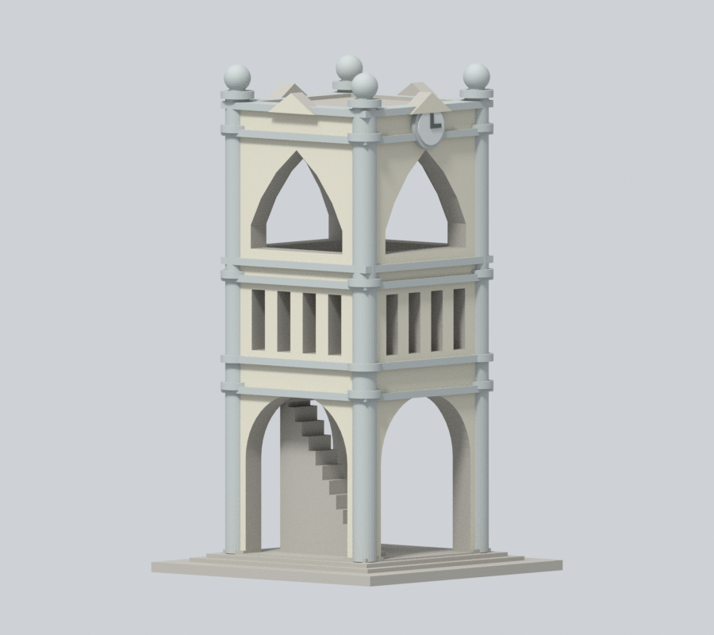
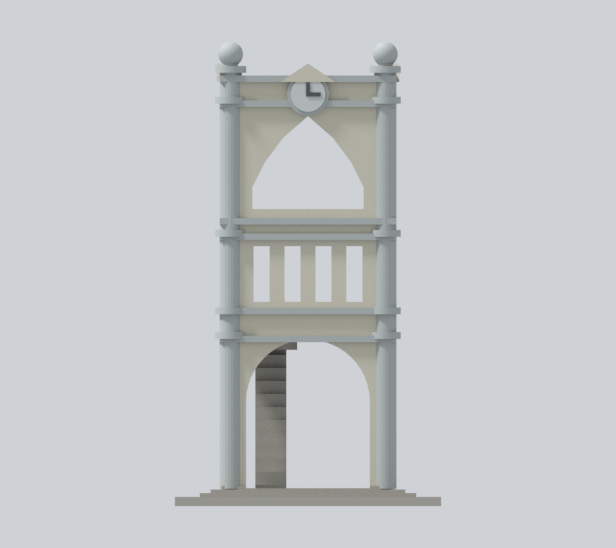
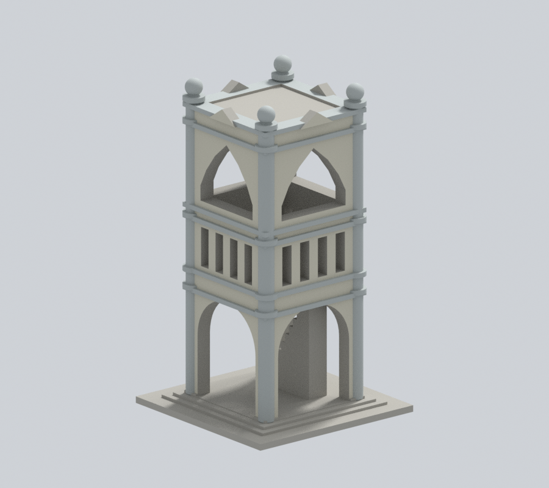
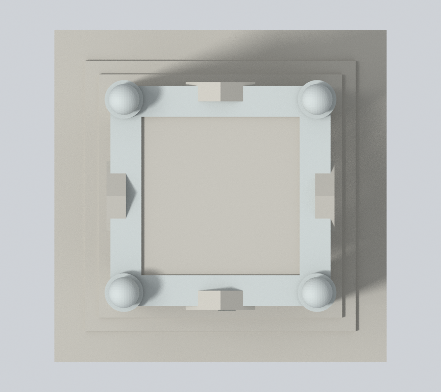

# 國立嘉義大學｜蘭潭校區嘉農鐘樓

## 模型預覽

| 新彩色正斜視 | 新彩色來源角度 | 新彩色立面 |
| :---: | :---: | :---: |
|  |  |  |
| 新彩色背向 | 新彩色上視 | 彩色下載 |
|  |  | [彩色3MF](appearance.3mf) · [Blender](appearance.blend) |

這是校園附屬地標構造物的外觀近似模型，不是教學館，不增加教學館完成棟數。依官方斜角實拍自建幾何；四方塔身由可見相鄰兩面推估，其餘面保留簡化。

### 側背原面同族材料延伸（原五張預覽保留）

保留全部原彩面及材質值，只補 7,084 個原中性三角面。依官方相鄰兩面照片，將暖灰米外板、銀灰角柱／線腳／球飾同族材料合理延伸至完整原側背構件；背面屬同棟延續推估，不冒稱新背照或現況測繪。1,216 個內梯、開口內部、屋頂／山牆厚度與底座等面保留中性。拱口／欄孔仍通透，無新窗、文字、月桂或裝飾，原鐘針不動。

[新讀照片日期與材料限制](APPEARANCE.md)。本輪JPEG EXIF記錄2017-12-13 10:39:01（無時區），不以2023網頁發佈日當攝影日。原幾何、STL、scene、五張原圖與列印限制保留，沒有實體試印。

## 已見與未知
- 保留底層拱口、中段欄孔、上段尖拱、角柱與球飾。拱口和欄孔真正貫通，沒有以凹刻取代主要挑空。
- 照片可見內梯，縮尺為加厚實體階梯並接到底座／塔身；非完整室內階梯測繪。
- 背面銘文未有清楚實拍，省略而不臆造；鐘盤與指針僅示意，不代表拍攝時間。頂面細節、背部与精確高度未知，屬外觀推估。
- 細天線、文字與鐘機省略。角球／柱飾加粗以適合縮尺，但仍可能脆弱。
- 秘書室與英文校景頁使用同幅鐘樓照片，不當作兩個独立角度；原研究當時未提供拍攝日期；本版確認原JPEG的EXIF記錄2017-12-13，與頁面2023發佈日分開。[來源與支持特徵](sources.json)。
- 原照片及PDF僅用於私人核對、不隨包散布；未擷取現成3D mesh。

## 尺寸與列印注意
- 單位mm，含底座86 × 86 × 150mm；與其他模型比例不同。
- 底座朝下。拱頂、欄孔、內梯及裝飾可能需要支撐；請先切片檢查，留意移除支撐時不要扭斷角球與細柱。
- 數位QA不等於Cura／Prusa等實際工具路徑，也未實體試印；不能保證可印或免支撐。

## 交付與驗證
[model.stl](model.stl)、[scene.blend](scene.blend)、[build_model.py](build_model.py)、[requirements.txt](requirements.txt)。Blend由交付STL匯入可編輯網格，參數腳本是幾何重建來源。

actual STL預覽：[正面](appearance/front.png)、[背面](appearance/rear.png)、[正立面](appearance/elevation.png)、[頂視](appearance/top.png)。

Python3.12安裝requirements.txt後，依序執行build_model.py、Blender背景執行render_preview.py、validate_model.py、check_contour_validity.py、check_thin_features.py。每個命令需exit0且JSON checks全true，失敗立即停止，不用repair掩蓋原STL問題。

- [validation.json](validation.json)：原法向／繞序、每邊兩面、頂點環、單一連通殼、150mm、獨立重建SHA、Blend幾何比對。
- [contour-validity-check.json](contour-validity-check.json)：z=0.071mm起、每0.2mm，共750層；degree2閉合與各別／組合Polygon有效。
- [thin-feature-check.json](thin-feature-check.json)：canonical共同邊插值、每1mm抽層0.8mm opening輔助檢查；不是全面最小壁厚分析。
- [SHA256SUMS.txt](SHA256SUMS.txt)：逐檔SHA256。

2026-10-13外觀覆核通過。獨立幾何與發佈檢查另見總清單。本件不代表學校或校區建築已全部完成。

## 本版材料核對

[新版左側](appearance/left.png) · [新版右側](appearance/right.png) · [原版同相機正斜視](appearance-review-v2/original-front.png) · [原版同相機背向](appearance-review-v2/original-rear.png)。

[逐點逐面與材料](appearance-review-v2/model-verification.json) · [完整面域分類](appearance-review-v2/boundary-continuity-audit.json) · [來源判讀](appearance-review-v2/source-register.json) · [九張渲染審閱](appearance-review-v2/color-continuity-review.json) · [乾淨重建](appearance-review-v2/clean-rebuild-equality.json)。

原appearance-review保留為前版歷史，現版由appearance-review-v2與appearance-freeze.json綁定。原幾何QA及未試印限制未變，校級校驗碼待授權發布時合併。
