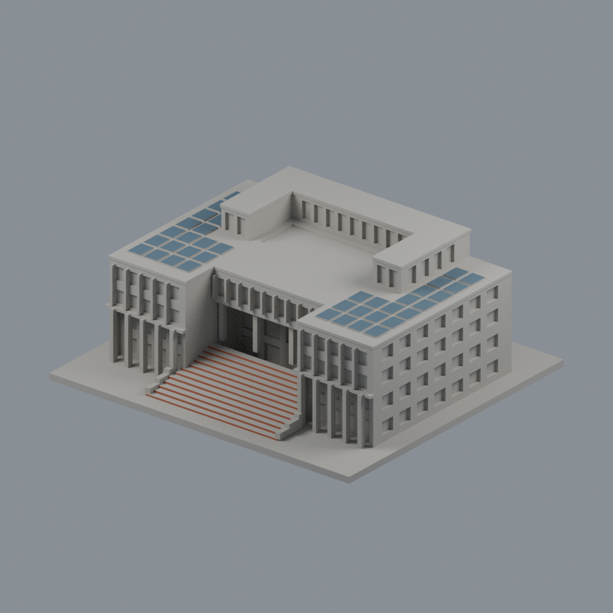
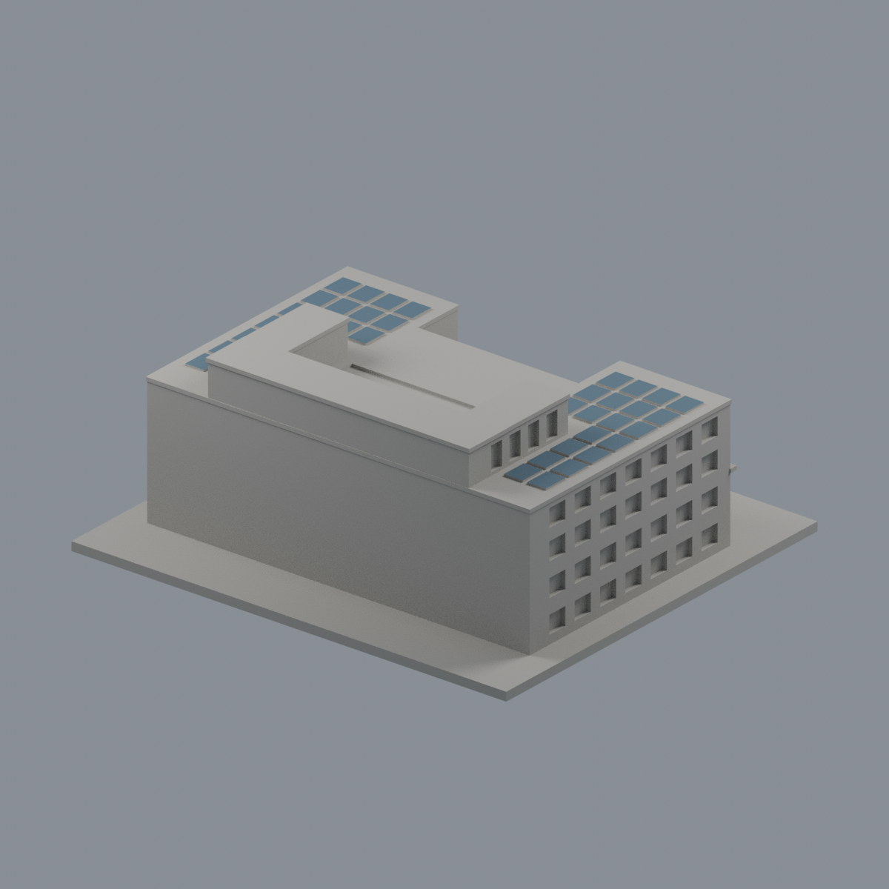
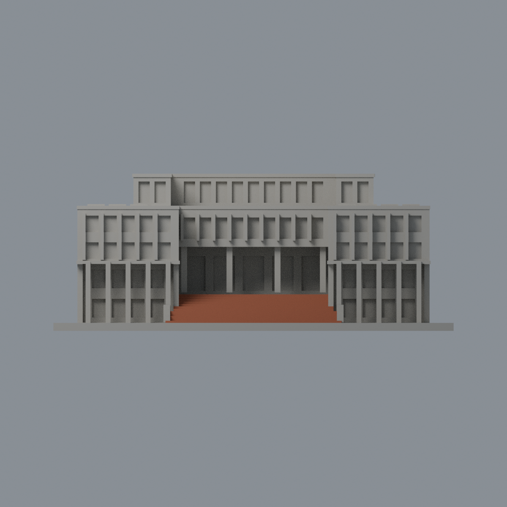
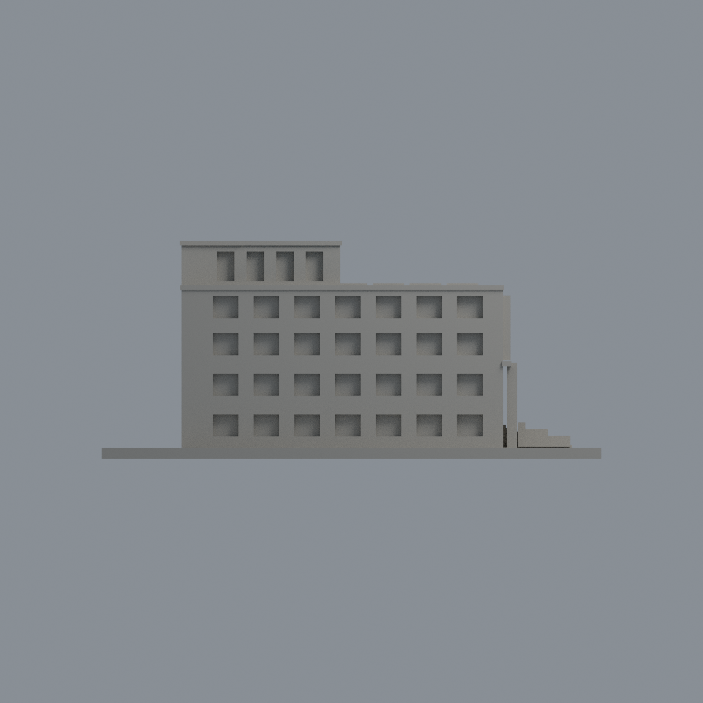
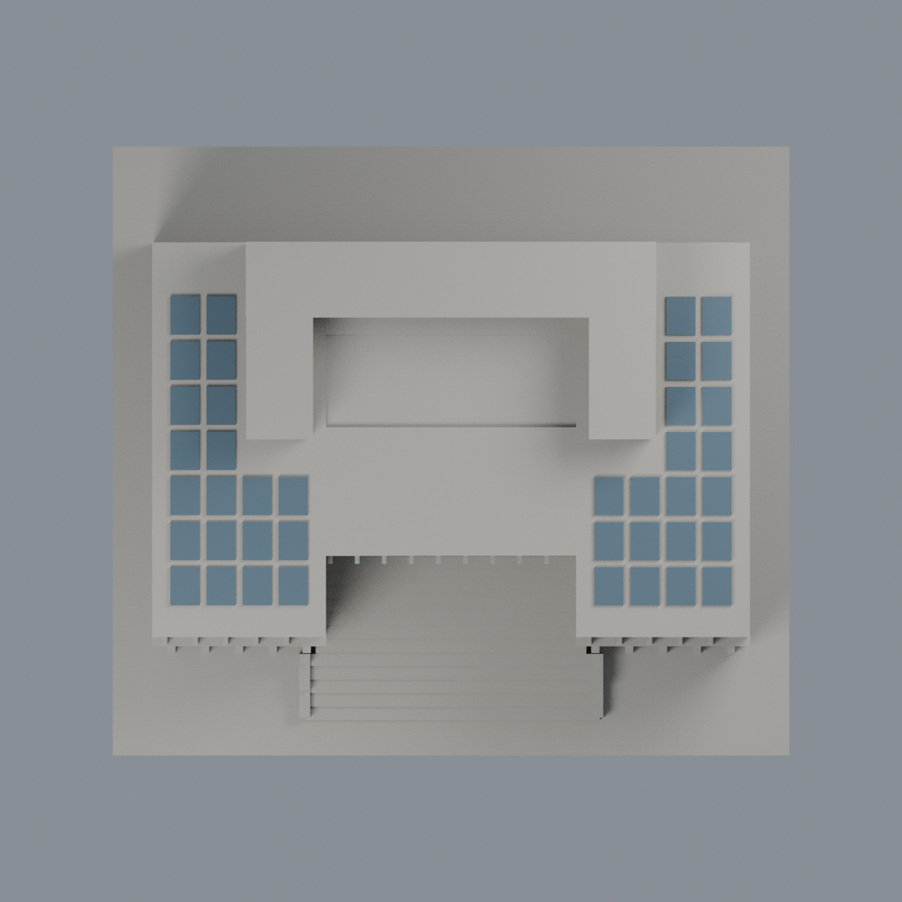

# 嘉義大學蘭潭行政中心（中正樓）｜原面光電頂面限域配色

2026-10-22研究；原模型外觀近似與幾何不變。此為原模型追加appearance，不新增模型套數，不是2026屋頂現況測繪。

## 配色範圍
只將原左右低翼40個粗化凸片的80個完整頂面賦予低飽和藍灰代理色 `#536A79`，合2210 mm²、頂面z=47.5 mm。40是原模型粗化板陣群組，不是實景光電片數、行列或尺寸測量。銀框、電池格線與支架沒有重建，不得宣稱逐片復刻。

以每片所有三頂點確認有限平面，未切面或增面。板薄側面、板間空隙、白色屋頂、中央露臺、高U屋頂、玻璃、立面、階梯及底座全部使用中性代理色 `#AAA79F`；中性色不是實景材質結論。僅一張前斜高空拍支持屋頂配色，未外推背面證據。

原STL共4248三角（4168中性、80光電），bytes、三角面序及座標不變。原生scene只有單一Warm stone preview only材質且全index0；此判定並非只因STL無色。原高差、進深、窗寬與細節由照片估計、後立面不明、屋頂凹庭非通天庭、各件獨立縮尺等限制保留。原有列印歷史QA不重寫；未做切片工具路徑或實體試印，不能保證可印／免支撐。

## 交付
- [彩色3MF](ncyu-lantan-administration-appearance.3mf)（毫米，逐面材質）、[可編輯Blend](scene.blend)
- [配色表](palette.json)、[原面對照](face-materials.json)
- [正面](previews/front.png)、[背面](previews/rear.png)、[正立面](previews/elevation.png)、[側面](previews/side.png)、[頂面](previews/top.png)：實際交付網格渲染，包含全底座。
- [來源及日期](SOURCES.md)、[權利說明](LICENSE-NOTICE.md)、[重建來源包](rebuild-source.zip)、[SHA256SUMS](SHA256SUMS)

| 模型預覽 | 模型預覽 | 模型預覽 |
| :---: | :---: | :---: |
| 正面  | 背面  | 正立面  |
| 側面  | 頂面  |  |

## 重建與驗證
重建包包含原model.stl及appearance/source。Python 3 + numpy + lib3mf；Blender 4.3.2+：依序執行 `python appearance/source/build_appearance.py`、`python appearance/source/verify_material_boundaries.py`、`python appearance/source/verify_exchange.py`、`blender -b -t 4 -P appearance/source/render_appearance.py`、`blender -b -t 4 -P appearance/source/verify_scene.py`。

3MF strict reader、真材質編輯存檔重開及Blend材質編輯存讀均獨立驗證；lib3mf另存時容許<0.0001 mm十進位誤差，交付3MF與原STL座標逐面精確一致。乾淨目錄重建3MF/maps/palette/五PNG需byte一致；Blend以幾何、材質及語義核對，不宣稱二進位重現。渲染是中性棚燈下的未校準sRGB代理，不是色卡測色。

## 2026-11-13 有限外觀修正｜模型交付版
僅12個原完整前立矩形24面0→新2紅褐背景#A65F45/.88；4248面幾何/面序不變，其餘4224indices及原2材不變。現4144中性/80光電/24階立面。原step box全三角支持；不踏面/細淺鼻緣/側裙/白矮牆/平台/底座。原12級連續代理與實照多級、多段平台不是逐階對位，原寬深及側截端保持，不增幾何，不認證精確磚種/色值。
模型與原生視角圖沿用完成候選的原bytes；不改幾何、不增加分界、不稱全棟精確配色或實體試印通過。公開預覽只含模型，不含新增圖片文字。原來源年代、工程及列印限制仍適用。先前敘述與審核屬其原版本，本段僅更新上述局部範圍。
本次只交付模型、必要重建輸入/腳本、預覽與此說明；完整研究與獨立審核紀錄另行保留，不在本批公開。PUBLIC-MODEL-SHA256SUMS只核本次所列公開產品，舊校驗與QA不代表本次新版。
