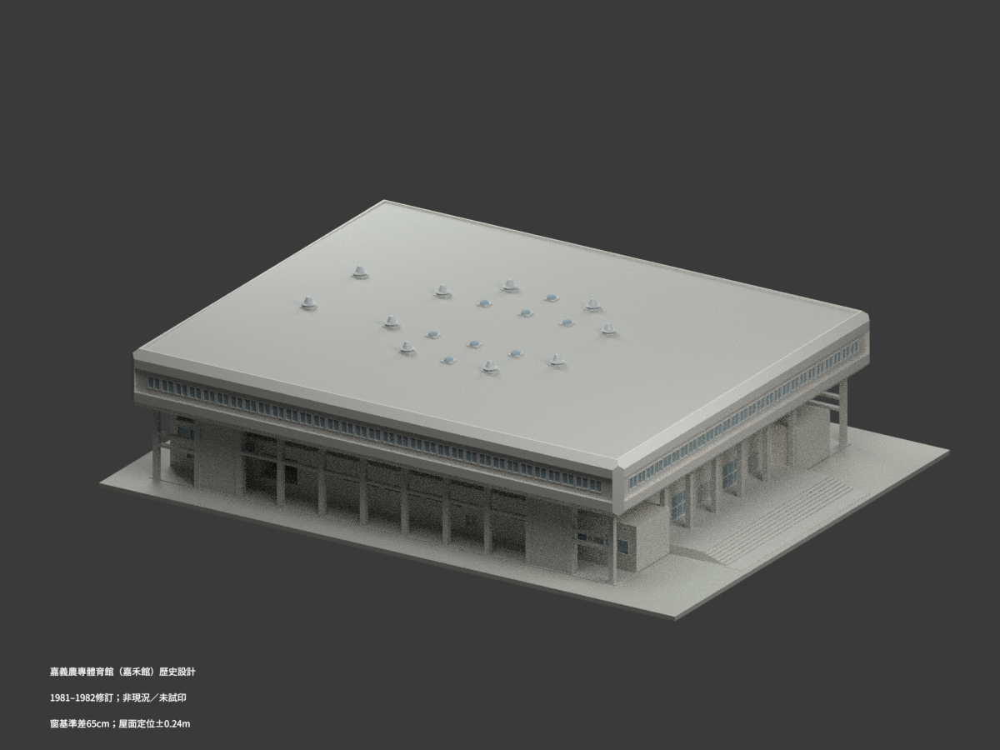
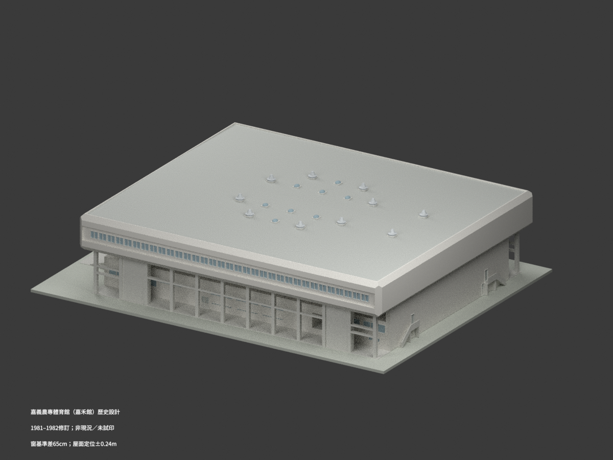
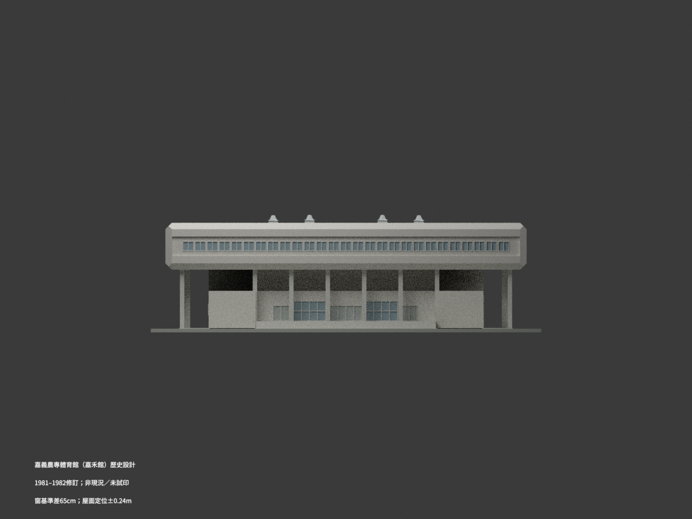
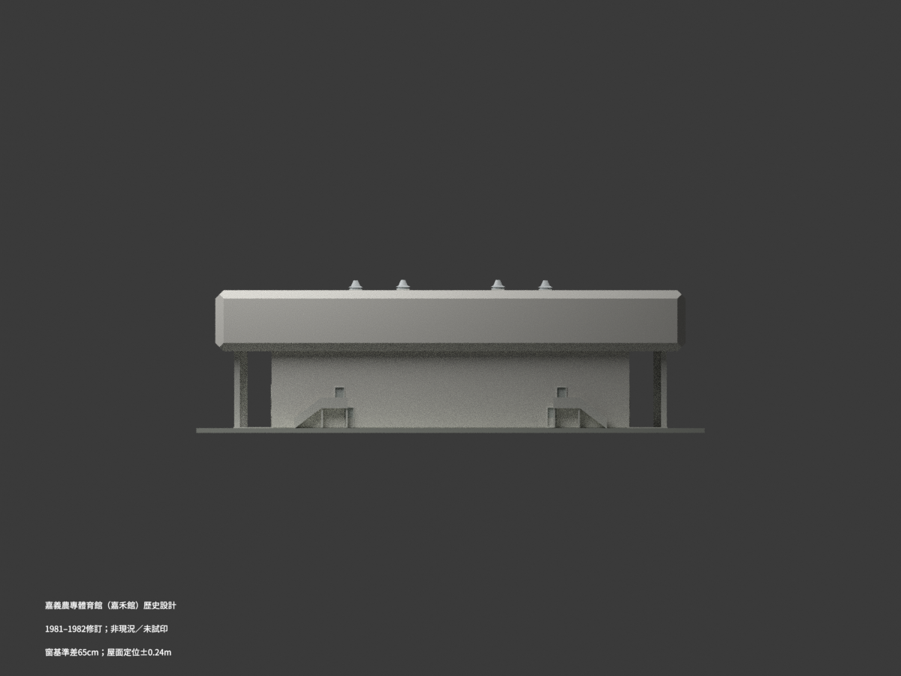
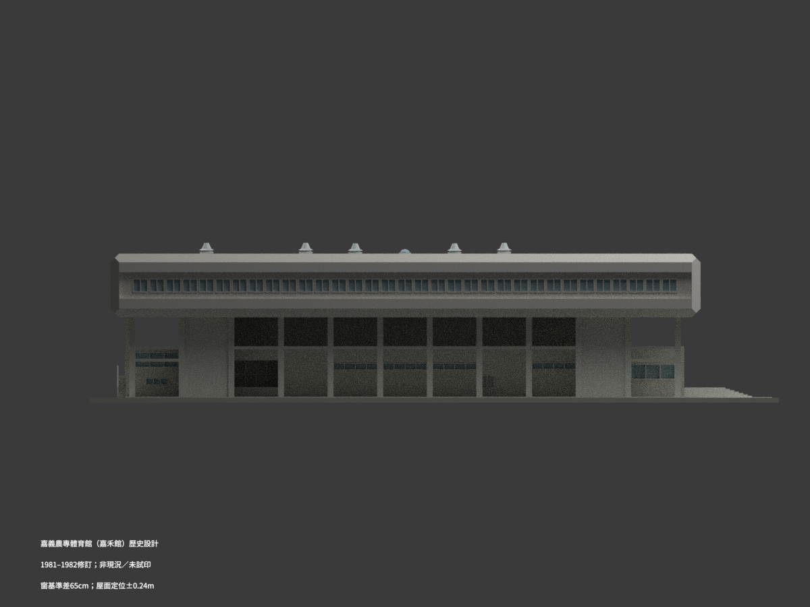
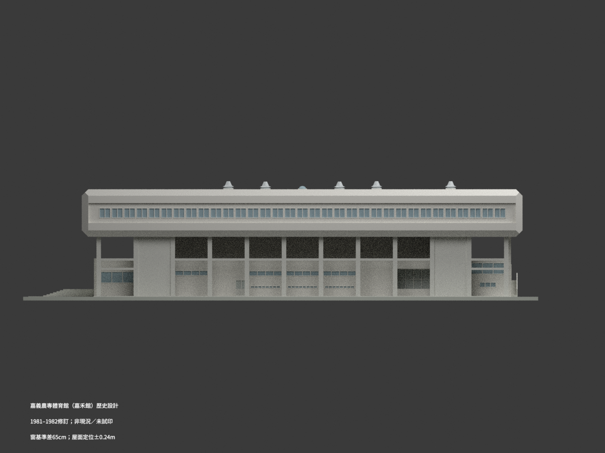
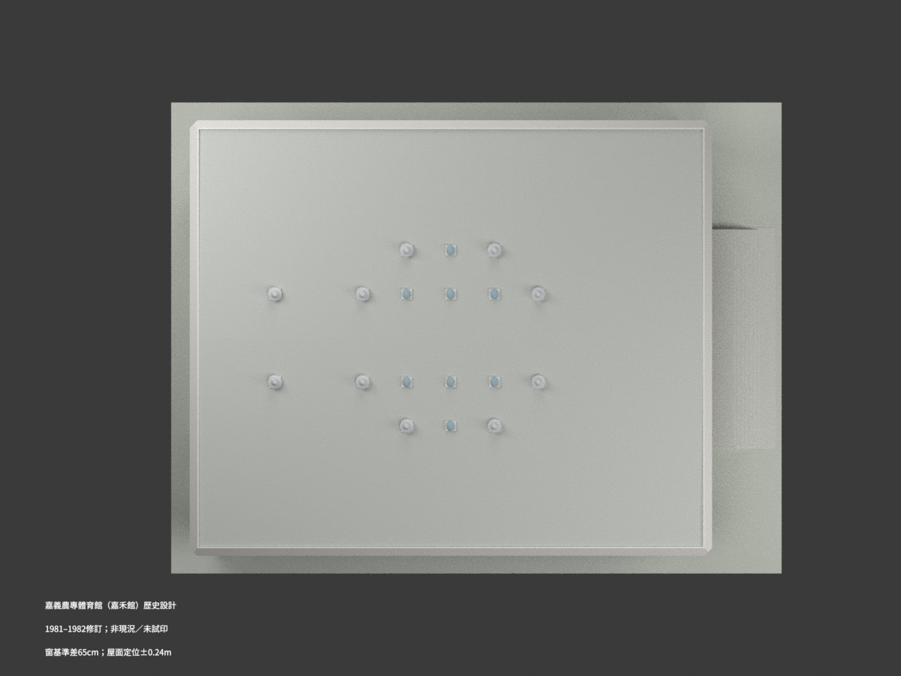
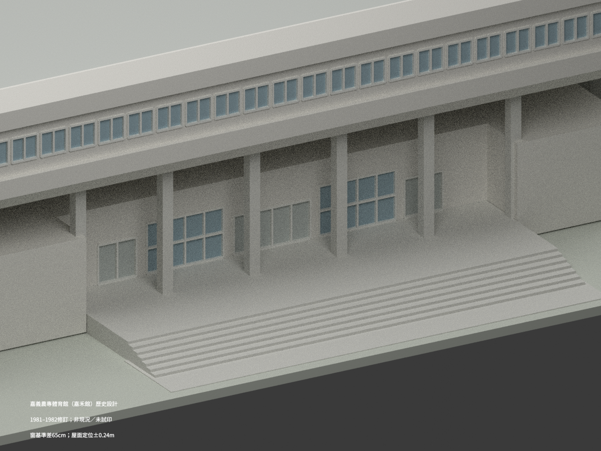
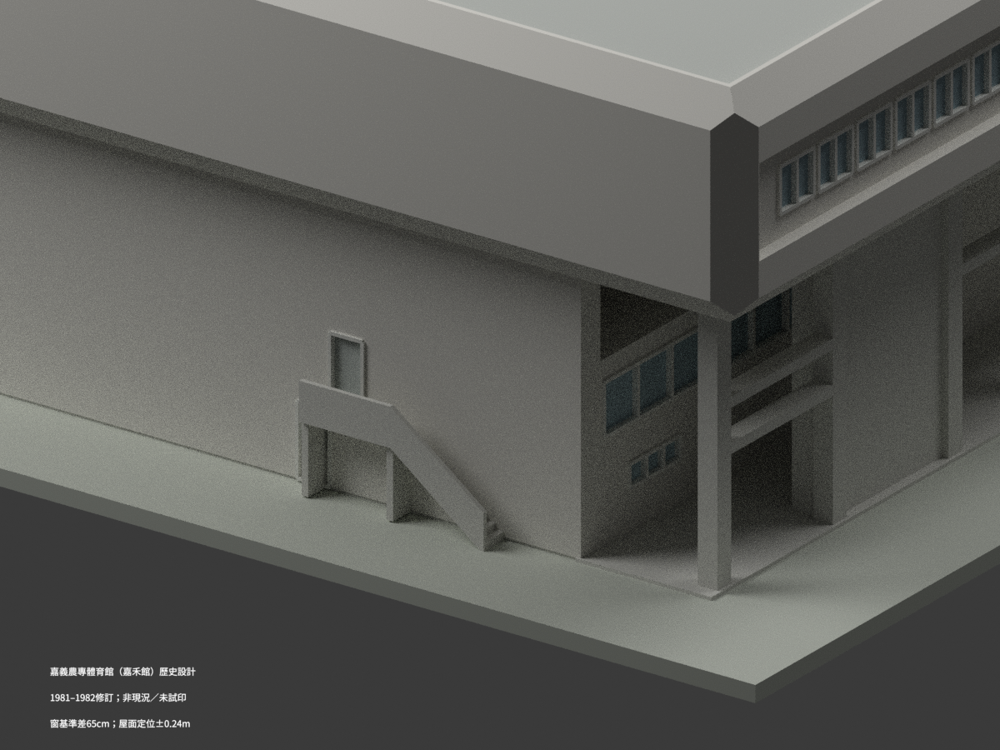
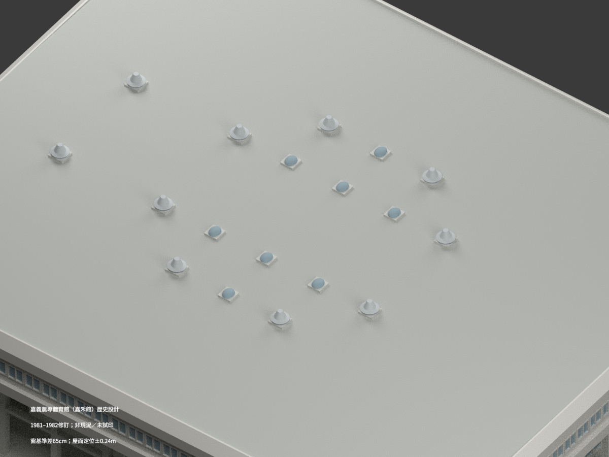

# 嘉義農專體育館（嘉禾館，1981–1982歷史設計圖示）

## 模型與十個實際渲染視圖

**本件採 CCCK226 修訂圖組重建歷史外觀，非今日現況、測繪成果或已證實竣工版本。**
不建舊 CCCK238 已取消的高背梯，不重建隱蔽室內機電；保留新版低丙梯與開放外廊。
**窗表與空間剖面有最大 65cm 基準解讀差；屋面絕對定位約 ±0.24m 不確定。薄件與成品均未實際列印。**

| 視圖 | 視圖 | 視圖 |
|---|---|---|
| <br>總覽 | <br>後側總覽 | <br>正面 |
| <br>背面 | <br>側面 A | <br>側面 B |
| <br>屋頂 | <br>前入口細節 | <br>後低梯細節 |
| <br>採光罩與風機 |  |  |

## 圖面版本與外觀範圍

- 名稱與設計者：嘉義農專體育館新建工程，陳其寬建築師事務所／C.K. Chen & Associates。現今嘉禾館的身份以校方照片及圖面形貌交叉辨識；不把現代改裝回填歷史模型。
- 1981–1982 指有日期的設計及修訂範圍，不是落成日期。外部資料所述1981／約1984落成尚未核定，不在本包斷言。
- 採 CCCK226 A5/A6/A8/A9 整組修訂平立面，包括下層門窗與入口。A5 丁梯移內、A6 後高梯不再存在、A8 擦改及 A15 修訂互相支持；CCCK238 舊高背梯只作比較，不混造第二方案。
- A10a（71.2）及 A15（71.3）控制新版入口／低丙梯。A27（70.5.20，71.8 鋼件修訂）採輕質屋面，不混用 A7 舊12cm RC屋面註記。
- 238 E5（69.11.6＝1980）僅取與 A7/A27 孔座及十台配置相合的外部風機形體，不採設備內部或機電配置。
- 地下室、室內完整看台／樓梯、球場設施、基地地形與後來增設設備不在範圍。顯示底座不是實測場地。

## 主要控制與必要限制

| 項目 | 控制／處理 |
|---|---|
| 軸網 | 長55m，深45m；不是全棟外接框 |
| 上部牆參考域 | 59.48×49.58m；長向偏移2.19/2.29m，不默改對稱。模型以此牆參考線作名義表面定位，未逐處外推薄飾面；約±0.10m局部表面解讀允差，非精測外框 |
| 標高 | GL0、1FL1.08、2FL3.78、屋面名義RF14.53m |
| 屋面坡度 | A7分水線向兩側1/100；**採高線14.53定位是建模協調，不是直接測得的高點EL**。整坡絕對位置約±0.24m解讀不確定，未把A27材料再疊高 |
| 上窗 W2 | 1.46×1.30m；A10/A11直接空間剖面優先，底10.67／頂11.97m。A20泛FL窗台169cm與走道9.63m未協調，若直接相加會差65cm；不平均、不宣稱精確原貌 |
| 外觀非鏡射 | 三面上窗、背面上部無窗；I側低通風帶與B側不同；外廊／側門凹入口保留空間 |
| 主入口 | +5→+103cm，7落階×14cm、6踏面×45cm，再至室內+108cm；415cm前平台鏈從端房外牆面判讀，飾面/位置約±10cm，不從門牆起算 |
| 低丙梯 | +5→+223cm，12落階×18.17cm（四捨五入）、11踏面×26cm，淨寬140cm，跑長286＋平台及通道280＝566cm；由外角向內升高，接室內+228cm。絕對平面落位圖量±20cm、後壁WD2a門位±25cm，不套舊高丁梯 |
| 八個採光罩 | 罩體93×118cm、拱高33cm；座高約16±7cm圖量，曲面插值是重建近似 |
| 十台風機 | 外罩最大1524mm、機體總高978mm、底1372mm；上錐頂徑與曲線由NO SCALE圖形估讀，非精測 |
| 其他圖量 | 下層A19小窗、部分門位置／窗框／柱細形約±10–15cm；高RC屏牆20cm，回折端墩內伸約1.1±.15m圖量；不把未取得詳圖冒稱直接尺寸。門窗顏色／玻璃用不透明色呈現，非透明列印材料 |
| 印製調整 | 1:250，0.50m顯示底座＝2mm；細框約0.10m＝0.4mm，局部薄件加厚／簡化。未做支撐設計、未實際列印，數學單體不保證任何機器直接可印 |

列印包外接尺寸約 **278×214.4×64.472mm**（含顯示底座）；一般220mm印床可能需重新縮放或分件，縮小會連帶減薄框件，未承諾直接可印。

## 檔案與可重現流程

- `model.stl`：毫米、單色幾何。
- `model.3mf`：毫米、分色三角形，與 `mesh.npz` 幾何一致。
- `scene.blend`：同一模型與十視圖渲染設定；畫面說明文字不是列印幾何。
- `build_model.py` + `geometry_helpers.py`：完整兩個建模輸入；不需要私人原圖即可重建已審核的幾何。
- `export_3mf.py`、`validate_model.py`、`render_model.py`、`verify_scene.py`：格式輸出、驗證與渲染。
- `components.json`、`SOURCE-REGISTER.json`、各 `*-QA.json`：元件、來源與檢查紀錄。數量檢查不代替來源與人工視覺審核。

Python 3，依 `requirements.txt` 安裝。Blender 4.3.2：

```sh
python build_model.py
python export_3mf.py
python validate_model.py
blender -b --python render_model.py
blender -b --python-exit-code 1 --python verify_scene.py
```

## 來源、署名與權利

圖面來源與個別館藏連結列於 `SOURCE-REGISTER.json`。建築設計署名陳其寬建築師事務所，典藏為國立臺灣博物館。
原圖各頁標示 **CC BY-NC**；元資料的 CC BY 不等於圖像可自由商用。原圖、裁圖、校方照片及私人審核底圖均不在公共包。
採用原圖的衍生素材仍須保留適用的署名與非商業條件；本包不宣稱已取得原建築／圖像的商業使用權，也不把原圖授權擴張成整個獨立程式的新增一律限制。
本模型不作結構、施工、消防、安全或現況導航依據。
