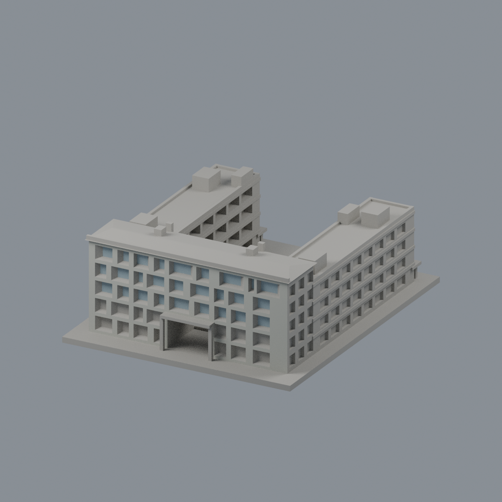
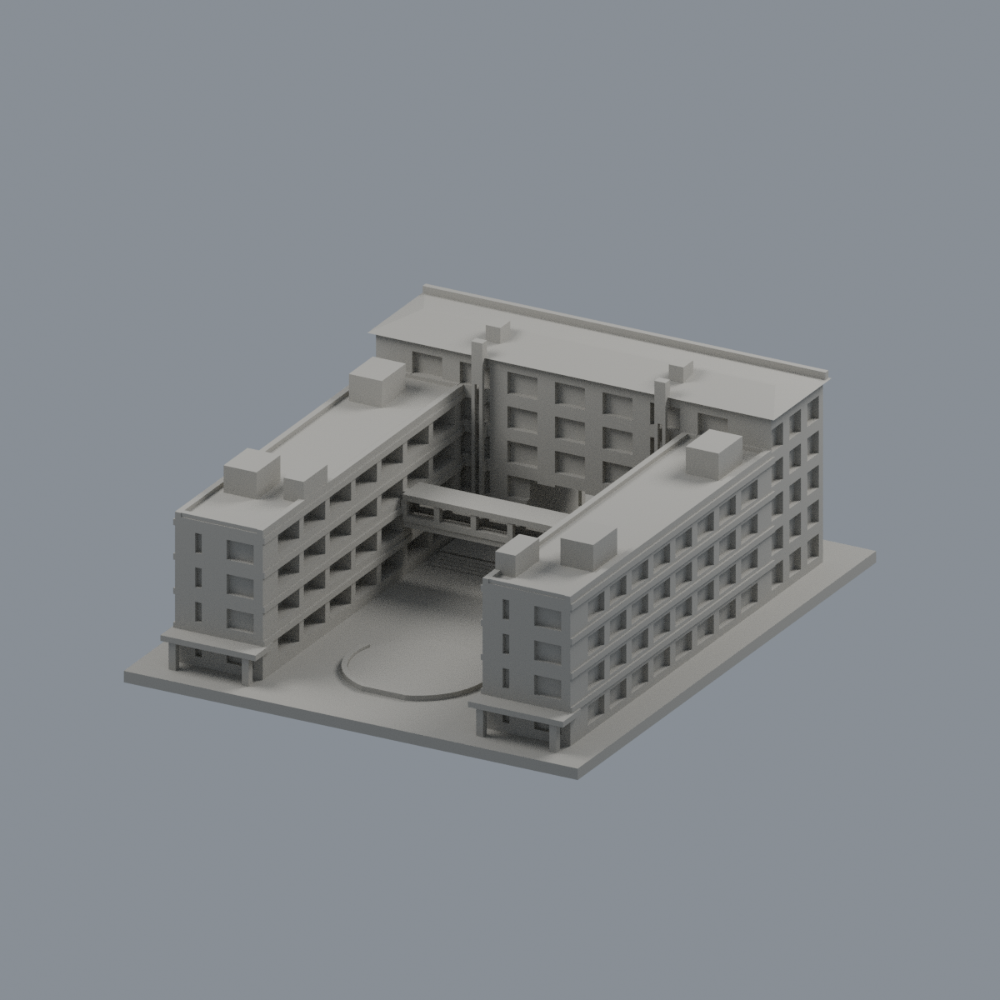
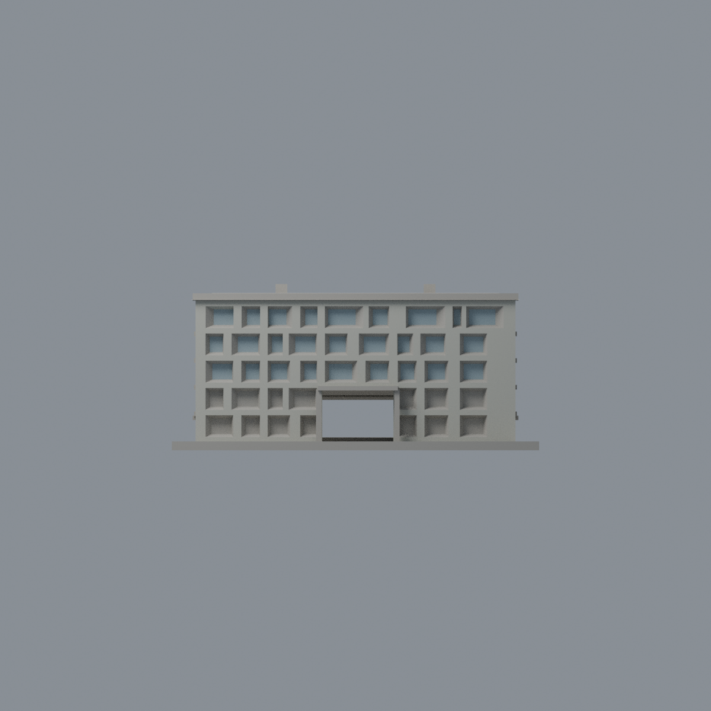
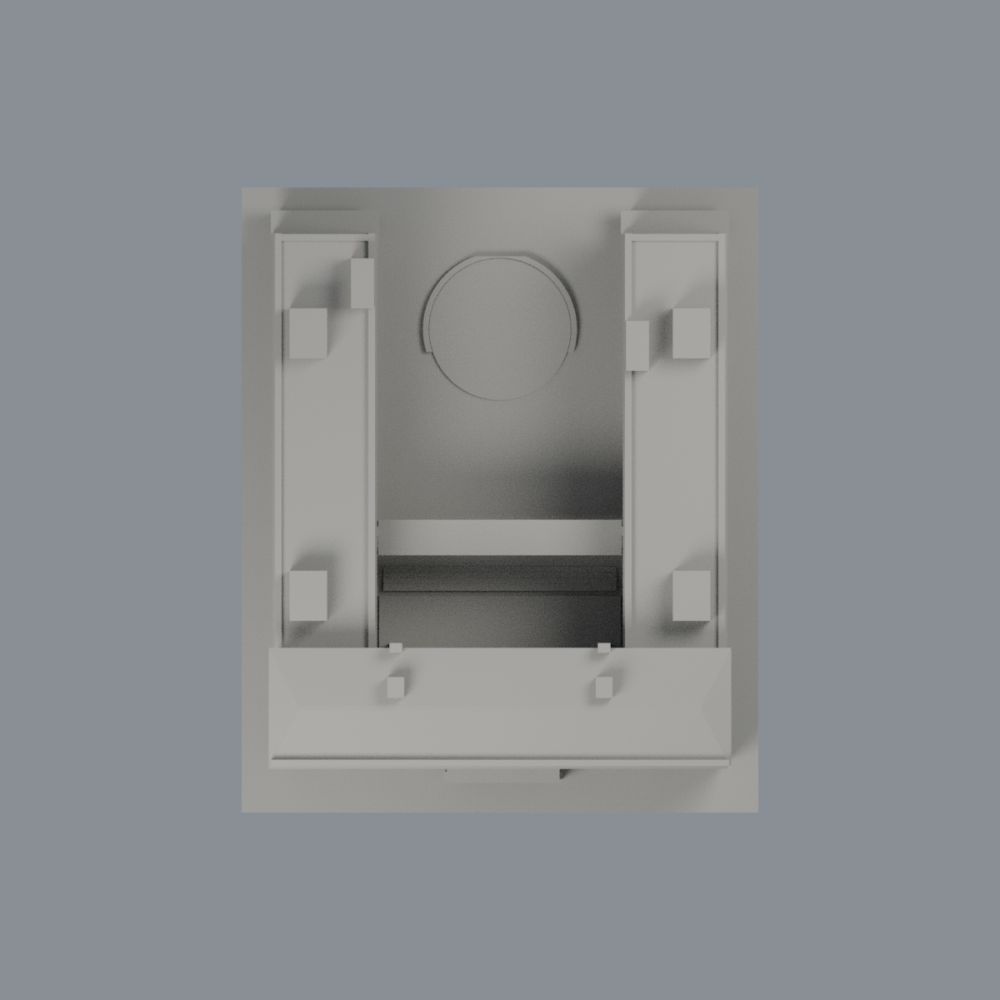
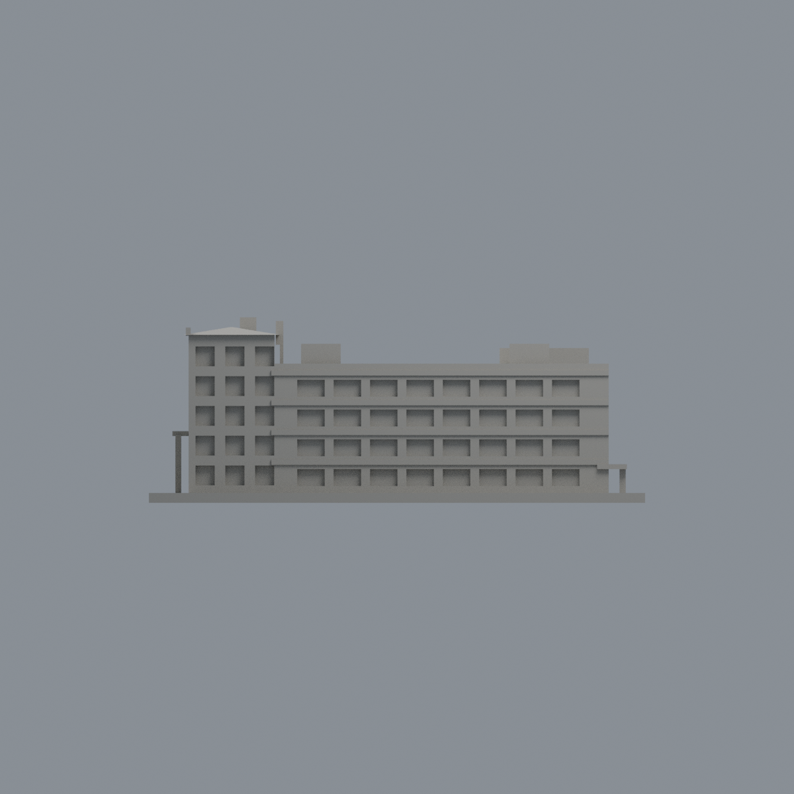

# 宜蘭大學綜合行政教學大樓：有限窗背外觀層

## 2026-11-18 限定補色版

最高排左首窗的上斜凹口 2 個原三角，延續前牆石板色。本次不增加套數、不改原始 STL 幾何，未補部位不代表實景材色。未實體試印。

[彩色 3MF](niu-administration-teaching-complex-appearance.3mf) · [可編輯 Blend](scene.blend) · [原 STL](../model.stl) · [本版數位查核](qa/product-numeric-validation.json) · [公開版清單](COLOR-RELEASE-MANIFEST.json) · [SHA256SUMS](SHA256SUMS)

| 現版模型預覽 | 現版模型預覽 | 現版模型預覽 |
| :---: | :---: | :---: |
|  前斜視／正面 |  後斜視 |  立面 |
|  頂視 |  側視 |  |

上級索引原代表圖保持原檔；新版彩色渲染請以上表為準。新色適用範圍及試印限制如下。下方舊版本導覽及資料只為歷史保存，舊面數、舊預覽與舊驗證不代表現版；以本章下載與公開版清單為準。

## 2026-11-18 單窗上斜凹口延續

僅最高排左首窗的完整上斜凹口兩個原三角（canonical STL 3979、3982）由中性0改用既有前牆石板族2（#B8B9AE），其餘6652面與原三材值均保持。現為6343中性、54窗背代理、257淺灰石板族。原6654面、STL、座標、繞向、拓樸與原近似偏心窗幾何不改，無切面或新增材界。

選取整個連通共面梯形，面積約23.2833923mm²：前緣y−63、z48.6517868，後緣y−60.32、z47.5750008。全部18個同無限平面三角屬不同窗，僅本窗兩面相連；不延其他窗。玻璃原3980／3983、左右及下凹口保持原色，不把金屬窗框或玻璃混塗。

建築師大藏原專案 YLUS01 正斜照可辨此窗上斜口與鄰接前牆石板族相續。此為原完整近似面域的同族延續判讀，非逐點攝影標定、精確漆號或原深度測繪；拍攝日期未知，專案2010與上架2020均不等於拍攝年，不宣稱2026現況。原照片只供私人核對，不公開貼圖或隨包分發。

原5視角1200×1200、Cycles CPU32、seed0、無denoise及全部場景設定保留；scene只有兩面材質指派變動，未新增/刪除材質、節點、物件或自訂屬性。原材色適用範圍文字不變；未實體試印或新切片，不升級歷史幾何工程QA。

新增有界重建：Blender 4.3.2 執行 `blender -b --python source/rebuild_reveal.py -- source/baseline /your/new/output`。必要baseline原件以SHA鎖定，來源固定commit `8f90ae2478f00cce6832a07de537f7d333f6dbc0`，會驗全序坐標及原面材後才更改兩面。只寫指定新輸出；不要選原baseline為輸出。原base-STL及原版來源保留，模型件數不變。

## 歷史版導覽與說明

僅正面 -Y 上方三排、27 個既有偏心斜凹窗的窗背 54 個完整三角面，使用低飽和淺灰藍色 #98ABB2（不透明玻璃／窗簾代理色，方便交換）；其餘 6600 面維持中性。這不是整棟彩色復原、透明玻璃模擬或現況色彩量測。

下方兩排 28 個窗背三角面受遮擋且原幾何明示近似，維持中性；斜窗框、窗台、opaque 牆體、其他立面、屋頂、教學翼、內院開廊均不套玻璃色。作者 YLUS01/06 支持上三排窗背分類；YLUS04/05/07 證明內廊開放，不能塗成玻璃。原有簡化樓梯塔、屋頂、連橋與所有近似幾何保持不變。拍攝日期未知，專案標題 2010 及檔案目錄 2020 都不是拍攝年份證據。

- [可編輯 Blend](scene.blend)、[雙材質 3MF](niu-administration-teaching-complex-appearance.3mf)
- [材質表](palette.json)、[逐面對照](face-materials.json)
- [正面](previews/front.png)、[背面](previews/rear.png)、[立面](previews/elevation.png)、[側面](previews/side.png)、[頂面](previews/top.png)
- [來源](SOURCES.md)、[權利](LICENSE-NOTICE.md)

| 模型預覽 | 模型預覽 | 模型預覽 |
| :---: | :---: | :---: |
| 正面  | 背面  | 立面  |
| 側面  | 頂面  |  |

原 STL bytes、三角面順序與各面三頂點座標不變。native polygon IDs 使用精確三頂點集合雙射轉換到 canonical STL IDs；每面三頂點皆位在 y=-60.32 有限窗背矩形且朝 -Y，總面積 827.71692042 mm²。不使用 centroid 選取、不細分、不加厚。原件仍是一件相連建築群，模型數不增加。

## 重建
原 model.stl 放在 appearance 上一層，Python 安裝 source/requirements.txt，順序執行 source/build_appearance.py、source/verify_exchange.py、source/verify_material_boundaries.py；Blender 4.3.2 執行 source/render_appearance.py、source/verify_scene.py。五張圖皆來自真實逐面材質，沒有貼圖補畫。交換／存讀檢驗不代表切片或實體試印，原幾何不確定性及歷史製造 QA 不被本層覆寫。

## 2026-11-13 有限外觀修正｜模型交付版

原y−63外平牆完整255面0→新2淺灰石板族#B8B9AE/.78，其餘6399面及原2材保持（原玻璃54、中性6345、新牆255），6654面幾何/面序不變。整三角支持原host扣含偏移的斜窗斷面、中央通道及雨棚交會，不用centroid裁切，不補分界。樹遮低處僅同牆推估，原低層窗位置近似、板縫未建，非測繪或精確材色。

模型、材質、原生視角圖與必要重建程式沿用完成候選，未改幾何或新切材界，不代表全館精確復色、現況或實體試印通過。原來源年代、工程與列印限制仍適用，舊說明與審核僅屬各自版本，本段更新上述局部範圍。

本次只公開模型、必要重建輸入／腳本、預覽與說明；完整來源、比較及研究審核不隨本批交付。根目錄PUBLIC-MODEL-SHA256SUMS僅校驗所列當前產品，舊表不驗證新版。重建ZIP只含必要重建檔與本說明；歷史來源及QA連結指儲存庫既有文件，非ZIP內的新增審核附件。
