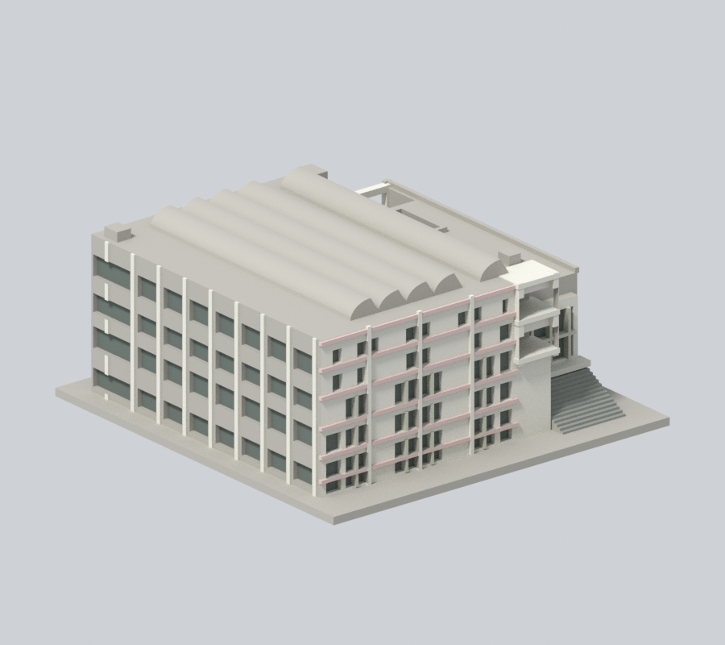
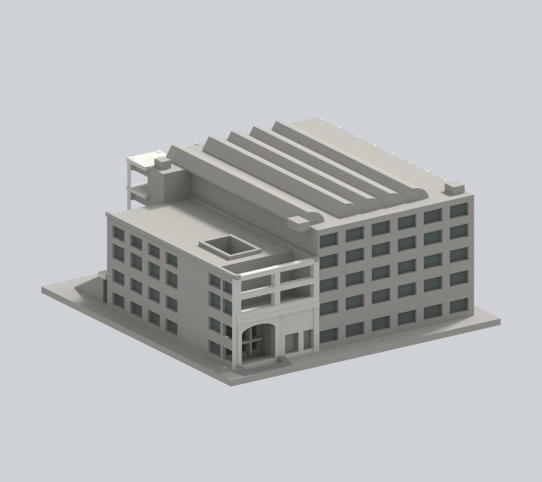
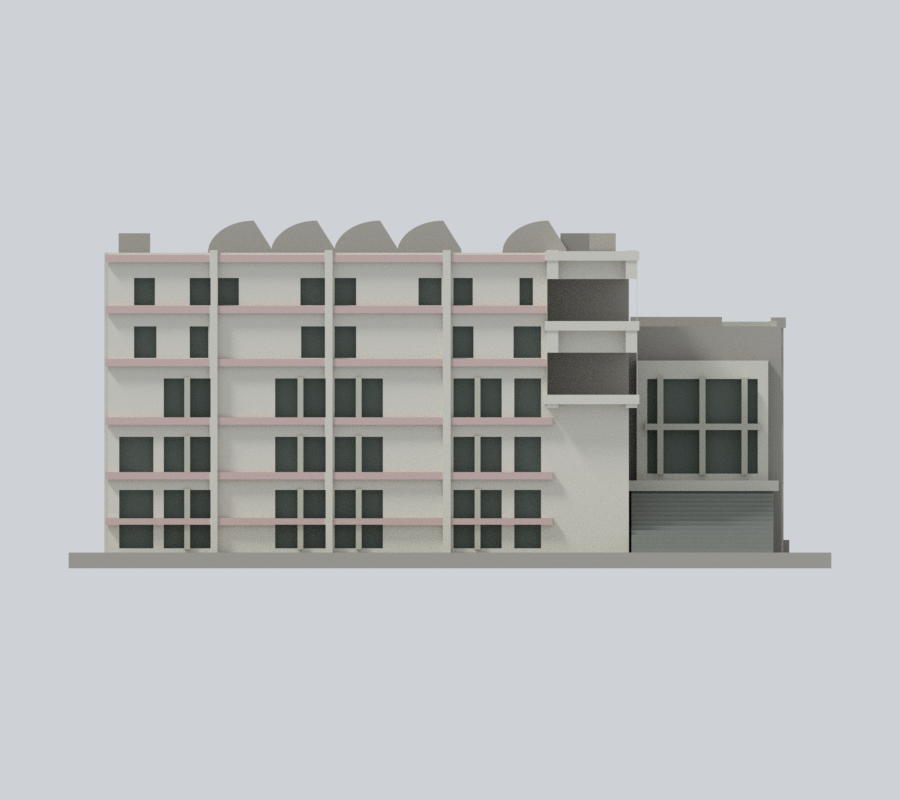
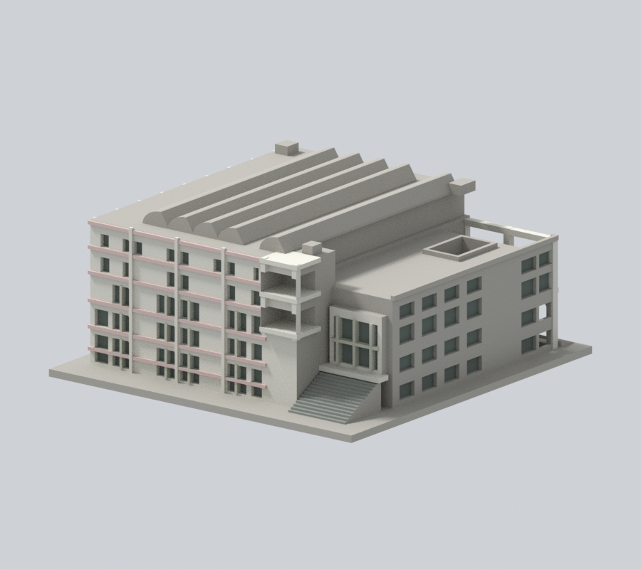
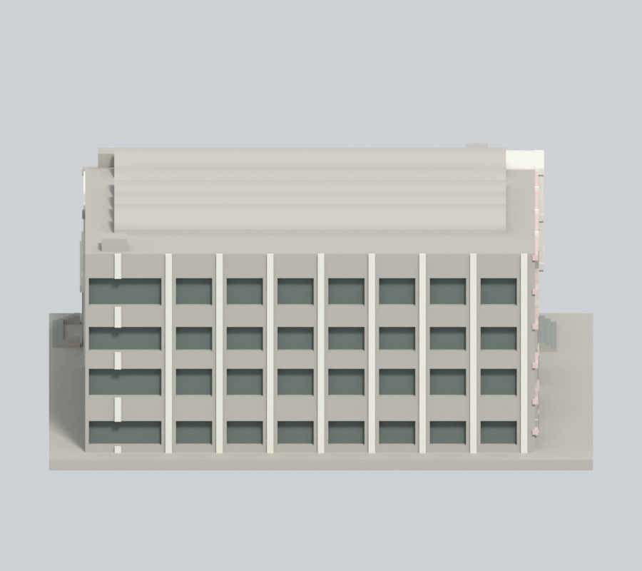
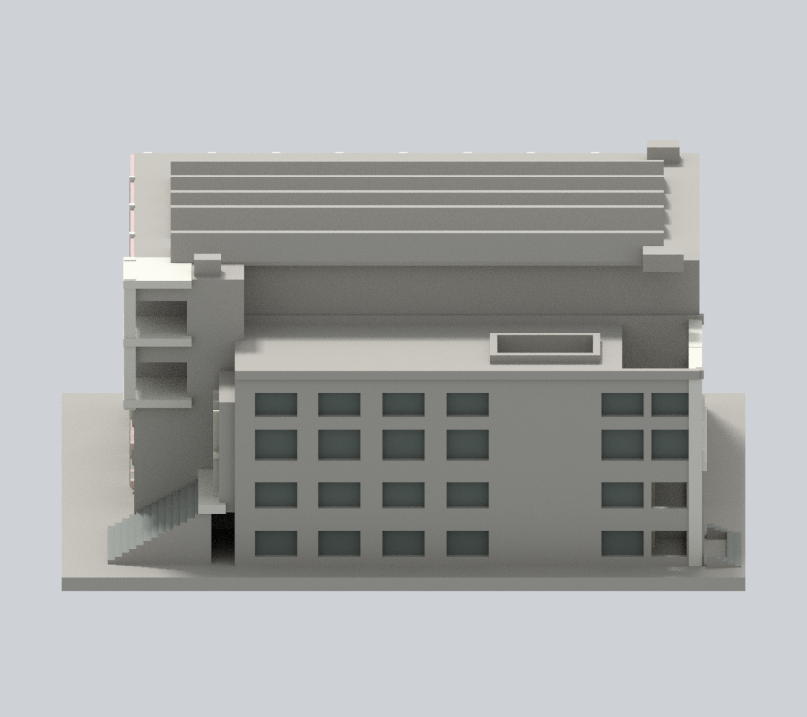
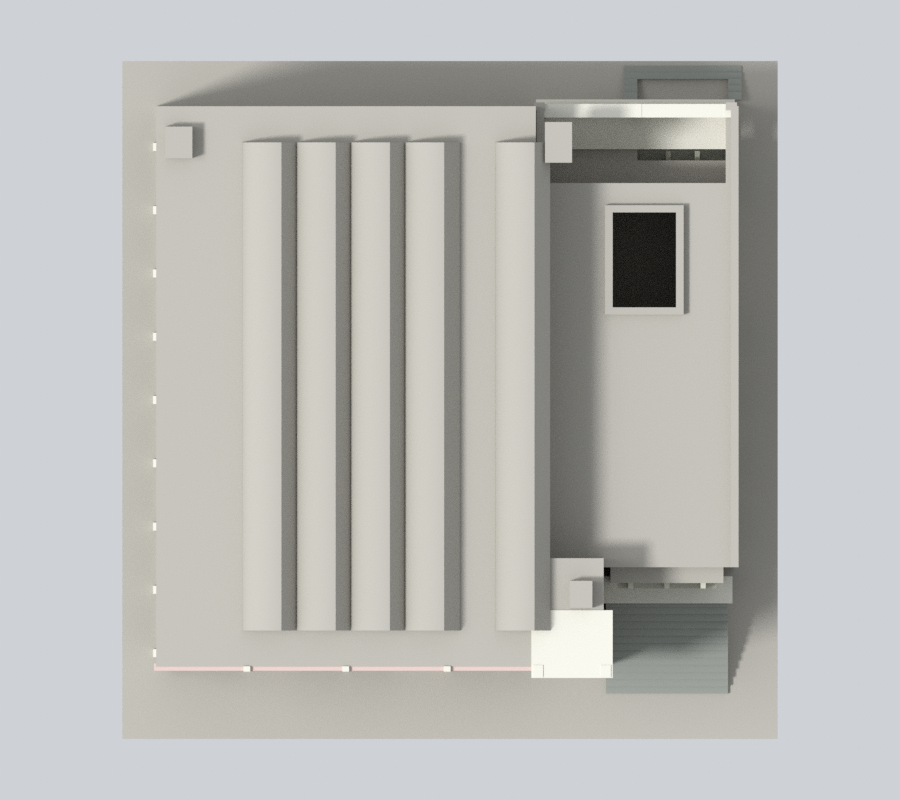

# 國立宜蘭大學體育館：頂列窗凹口跨凸柱續色

沿用原2822頂點、5684三角面、145×150×66.1mm、transform、STL/OBJ/scene及5張原預覽。本包不是測繪、BIM或2026現況認證。

## 本次範圍
場側最高窗列兩個既有窗的上下水平凹口，共4個完整連通共面域16面。保留原8個灰白1，補原8個unknown0為相同灰白1。每域跨原主牆前緣y−59與灰白凸柱前緣−60.1；原v2只取主牆深度，留下跨柱三角。本次全部三角投影核屬原window-cut與host-wall/white-pier聯集之交集，不只檢中心點。

只處理z50及55.2兩層，避原粉帶48.5..49.9及58.2..59.6；不補其他混材域、整片側背牆、屋冠、屋頂、天井或棚底。原6材值與其餘5676面、幾何完全保持，無新增窗格、磁磚縫或色帶邊界。

[校方《校園變遷》PDF](https://lic.niu.edu.tw/var/file/10/1010/img/8/211903019.pdf)第15–17頁（印159–161）已實看。印159場側頂列白牆與凸柱支持同灰白族，粉帶另有界。小凹口水平面採同構件延伸推估，不聲稱每片直接量色或每點攝影。印160內景不作外殼配色依據；印161另一入口不能當這兩窗精測。照片日未載，1999啟用與PDFmetadata不等於拍攝日期；歷史2018外牆更新/後加光電不等於本模型已納入，未重建光電或宣稱現況。

七張900×800、Cycles CPU96samples、seed0、單執行緒無denoise的原生鏡頭/照明及相機記錄保持。REVEAL-SOURCE-QA、REVEAL-NUMERIC-QA及最終公開獨審只綁公開產物；來源原件與私人比較另內部保存，不公開metadata。

## 工程與歷史限制
不改原五屋冠、兩片無材界壁畫、框架與真門洞。側背混白/粉但無原分帶面界仍未知；不憑三角碎塊新增斜補丁。原validation、contour、thin-feature等工程報告留其原範圍，不是本次全面重測。未實體試印、未實際Cura/Prusa切片；不保證AMS、任意多色切片器、免支撐或任意縮放可印。原開口、薄梁、凹窗與懸挑等風險不變。舊公開版本保留Git歷史。

