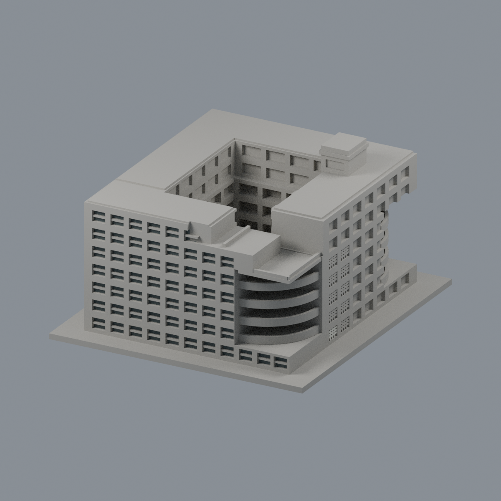
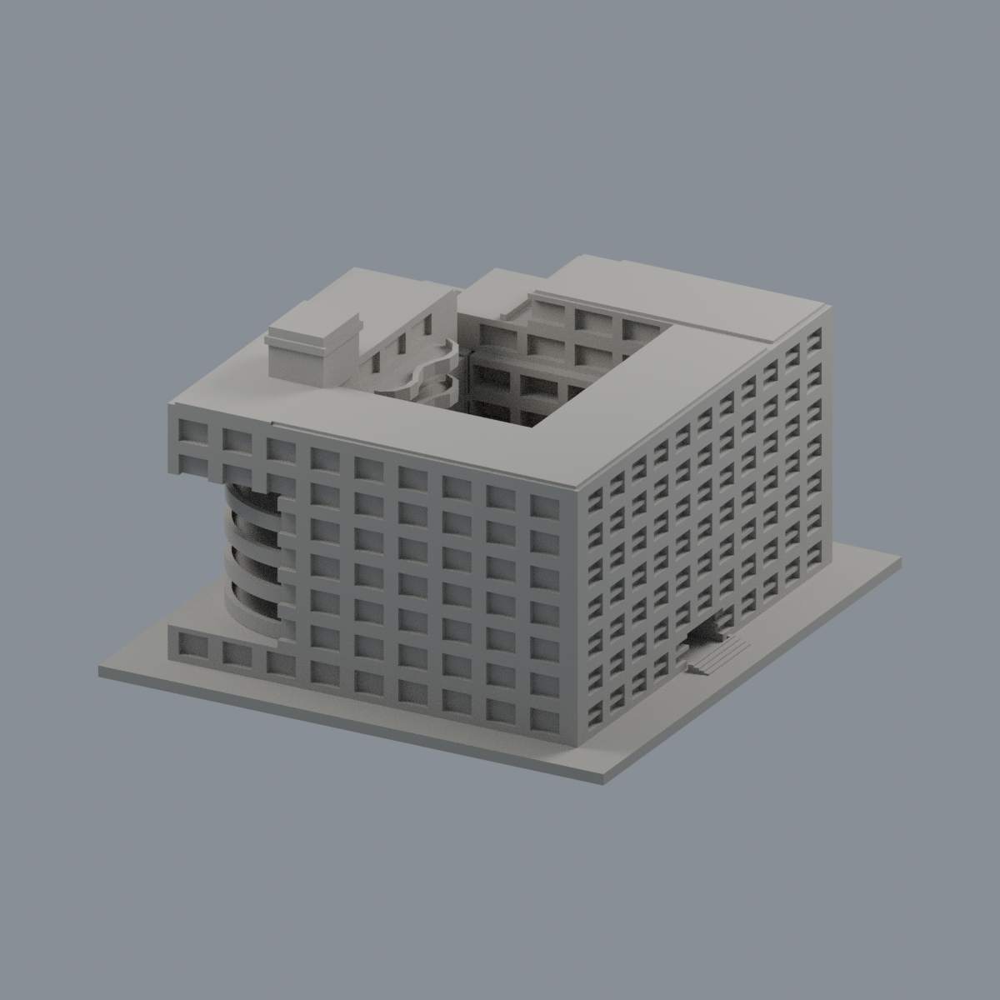
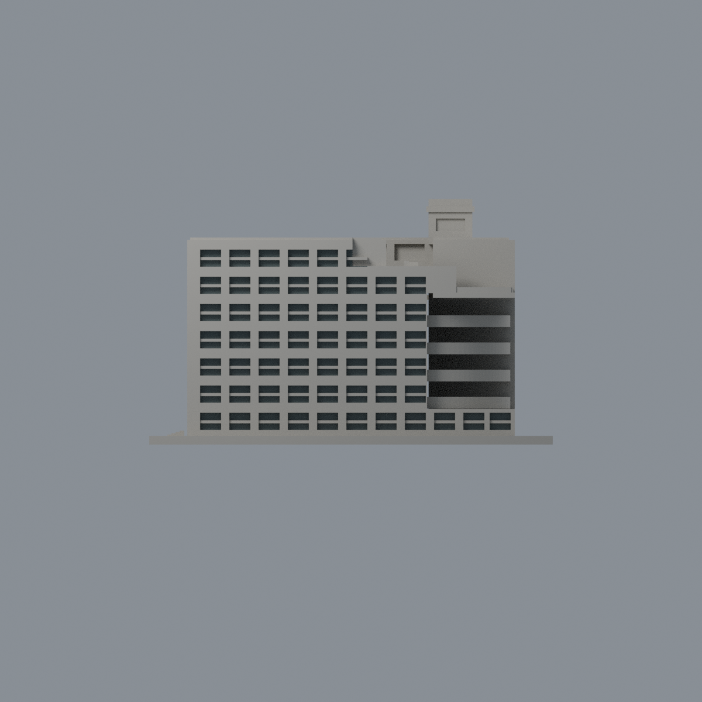
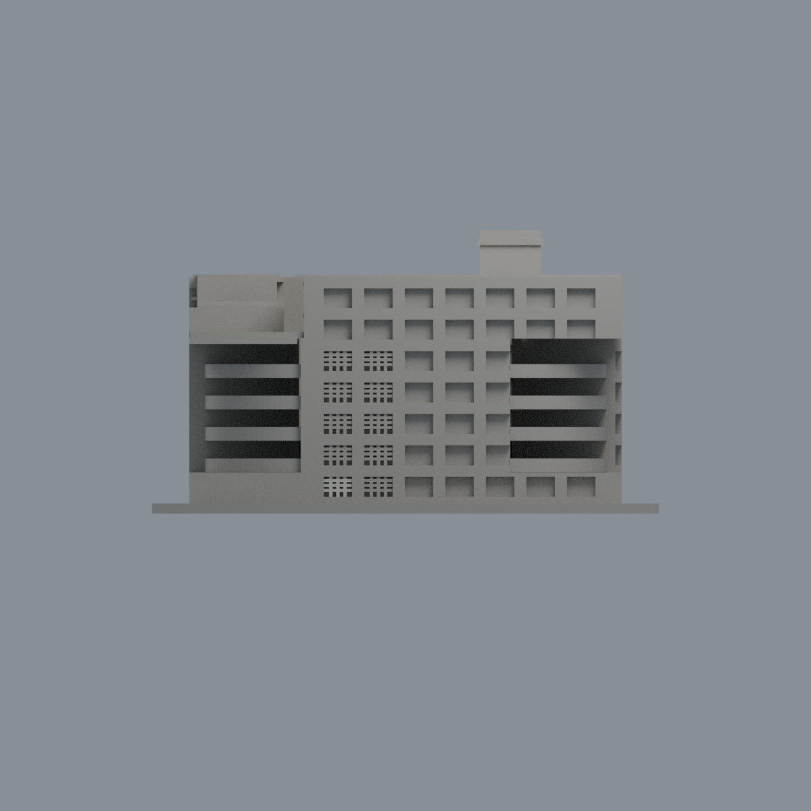
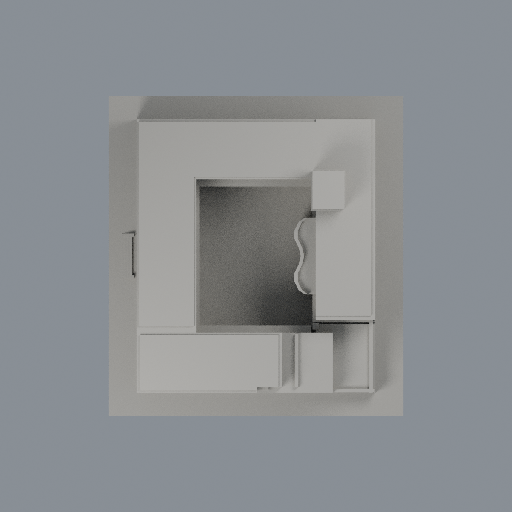

# 宜蘭大學經德大樓：有限窗背外觀層

僅既有 -Y 教室立面 57 灣上下窗背的 230 個完整三角面使用低飽和灰綠玻璃代理色（不透明方便交換），其餘 13,876 面維持中性。這不是整棟彩色復原，也不是透明玻璃或現況色彩量測。

作者原圖 photo-8 可辨連續教室窗、灰帶與白柱；但原有 opaque 大三角面沒有相應材質邊界，因此不塗灰帶／白柱。photo-1/12 所見開廊不能當成玻璃；+X、內院、其餘立面與屋頂均不套用本窗色。照片拍攝年代未證，不稱 2021、2010 或 2026 實拍；文章發表年不是拍攝年。既有中庭棚及全部近似幾何不變。

- [可編輯 Blend](scene.blend)、[雙材質 3MF](niu-jingde-building-appearance.3mf)
- [材質表](palette.json)、[逐面對照](face-materials.json)
- [正面](previews/front.png)、[背面](previews/rear.png)、[立面](previews/elevation.png)、[側面](previews/side.png)、[頂面](previews/top.png)
- [來源](SOURCES.md)、[權利](LICENSE-NOTICE.md)

| 模型預覽 | 模型預覽 | 模型預覽 |
| :---: | :---: | :---: |
| 正面  | 背面  | 立面  |
| 側面  | 頂面  |  |

原 STL bytes、三角面順序、每個頂點座標保持不變；native polygon IDs 已用精確三頂點集合雙射轉為 canonical STL IDs。選取必須全 3 頂點位於 y=-61.9 有限矩形且朝 -Y，總面積 1986.98958182 mm²。沒有 centroid 裁切、細分、加厚或新幾何。最高列 x=2 的下窗保留既有 4 面。

## 重建
將原 model.stl 放在 appearance 的上一層。Python 安裝 source/requirements.txt，順序執行 source/build_appearance.py、source/verify_exchange.py、source/verify_material_boundaries.py；Blender 4.3.2 執行 source/render_appearance.py、source/verify_scene.py。5 張圖均來自真實面材質，無貼圖補畫。交換與存讀驗證不代表切片或實體試印；原近似背面、屋頂、內部幾何的不確定性仍在。

## 2026-11-13 有限外觀修正｜模型交付版

原完整66面凸網正面0→新2淺灰白磚背景#CECEC2/.78，原230玻璃、13810其他中性及原兩材值保持；14106面幾何/面序不改。三角全頂點及sharededge解析面核對、原3豎3橫條union全三角支承，未切界。網孔背面/內側/外框/其他層不擴色；孔格數、比例、底緣非實測，照片日期未知。

模型、材質、原生視角圖與必要重建程式沿用完成候選，未改幾何或新切材界，不代表全館精確復色、現況或實體試印通過。原來源年代、工程與列印限制仍適用，舊說明與審核僅屬各自版本，本段更新上述局部範圍。

本次只公開模型、必要重建輸入／腳本、預覽與說明；完整來源、比較及研究審核不隨本批交付。根目錄PUBLIC-MODEL-SHA256SUMS僅校驗所列當前產品，舊表不驗證新版。重建ZIP只含必要重建檔與本說明；歷史來源及QA連結指儲存庫既有文件，非ZIP內的新增審核附件。
