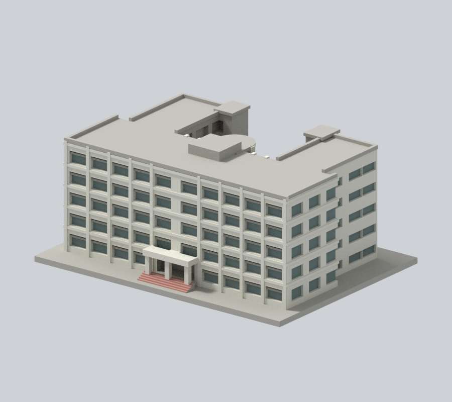
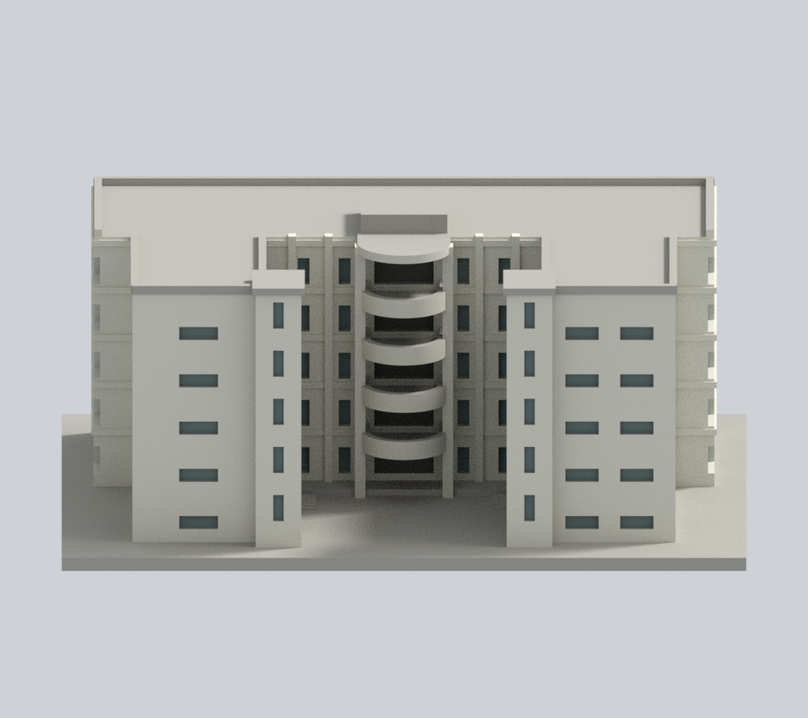
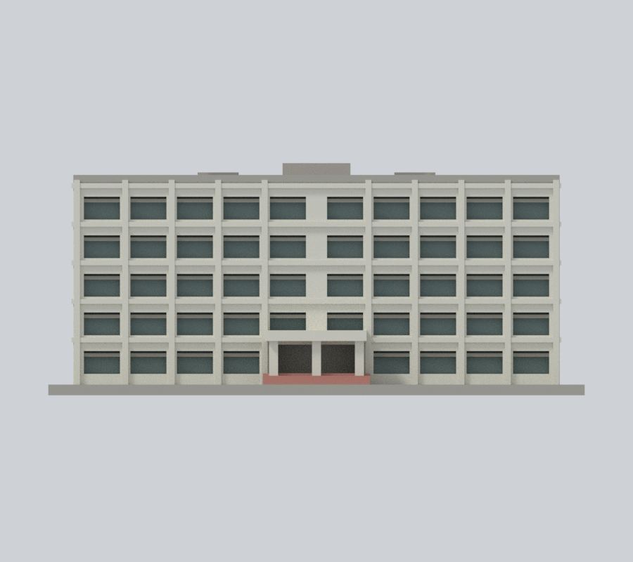
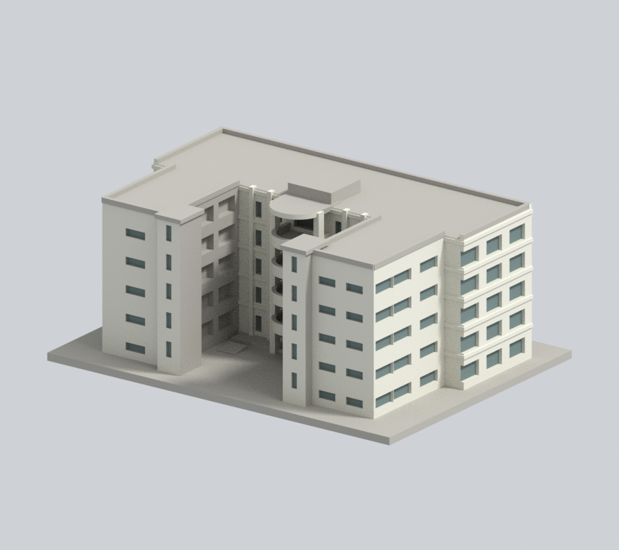
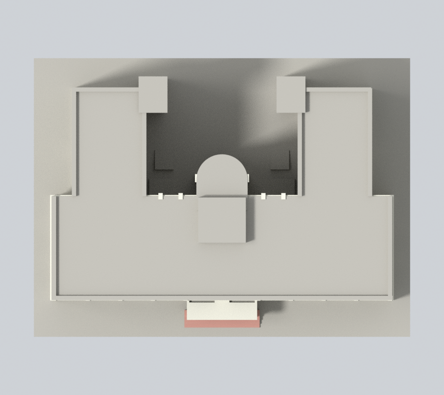
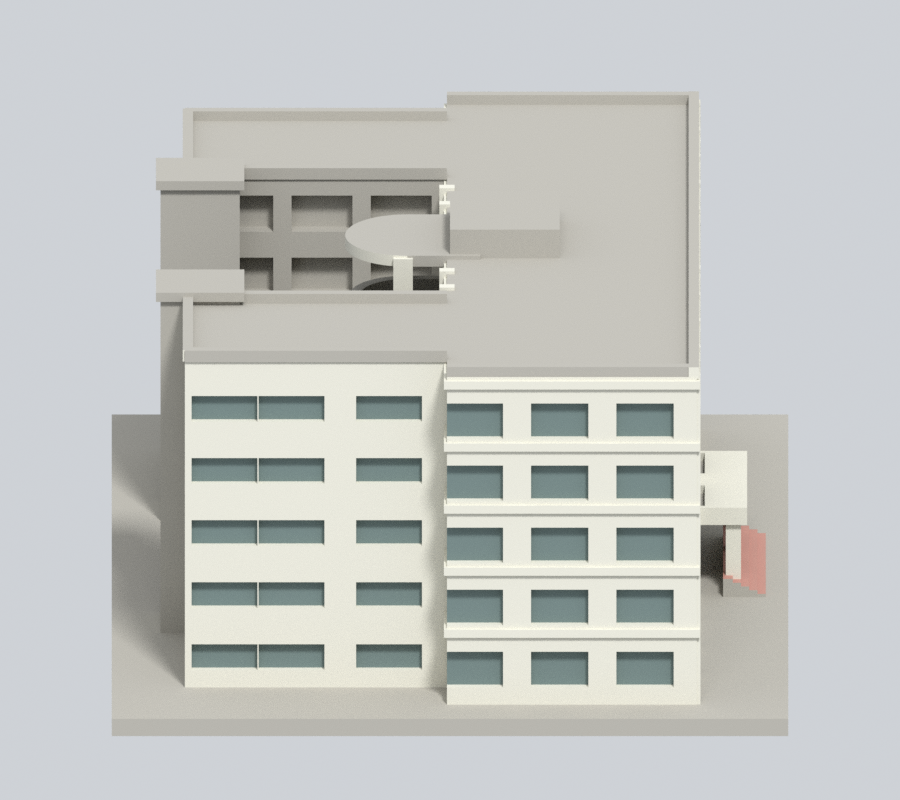
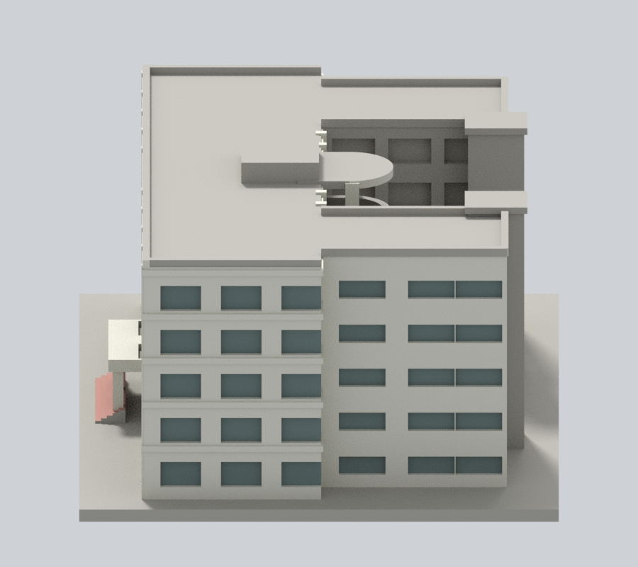

# 國立宜蘭大學｜時習大樓

## 模型預覽

| 新彩色正斜視 | 新彩色來源角度 | 新彩色立面 |
| :---: | :---: | :---: |
|  |  |  |
| 新彩色背向 | 新彩色上視 | 彩色下載 |
|  |  | [彩色3MF](appearance.3mf) · [Blender](appearance.blend) |

| 新彩色左側 | 新彩色右側 | 同相機原圖 |
| :---: | :---: | :---: |
|  |  | [原正斜視](appearance-review-v2/original-front.png) · [原背向](appearance-review-v2/original-rear.png) |

公開資料自建的近似外觀縮尺模型，單位為毫米（mm），含底座最長150mm。不是測繪、竣工圖、結構模型或保證可列印的成品。

### 完整外牆延續補色 v2（原預覽保留）

依官方校史印頁154三張跨期照片及同棟材質延續，補齊2,396個原中性面：完整外側牆、原有60個側窗凹背、窗洞與樓帶轉折。沿用乳灰米牆及灰藍綠混合窗背材料，原已上色面不改。隱藏／對側範圍屬推估；深院、屋頂與未證面保留中性。舊照標「正面」是模型+Y露台端，下方較新入口照對模型−Y寬窗端，不能直接按照片前後標題套色。這不是同日或2026現況復原。

[來源與材料限制](APPEARANCE.md) · [v2審核](appearance-review-v2/color-continuity-review.json)。原STL、OBJ、scene、預覽與列印QA不改；原0.13519% opening loss僅保留歷史數位記錄，非本輪重測，未完成實體試印。

## 模型與預覽

[頂視圖](appearance/top.png) · [正立面](appearance/elevation.png) · [STL下載](model.stl) · [可編輯Blender](scene.blend) · [原始網格OBJ](model.obj)

- 尺寸：150 × 111 × 65 mm（包含3mm底座；STL實測值以validation.json為準）
- 範圍：時習大樓為一件。照片中旁邊的其他大樓不納入；不同實驗室為同館使用單位，不拆算。
- 保留特徵：五層量體、深U形開放院落、四層D形外挑露台與圓弧頂蓋、兩側通高直柱/窄窗、非對稱細橫窗、兩側梯間量體、平直入口門廊及寬階梯、相異的正面寬窗和院落侧細橫窗。
- 每件獨立比例，不可直接和其他模型組成同一真實比例校園。

## 列印提示

- STL採毫米，底座朝下。先於切片器確認模型尺寸、平台接觸及支撐。
- 可用0.2mm層高與約0.4mm噴嘴作切片起點，但未完成Cura/Prusa等工具路徑或實體試印。
- D形露台、門廊頂、外挑檐口可能需要支撐；請以底座朝下，在實際切片器確認支撐位置與可移除性。
- 露台側牆約1.7mm、板厚1.7mm、弧廊直柱2.3mm，入口柱2.5mm，屋頂女兒牆1.7mm；小型貼牆橫框有實牆背板。
- 切片器、材料、機器設定及縮放都會影響成果；縮小後需重新檢查薄件。

## 來源與不確定性

詳細來源及照片年代見[sources.json](sources.json)。取閱日2026-10-13。公開包不含來源原照片/PDF。

- 官方校史p154同時收錄舊正背照片和較新入口照片，個別攝影年月不明；不稱2026全館實拍。
- 樓層依舊完整照片可見五排窗與官方1–5F平面交叉核對；主入口近照不是唯一樓層依據。
- 以公開平面核U形庭院與D形露台，未取得立面測量，窗距、屋頂設備和左右細節為近似。
- 2025工程紀錄列時習新設防墜欄杆；本模型不精刻無法確定當期形式的細欄杆。

## 重建與數位QA

1. Python 3.12環境安裝 [requirements.txt](requirements.txt)。
2. 執行 python build_model.py，自建[STL](model.stl)和[OBJ](model.obj)。
3. Blender 4.3.2 執行 blender -b -t 2 -P render_preview.py，從actual STL匯入、渲染並儲存scene.blend。
4. 執行 python run_all_checks.py。任何驗證非零退出或checks不全為true都停止，不能發布。

- [生成腳本](build_model.py) · [STL渲染腳本](render_preview.py)
- [原始STL/獨立重建/Blend檢查](validation.json)：水密、原始法向、每邊兩面、頂點link單環、單一連通外表面、正體積；未修補輸入。
- [0.2mm逐層檢查](layer-check.json)：325層，固定z=0.071mm起點，degree2閉合，個別和合成Polygon都必須valid；禁止repair後繼續。
- [薄特徵輔助檢查](thin-feature-check.json)：1mm層距、0.8mm參考寬度opening；不是全域最小壁厚保證。使用已核SHA的canonical fail-closed v3原腳本。
- [綜合QA](qa-summary.json) · [驗證入口](run_all_checks.py) · [逐檔SHA256](SHA256SUMS)

幾何QA不等於工具路徑驗證或實體試印。正確處理的source_rebuild_hash_matches及blend_stl_geometry_agree見validation.json。

全校及全國尚未完成。本件不能表示全校建築已製作。

## 2026-11-13 有限修正補充
以下補充更新本次局部材色範圍；上文原v2數量與QA保留歷史作用域。既有預覽表格、圖像路徑和下載連結保持。

# 國立宜蘭大學時習大樓：窗側原切口延續

保留原4288頂點、8624三角面、150×111×65mm與全部transform、幾何、原STL/OBJ/scene及預覽。不是實測、BIM或現況認證。

## 範圍
入口上方原兩窗的4個完整連通共面側域共32面，原24面乳灰磁磚1保持，僅8個中性0面延續既有1。原窗cut與門廊頂後段交會；原v2只覆蓋主牆深度留下外挑段，本次全三角核屬windowcut與hostwall/porch聯集之交集，且不越原灰褐橫框。不是只看面心，也未切新界。

[官方校史PDF](https://lic.niu.edu.tw/var/file/10/1010/img/8/211903019.pdf)第10頁（印154）三張照片已實看。入口雨棚可見正面、底與窗間壁皆淡色磁磚族；隱藏切口採同原構件家族延續推估。模型窗cut切入雨棚頂後為原代理幾何交會，不能稱實照逐點復原或準確窗位。不因同平面就認定同材；本次另核原支持構件與照片。跨期照片日期不明，出版「現況」並非2026現況。模型−Y入口、+Y D形露台沿原，不按舊照正背標籤反套。

原6材值與其他8616面不動，深院、D形內面、屋頂、服務核心、基座及其他步階不補色；不新增磁磚、欄杆、窗框或文字。中性不代表實物必為灰色。

七張900×800原生視圖、Cycles CPU96samples、seed0、單執行緒無denoise及原鏡頭/照明保持。公開REVEAL審核僅綁公開產物；完整來源及私人比較證據內部保留。

## 歷史與工程限制
原工程報告仍屬歷史範圍，本次不是全面工程重測；原D露台/簷/門廊支撐、薄構件、近似尺寸與開口限制保持。未實體試印或Cura/Prusa工具路徑驗證，不保證多色映射、免支撐或任意縮放列印。原版本於Git歷史保存。本包只有限外觀修正。
