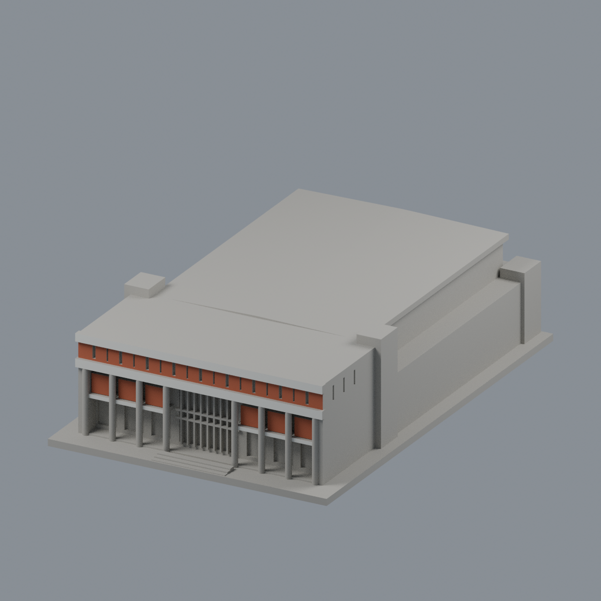
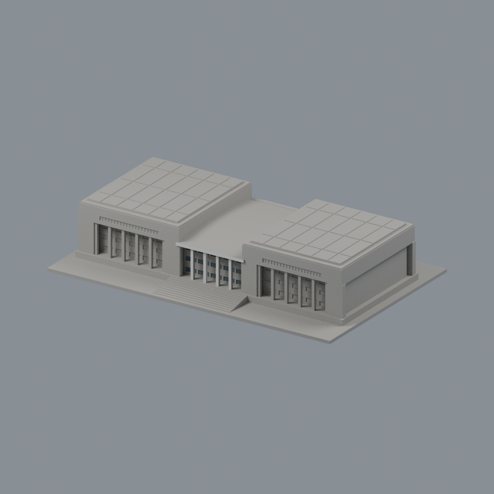
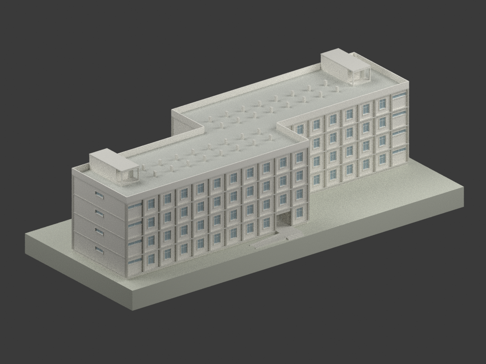
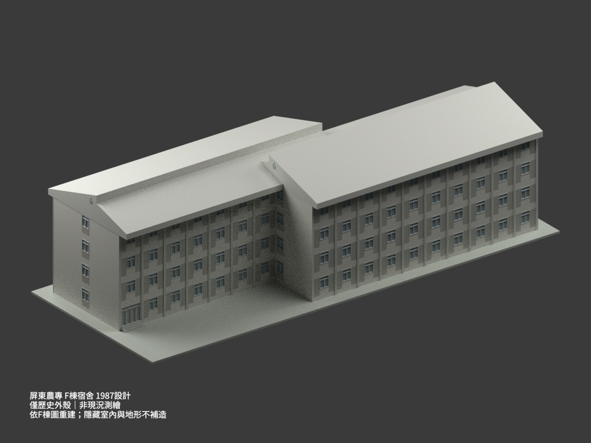
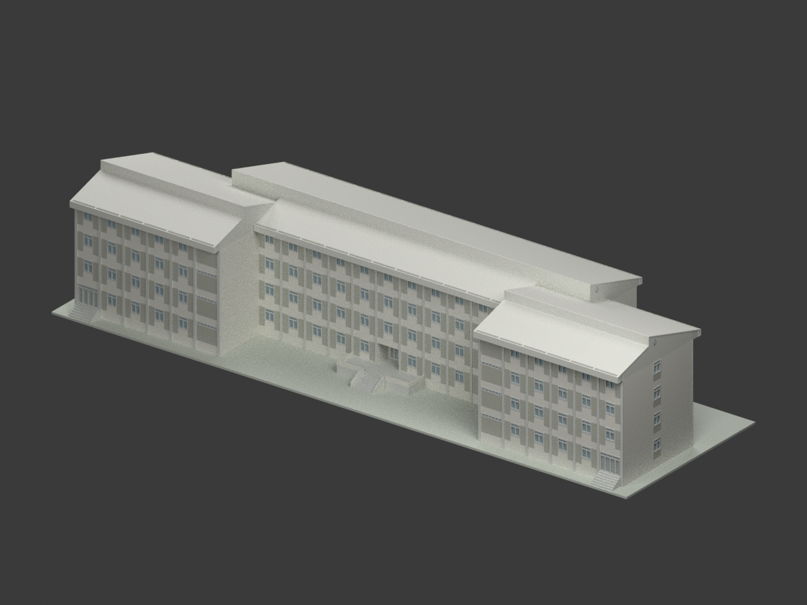
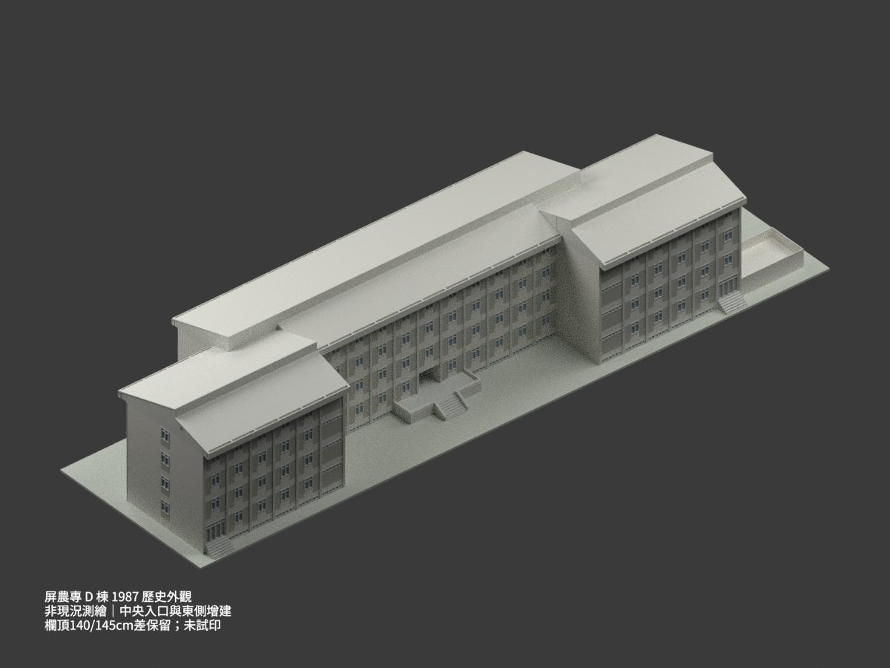

# 國立屏東科技大學

## 模型圖鑑

| 建築模型 | 建築模型 | 建築模型 |
| :---: | :---: | :---: |
|  **[述耘堂｜當代公開影像外形近似](內埔校本部/buildings/npust-shuyun-hall/README.md)** 正面 |  **[玉崗紀念圖書館（前中央有限配色）](內埔校本部/buildings/npust-yukang-library/appearance/README.md)** |  **[第二餐廳](內埔校本部/buildings/npust-second-refectory/README.md)** |
|  **[女生宿舍｜1990年原設計圖版](內埔校本部/buildings/npust-female-dorm-1990-design/README.md)** [STL](內埔校本部/buildings/npust-female-dorm-1990-design/model.stl) · [彩色3MF](內埔校本部/buildings/npust-female-dorm-1990-design/model.3mf) · [Blender](內埔校本部/buildings/npust-female-dorm-1990-design/scene.blend) |  **[F棟宿舍｜1987歷史設計外殼](內埔校本部/buildings/npust-dormitory-f-1987-design/README.md)** [STL](內埔校本部/buildings/npust-dormitory-f-1987-design/model.stl) · [彩色3MF](內埔校本部/buildings/npust-dormitory-f-1987-design/model.3mf) · [Blender](內埔校本部/buildings/npust-dormitory-f-1987-design/scene.blend) |  **[E棟宿舍｜1986–1987局部重建；中央入口階梯未重建](內埔校本部/buildings/npust-dormitory-e-1987-design/README.md)** [STL](內埔校本部/buildings/npust-dormitory-e-1987-design/model.stl) · [彩色3MF](內埔校本部/buildings/npust-dormitory-e-1987-design/model.3mf) · [Blender](內埔校本部/buildings/npust-dormitory-e-1987-design/scene.blend) |
|  **[D棟宿舍｜1987歷史分期圖示外觀](內埔校本部/buildings/npust-dormitory-d-1987-design/README.md)** [STL](內埔校本部/buildings/npust-dormitory-d-1987-design/model.stl) · [彩色3MF](內埔校本部/buildings/npust-dormitory-d-1987-design/model.3mf) · [Blender](內埔校本部/buildings/npust-dormitory-d-1987-design/scene.blend) |  |  |

## 模型圖鑑

## 模型圖鑑

現行收錄 **7 套模型包**：述耘堂、玉崗紀念圖書館、第二餐廳、1990女宿、F棟歷史外觀、E棟局部重建及D棟分期外觀；不是已證實實建整棟數。各件為公開影像有界近似或歷史設計圖研究，非全校完成；未實體試印。審核紀錄見各模型QA，是否正式發布以統一發布清單為準。

## [述耘堂｜當代公開影像近似](內埔校本部/buildings/npust-shuyun-hall/README.md)

## 第二餐廳

第二餐廳完整主要外觀近似：高單層四坡主方廳、中央方採光低四坡、削角外廊/局部半地下與非對稱外階，相連東三坡服務翼/中央有頂灰蓋/高側窗；不是第一餐廳或整校。依1989/1990設計圖、1997竣工記載、2012遊記實拍與拍攝年未知官方正射，非2026現況或竣工測繪。252×182×43.925mm、8色Blend/3MF/STL及5真mesh圖；12428三角單閉殼、220有效層、34空實點、strict材質/Blend頂點實改存讀、乾淨9件bytes一致與來源獨審通過。保留4層0.8mm薄島警告、0.56mm窗框，外廊/簷/階下需支撐，未實印；細窗近似、未知院內後加物省略。

[模型與來源](內埔校本部/buildings/npust-second-refectory/README.md) · [驗證與限制](內埔校本部/buildings/npust-second-refectory/QA.md)。既有兩套模型幾何與QA不變。

[述耘堂正面紅板與白帶限域配色／五視角](內埔校本部/buildings/npust-shuyun-hall/appearance/README.md)（94完整原面，其餘中性；非2026現況）。

## 女生宿舍原設計研究

1990-08-31（79.8.31）國立屏東農業專科學校女生宿舍原設計；A1-1內埔計畫40號，未證實等同今日具名宿舍或按圖建成。四層錯位雙翼與32個屋頂突出構件；地下層由展示地面包覆不可見。尺寸估讀、中性配色、薄件簡化保留；未實體試印。

## F棟宿舍歷史設計研究

屏東農專1987年F棟專屬七圖研究，與1990女生宿舍不同，不確認今日館名或實建現況。四層相連錯位雙翼，屋脊17.05m、相向錯階1.16m；不採E棟17.08m、GL65cm等舊錯引，勘誤保留。缺一樓室內平面，不補隱藏室內、地形或地下外露。窗檐部分圖量估讀±.10m，細框加厚、中性配色，未實體試印。

## E棟局部重建與入口缺階限制

中央入口階梯細節缺圖，未重建；非完整外觀復原。屏東農專1986–1987 E棟圖示歷史外觀局部研究，不是現況測繪或核實竣工，不確認今日館名。中央門廊保留，不用平台、坡道或遮蔽物補造階梯；後續補圖應更新同一項目，不另計建築。屋脊17.08m、GL−1.20m；北端落階1.22m、中段1.395m為推導。共用F圖只引用索引屋簷細部，不跨用F主體；框格圖量±.10m、屋皮及槽底封端為協調建模值，隱蔽室內與地形不補造，未實體列印。

## D棟宿舍歷史分期研究

屏東農專D棟1987歷史分期圖示外觀，依D專屬平立剖與修訂，非現況測繪或竣工認證，現名未定。保留中央入口、端門階與東側增建，不以E/F鏡製。東增建詳剖140cm與立面145cm差異保留，未造5cm抬台消差；地下室內部、共用廣場與地下道未建，可見地下採光低窗保留。估讀、細框簡化與中性配色明示，未實際列印。
