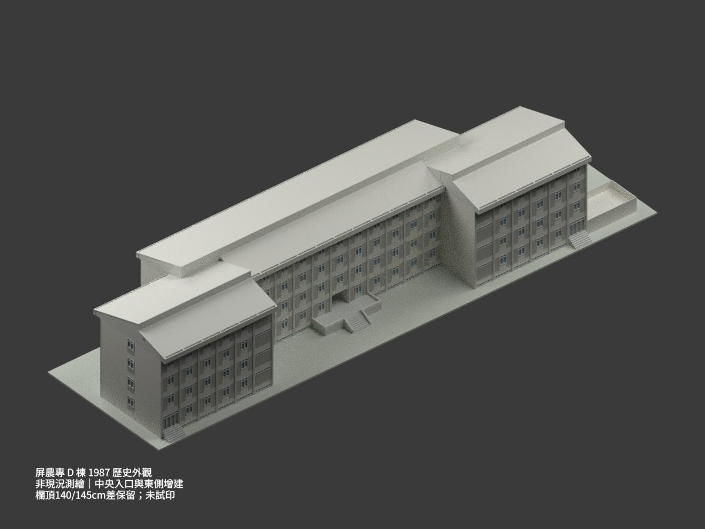
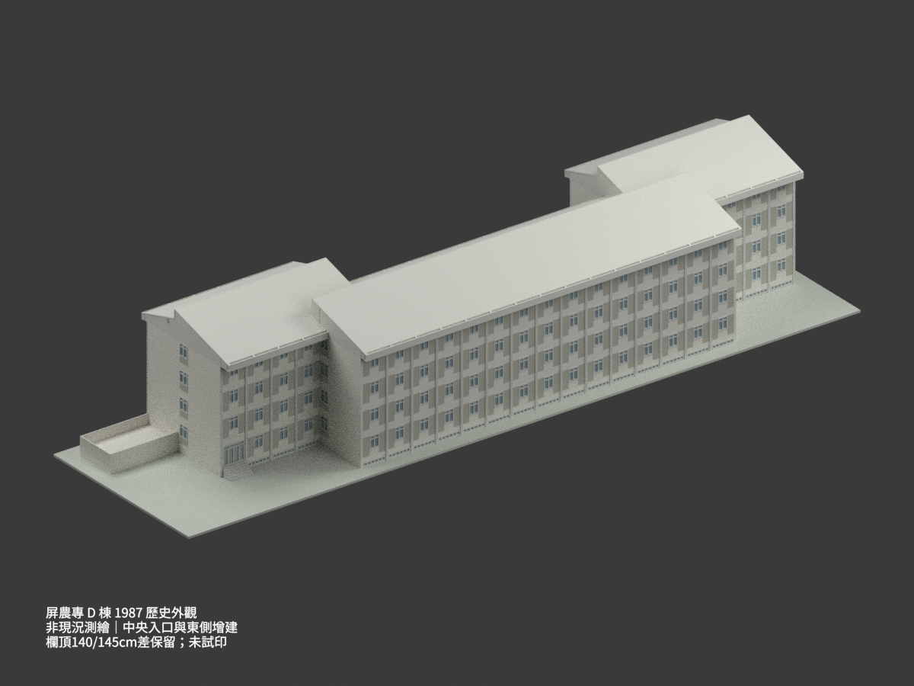
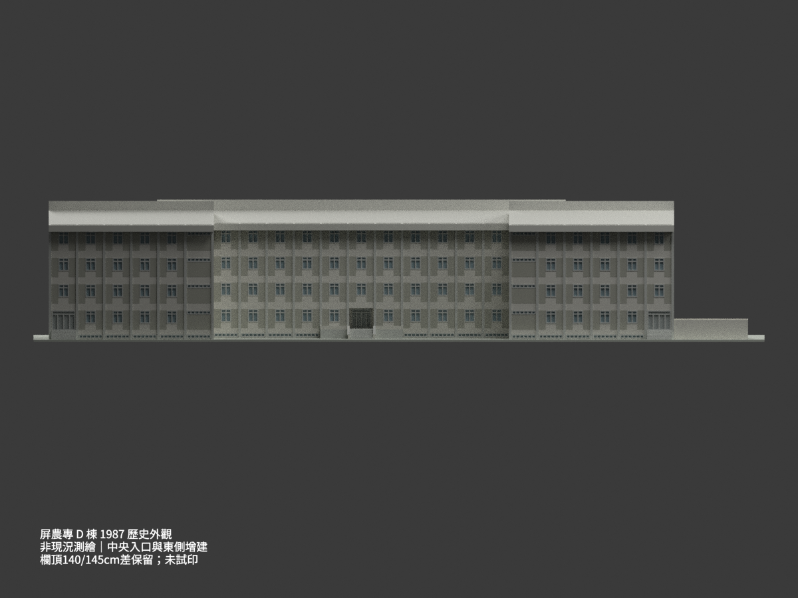
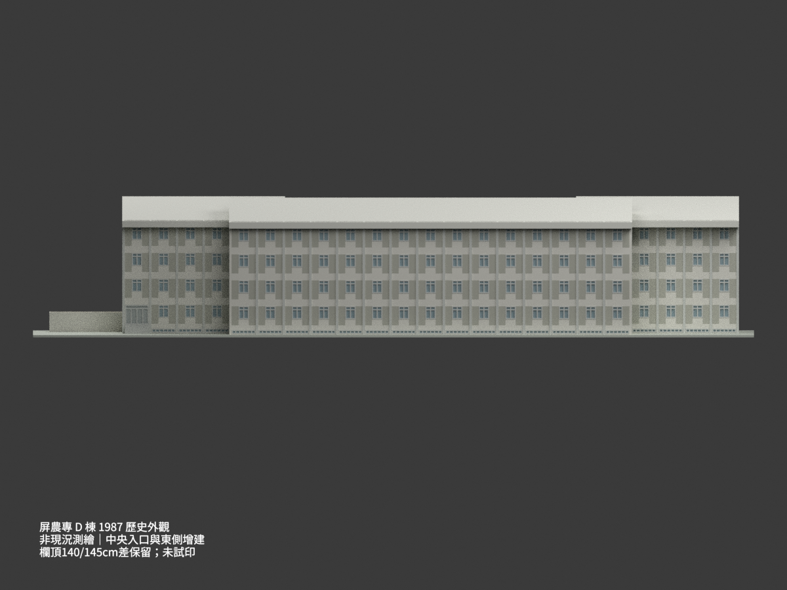
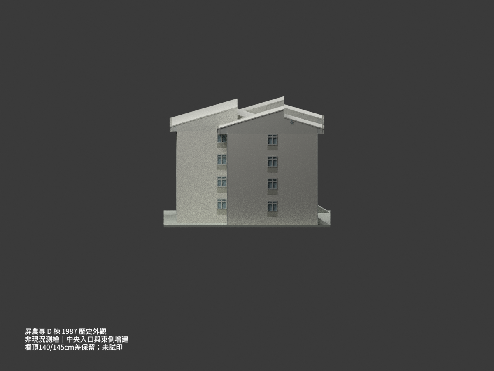
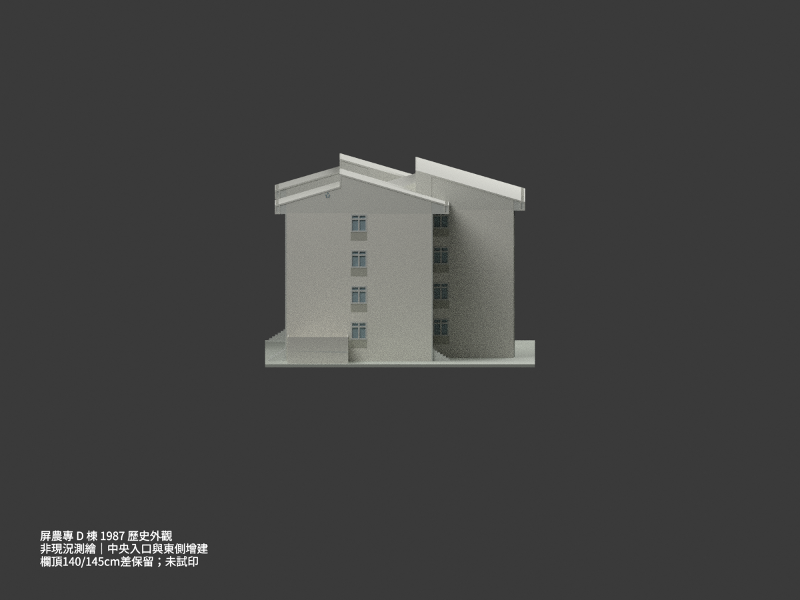
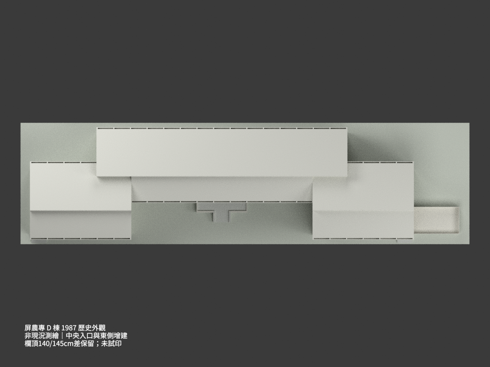
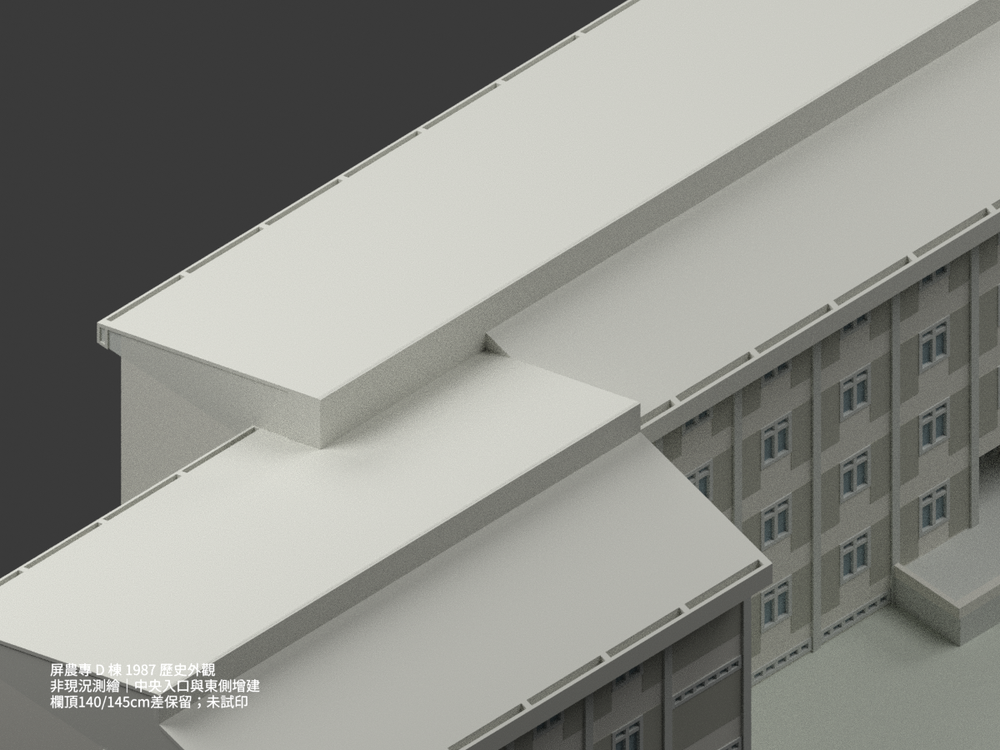
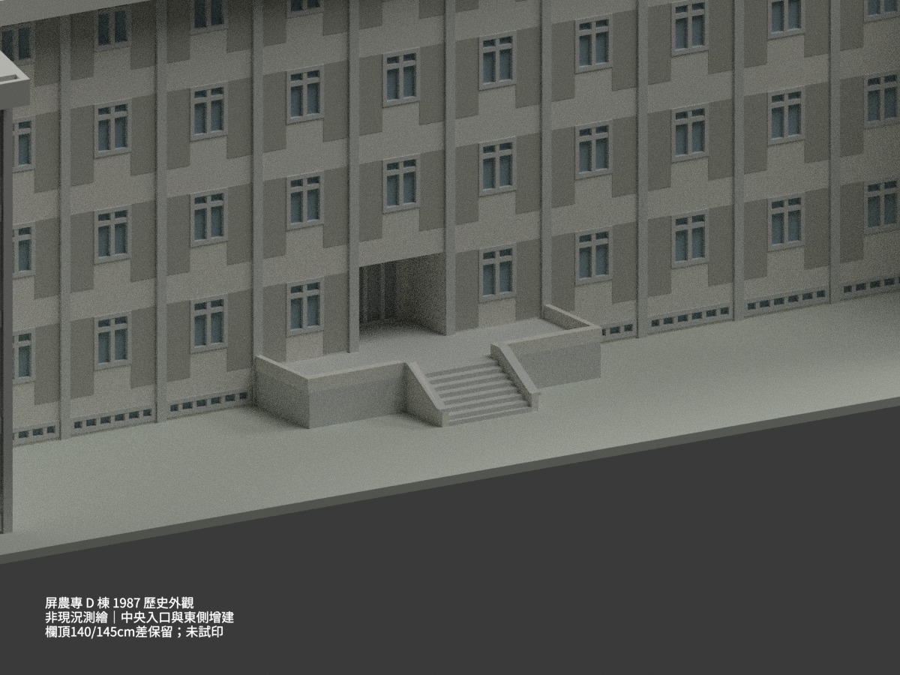
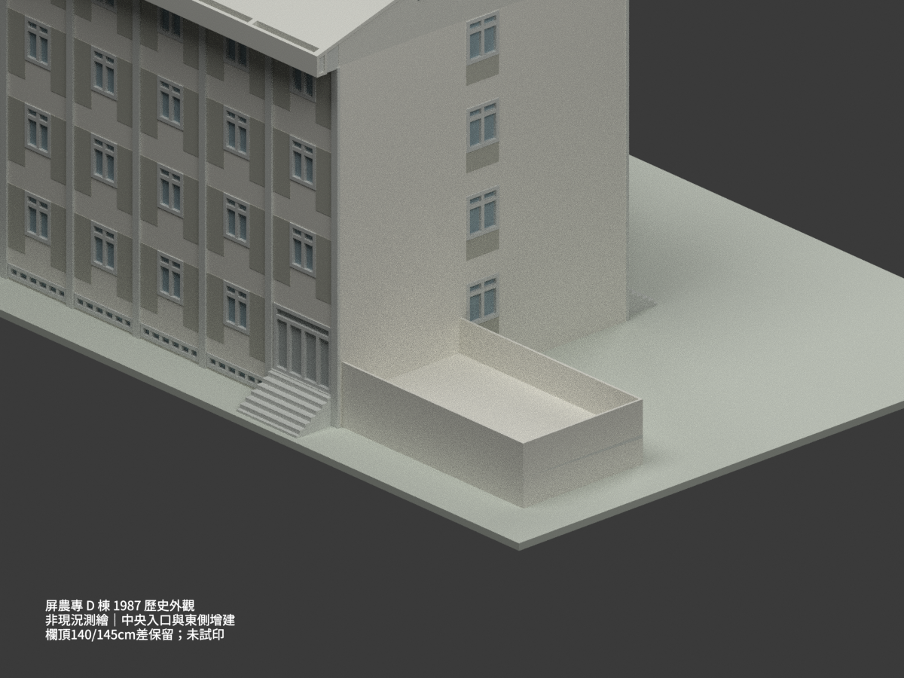

# 屏農專 D 棟宿舍｜1987 歷史分期圖示外觀

## 模型預覽與範圍

**國立屏東農業專科學校 D 棟宿舍的歷史外觀重建，不是現況測繪或竣工認證。** 採 D 專屬平立剖與明確修訂，保留中央入口、三處端門階及 1987 年東側增建。不是把 E／F 棟鏡製；中央共用廣場、地下道與其他棟不納入。未試印。

| 南西鳥瞰 | 北東鳥瞰 | 南立面 |
|---|---|---|
|  |  |  |
| 北立面 | 西立面 | 東立面 |
|  |  |  |
| 俯視 | 錯脊及排水槽 | 中央入口 |
|  |  |  |
| 東側增建 | 140／145 cm 欄頂差異保留 | 原圖不公開 |
|  | 詳剖優先，不造 5 cm 抬台消差 | 細節與限制見下文 |

## 範圍與版本

- 來源包含 D 首層、二三層、四層、地下層、兩版屋頂、四面立面、D 長短向剖面、真正帶撇號的中央入口修訂詳圖，以及東側增建詳圖；來源登錄共 20 張，其中 A4-6 劃除部分不採幾何，F A2-22 只取 D 屋頂明確索引的 1-1／1-2 共用假梁細部。
- 民國 75.5（1986 年 5 月）入口及排水細部、76.4 屋頂、76.6 增建按各自適用處採用；不是聲稱整組同日竣工圖。A3-1／A4-1 內題為 D、圖框小字卻有 E，保留原字差異，以 D 各層輪廓、屋頂與東西立面互證身份，不概括說所有圖框都寫 D。
- 本件不據目前校名推定現名、現用途或當代外觀。地下室內部、機電、儲藏室內階、31 m 共用地下道與廣場未重建，但**地面以上可見地下採光低窗仍保留**，不是以「地下」為由省去可見立面。

## 尺寸與高程

- 主軸 82.80×21.90 m，長向 23 跨×3.60 m；來源座標 x 向東（24 軸＝0，1 軸＝82.8），y 向北。中央北翼與兩端南翼錯位，外牆完成面與軸線分開；主屋頂外長 83.15 m。
- 1FL＝0，樓高每層 3.50 m，RF＝14.00 m，兩屋脊＝17.08 m；外 GL＝−1.20 m，因此脊高為外 GL 以上 18.28 m。1708 是 1FL 至脊，不能再當成 GL 總高。地下 BFL＝−3.50 m，不把整個地下室及基腳畫成地上裸露樓層。
- D 屋頂兩個長坡同向向南升高：中央北翼北緣 y23.15→脊 y12.55，長 10.60 m；中段短坡 5.80 m，落階 1.395 m。兩南端翼北緣 y15.75→脊 y5.15，同為 10.60 m 長坡；南短坡 6.40 m，落階 1.22 m。重疊區中央短坡截短，直接落到另一長坡，不保留重複折面。
- 出檐依 D 屋頂有效 1.25／1.85 m，不統一化。直接索引的共用詳圖為 23 cm 假梁、外端 85 cm 深檐及 12＋26＋12＝50 cm 開口 U 槽；沒有將 F 的屋頂主體移植。槽底及端封厚度 12 cm、屋皮 16 cm 是圖量／數位表現協調，不冒稱全部直接施工厚度。

## 入口、增建與保留差異

- 中央新版入口在 13–12 軸間，南向退門；真正來源為 A2-1′／A4-1′／A4-2′，不是普通 A2-1 地下室平面。
- 中央階 **6 踏面×30 cm＝180 cm，7 落階×15 cm＝105 cm**。廣場完成面為 −1.05 m，結構頂 −1.20 m 上有 15 cm 面層；不能把外 GL 的 120 cm 直接當階高，也不能將六踏面當六落階。
- 中央上平台自 C 軸外伸 3.50 m，兩側為 3.00 m 淨深＋35 cm 帽；局部階腳至 C 軸 3.50＋1.80＋0.15＝5.45 m。只建此入口及局部鋪面切口，不加整片共用廣場。階淨寬 3.10 m、坡上矮牆頂約 45 cm 屬圖量協調；25 cm 牆身／35 cm 帽向外處理保留淨寬，不聲稱沿坡每點皆有直接尺寸。
- 三處端門階：南西端有 2/A4-1 直接詳圖，6×17.5 cm＝105 cm；下鋪面比外 GL 高 10 cm，上端另 5 cm。南東、北東同 DW1 依同類端階協調，並非三處均有獨立逐字尺寸。它們不同於中央 7×15 cm 階。東立面左側的小階是既有南東端門階投影，未額外杜撰增建樓梯。
- 東增建軸域 x82.80–92.80、**y0–5.90 最南帶**，10.00×5.90 m；地下圖 A–C＝590 與首層 A–B＝590 是同一實體帶但字母不同。早期 GO 的「C–D」跨圖字母錯配已正式撤回，沒有改成另一任選方案。
- 增建平台 15 cm 板，欄牆原示 10 cm。A4-13 詳剖欄頂為 1FL＋1.40 m，A3-2 同期立面卻標＋1.45 m：採詳剖 1.40 m，**明留 5 cm 差異**，不虛構平台先抬高 5 cm。外 GL 以上可見基座為 1.20 m，沒有把下方 3.50 m 地下牆完整暴露。

## 開口與數位表現限制

- 南北面普通房窗 W3 圖量約 1.40 m 寬、±0.10 m 解讀範圍；剖面直接窗台 0.90 m＋窗高 1.75 m＋上帶 0.85 m＝層高 3.50 m。中分格穿過上橫亮，未泛套其他室內 W1。
- 南面兩浴廁高窗約 3.20×0.55 m、頂 FL＋2.65 m，是圖量；端面 W2 走道窗採約 1.60 m 寬，位置 y6.94／14.94，不將整個端房開窗。各層開口與新版首層門分開處理：南兩端首層門、北僅東端首層門、中央修訂門覆蓋舊立面一窗。
- 可見地下低窗圖量約 3.20×0.55 m、FL−1.10 至−0.55 m，南 18、北 22 條避端門與中央平台遮蔽區；這些是外觀凹槽／實色窗面，不代表精確地下房間。
- 東西最外端各一群五圓通氣孔，依立面圖量；中央翼露端大空牆未見同孔，不補成四群。窗框、拼貼帶及小構件色調皆近似，沒有毫米級窗表精度或現況色票保證。
- 窗框加粗約 15 cm（1:300 約 0.50 mm），局部接縫互穿以消除數值裂縫；房間與閣樓採閉合實心外觀，非內部結構模型。支座不是現場地形，配筋與承載未驗證。

## 檔案、列印及重建

`model.stl`、彩色材料分區 `model.3mf`（mm）、`scene.blend`、`mesh.npz`、可重現程式、10 張原創渲染及測試紀錄。比例 **1:300**，含支座外框約 **324.0×87.67×61.93 mm**。

**未切片、未試印。** 10 cm 增建欄牆縮尺僅約 0.33 mm，細框與薄槽脆弱；挑檐、狹槽及長底板需製作策略。數位單一水密網格不保證免支撐、床面容納或可成功列印；需要時另行做明示的製造加粗／分件版本，而非假稱原尺寸即可列印。

```bash
python -m venv .venv
. .venv/bin/activate
pip install -r requirements.txt
python build_model.py
python export_3mf.py
python validate_model.py
blender -b -t 4 --python render_model.py
blender -b scene.blend --python verify_scene.py
```

程式不需讀取私人原圖。拓樸／正體積／STL／3MF／重建 hash／場景重開／完整畫面邊界與獨立來源視覺各自留檢查紀錄；PASS 不等於施工安全、竣工確認或實體試印。

## 來源與權利

[來源登錄](SOURCE_REGISTER.md) 列逐圖用途與連結。原圖題為國立屏東農業專科學校學生宿舍 D、E、F 棟新建工程；早期圖署陳其寬建築師事務所，後期修訂圖並列陳其寬、陳宗德、石金廉聯合建築師事務所，保留各圖原署名而非宣稱全部同版作者欄。

原圖影像 CC BY-NC 與元資料 CC BY 分開；原圖、裁圖及私人研究原檔不進公開包。公開內容為獨立重建幾何、程式、原創渲染與檢查文字，保留來源建築與圖面作者權利，不是來源作者背書、不保證所有商用權已清理；也未把影像授權直接套成整包一律 NC 聲明。
