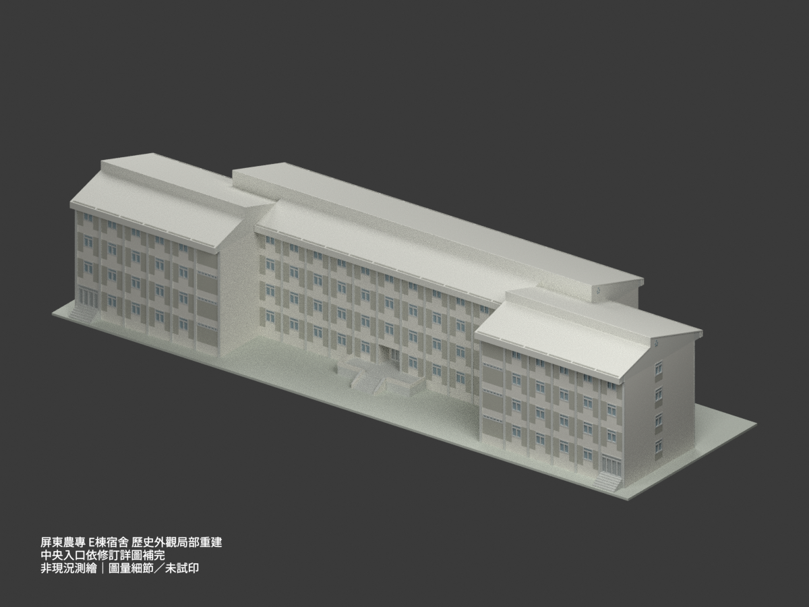
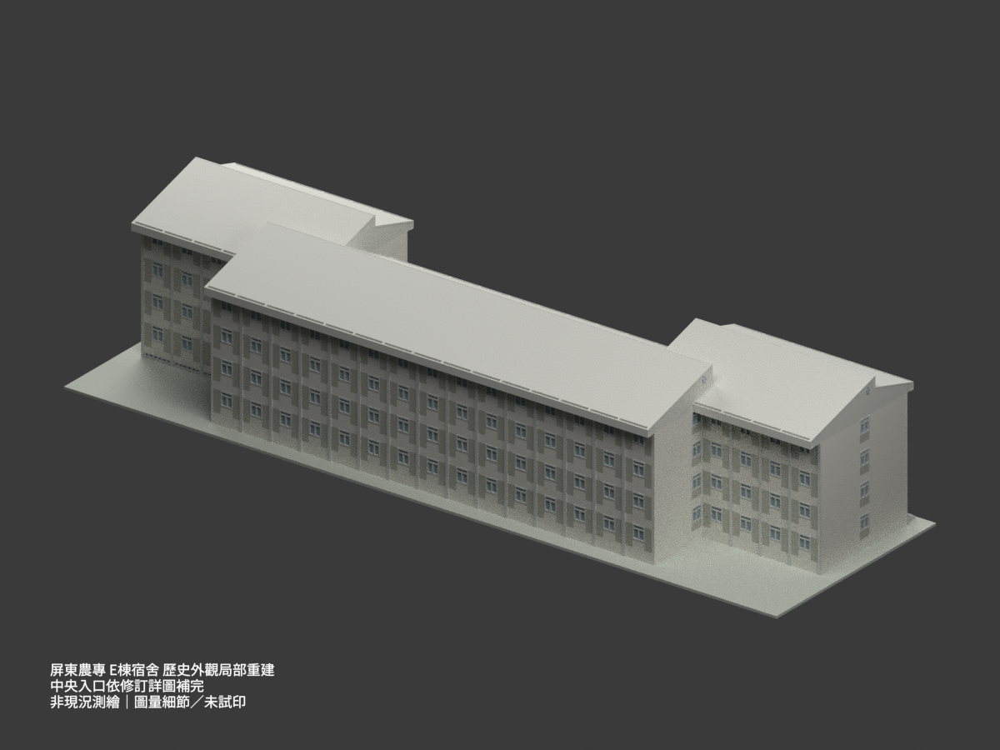
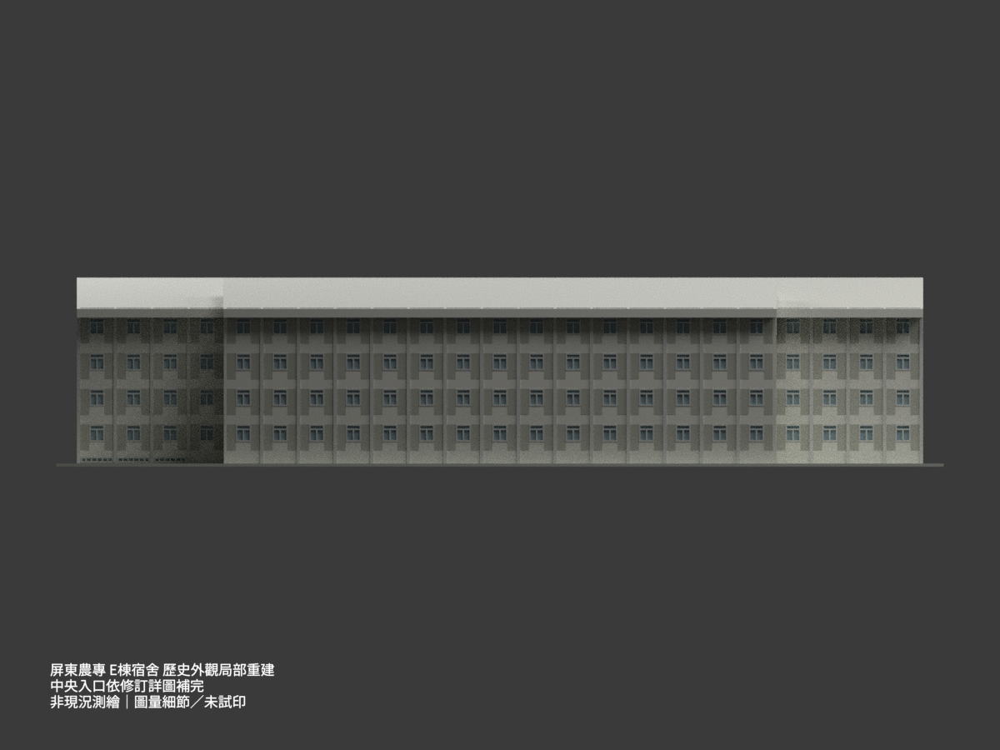
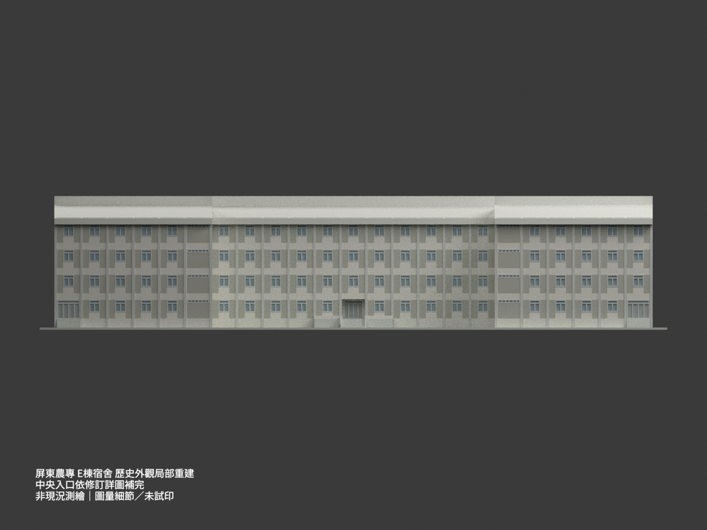
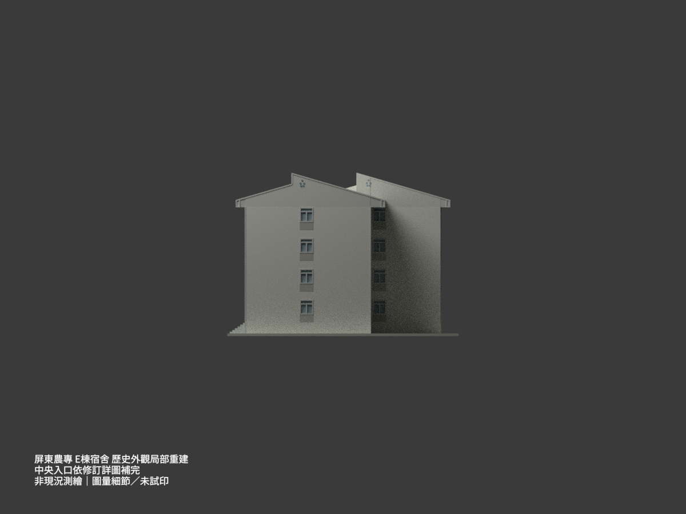
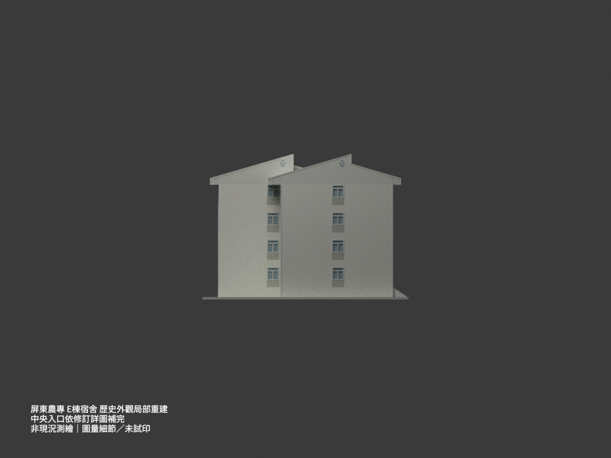
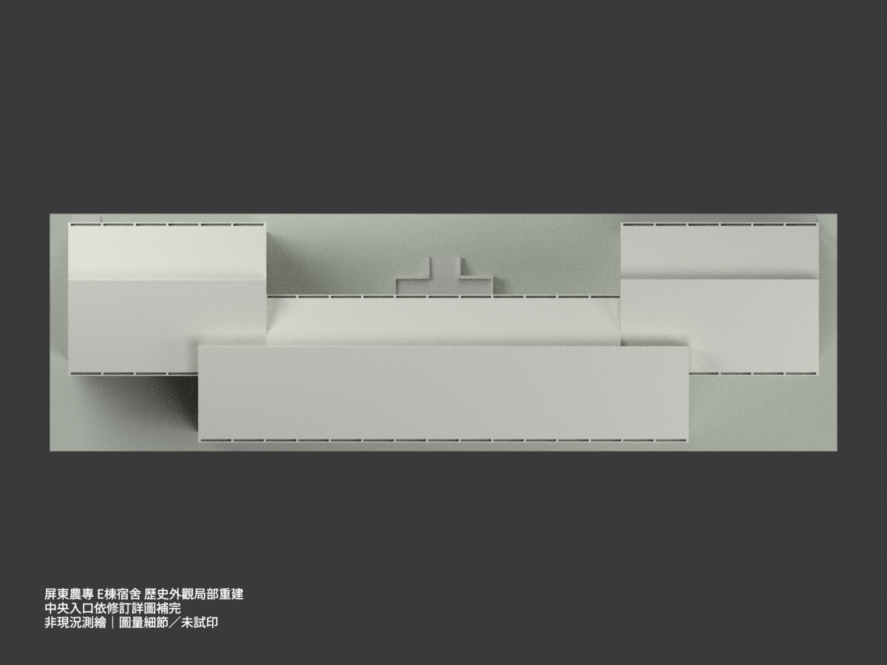
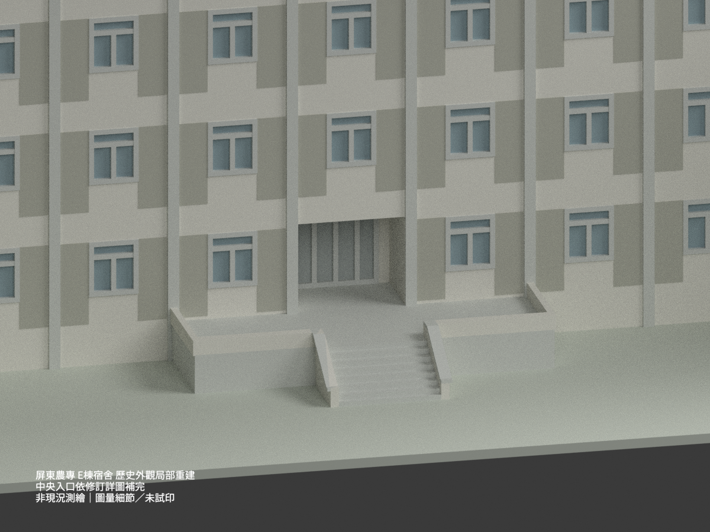
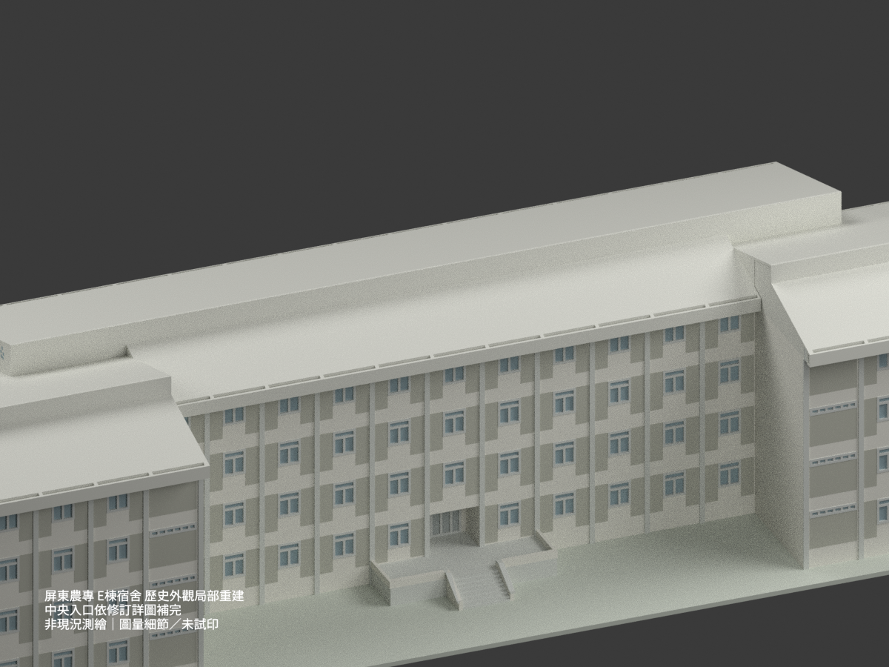
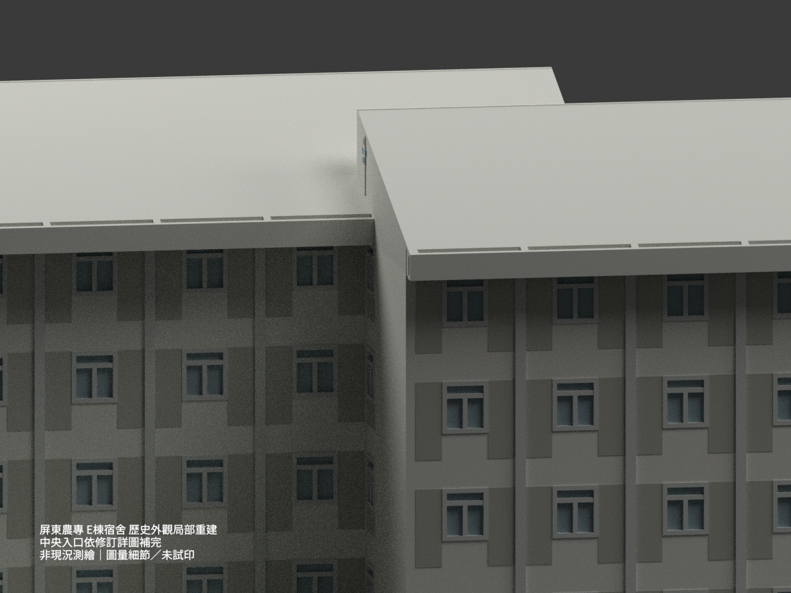

# 屏東農專 E 棟宿舍｜1986–1987 圖示歷史外觀局部重建

**中央入口已依新定位的 E 專屬修訂詳圖補完，更新同一模型，不另計新建築。** 仍為歷史外觀重建，非現況測繪或竣工認證；地下道及隱蔽內部不重建。

## 模型預覽（10 張實際渲染）

所有視圖均帶歷史重建與未試印警語；底座僅為展示支座，不是測繪地形。

| 視圖 | 視圖 | 視圖 |
|---|---|---|
|  |  |  |
|  |  |  |
|  |  |  |
|  | — | — |

## 範圍與版本

國立屏東農業專科學校（今國立屏東科技大學）內埔校區學生宿舍 E 棟，僅依歷史圖示重建可見外觀的一部分；未確認今日棟名。A2-17 標 76.4（1987 年 4 月），另採有明確 E 棟身份的 75.5（1986 年 5 月）首層及屋簷修訂控制。75.5 不是 76.4 之後的修訂；不把全部圖紙假定同日或竣工圖。首層中央入口採修訂平面，不延用立面舊普通窗。

2026-11-02 補圖更新：原包因缺詳圖而明示省略中央階梯；現已定位首層直接引用的 A2-1′ 圈2，以及 A4-1′／A4-2′。共用圖右端明標 E，日期75.5吻合入口修訂，不把 D 的印刷尺寸直接移植。原凍結版與勘誤另存私人審計，這是同一 E 項目的補完，不另計套數。

中央階為 **6踏面×30cm、7落階×15cm＝105cm**；1FL=0，廣場結構−1.20，上15cm面層後完成面−1.05。E側平台直接鏈為300+35cm帽（25cm牆身加兩側5cm帽），45cm矮牆。依 E 平面 C–B=590cm校準，中央階起距C約3.50m、末端約5.45m，均為 **圖量±0.10m**，不是 E 原圖直接印刷545；不可因數值近D便誤稱同一直接標註。淨階寬約3.10m亦為圖量。只補E側門廊、平台、六踏面及連續側矮牆，不造31m共用廣場、地下道或另一棟入口。

補核南立面及未劃除地下平面：僅最西24–21軸三跨可見地下低窗，於x1.8／5.4／9.0、南側翼面y7.865補入；寬約3.20m、高約0.55m、FL−1.10至−0.55為圖量，不套D整排低窗。其他地下取消區、隱蔽室內及設備仍不補造。

## 尺寸與來源界線

- 軸域 **82.80 × 21.90 m**（23 跨 × 3.60 m；橫向 8.00 + 5.90 + 8.00 m），不是外緣包圍盒。屋頂長 83.15 m，兩端出軸 0.175 m；橫域 −1.25 至 23.15 m。
- 四層，層高 3.50 m；以 1FL=0、RF=14.00、屋脊=17.08 m、圖示 GL=−1.20 m 為基準。因此脊距圖示 GL 為18.28 m。底座僅作者支座，不宣稱現場地形。
- E 棟兩組長坡同向，不是 F 棟的反向坡。中段長坡 10.60 m、短坡 5.80 m；北端長坡 10.60 m、短坡 6.40 m；兩脊間距7.40 m。
- 北端落階 **1.22 m**由 E 的 A4-7 剖面讀出。中段落階 **1.395 m**為坡度／短坡幾何推導，不是把未確棟別的 A4-8 當直接 E 證據。中、北翼重疊區的高坡直接落至北翼長坡，沒有額外虛構短坡折線。
- A2-17 初圖凹角圈號19與1440尺寸鏈不符；E 樓層平面及另張75.5屋頂圖均以20支持14.40m端段，依物理輪廓對位。研究初讀的2400／2170、GL100／屋脊300已撤回，原像素是2190、120、308，**不是另選版本**。
- E 屋頂明確索引 F 圖張 A2-22 的 **1-1／1-2共用屋簷細部**，僅引用此細部，不借用 F 主體／屋頂輪廓。挑簷依 E 各側1.25／1.85 m；假梁寬23cm，結構梁註23×60cm，外緣下垂85cm。排水槽12+26+12cm，頂部開口且按 E 實際開間分段；暗管是埋入假梁的落水管，不把槽封蓋。隱藏管線、鋼筋不製作。

## 圖量、簡化與列印

門窗與立面局部框格按 E 平立面、3.50m層高與3.60m開間校準，容許約 ±0.10m 圖量差，非精測。側面不由單面盲鏡射。屋皮16cm為外觀／列印表達厚度，不是已核結構板厚。窗框加厚至15cm，1:300成品約0.50mm；玻璃採不透明封閉凹面、內部實心化，假梁槽內不建暗管。兩端已有階梯採可見外形與1.20m高差等分的簡化表達，不能當施工級踏步尺寸。中央階梯已按直接引用的 prime 詳圖補完，階數與高差不再以GL等分猜測；兩端舊階的圖量限制仍保留。

顏色只表達圖示馬賽克、混凝土與窗框區別，非現場採色。5個圓形通風花紋為淺浮雕，不模擬通風構造。布林結果先以STL浮點精度正規化，再在0.00001mm數值容差與同級座標合併下消除退化接縫，保留每面材質，不改來源尺寸。

比例 **1:300**，含展示底座約290.67×87.67×61.93mm。**未實際列印**；細槽、屋簷懸挑與薄窗框需自行切片檢查，可能需支撐、調整朝向或放大。網格測試不等於物理試印成功。

## 檔案與重建

`model.stl`（毫米）、`model.3mf`（毫米／分面色）、`scene.blend`、`mesh.npz`、可重現程式與檢查紀錄。Blender場景中的文字是警語，不進入列印網格。

```bash
python -m pip install -r requirements.txt
python build_model.py
python export_3mf.py
python validate_model.py
blender -b --python render_model.py
blender -b --python verify_scene.py
```

## 來源與權利

見 [來源登記](SOURCE_REGISTER.md)，原十四張及新增三張 prime 詳圖只作私人比對，**未放入本公開包**。館藏原圖標示 **CC BY-NC**，元資料若另標 CC BY 不取代圖像授權。模型、程式與渲染為本次重建產物，但不據此宣稱建築設計及第三方權利已獲商用許可，也不將原圖授權擅改為整個模型的概括限制；使用者需自行確認適用權利。
