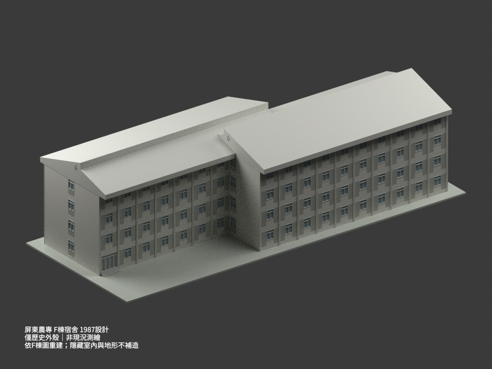
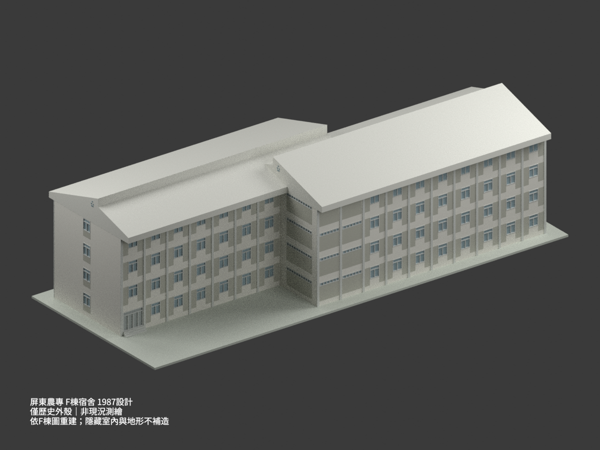
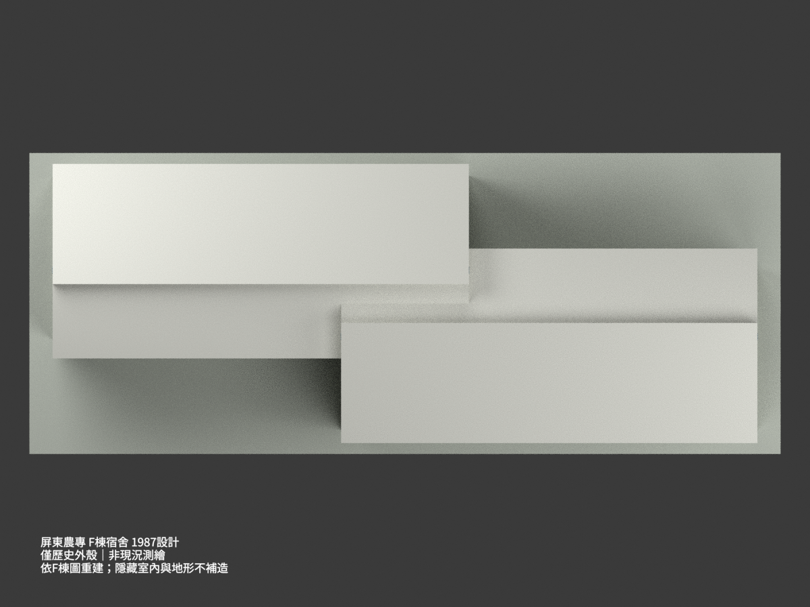
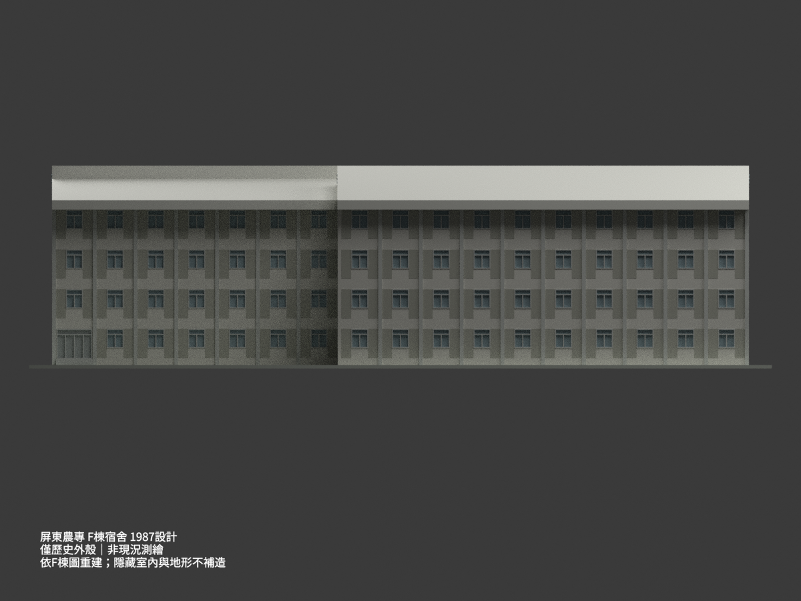
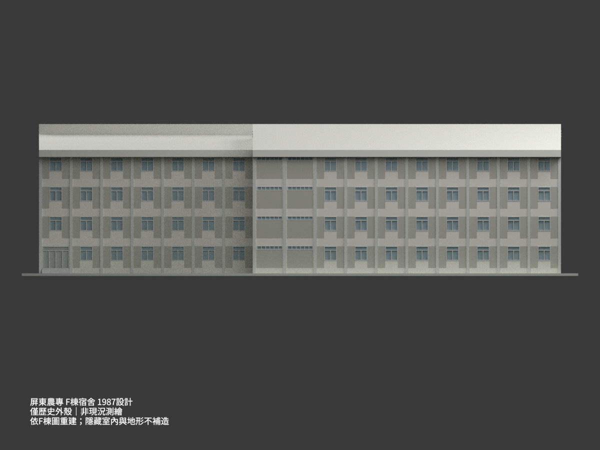
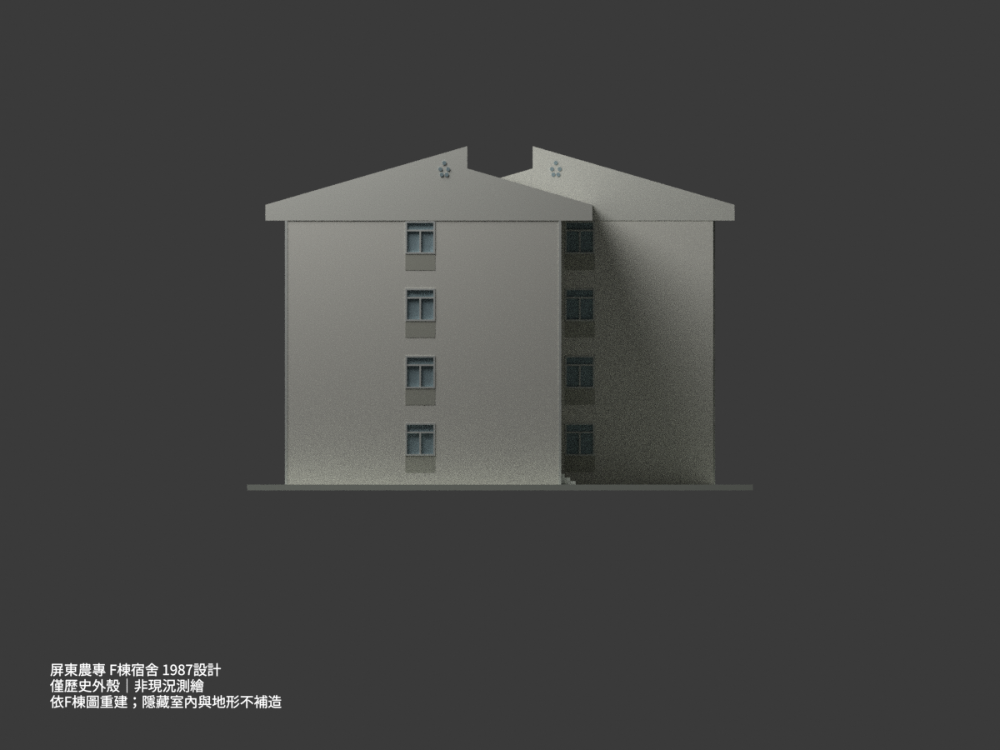
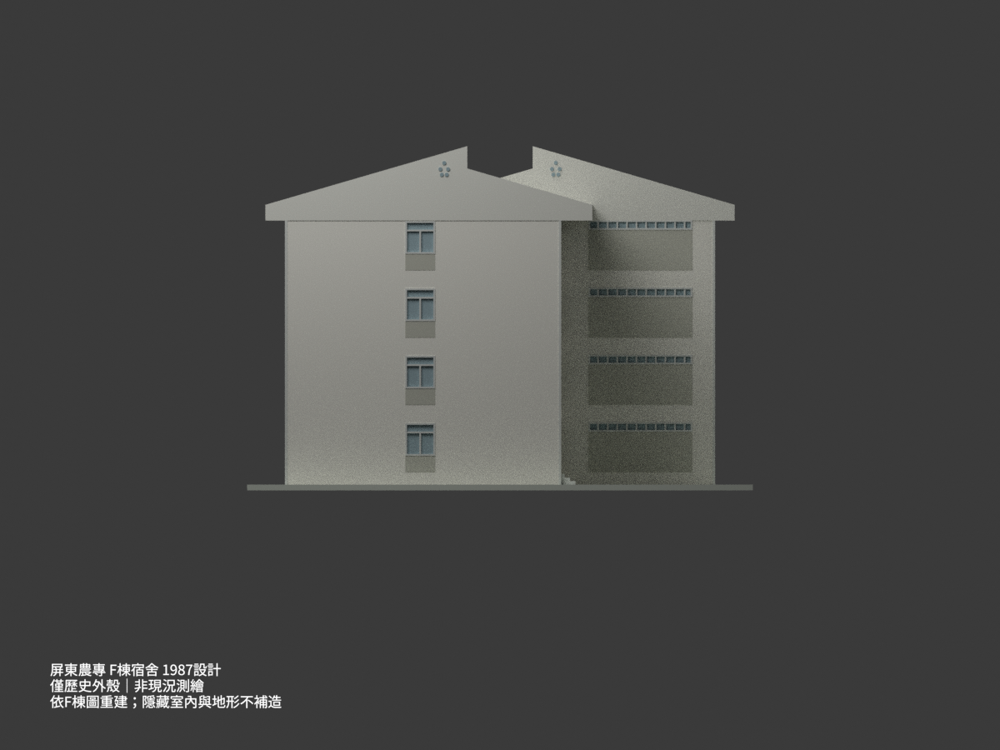
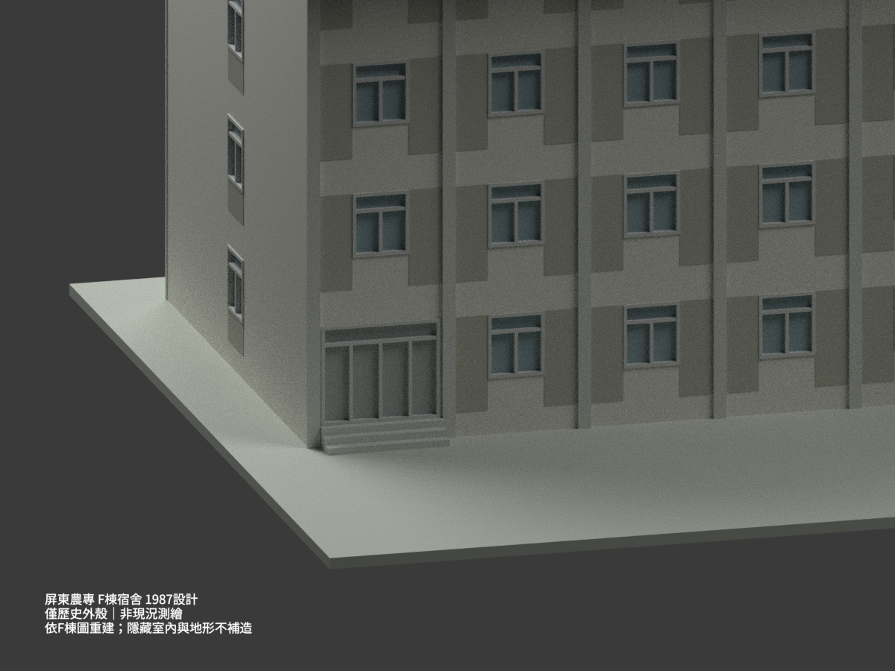
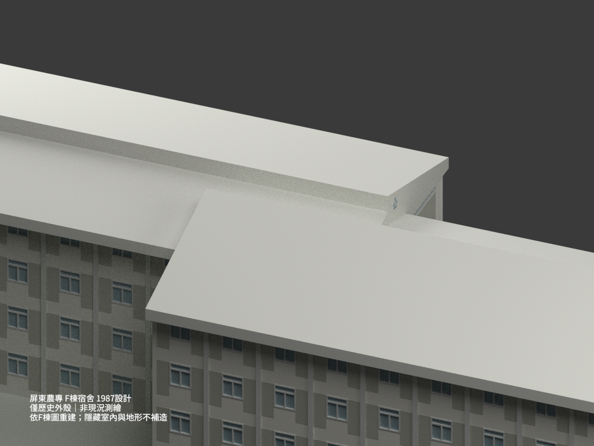
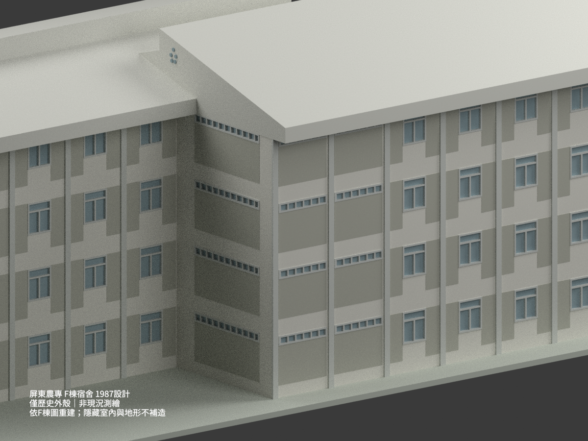

# 屏東農專 F 棟宿舍｜1987 歷史設計外殼

## 模型圖片（實際三維渲染）

| 正面與全景 | 背面與側面 | 屋頂與細部 |
|---|---|---|
|  |  |  |
|  |  |  |
|  |  |  |
|  |  |  |

## 範圍與來源

本件是國立屏東農業專科學校學生宿舍 **F 棟**的1987年歷史設計外殼；校名現為國立屏東科技大學。僅一棟相連、兩翼錯位的四層宿舍，並非整個宿舍區。未確認今日建物名稱或現況，不能以字母或年份推認為某座現名宿舍，也不把設計模型稱為竣工實測。

A1-3與A2-22圖欄「76.4」對應1987年4月；A1-3另有76.6第三次修訂，取消F棟南方人行步道及踏步，本件不重建該取消工程。其他圖欄未全標日期，不聲稱七張同日。

採國立臺灣博物館建築館藏中F棟專屬七張：配置、地下層平面（只核範圍）、二三層、四層、屋頂與四向立面。作者依圖欄為陳其寬、董家範、石企孟聯合建築師事務所（C. K. Chen & Associates）；逐張連結見 [來源登錄](SOURCE_REGISTER.md)。此棟與1990新女生宿舍不同：1990配置圖將既有／核准D、E、F區與另擬建女生宿舍40分別標示，並非只憑日期排重。

**未取得一樓內部平面。** 本件的一樓可見牆面、入口與開窗依本棟立面；不補隱藏入口退縮或室內配置，不重建地下室內部、地下外露範圍、精測地形或後來改建。

## 尺寸與屋面控制

- 主軸域 **61.20 × 21.90 m**，長向17跨×3.60 m；橫向8.00＋5.90＋8.00 m。每翼軸寬13.90 m，錯位8.00 m。這些是軸線，不是外牆或屋頂外包尺寸。
- 採1FL＝0；各樓0、3.50、7.00、10.50 m；RF＝14.00 m；F棟立面屋脊＝**17.05 m**。本棟圖示GL低於1FL **0.55 m**，脊距該GL17.60 m；展示底座不是現況地形。
- 屋頂不是平板或對稱雙坡：兩翼長坡相向，單翼橫向 **10.50＋6.50＝17.00 m**；上升3.05 m後落階 **1.16 m**，低側峰為RF＋1.89 m。短坡以6.50 m回到RF；兩坡率因原圖四捨五入有約2 mm的計算閉合差，不硬改直接尺寸。
- 橫向兩側挑出依F屋頂平面分為 **1.25／1.85 m**，不是兩側各1.55 m；長向端面依F屋頂平面採軸外0.175 m；側立面的100 cm是橫向簷口參照，不能誤用為長向挑出。
- A2-22屋頂端軸標號與樓層平面有局部互置：中間11軸仍在25.20／61.20約41%的位置，D／A方向也未反轉。本模型依A2-20／21一致的外形、尺寸鏈與中間軸對位，**不因錯置的端軸號鏡射整個屋頂**。

## 來源適用性勘誤

前期來源包曾將A4-7、A4-8當成F棟屋面控制；該判讀已正式撤回。實圖A4-7圖號框明標 **E棟**，A4-8適用棟別未獲F棟索引證明（不能逕稱D棟），本件兩張均不採作幾何控制。因此不採其10.60＋5.80 m、3.08 m上升、1.395 m落階、GL低1.20 m等值；原先所謂F棟「脊差3 cm／GL差65 cm」亦撤回，不是本棟內部未解矛盾。這是更正跨棟來源適用範圍，**不是任選另一個F棟方案**。

## 圖量、簡化與未確認內容

窗、窗台、上亮分隔、端簷底及立面材料帶以F棟350 cm層高／360 cm開間校尺，約 **±0.10 m圖量容許**，非全部直接標尺寸。一般窗名義1.50 ×1.70 m、窗台約0.95 m；檐帶圖量約0.85 m，模型採0.82 m以避免與頂層窗框共平面重疊，仍在上述估讀範圍。不同面的浴廁高窗、走廊端窗和入口分別配置，沒有盲目鏡射。

屋頂封閉體表達可見外形與山牆，不表示坡屋皮或屋架是實心混凝土，也不聲稱知道其結構厚度或簷溝內部。圓形山牆通氣孔以淺色面／凹凸外觀表示，不建隱藏管道。玻璃為不透明著色背板以封閉列印幾何；窗細料、精確色彩、表面磁磚尺度未查證，深淺馬賽克區位置來自圖面，顏色僅示意。入口可見小階為依立面總差推導的等分階，非取消的校園步道。

## 檔案與重現

`model.stl`、含色彩的 `model.3mf`、`scene.blend`、原始數據`mesh.npz`、十張PNG及完整程式均附。格式單位為 **mm**，比例 **1:200**。以`requirements.txt`建立Python環境後：

```bash
python build_model.py
python export_3mf.py
python validate_model.py
blender -b -t 4 --python render_model.py
blender -b --python verify_scene.py
```

使用NumPy、trimesh、manifold3d；渲染以Blender 4.3.2／Cycles 64樣本製作。中文字型若系統提供Noto Sans CJK則使用，否則顯示英文範圍說明。渲染標示是場景文字，不進STL／3MF建築網格。完整重建與各格式／場景檢查結果見相應QA檔。

## 列印與權利限制

**未實際列印。** 單連通水密及格式通過不等於可免支撐直接列印；深挑簷、窗框、山牆細孔需切片評估。窗框等細件調整為名義0.09 m（此比例0.45 mm）浮雕；不可當成原建築實際框料尺寸。含底座包絡約328 ×131.5 ×89.5 mm，需要足夠列印範圍或自行合理分件／縮放，不附未測試的免支撐承諾。

館藏**原圖為CC BY-NC**；元資料的CC BY須與原圖授權分開理解。原圖、裁圖與私人來源審核只留私人備份，公開模型包不含原圖或以原圖為貼圖。此處不自動替自製幾何或來源衍生內容推定通用商用權，也不把原圖授權未經分析一律套成整包模型授權。使用者仍須尊重來源署名與實際適用權利。
