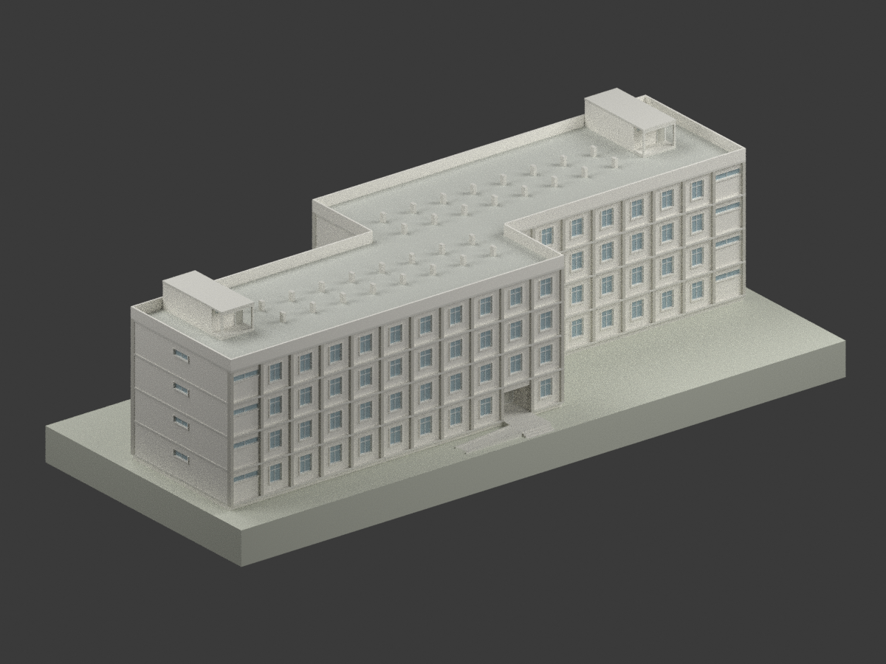
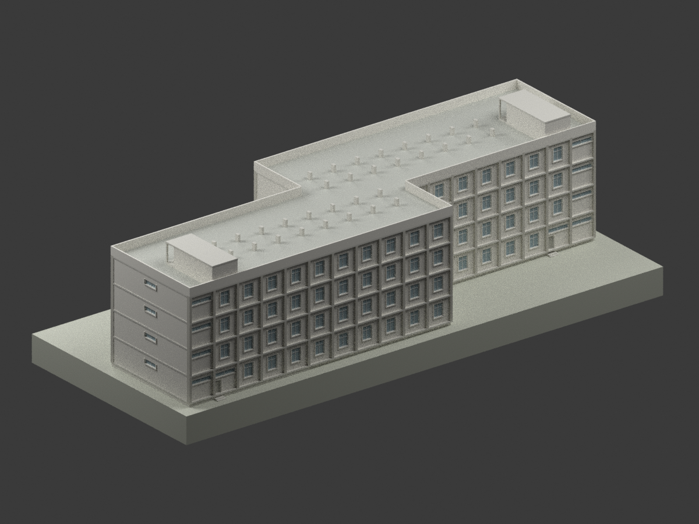
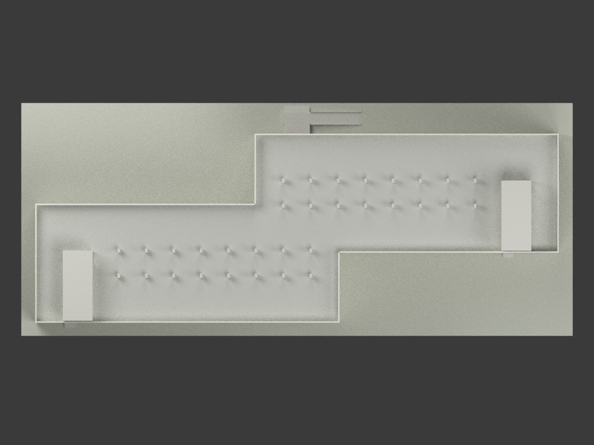
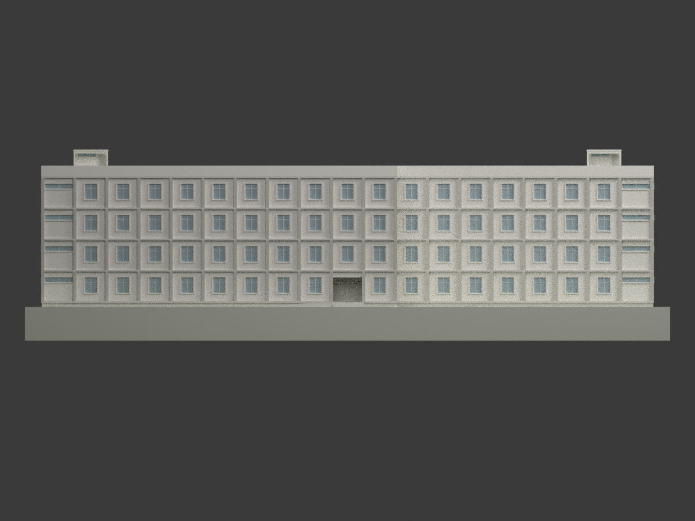
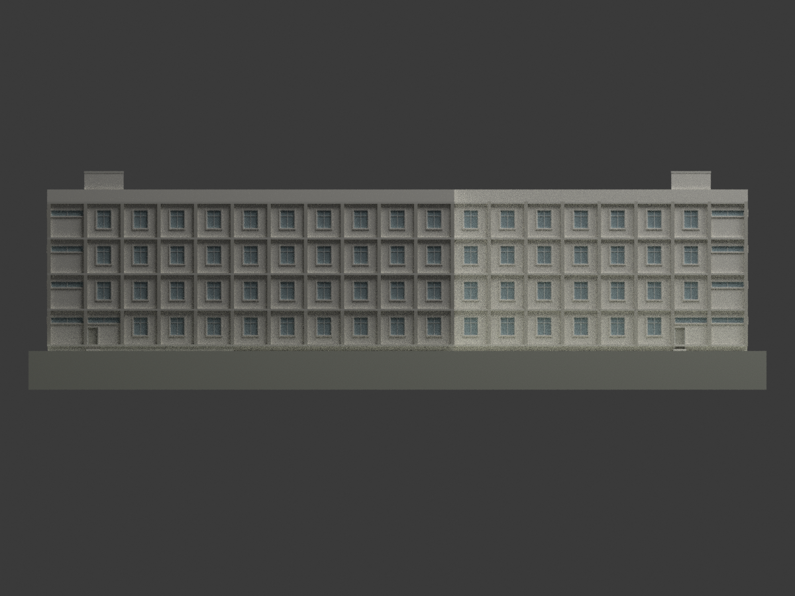
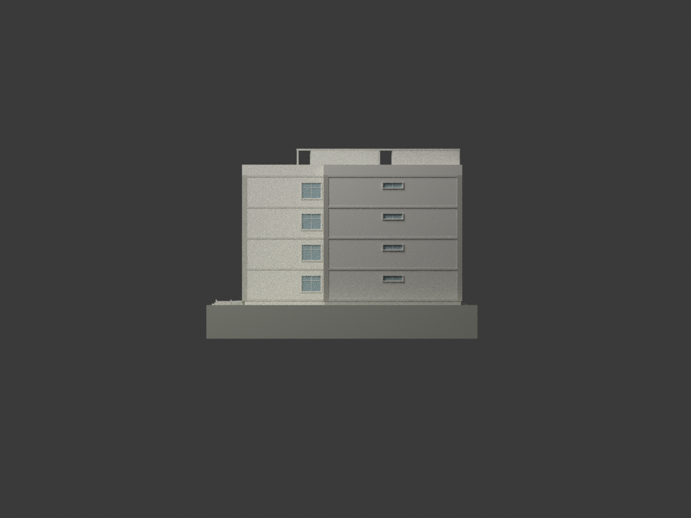
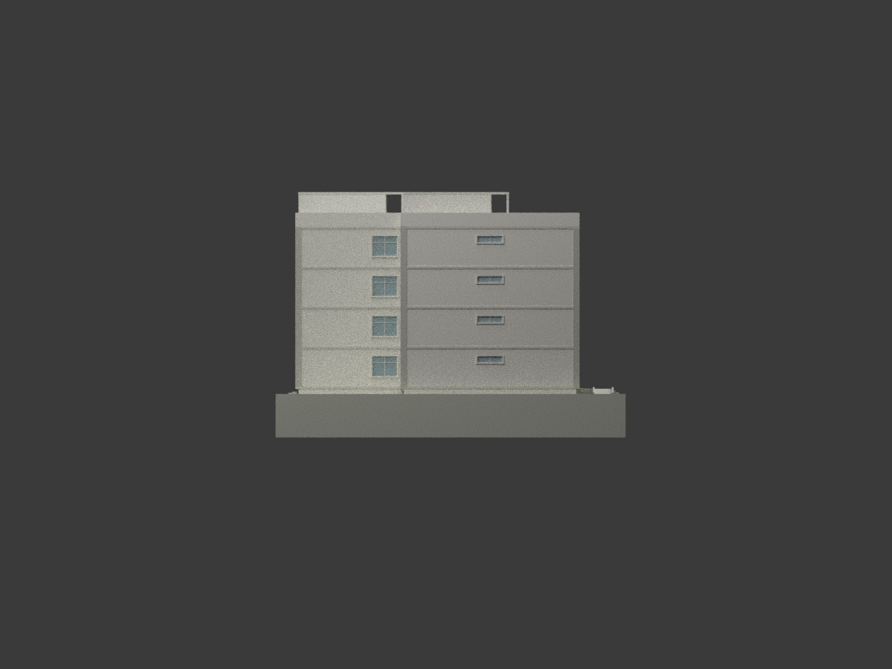
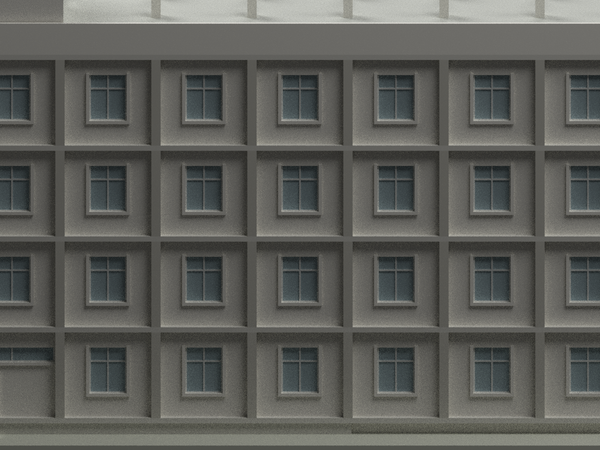
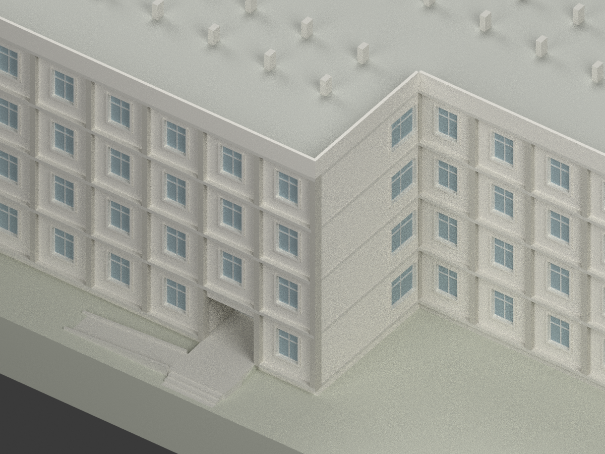
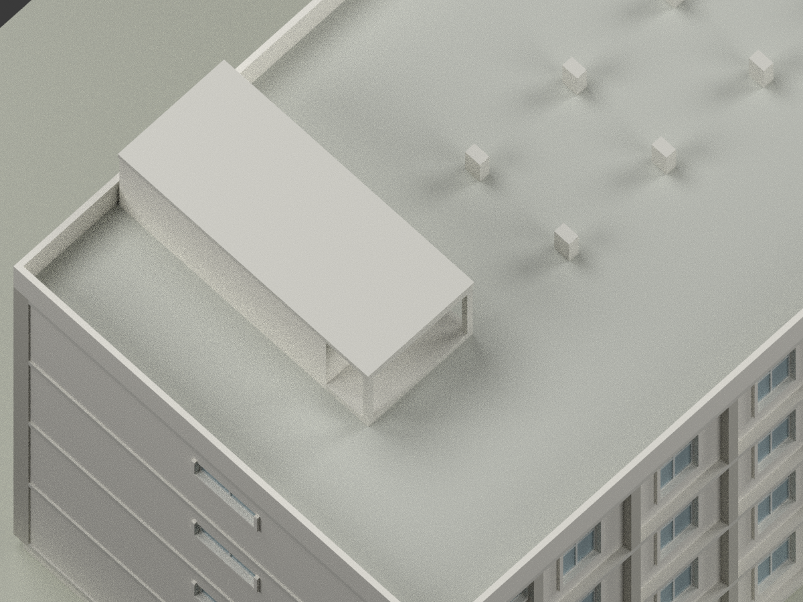

# 屏東農專女生宿舍｜1990 年原設計模型

## 模型圖覽

| 全貌／立面 | 全貌／立面 | 全貌／細部 |
|---|---|---|
|  |  |  |
|  |  |  |
|  |  |  |
|  | 細部圖為刻意局部取景 | 中性配色，非現況照片 |

## 身分與範圍

本件重建陳其寛／陳其寬聯合建築師事務所於 **1990-08-31（民國 79.8.31）**所繪「國立屏東農業專科學校男生（女生）宿舍新建工程」中的**女生宿舍**。日期由題欄確認，並非完工日期。學校現名為國立屏東科技大學；A1-1 將本件標為內埔校區規劃女生宿舍第 40 號。**未證明其等同今日哪一棟命名宿舍，也不宣稱已建成、仍存、現況或測繪精度。**

依女生 A2 平面、A3 四向立面、A2-4 屋頂、共用 A4 高度與構造、A6 窗表，建置兩翼錯位相連的四層建築、兩個樓梯屋突、32 個露出屋面柱墩、主要外窗、入口凹廳及坡道。地下室保留在程式中的封閉 L 形量體，但被展示地面包覆；模型不是室內、結構或無障礙施工圖。

## 尺寸控制與圖面判讀

- **軸網不是外框：**1–20 軸為 19×3.60＝68.40 m；A–F 軸為 5.90＋3.30＋5.90＋3.30＋5.90＝24.30 m。西南翼為 1–12／A–D，東北翼為 9–20／C–F，中央為連通交疊區。
- A2-3 牆心鏈 5.955＋2.920＋5.955＝14.830 m，與 15.100 m 柱軸跨距不同；兩翼外牆心分別為 y＝0.135／14.965、9.335／24.165 m。名義牆厚 23 cm。外柱約 35×55 cm、端牆相對軸線、外包及窗水平退縮為**圖量解讀**，不是已標註的整體完成面尺寸。
- GL＝0；四層完成面＋0.65／4.15／7.65／11.15 m；屋面＋14.65 m；女兒牆頂＋15.85 m；樓梯屋突頂＋17.65 m。不要把 A3 的鋪面＋10 cm 基準混入 GL。
- 地下室依**女生 A2-1**：1–11 軸／B–D，加 1–6 軸／A–B，為 L 形；BFL＝−3.50 m 自 GL 起算，與 1F 相差 4.15 m。共用 A4-2 把地下室畫在另一翼，本件不鏡抄該位置。小檢查井、地下室室內、地形開挖均簡化。
- 屋頂外側女兒牆為直邊。A2-4 內部鋸齒線是 **30 cm 排水溝繞柱**，不是鋸齒外輪廓。屋面 1/100 排水坡、溝、泛水細層以平面展示簡化；未加水箱或猜測斜屋頂。
- 南翼 B／C 行 4–11 軸與北翼 D／E 行 10–17 軸，共 **32 根高 1 m 柱墩**；周邊柱併入女兒牆。兩屋突壁心寬 3.73／3.75 m，加 12 cm RC 壁推導外寬 3.85／3.87 m；深度按 3.30＋5.775 m 參考鏈解讀，完成面相對軸線配置仍屬有限圖量。A2-4 與 A4-1 顯示屋突北端約 156 cm 為有頂開放前廊，D3 與該處標示 210×55 cm 窗位於內退牆；屋頂覆蓋前廊，未將其誤封為全高外牆，前廊地坪採 RF＋30 cm，內外 5 cm 微小高差與門窗微細框位簡化。
- W1＝140×175 cm、窗台 90 cm；W3＝220×175 cm；W2＝220×55 cm、窗台 210 cm；W4＝320×55 cm，窗台以相關立面近似。最外西／東端是浴廁 W2；W3 在另外兩個**內退階端面**，不能把兩種窗放到同一外端牆。
- 南側交誼廳外牆仍為三個 W1；W6／W7／D2 屬內走道面，因封閉室內不重建。兩端地面樓梯出口採 D5＋上部 W4，與上層 W1 不同；D5 門板百葉簡化，上方 W4 與浴室高窗同列對齊（GL＋2.75～3.30 m），不隨樓梯門檻＋20 cm 降低。
- 北入口 DW1＝335×265 cm，位於門廳內而非 F 軸外牆平面；凹入深約 2.5 m 為圖量。門廳由＋65 cm 坡降至＋45 cm 平台，北接三級。東向坡道標 665×150 cm、1:14；665÷14＝47.5 cm 與平台＋45 cm 有 2.5 cm 差，本模型保留標示坡率並將末端取 −2.5 cm（展示地面局部遮覆），**不宣稱已解決施工標高或符合現行無障礙規範**。扶手省略、低緣石簡化。

## 檔案、比例與製作限制

- `model.stl`：單一連通封閉外殼，毫米。
- `model.3mf`：相同幾何、毫米、逐面基本材料。
- `scene.blend`：實際輸出的 Blender 場景；非僅效果圖。
- `mesh.npz`、`palette.json`、`components.json`：幾何、逐面材料及建模構件記錄。
- 比例 **1:300**；含展示底座約 **241.33×102.00×71.50 mm**。模型空間平移以底座底面為 z＝0，不是把歷史 GL 改寫。
- 室內封實，玻璃不透明有背板，窗框細分格（包括 W4 多小格）、門板百葉、馬賽克裝修框帶幾何和外包簡化。原 10 cm 女兒牆向內加厚為 18 cm；部分 6 cm 窗框在成品僅約 0.20 mm，**尚未實體列印**，切片、材質、朝向及細節可製造性須另驗證；水密網格不等於任意印表機都能成功。
- 展示底座／地面為作者附加，非測量地形。地下室形狀只在程式構件中可追溯，無法從不透明底座外觀驗證。未重建室內設備、管道、所有裝修縫、屋頂排水微坡與扶手。
- 圖面指定馬賽克及不同帶狀處理，但確切選樣色未明；材料僅採中性近似，不對應今日外觀。

## 重建與檢查

Python 依 `requirements.txt` 安裝；Blender 4.3.2 實測。

```bash
python build_model.py
python export_3mf.py
python validate_model.py
blender -b -t 4 -P render_model.py
blender -b scene.blend -P verify_scene.py
```

幾何測試檢查單一連通、水密、方向一致、無零面積、有限座標；STL 重新讀取比較、3MF XML 頂點／面／材料／單位比較、獨立目錄重建幾何雜湊、Blender 重開與圖框檢查分別記於 `*-QA.json`。布林接縫浮點退化面以極小厚度和零體積雙條件清理，並記錄刪除數，不以此任意刪去建築構件。來源及視覺審核另記 `SOURCE-VISUAL-QA.json`；完整檔案雜湊列於 `SHA256SUMS`。

## 來源與權利

12 張實際圖面之登錄號、題名與館藏連結見 [SOURCES.md](SOURCES.md) 及 `SOURCE-REGISTER.json`。收藏／數位展示：國立臺灣博物館「臺灣現代建築」典藏；設計者：陳其寛（圖框作陳其寬）及其事務所。學校沿革見[屏科校史](https://archive.npust.edu.tw/%E5%B1%8F%E7%A7%91%E6%A0%A1%E5%8F%B2-2/)。

館藏原圖標示 **CC BY-NC**；原圖與放大裁圖只存私人參考備份，**未包含於公開模型包**。本包程式、模型與渲染是本次製作的解讀成果，不能因此推論館藏影像或建築設計的權利已消失。原圖授權與本次製作檔案分開說明：不把原圖標示直接當成整包一律非商業限制，也不保證模型具有不受限制的商業利用權；再利用需自行確認適用權利、署名及授權條件。
