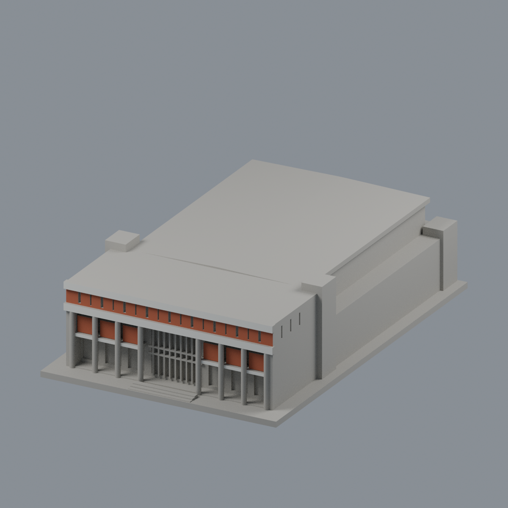
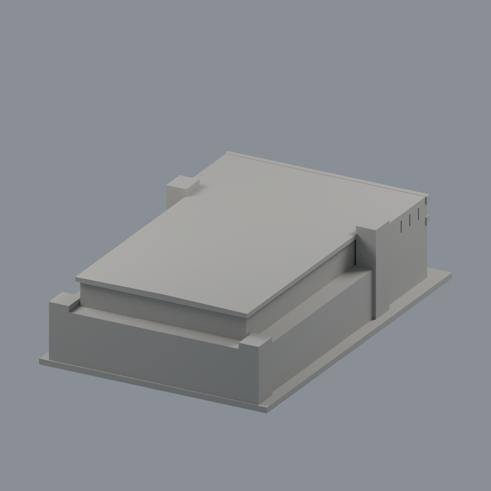
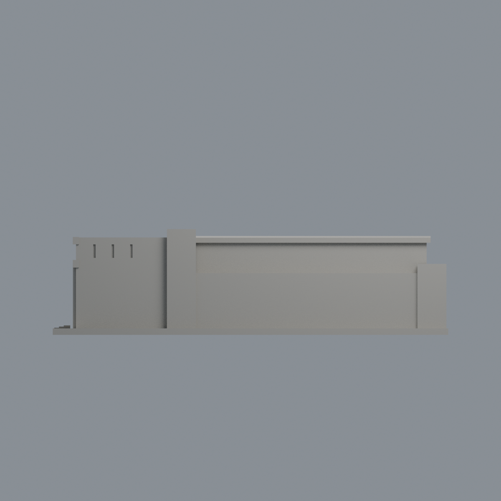
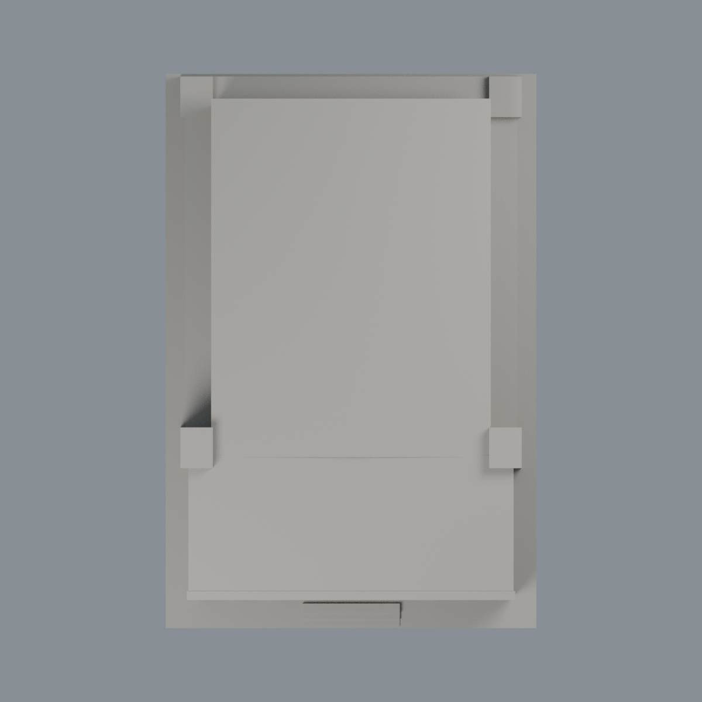

# 屏科大述耘堂 — 正面紅板與白帶限域配色

既有述耘堂近似模型的附加外觀層，不增加模型套數。原 STL bytes、3120 三角的座標與面序不變；不移點、切三角或新增幾何。

依兩張校方歷史影像相容的正面色類，僅塗 94 個完整原面、1232.14024 mm²：紅板 82 面 #AB593D，白水平帶 12 面 #D8D8D1。上18紅欄板的前表面70面（y=-66.2，x±44，z28.424–34.32）；下6紅板各2面（y=-64.7，x中心±17.16/26.84/36.52，各半寬3.52，z16.72–23.32）。白腰帶10面（y=-67.4，x±44.44，z25.52–28.424）、白上沿2面（同y/x，z34.32–37.136）。單位毫米，已計原 generator 的 Y+4.8 及 X/Z×0.88。全部三頂點滿足有限平面，不用面心或籠統bbox。

其餘3026面中性 #AAA79F，不代表現場色彩：側背、屋面、玻璃、柱身、板側/頂/底、槽深、細格與側翼均不延伸著色。證據邊界不是真實材質接縫。18板之間原有槽縫和縮尺連接保留，不新增縫線或描文字。色號為粗糙不透明視覺近似，非官方精測色，不模擬歷史曝光色偏。

2014原照只見部分正面；完整校史圖補足全正面。這不是任一單年的完整測繪、1990復原或2026現況。原幾何簡化與屋面推定保留；原歷史製造QA不重算，未實體試印，不保證免支撐或可印。

## 檔案與重建
- [彩色3MF](npust-shuyun-hall-appearance.3mf)、[Blender](scene.blend)
- [色票](palette.json)、[原面對照](face-materials.json)、[來源](SOURCES.md)、[許可](LICENSE-NOTICE.md)
- 五圖：[正斜](previews/front.png)、[後斜](previews/rear.png)、[正立](previews/elevation.png)、[側面](previews/side.png)、[頂面](previews/top.png)

| 模型預覽 | 模型預覽 | 模型預覽 |
| :---: | :---: | :---: |
| 正斜  | 後斜  | 正立  |
| 側面  | 頂面  |  |

原 model.stl 與 appearance 同父層。Python numpy 2.3.5、lib3mf 2.5.0 依序執行 source/build_appearance.py、source/verify_exchange.py、source/verify_material_boundaries.py；Blender 4.3.2 執行 source/render_appearance.py、source/verify_scene.py。strict 3MF真材質改存讀；Blend真材質/頂點改存讀及重開render；乾淨重建3MF、maps、五PNG bytes一致，Blend僅語義一致。

## 2026-11-13 有限外觀修正｜模型交付版
# 述耘堂六下紅板托帶前面有限增補

官方2014照片：https://ic.npust.edu.tw/wp-content/uploads/2024/08/述耘堂.jpg
完整校史原圖：https://archive.npust.edu.tw/wp-content/uploads/2024/05/1990年10月-述耘堂竣工.jpg

兩張原幅可辨下紅板下方淺色托帶。完整校史圖支持六帶，2014右裁圖只交叉可見部分。僅六原托帶垂直前面完整12面0→既有white2 #D8D8D1/.78；不頂/底/側返/柱/玻璃/屋頂/背面，不認證與上白帶同材產品或精測色。原粗寬厚與24邊柱交端保留，不新增細縫/文字，不稱逐點標定。

3120原面/面序/幾何與原3材保持，其餘3108indices（含既有94配色）不改。2014原元資料沿歷史已核記錄，本輪不冒稱重新核EXIF；1990/10為竣工條目非確證拍年，2024是上架。不是單年復原或2026現況。原製造QA與幾何推估限制保留，不認證免支撐/新試印。
模型與原生視角圖沿用完成候選的原bytes；不改幾何、不增加分界、不稱全棟精確配色或實體試印通過。公開預覽只含模型，不含新增圖片文字。原來源年代、工程及列印限制仍適用。先前敘述與審核屬其原版本，本段僅更新上述局部範圍。
本次只交付模型、必要重建輸入/腳本、預覽與此說明；完整研究與獨立審核紀錄另行保留，不在本批公開。PUBLIC-MODEL-SHA256SUMS只核本次所列公開產品，舊校驗與QA不代表本次新版。
