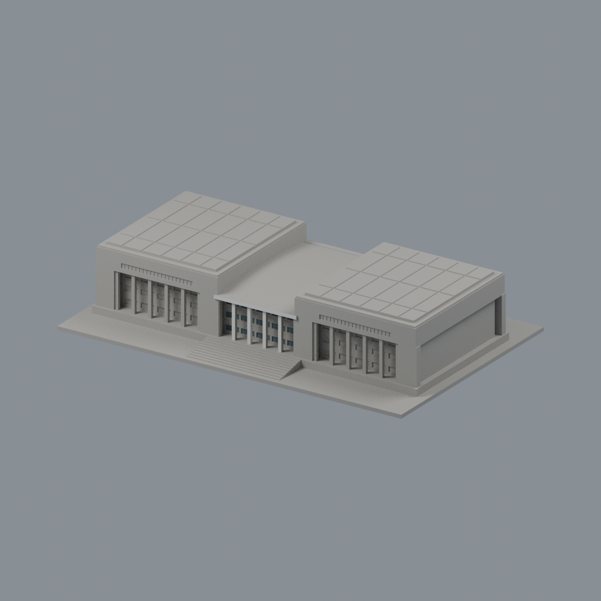
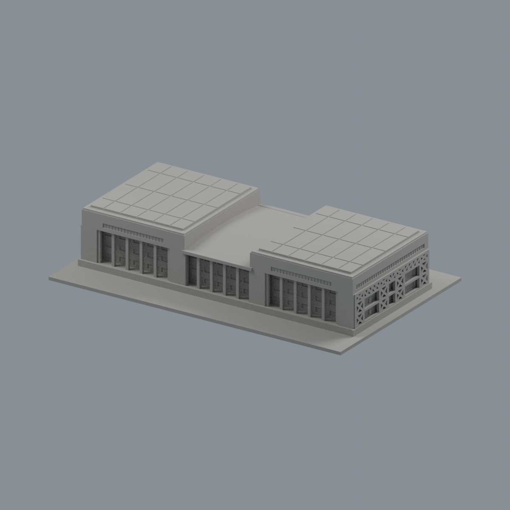
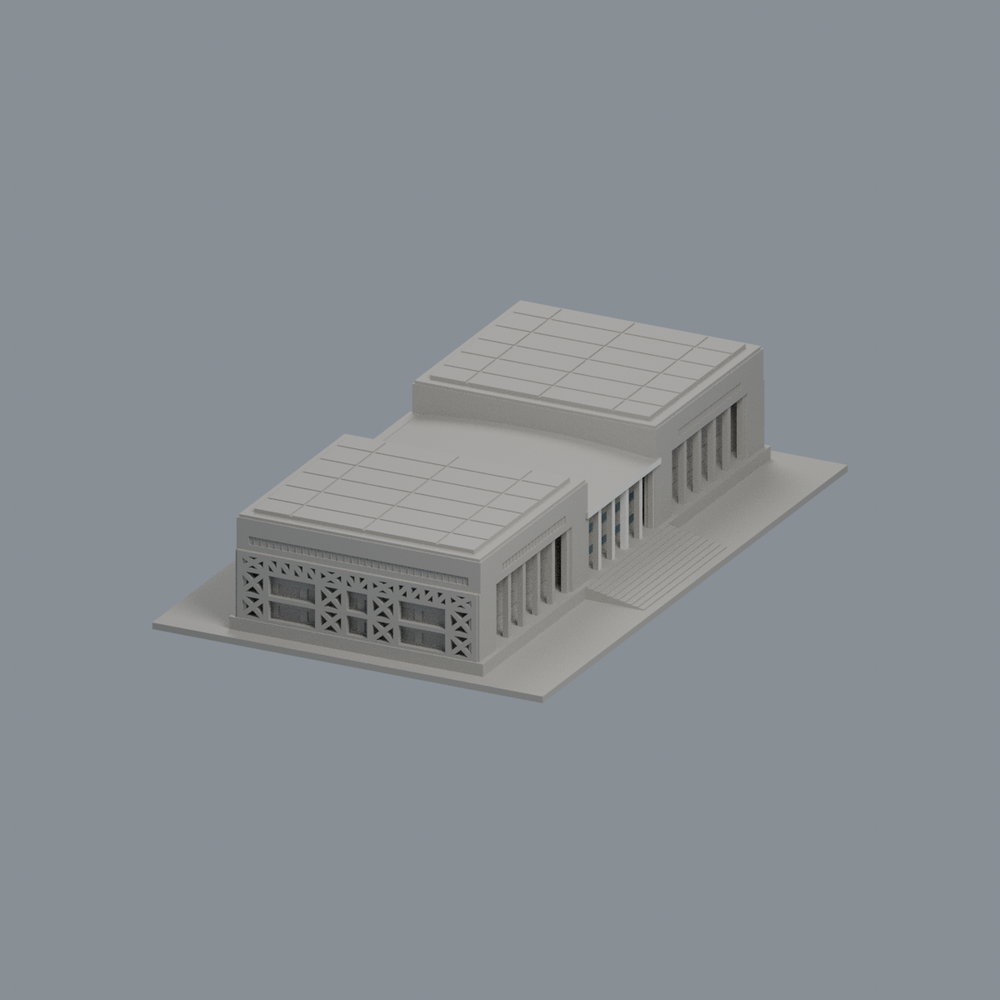
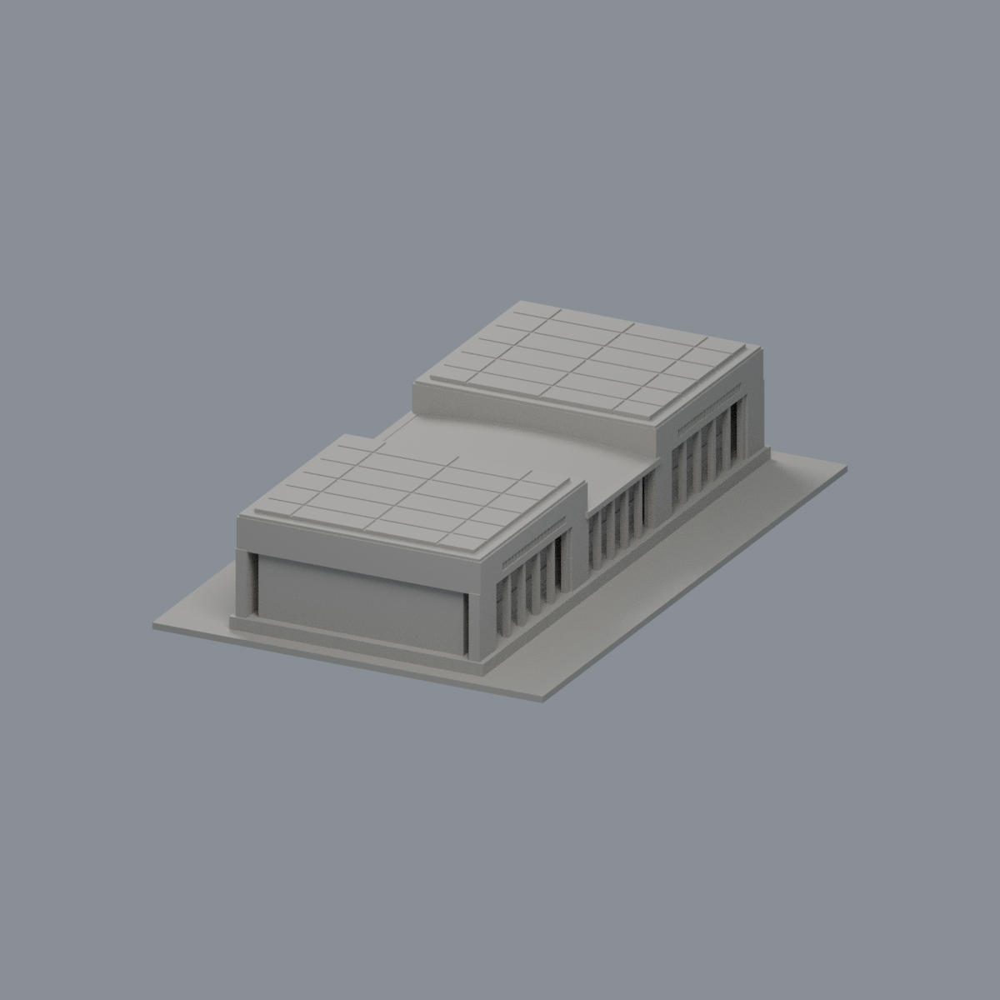
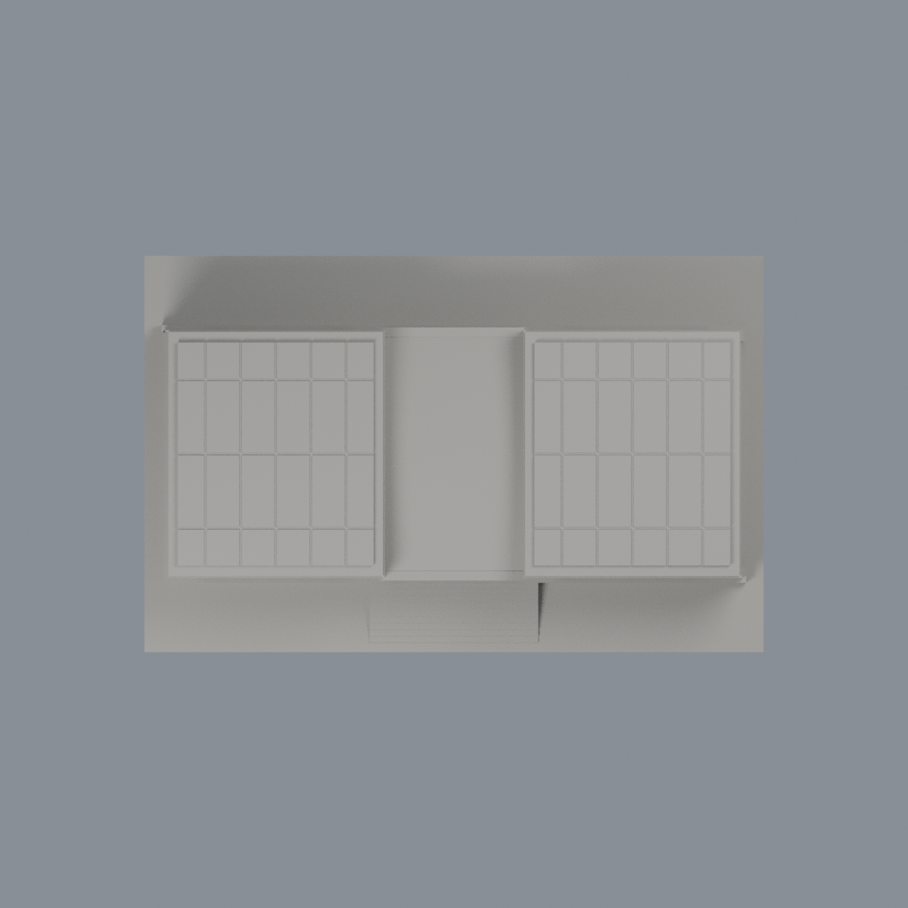

# 玉崗紀念圖書館｜前中央有限外觀層

僅 **30面中央凹窗背面＋14面前白柱／名牌梁**，共337.45678mm²；其餘7062面保持中性。正面中央小幅改善，不是全樓精準彩色或同年原貌復原。另四角度幾乎中性（左斜僅微弱差異）。灰色窗間牆跨界，不能整面染色；兩翼布幔遮擋處、後面、屋頂、未知玻璃及柱側／梁底不染。玻璃是深灰藍不透明近似；未加細框、反射、文字或貼圖。色彩未校準。

[三材質3MF](npust-yukang-library-appearance.3mf) · [可編輯Blend](scene.blend) · [原STL](../model.stl) · [重建源碼ZIP](rebuild-source.zip)

| 模型預覽 | 模型預覽 | 模型預覽 |
| :---: | :---: | :---: |
| 正面<br> | 背面<br> |  |

[左](previews/left.png) · [右](previews/right.png) · [頂](previews/top.png) · [同角中性對照](qa/mono-front.png)

| 模型預覽 | 模型預覽 | 模型預覽 |
| :---: | :---: | :---: |
| 左<br> | 右<br> | 頂<br> |

全7106原三角／面序不變，沒有增建或切割面。原模型跨1991、2012、105學年度、2024正射及2026照片的有界外觀近似、尺寸／薄件／支承限制均繼承原README與QA。本次只改材料，未實體試印、未產生切片工具路徑、不保證無支撐可印。模型外觀層不是校方色碼、結構或製造認證。

## 重建
Python 3.12、numpy與lib3mf（見source/requirements.txt），Blender 4.3.2：在原STL旁建立appearance/source結構後，依次執行：

```
python appearance/source/build_appearance.py
python appearance/source/verify_exchange.py
blender -b -t 4 -P appearance/source/render_appearance.py
blender -b -t 4 -P appearance/source/verify_scene.py
```

乾淨重建比較3MF、palette、face maps、五PNG bytes；Blend只宣告幾何／材料語義一致，不宣告二進位相同。[來源](SOURCES.md) · [授權](LICENSE-NOTICE.md) · [檢核](qa/) · [SHA256](SHA256SUMS.txt)


## 2026-11-13 有限外觀修正｜模型交付版
# 玉崗紀念圖書館中央兩柱內側有限增補

教育部官方頁：https://www.moe.gov.tw/News_Content.aspx?n=9E7AC85F1954DDA8&s=34B2A97FA69E35C4
官方原圖：https://ws.moe.edu.tw/001/Upload/photoedittemp/957bb274-e8e3-45f9-969e-1380f50deb2b.jpg

僅原中央兩柱朝中央的側返，各完整4面，共8面沿既有淺柱族2近似。原正面顏色不單獨作側材證據；原幅可辨淺柱側與後灰牆分開。低處人群遮擋部分為同柱有界推估，非逐點相機標定或同磚產品認證。柱背/外側、其他柱、窗/字梁底/屋面不擴。

原柱與梁交會、六柱位置與粗寬深不變，不建磚縫/燈具；7106面、原3材及其餘7098面保持。頁上版2026-01-22不是快門日期，未認證EXIF或現況。原跨年幾何/PV粗實板、2996密點真薄段0.264mm/背接及北鋼框上端36.3639392758%等工程限制與原報告保留，非新工程通過/實體試印。
模型與原生視角圖沿用完成候選的原bytes；不改幾何、不增加分界、不稱全棟精確配色或實體試印通過。公開預覽只含模型，不含新增圖片文字。原來源年代、工程及列印限制仍適用。先前敘述與審核屬其原版本，本段僅更新上述局部範圍。
本次只交付模型、必要重建輸入/腳本、預覽與此說明；完整研究與獨立審核紀錄另行保留，不在本批公開。PUBLIC-MODEL-SHA256SUMS只核本次所列公開產品，舊校驗與QA不代表本次新版。
