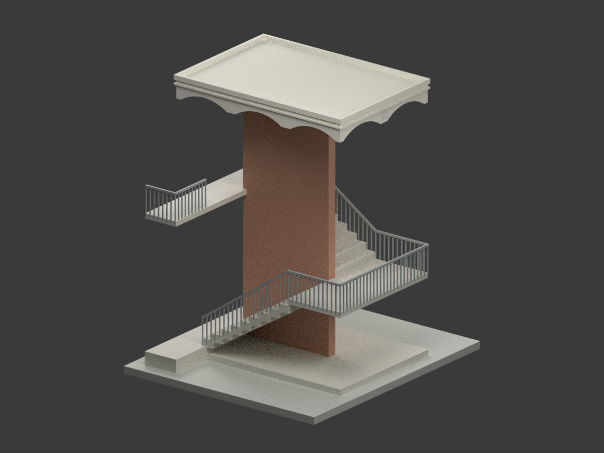

# 國立屏東高級工業職業學校｜校本部歷史建築設計研究

## 模型圖鑑

| 建築模型 | 建築模型 | 建築模型 |
| :---: | :---: | :---: |
|  **[外梯增建單元｜1971年8月原設計](buildings/ptivs-stair-1971-design/README.md)** [STL](buildings/ptivs-stair-1971-design/model.stl) · [彩色3MF](buildings/ptivs-stair-1971-design/model.3mf) · [Blender](buildings/ptivs-stair-1971-design/scene.blend) |  |  |

現行收錄 **1 套模型包**；不是完整教室樓、全校建築數或全校完成。

## 收錄範圍

陳仁和建築師事務所省立屏東高級工業職業學校樓梯新建工程，1971年8月歷史設計。僅外梯增建單元、中央貼磚牆、雙跑梯、平台與弧底雨遮；舊教室樓僅保留接口邊界，不猜補整棟。實際興建與現存狀態未確認，非現況或竣工測繪；圖量估讀、欄杆加粗、中性示意配色、需評估支撐，未試印。

[校方沿革](https://www.ptivs.ptc.edu.tw/home?cid=1042)記錄1970年改稱台灣省立屏東高級工業職業學校，2000年改為現名；歷史與現名合計同一所高中職，不列入大專校院校數。校本部為目錄分組，不據此聲稱1971案精確基地或現存身分；也不與屏東高中、屏東大學或屏東科技大學混算。

保留設計者與國立臺灣博物館典藏來源；原圖權利與本次模型／程式／渲染分開，不附原圖、裁圖或私人參考備份，不宣稱不受限制商用。

[回學校圖鑑](../README.md)
