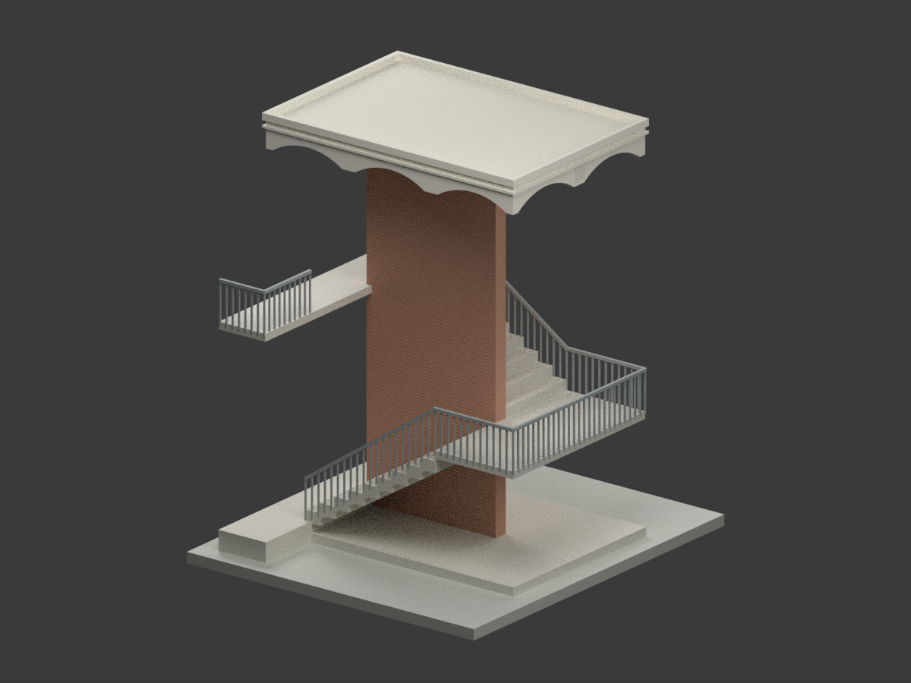
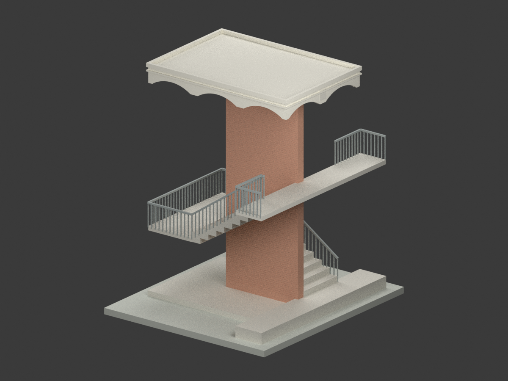
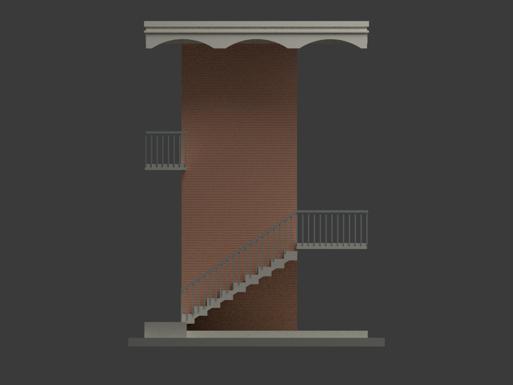
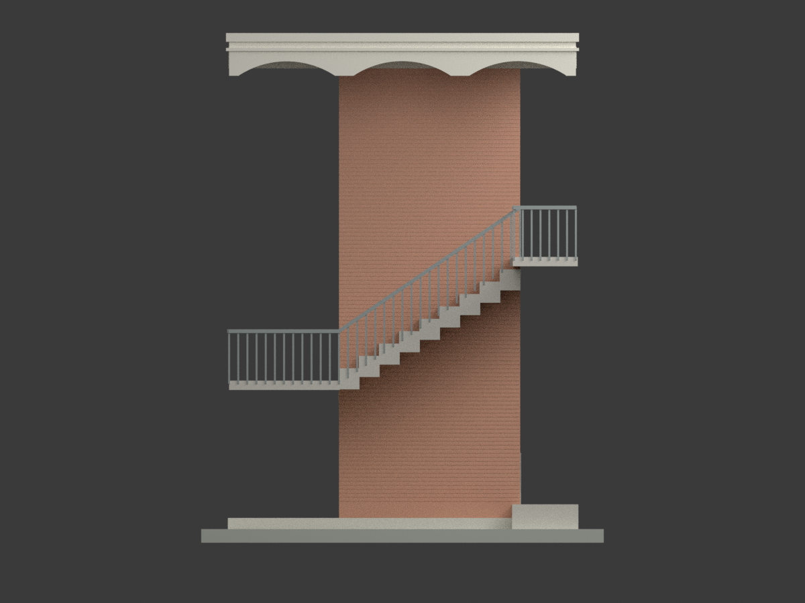
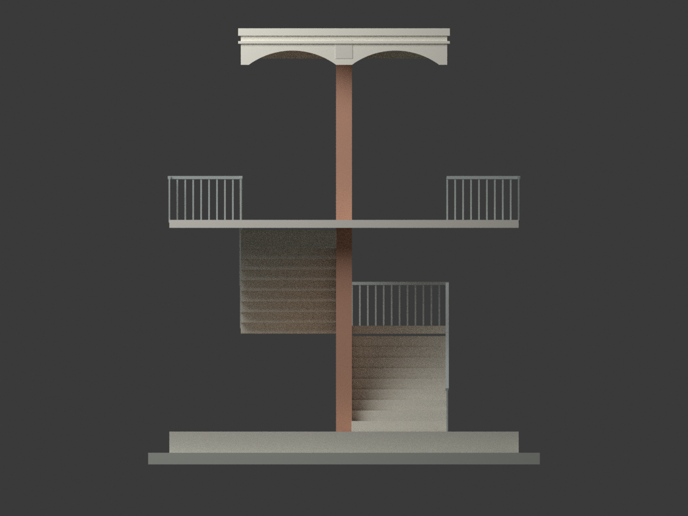
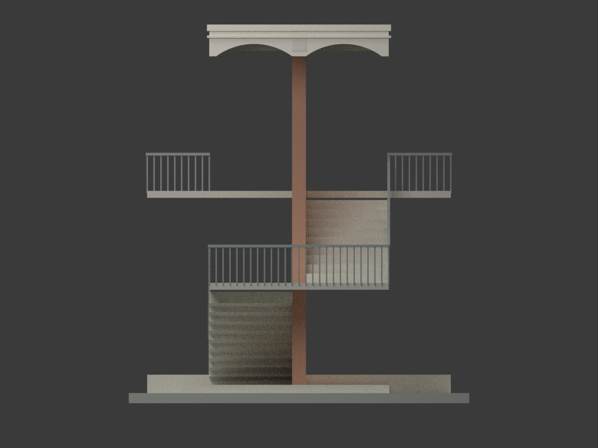
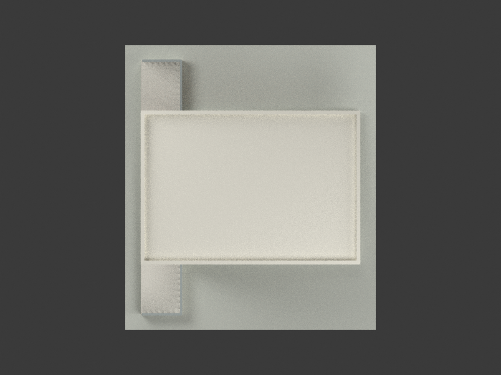
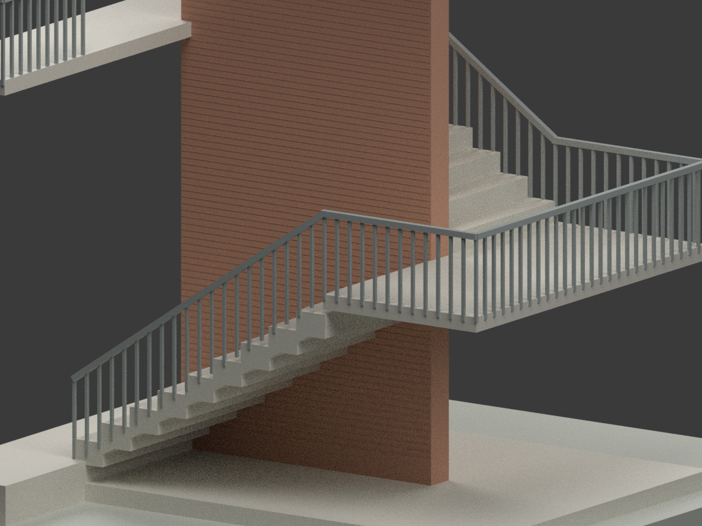
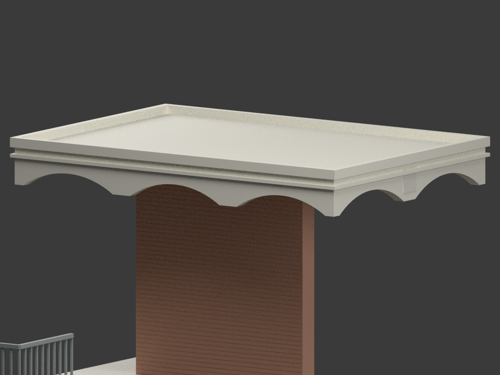
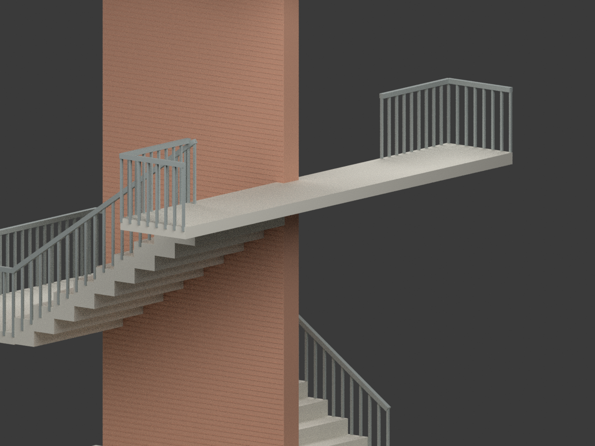

# 屏東高工外梯增建單元｜1971 年 8 月歷史設計模型

## 模型預覽

| 整體 | 另一側 | 正面 |
|---|---|---|
|  |  |  |
|  |  |  |
|  |  |  |
|  | | |

## 範圍與來源

省立屏東高級工業職業學校（今國立屏東高級工業職業學校）「樓梯新建工程」，陳仁和建築師事務所，圖欄 **60.8（1971 年 8 月）**。只重建圖示外梯、中央貼磚牆、雙跑梯、平台與弧底雨遮；**不是整所學校，也不是現況或竣工測繪**。既有教室僅保留連接邊界，不補造建物或外牆。

採國立臺灣博物館／臺灣現代建築資料典藏：
- [CCRH53623005：配置及剖面詳圖](https://collections.culture.tw/docomomo_collectionsweb/Collection?GID=MXMYMFM8MD)
- [CCRH53623006：平面、立面及剖面](https://collections.culture.tw/docomomo_collectionsweb/Collection?GID=MNMYMFM8MD)

同冊 001–004 是未定年教室／草圖，**不作本件尺寸或日期依據**。原圖授權標示 CC BY-NC，後設資料另標 CC BY；兩者不可混用。原圖、裁圖和私人逐像素審核不在公開包。模型保留設計者及館藏歸屬；本說明不宣告原建築設計／來源衍生物可無限制商用，也不替第三方權利另作許可。

## 幾何控制與限制

- 屋頂長向控制 **5.60 m = 0.90 + 2.925 + 1.775**；寬向 **3.90 m = 1.80 + 0.30 + 1.80**。外線腳局部再出 5 cm，不把控制線直接當外包框。
- 既有建物端接口展寬 **6.60 m**，不是整塊屋頂寬度；接口切斷面不是新建封牆。渲染檔案 north/south/east/west 為模型座標視向命名，不主張真實地理方位。
- GL = 0；FL = +0.40，中平台 +2.40，既有二樓接口 +4.40；主屋面 **+7.90 m = 0.40+2+2+3.50**，局部 12 cm 上翻邊最高 **+8.02 m**。
- 每跑 10 個 20 cm 級高，9 個 32.5 cm 踏面，水平長 2.925 m；欄杆名義高 80 cm；斜扶手以兩平台標高加 80 cm 線性連接，端部作圖量簡化。外側開放，不填成實心樓梯塔。
- 屋面板 12 cm、直線帶 5 cm、弧底帶 40 cm 分開，弧底最低 +7.33 m；40 cm 不是圓弧升高。長面三弧名義 R1.42 m、淨跨約 1.57 m；端面兩弧名義 R1.40 m、淨跨 1.65 m。端面半徑手寫末字有約 2 cm 估讀不確定；長向各段存在約 1 cm 圓整差，以 5.60 m 總控制優先。
- 中央牆厚 30 cm、長 2.925 m；KG1／KG2 梁深 45 cm 含板，梁底 +7.45 m，不與簷帶最低點混用；來源指示紅色二丁掛。貼磚紋理只作簡化水平分縫，材質顏色為示意，並非現場取樣。
- 內部鋼筋、基礎埋深、真實地形不製作；底座是展示支座。細部線腳、接口厚度及未標偏移仍為圖量解讀，不作施工或厘米精度承諾。

## 比例與製造提醒

**1:50，STL／3MF 單位 mm。含展示底座外框 130 × 148 × 164.8 mm；10,330 三角面。未實際列印。** 原圖約 10 mm 方鐵欄杆加粗為 30 mm（模型 0.6 mm），扶手簡化 60 mm（模型 1.2 mm）；不得理解為原設計全部構件原厚。隱藏交接處約 1 cm 重疊用於避免非流形刀口；不改主要標高與軸控。階梯下方及雨遮有懸空，需要依材料／設備檢查支撐與方向；水密不等於所有設備可免支撐列印。

## 檔案與重現

`model.stl`、保留面材質的 `model.3mf`、`scene.blend`、`mesh.npz`、可重現程式、十張實際模型渲染及 QA。原始掃描與 Blender 自動備份不在公開清單。

```bash
python -m venv .venv
. .venv/bin/activate
pip install -r requirements.txt
python build_model.py
python export_3mf.py
python validate_model.py
blender -b -t 4 --python render_model.py
blender -b -t 2 --python verify_scene.py
```

`BUILD-QA`、`FORMAT-QA`、`REBUILD-QA`、`SCENE-QA`、`FRAMING-QA` 與獨立 `SOURCE-VISUAL-QA` 記錄各自實際檢查，不取代工程安全或實體列印認證。
