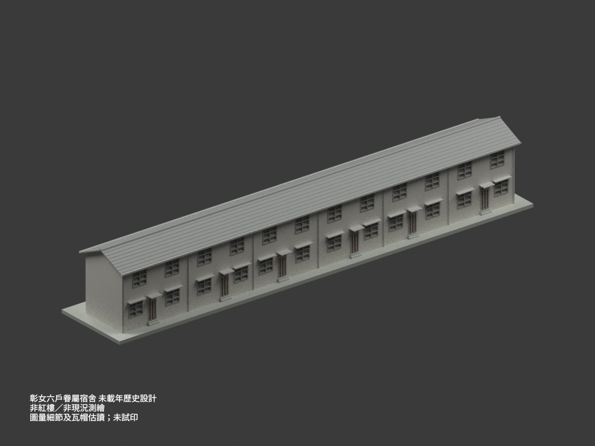

# 國立彰化女子高級中學歷史建築設計研究

## 模型圖鑑

| 建築模型 | 建築模型 | 建築模型 |
| :---: | :---: | :---: |
|  **[眷屬宿舍｜未載年六戶連棟設計](校本部/buildings/chgsh-family-residence-six-unit-undated-design/README.md)** [STL](校本部/buildings/chgsh-family-residence-six-unit-undated-design/model.stl) · [彩色3MF](校本部/buildings/chgsh-family-residence-six-unit-undated-design/model.3mf) · [Blender](校本部/buildings/chgsh-family-residence-six-unit-undated-design/scene.blend) |  |  |

現行收錄 **1 套模型包**；不是六套、全校建築數或全校完成。

## 收錄範圍

陳其寬建築師事務所《省立彰化女子中學眷屬宿舍新建工程》，國立臺灣博物館館藏 CCCK61023001–05。未載年六戶兩層連棟歷史設計，一棟／一模型套件，不是彰女紅樓或學生宿舍；不主張現況、現址存續、現用途或竣工年代。以六戶全棟基礎變更圖43.20m與三組鏡像配對控制，再核三戶立面，不盲倍三戶。屋脊7.225m由尺寸鏈推導、瓦帽及局部位置圖量約±0.10m，前門棚8cm／窗棚7cm與後RC頂2.86m分開。1:200薄棚約0.35／0.40mm，未試印。

[校方網站](https://www.chgsh.chc.edu.tw/)與[教育部學校名錄](https://www.k12ea.gov.tw/School/Highschool_view2?Type=3&ctycod=07)核現名為國立彰化女子高級中學；來源所列省立彰化女子中學歸同一校，不重複計校，不列入高教校數。「校本部」僅為歷史校屬目錄歸組，並非宿舍現址或存續已確認。

保留設計者與典藏來源；原圖權利與模型／程式／渲染分開，不附原圖、裁圖或私人參考備份，不保證商用權利。

[校本部圖鑑](校本部/README.md) · [回總目錄](../README.md)
