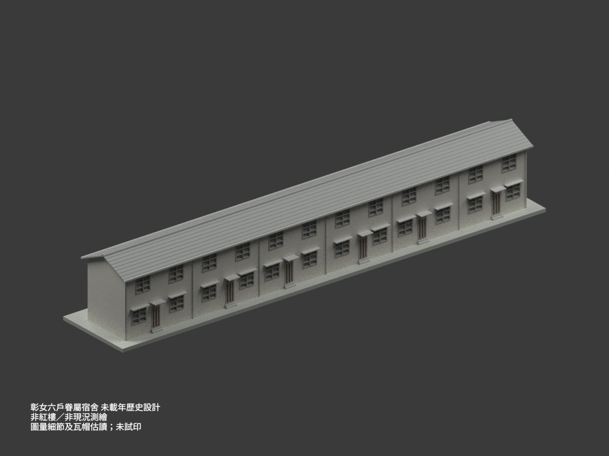
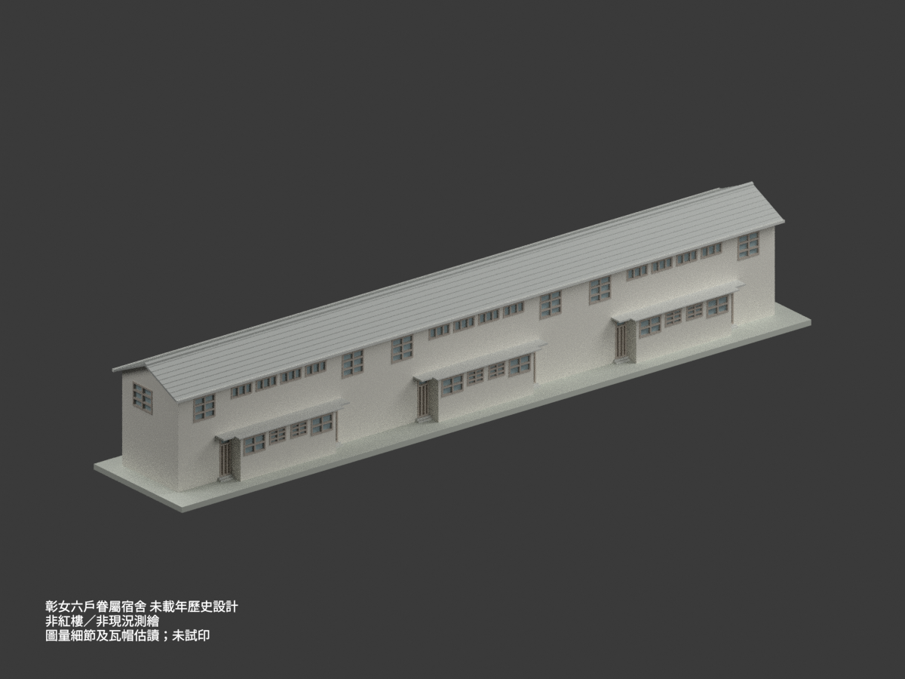
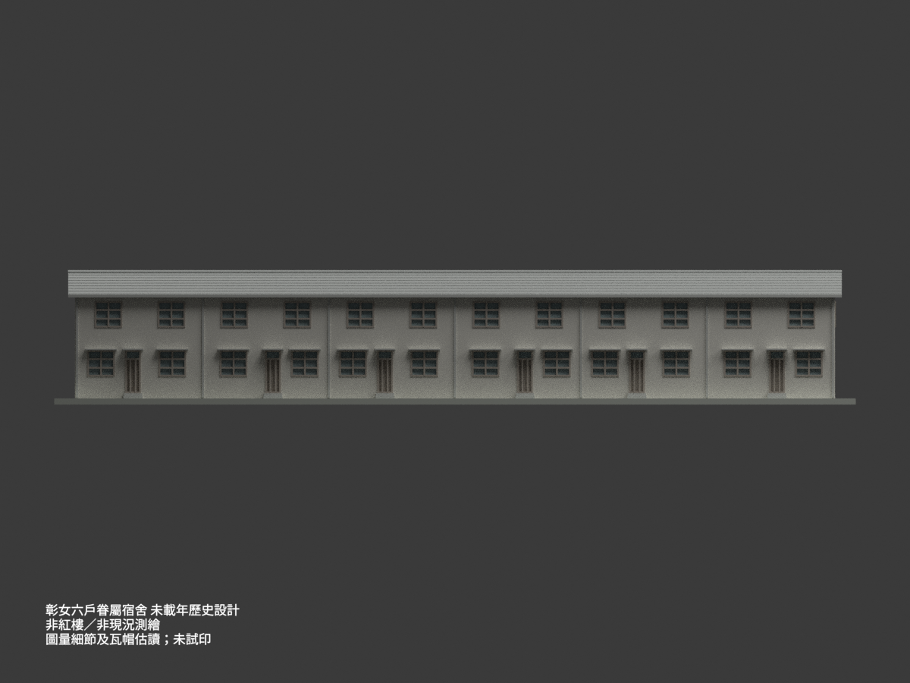
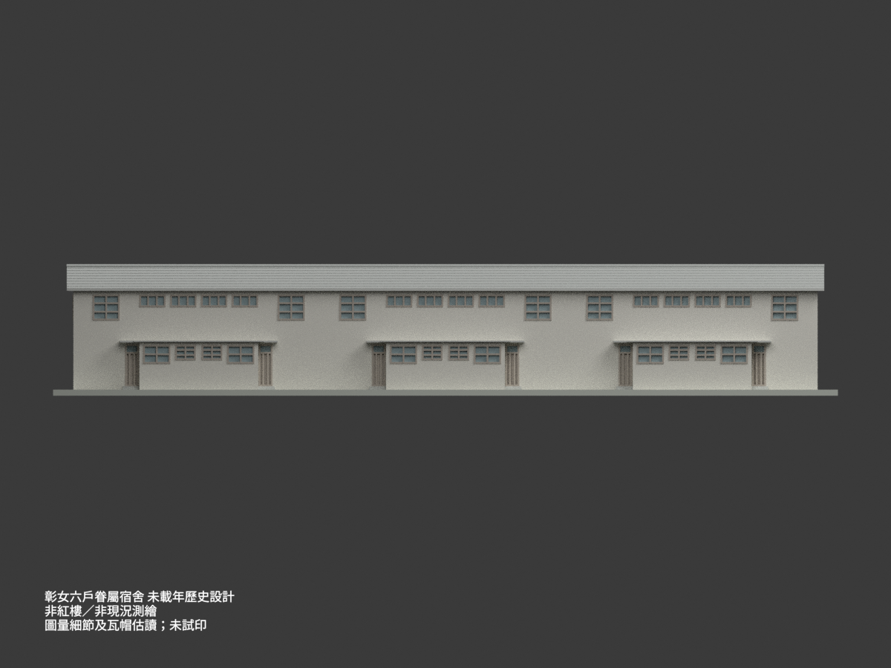
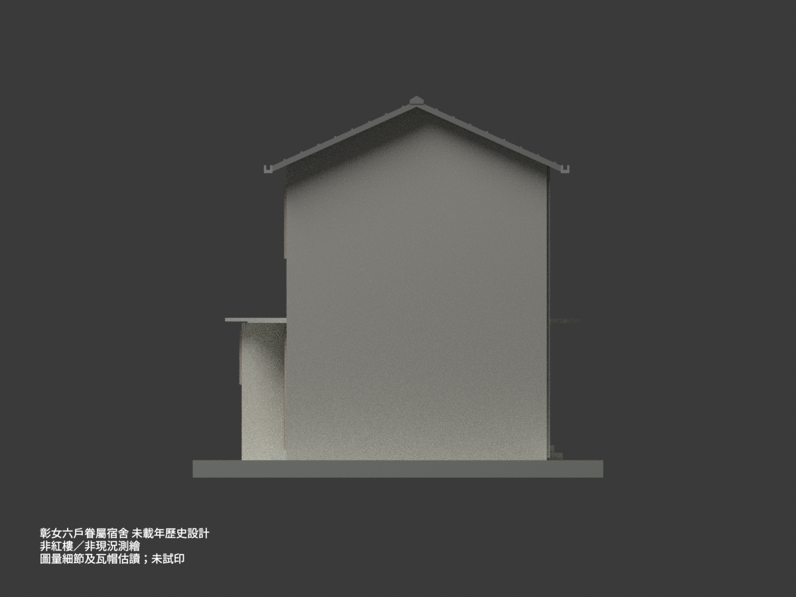
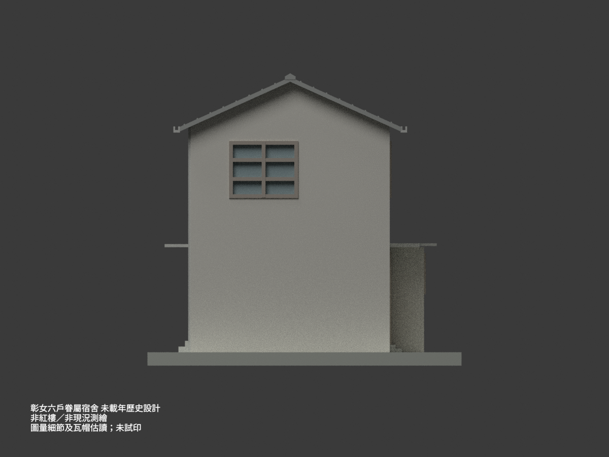
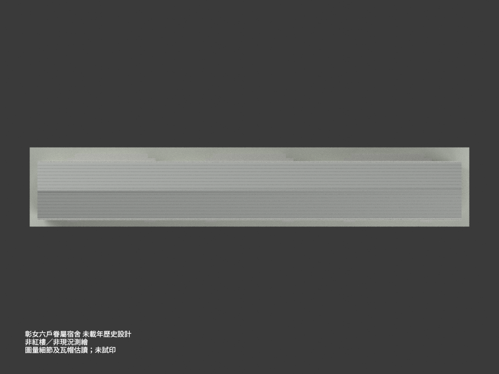
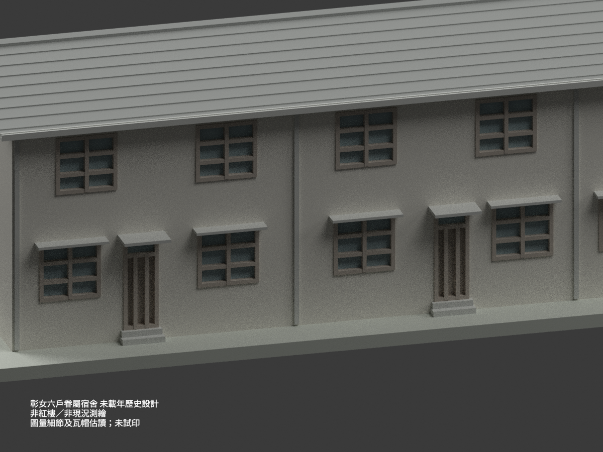
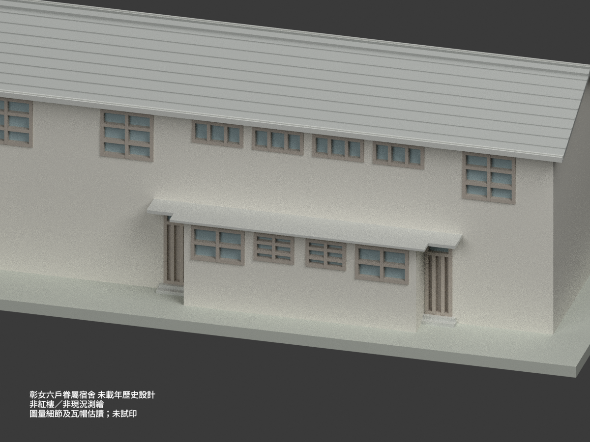
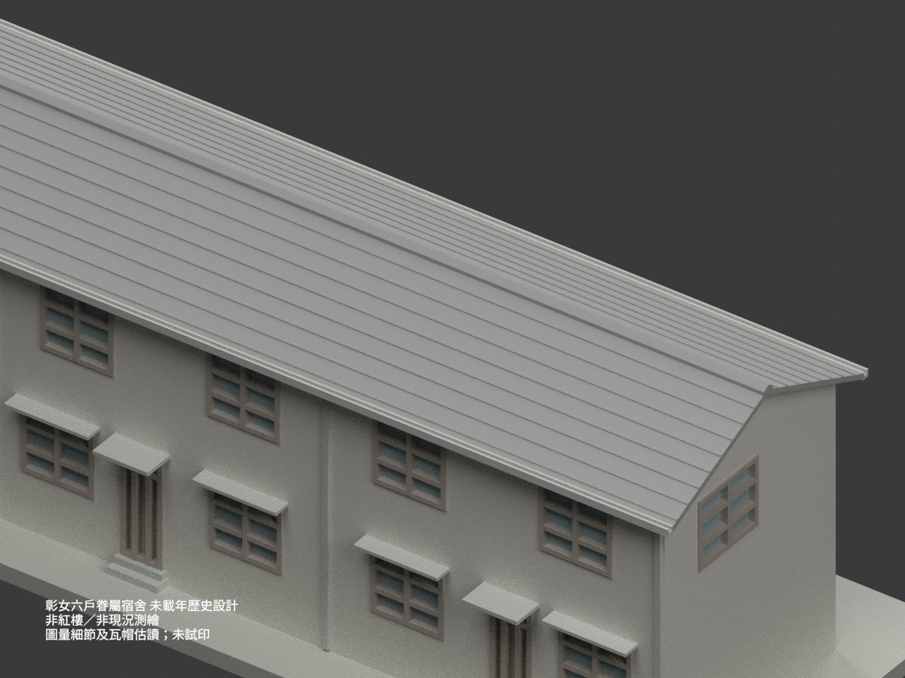

# 彰化女中眷屬宿舍｜未載年六戶連棟歷史設計

## 模型預覽與範圍

**六戶兩層的歷史眷屬宿舍設計，不是彰女紅樓、學生宿舍或現況測繪。** 以全棟基礎變更圖限定43.20m、三組鏡像配對，再用三戶圖核各戶外觀；沒有把三戶圖盲目複製兩次。未試印。

| 視圖 | 視圖 | 視圖 |
|---|---|---|
|  |  |  |
|  |  |  |
|  |  |  |
|  | — | — |

## 身份、日期與版本

- 館藏 CCCK61023001–05，原題「省立彰化女子中學眷屬宿舍新建工程」，陳其寬建築師事務所。學校今名國立彰化女子高級中學，但未據此推定宿舍現名、現址仍存、現用途或竣工年代。
- 圖中見 Dec.25／Dec.28 等月日，未載可確認年份；不借紅樓歷史年份補年。
- A0配置／面積及A4全棟基礎變更明示43.20m六戶，A1只畫21.60m三戶。採A4三組鏡像配對（＋−、＋−、＋−）限定整棟，A1/A2/A3供單戶平立剖與門窗；不將＋−＋直接重複而造成中段錯配。
- A0後凸朝北箭頭所向，與A1紙面方向需旋轉對位。模型x循A1前立面由左向右，前側在y0、後側在y5；依原圖相對方向左西右東，**非現地定向測量**。只東端上層一扇W1′，西端空牆，未盲鏡射兩端。

## 尺寸與高程

- 六戶各7.20m，主軸全長43.20m、主深5.00m；後一樓廚衛凸出0.90m。每配對後凸長6.70m，二樓不加後凸房間。
- 主1FL＝GL＋0.30m、二樓＝3.10m（層高2.80m）；上部屋面牆軸參考6.10m（再高3.00m）。後廚衛地坪另較主1FL低約0.10m，模型不展示內部高差構造。
- 坡比0.45、半軸2.50m，名義瓦屋面脊 **6.10＋2.50×0.45＝7.225m**；橫向挑簷0.43m，瓦面檐參考 **6.10−0.43×0.45＝5.9065m**。這些為來源鏈推導，不代表實測精度，也不是瓦帽最高點。
- 山牆兩端屋面挑出約0.50m是A1圖量（±0.10m），不是把橫剖43cm套到四邊。瓦帽形狀／高度另估讀，名義最高7.325m；屋皮向下12cm為數位／列印表達厚度。水泥瓦以約34cm節距、2.5cm微浮雕表示瓦列，**不是來源精測瓦模數**，不重建每片瓦的內扣接構造。

## 雨庇、後屋面及門窗

- 後凸RC屋面上緣 **GL＋2.86m**：A2的286鏈由GL起，不能再加1FL的30cm。S3內側厚10cm、外挑部分厚7cm分開；後外挑總剖45cm與局部詳圖約47cm字形差保留，採45cm，不冒稱全部圖完全一致。
- 後RC屋面保留階梯形：每對廚衛上方深段至y6.35，側向約45cm挑出；兩側另有較淺短翼覆蓋D5外門凹口，至y約5.90、側延約1.25m。側翼和縱向邊界為圖量±0.10m，不是一塊全長矩形後廊棚。
- 前立面每戶兩窗棚、一門棚分段，不做全長連續廊棚。S4門棚挑80cm、結構厚8cm；S5窗棚挑50cm、厚7cm。剖示下緣名義GL2.76m，故本模型門棚結構頂2.84m、窗棚2.83m；表面粉刷／找坡是否另升至後RC2.86未明，未虛構2cm面層來消差。
- W1約157.5×150cm、東端W1′181.5×150cm，2列×3行；W2為159×109cm，2列×2行；W3為120×88cm，2列×3行；W4為153×72.5cm，3列×1行。前首層窗中心按實際洞口約1.375／5.45m、D1門約3.20m，**不是把275隔牆尺寸當門中心**；上層前窗另約1.80／5.40m，不強迫上下對齊。
- D1前外門90×245cm、D5後外門80×245cm，保留上亮與下門扇區別。後D5在主後牆y5、正戶x2.75–3.85的凹口，中心約3.30m圖量；D3是內部廚房門，未錯做後凸側面外門。
- 前窗底GL1.25m／上層4.05m按窗台與樓層鏈協調；後W3底約1.73m、頂2.61m，W2同頂下推1.09m。各洞口局部位置約±0.10m圖量，玻璃用封閉實色表示，未重建室內與木窗可動機構。

## 數位簡化與列印限制

比例 **1:200**，含作者支座約229.00×41.25×38.375mm。窗框加粗為10cm（成品0.50mm），落水管由原註約7.5cm加粗到12cm（0.60mm）；檐口U槽為外觀近似，不是排水設計。門前局部踏步為地坪高差的圖量示意，不作施工級戶外階梯尺寸。內部、基礎、配筋、防空洞、未來另排及場地未重建。底座不是現場地形。

**未實際列印、未切片驗證。** 7cm薄棚在1:200約0.35mm、8cm門棚約0.40mm，瓦列與槽壁更薄；實物可能需要放大、加支撐、改朝向或另行加厚。單連通／水密網格並不保證物理可印、承載或細件存活。色彩為石灰粉刷、水泥瓦、木框與混凝土的示意區分，非現況採色。

## 檔案與重建

`model.stl`與`model.3mf`單位毫米；3MF含分面材質。`scene.blend`、`mesh.npz`、參數化程式、10張實際渲染與QA紀錄一併保存。場景警語不納列印幾何。

```bash
python -m pip install -r requirements.txt
python build_model.py
python export_3mf.py
python validate_model.py
blender -b --python render_model.py
blender -b --python verify_scene.py
```

## 來源與權利

見[來源登錄](SOURCE_REGISTER.md)。五張原圖與研究裁圖只作私人比對，**不在公開包**。原圖個別標示CC BY-NC，元資料CC BY不能取代原圖授權。本模型與渲染為獨立重建產物，但不據此保證建築設計或第三方權利可商用，也不擅把原圖授權擴張成全模型的概括限制；使用者需確認適用權利。
