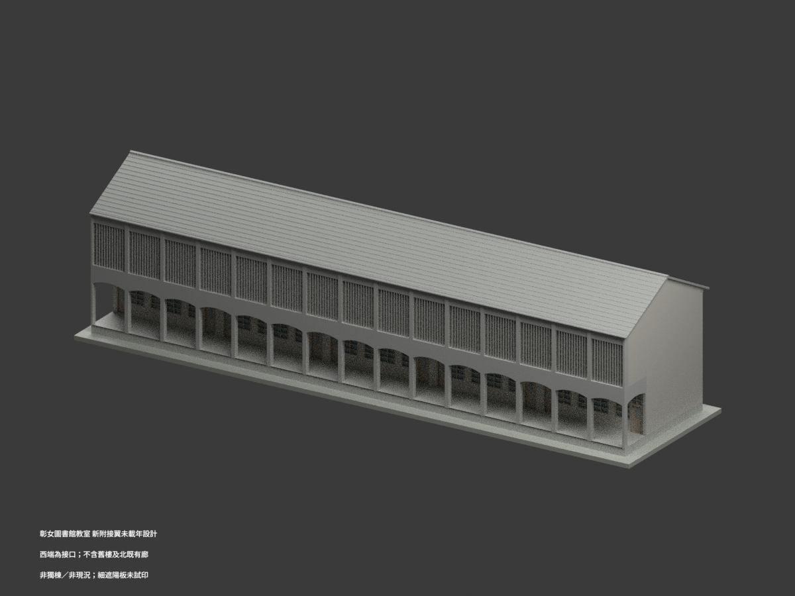
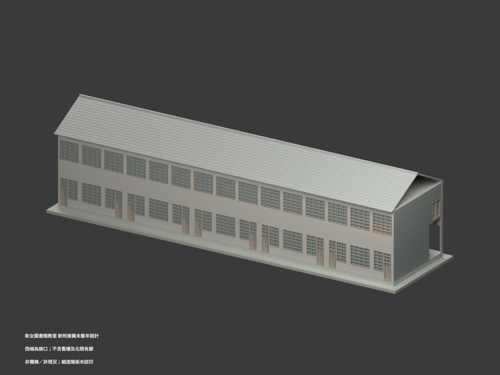
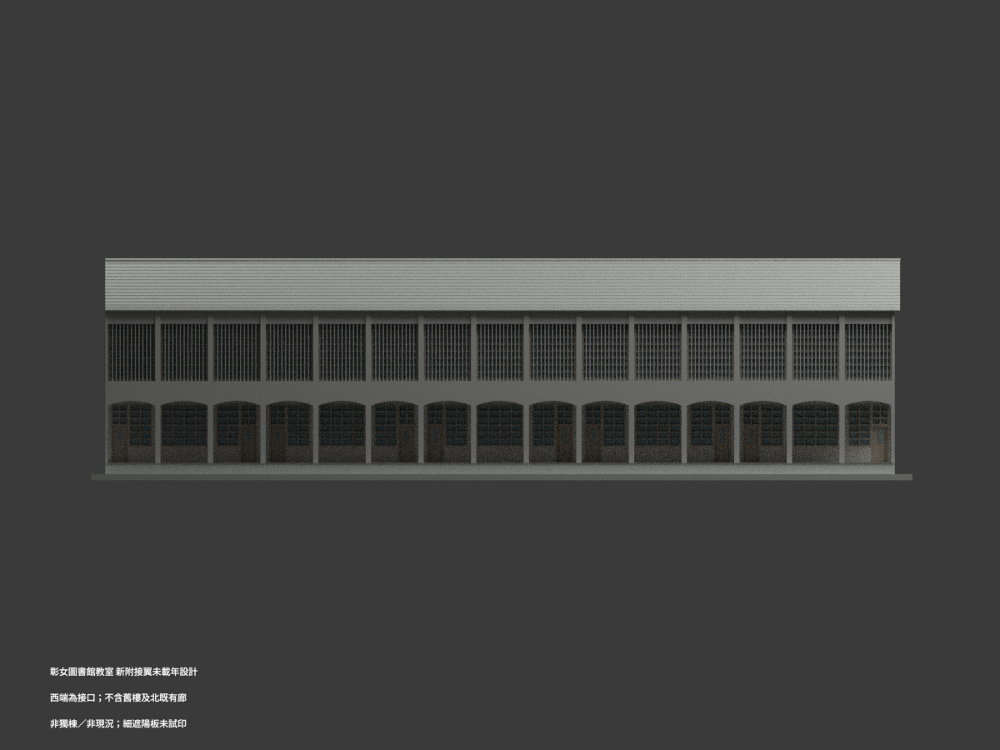
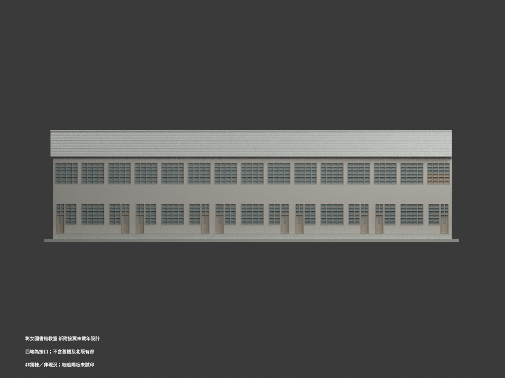
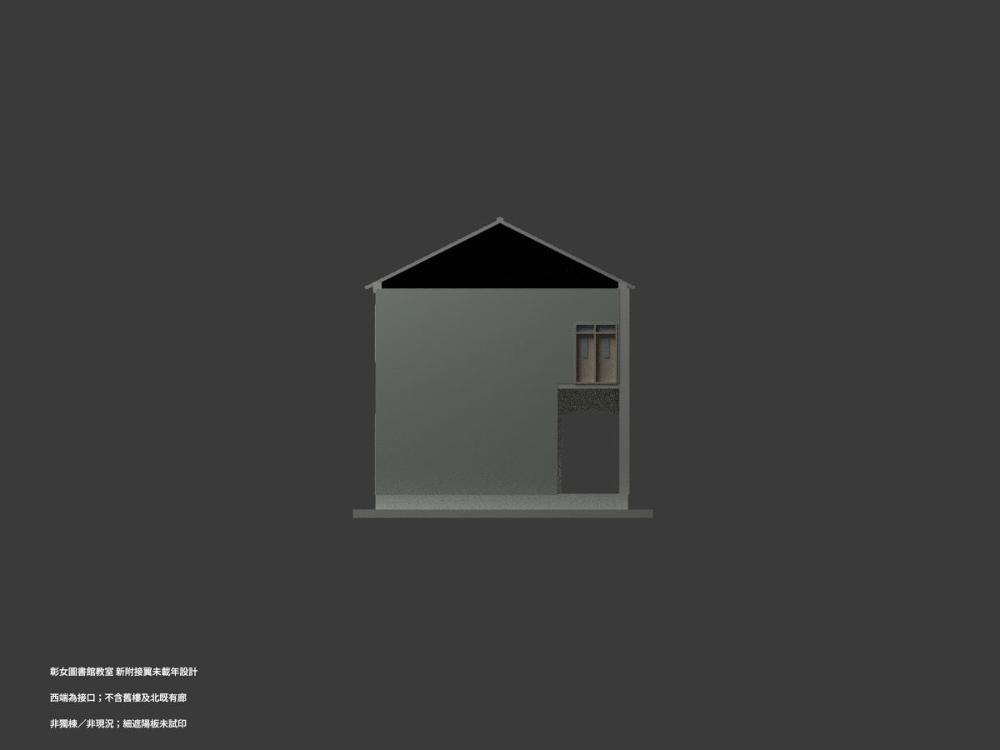
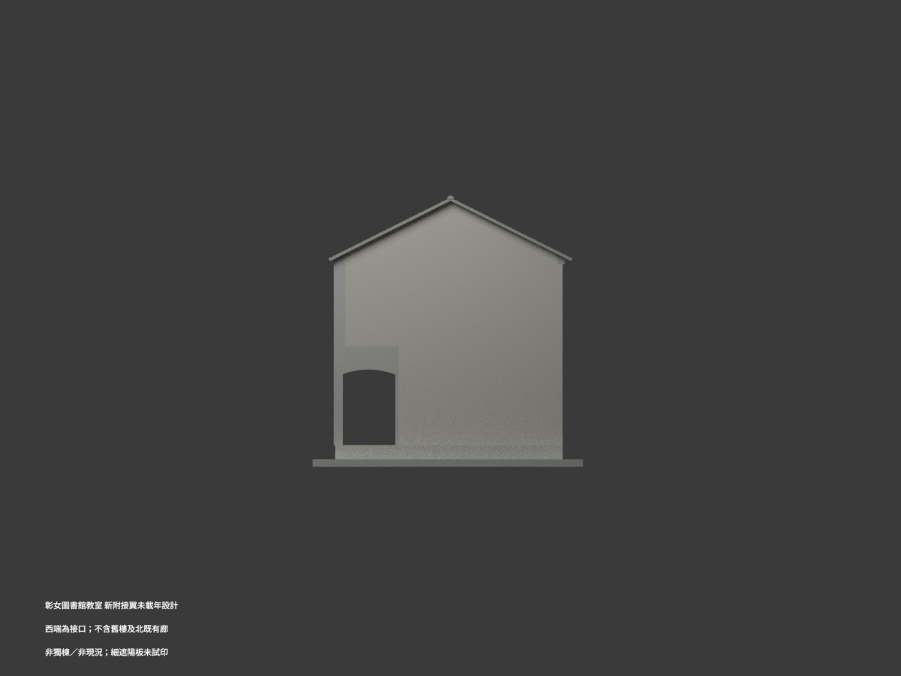
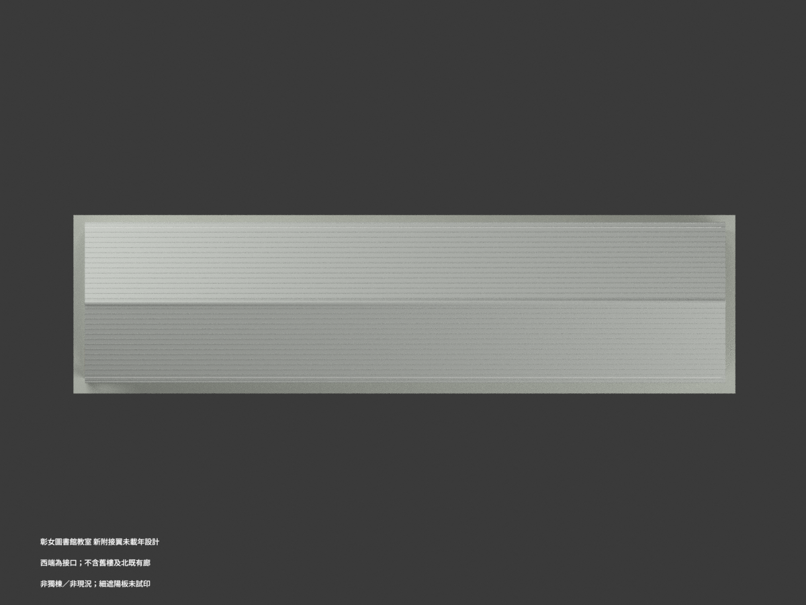
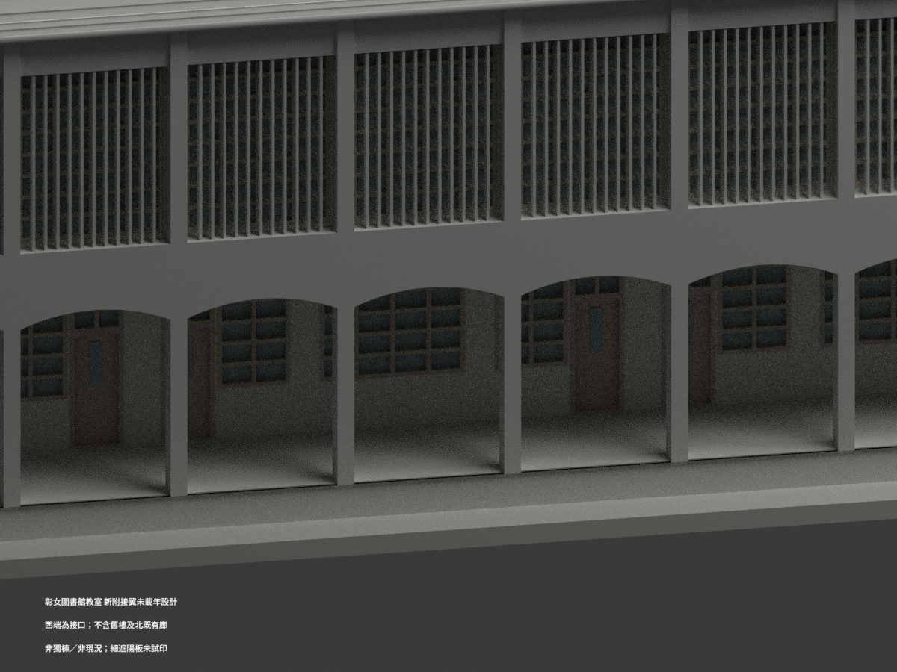
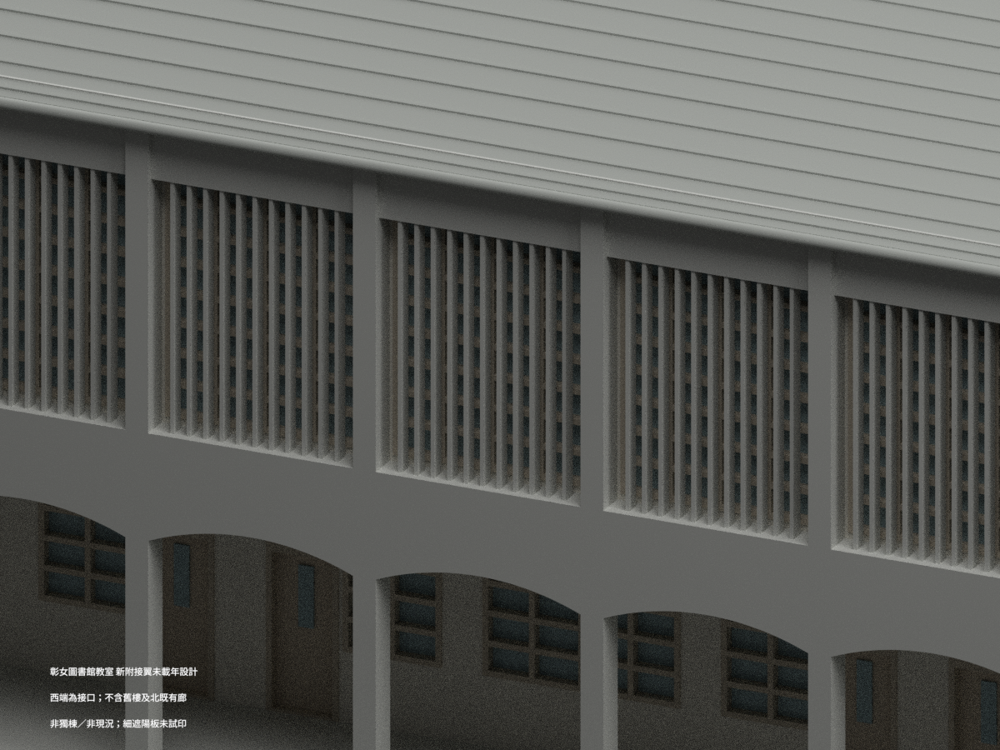
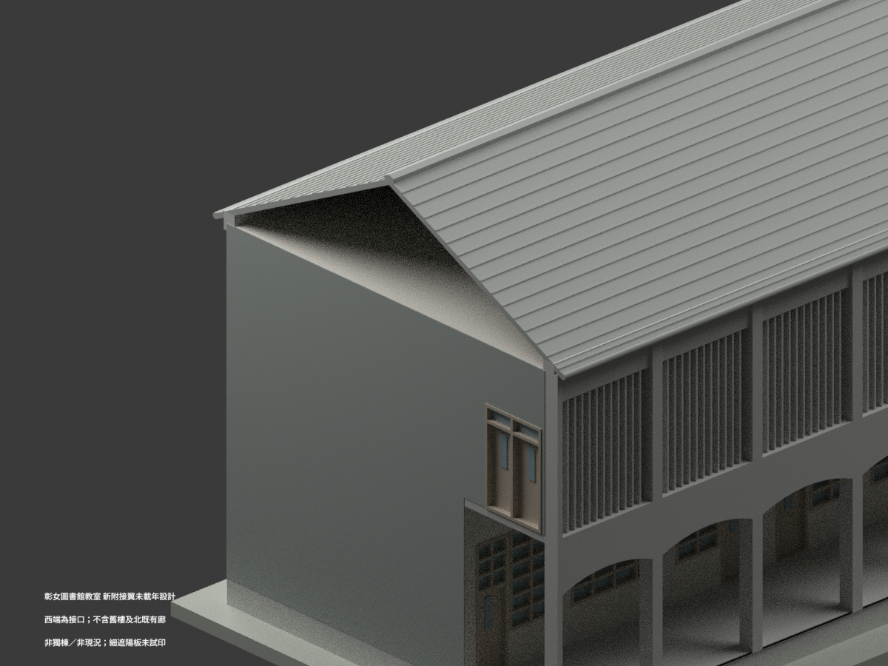

# 彰化女中圖書館及教室｜未載年新建附接翼歷史設計

## 1. 模型實際渲染

**僅重建45 m長的新建兩層附接翼；不是獨立整棟，不是現況或竣工認證，未試印。** 西端是既有校舍接口，沒有補造西山牆、舊樓或舊樓梯；北側既有走廊修繕不在本包。未載年，不硬配紅樓或1989現圖書館。

| 視圖 | 視圖 | 視圖 |
| --- | --- | --- |
|  |  |  |
|  |  |  |
|  |  |  |
|  |  |  |

## 2. 檔案與重建

[STL](model.stl)／[材質3MF](model.3mf)／[Blender場景](scene.blend)。單位mm，**1:150**；原5 cm薄遮陽板在此比例僅約**0.333 mm**，非適合所有列印機的保證。可重建程式為`build_model.py`與`geometry_helpers.py`，依`requirements.txt`安裝後執行：

```bash
python build_model.py
python export_3mf.py
python validate_model.py
blender -b --python render_model.py
```

Blender4.3.2／Cycles64；模型薄片、挑簷與拱廊需支撐、材料與設備評估，未實際列印。數位水密及單連通不等於製造成功。`SOURCE-VISUAL-QA.json`與格式、重建、場景、圖片檢查分別保留；原圖不在公開包。

## 3. 來源控制與解讀

| 項目 | 採用控制及限制 |
| --- | --- |
| 新翼 | 15×3.00＝45.00 m；深10.45 m，南廊2.80＋教室7.65；有柱、簷與圖量邊緣，不把所有尺寸當最外bbox |
| 標高 | GL至1FL0.66；首層4.62→2FL5.28；上層4.00→梁頂9.28 m |
| 主屋面 | 梁頂9.28＋局部30 cm鏈→名義牆軸屋皮9.58；坡0.5，半跨5.225→名義坡面脊12.1925 m，是推導不是直接標注脊帽頂 |
| 屋簷與瓦帽 | 南北挑簷名義0.35、東端0.30 m，依剖立面圖量約±0.10 m；瓦帽加約0.10→名義最高12.2925 m，屋皮約0.15、瓦列浮紋與排水溝為外觀近似，不稱精測構造 |
| 淺拱廊 | 半徑3.50，不是半圓；拱頂5.28−1.10＝4.18，圓心取GL0.68，與1FL0.66＋3.50＝4.16差2 cm保留為圖面／層面協調差 |
| 前柱與淨跨 | 長向約0.30、深約0.42，淨跨約2.70 m，圖量±0.05／0.10；A5的260不是南面水平跨，不拿窗寬反推柱寬 |
| 上南遮陽 | A6明示每W2 **11片5×20 cm**，15窗共**165片**；不是A2示意9片×15。高度由2FL5.28至8.58，不延至全4m層高 |
| 遮陽排位 | 窗寬2.60內11片中心以12等份圖量，約21.67 cm；窗框外留約10 cm再出挑20 cm，偏移圖量±3 cm，非全部直接尺寸 |
| W2 | 2.60寬、3.15高（114＋6＋108＋6＋81 cm）、窗台0.15、頂3.30；遮陽板從樓面起，不能從窗台起 |
| W1／W3 | 2.60×2.34、窗台0.96、頂3.30；上北西端一組W3保留完整框，只下半改不透明板，其餘14組W1 |
| 首層門窗 | 每9m教室DW1—W1—相反手DW1；每長面10組DW1與5組W1。DW1寬95＋6＋130＝231 cm；門210、上框6＋氣窗114至330，門葉20×80玻璃另呈現 |
| 西接口 | A6伸縮縫2.5 cm為新舊接合控制；本包只示新側截斷界面，不用未建舊樓來假造完整縫或獨棟外牆 |

## 4. 範圍、差異與省略

- 七張圖的實際題名均為「省立彰化女中圖書館及教室新建工程」；館藏母冊沿用宿舍標籤，不將本件混成六戶眷舍。同校別案不等於同一建築。
- A4屋架／天花左右半圖是同一45×10.45 m全翼，不是兩棟或兩種屋頂。只東端有來源明示的真山牆與下方拱廊側口；西端坡板到工程接口即止，未新增西三角山牆。灰綠色西側矩形面是**模型截斷面**，不是歷史外牆材料推定。
- 北既有走廊A0翻修2.56×40.00 m、A1/A2似延45 m的範圍差未擅自消除；既有修繕context整項排除，因此本包不宣稱包含原校舍全部連接環境。
- A4局部階梯／原磚牆／原水溝詳圖屬既有接口改造，不能複製成南側45m整排階梯。南廊只保留GL0.66完成面足台；未唯一定位的新外階不造。
- 室內藏書架、黑板、吊頂、隱蔽結構及原有樓梯不重建；西接口保留A1明示D1 1.80×2.55門背板／框（中心y約1.20±0.10 m圖量、底2FL5.28），不稱獨立西入口；西舊D2不猜尺寸。窗格、屋皮、瓦列與局部排水外觀作明示比例化簡化；框約7.5cm在模型為0.50mm，不是每根木框原寸；小玻璃格以等距近似，並非逐段114／108／81尺寸復刻。遮陽端頭約2cm藏入上下固定帶是數位連接交疊，不是改宣原可見高度。
- 展示底座非測量地形；色彩與材質僅示意。模型不證明目前仍存在、原方案已完全實建，或現代圖書館使用名稱。

## 5. 來源與權利

設計署名：**陳其寬建築師事務所**。典藏：**國立臺灣博物館臺灣現代建築圖說**，CCCK61023008–23014。原圖影像標示**CC BY-NC**，詮釋資料**CC BY**與影像分開；原圖、裁圖及私人核圖紀錄不公開。

本包是新建數值幾何、程式、實際模型渲染與文字審核，沒有把原圖影像NC自動等同全部新幾何授權，也不保證建築設計／新模型可無限制商用。逐張來源連結見[SOURCE_REGISTER.md](SOURCE_REGISTER.md)。
