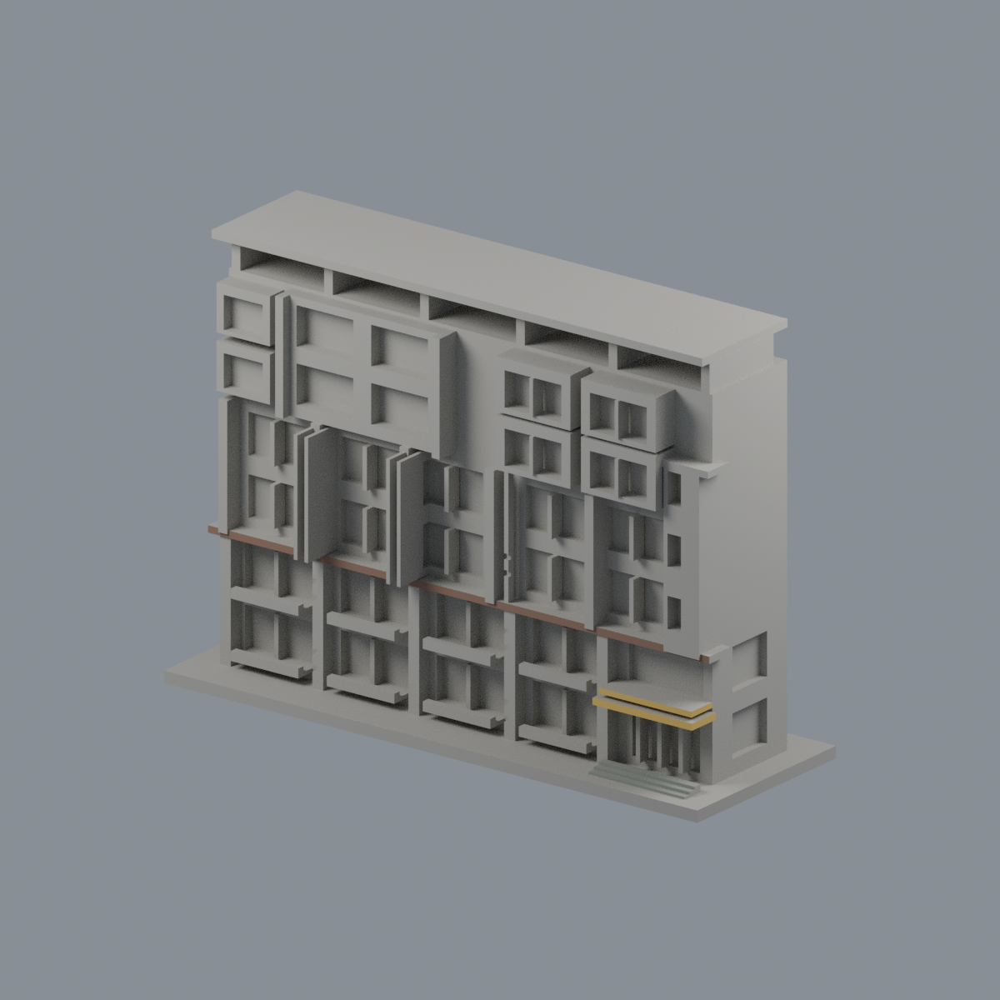
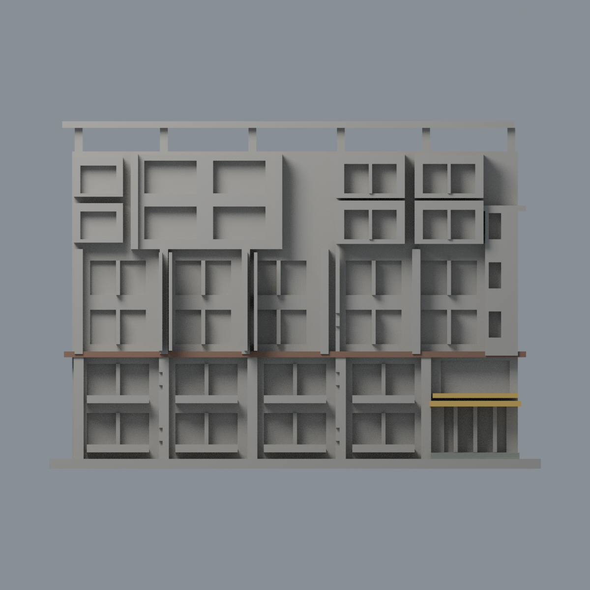
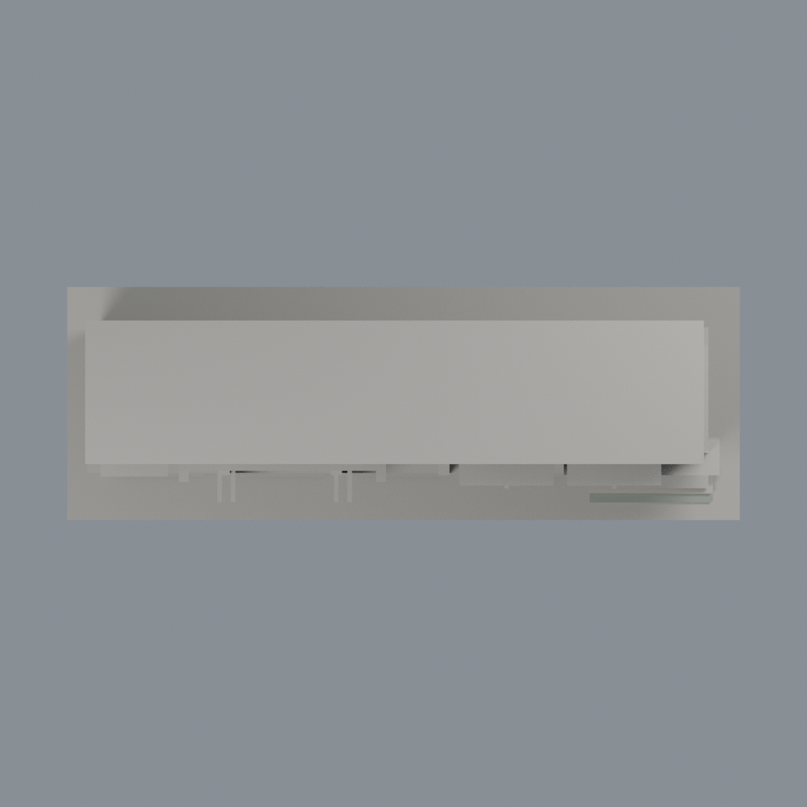

# 彰師理學一館主立面段黃棚與棕帶點色：三材質外觀版

沿用原 **2,450 三角面／1,171 頂點**，不改原 STL 位元、座標、面序或幾何；這是既有模型外觀改版，不增加模型包數。

| 模型預覽 | 模型預覽 | 模型預覽 |
| :---: | :---: | :---: |
| 正面  | 背面保持中性  |  |
|  |  |  |

[表面色 3MF](ncuescience-appearance.3mf) · [可編輯 Blender](scene.blend) · [材質色表](palette.json) · [逐面指派與依據](face-materials.json) · [原 STL](../model.stl)

## 來源與配色邊界

這是**黃雙挑棚與棕橫帶的局部點色研究**，不是全棟或全立面配色還原。親看彰師大兩張完整官方完成立面與入口近照，以及原網格、生成器。[精確 URL、SHA、日期](qa/source-review.json)。正面照無 EXIF 拍攝日期；入口近照 Original／Digitized 為 2026-06-03 08:47:11，不能以網址的 1150908／1150914 當拍攝日。不宣稱拍攝之後的現況。原照片僅私有研究，不入公開包。

- 原兩層獨立挑棚的前緣、側端與底面依近照採暖黃；未見頂面保留中性，兩棚間陰影不另塗褐色。這仍是既有厚化簡化方形棚，不補實景折角細節。
- 原 z34–35.8 獨立橫帶僅向前垂直面採低飽和棕色。實景其底面白色，不能將整條橫帶全染棕；底面中性也不宣稱已還原白色。較高另一條實景棕帶沒有獨立原幾何，明確省略，不畫橫向假色界。
- 灰柱上的白樹枝紋無材質分面，全部中性；樓上窗背混黃簾頭、玻璃、窗裙，樓下陽台混磚牆、窗、欄杆及空調，也全部中性。入口門含藍色安全帶未分面，不能整片塗藍玻璃。上窗有白簾，不把亮色當本體玻璃色。
- 原主屋頂、未知側後截面、標字、白牆及其餘窗不推測著色，不增文字或穿孔花紋。中性不是實景灰色還原；本件只有 59 個原三角面的局部色彩重點，其他原面維持中性。
- 不使用施工中吊車照片作完成色彩證據。不改原 STL、面序、外形或歷史 QA；未做實體列印測試。

[原幾何與歷史來源限制](../README.md)

## 重建與核驗

安裝 [依賴](source/requirements.txt)，Blender 使用 4.3.2。由本資料夾上層提供原 model.stl：

1. `python appearance/source/build_appearance.py`
2. `python appearance/source/verify_exchange.py`
3. `blender -b -t 3 --python-exit-code 1 -P appearance/source/render_appearance.py`
4. `blender -b -t 3 --python-exit-code 1 -P appearance/source/verify_scene.py`

[獨立重建 ZIP](rebuild-source.zip)含原 STL、四支程式及依賴，不含第三方照片；不取代原建模腳本。[逐檔 SHA256](SHA256SUMS)

[交換／拓撲 QA](qa/exchange-validation.json)核對原座標與面序、全部面材質、單連通、有向水密邊、頂點 link 單環、正體積與零退化／重複面；lib3mf 嚴格讀取零警告，實際編輯單材質再存讀，其他材質及面指派不變。SDK 六位小數量化誤差另列。

[Blender 存讀與編輯](qa/scene-validation.json) · [渲染記錄](qa/render-manifest.json) · [獨立重建](qa/rebuild-validation.json)

## 製造限制照舊

尺寸仍為 150 × 52 × 106 mm；原 STL、建模程式、場景及歷史 QA 保留。原層檢與薄特徵檢查本次未重跑，不能由材質 QA 代替。

3MF 是同一網格的表面色，不是各材質各自封閉的分色實體、切片專案、噴頭映射或 G-code。切片 GUI、多材料路徑與實體列印未測；柱頭、屋簷、窗框及薄邊仍須評估材料、支撐及拆除風險，沒有保證可印或免支撐。

## 2026-11-14 有限外觀修正（重新建置交付版）

# Bounded entrance-step gray background

Only12 neutral triangles become new3 #90958C/.88; original3 shaders and2438 other indices unchanged.

Only three original entrance steps, six complete tread/front-riser domains and twelve neutral faces. Original formula add(55,-21+i*1.9,2.8,27,2.2,.8+i*.65), i0..2. First riser exposed bottomz3; top tread ends y-16.1 while hostfront is-11, original5.1 gap retained. Exclude side skirts/base/rear risers/door/porch/platform.

Source1 official entrance closeup directly shows gray tread/riser background, yellow narrow nosings and pale side skirts/platform. Yellow fine nosings and surface granules are not modeled; proposed background approximation does not certify entire real stairs homogeneous gray. Original three coarse steps/width/depth/level count are not individually surveyed. Do not add missing stripes or bridge the gap.

source0 official whole facade corroborates entrance identity and family but stairs partly cropped; source2 side ramp is not evidence for central step faces. All three newly retrieved supplied originals and nativefront fully inspected. Official award report newly GET200 read for identity; awards/accessibility claims do not certify model engineering.

Source0 has no capture EXIF. Newly read source1 subIFD Original2026:06:03 08:47:11 with OffsetTimeOriginal+08:00; source2 2026:06:10 15:42:06 with+08:00. Camera self-reports unverified. URL filenames1150908/1150914 and report event dates are not shutter dates; no later-condition claim.

New original-STL full-plane shared-edge BFS and original step rectangle subtraction checked every triangle and reverse union. Area213.300002575mm2, outside0.000056648 and reverse missing0.000054073 are nonzero float32, each domain tolerance0.001mm2. No exact-zero claim.

Original three shader values and geometry/STL/face order, historical QA and both original checksum schemas retained. Actual original ZIP6 all members same. OBJ exists preserved only. Nativefour views1200CPU48, no side view. Model remains front segment not entire building; original manufacturing/coarse depth/window/side-back limitations retained.

Install source/requirements-current.txt, run build_current.py and verify_current.py then Blender render_current.py. No original boundary verifier existed; current complete verifier is newly supplied.

# Public reference links

- https://www.ncue.edu.tw/p/406-1000-34740,r93.php?Lang=zh-tw
- https://www.ncue.edu.tw/var/file/0/1000/img/86/1150908-4.jpg
- https://www.ncue.edu.tw/var/file/0/1000/img/86/1150914-2.jpg
- https://www.ncue.edu.tw/var/file/0/1000/img/86/1150908-9.jpg

Official source1 entrance closeup primary; source0 whole facade identity/family, source2 separate ramp not target. Source1 camera self-reports2026-06-03 08:47:11 +08:00, source2 2026-06-10 15:42:06 +08:00, unverified; filenames/report event dates not shutter dates. No private photographs redistributed.

現版共 4 個顯示材質（含未知中性色）。上方原材質數、面域與QA描述為歷史版本，僅由本節有限範圍更新。本版是重新建置，不是尋回遺失草稿；不新增幾何或擴充補色範圍。

本節提及原ZIP/QA/校驗數目屬歷史記錄，不是現版ZIP清單。現版ZIP僅含原STL、必要舊建置與渲染程式、三支現版包裝／驗證程式、requirements-current.txt與本README及授權說明（如原有）。完整來源研究、照片、私人審核與廣泛校驗清單不公開。PUBLIC-MODEL-SHA256SUMS僅核當前交付產品；原QA不替代當前驗證。

現版命令：`python -B appearance/source/build_current.py`、`python -B appearance/source/verify_current.py`、`blender -b -t 4 --python-exit-code 1 --python appearance/source/render_current.py`。依requirements-current.txt安裝必要依賴。直接執行舊builder會重建歷史配色。包裝程式僅執行固定本地舊程式，新增材質時只替換新材質粗糙度運算；寫模型、材質、場景、原視角PNG與當前本地QA。歷史報告先保存再還原；原不存在時只刪該次產生的舊名報告。不進行網路或憑證操作。
