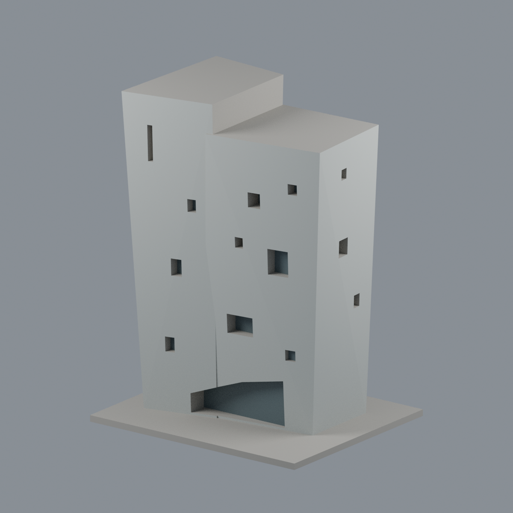
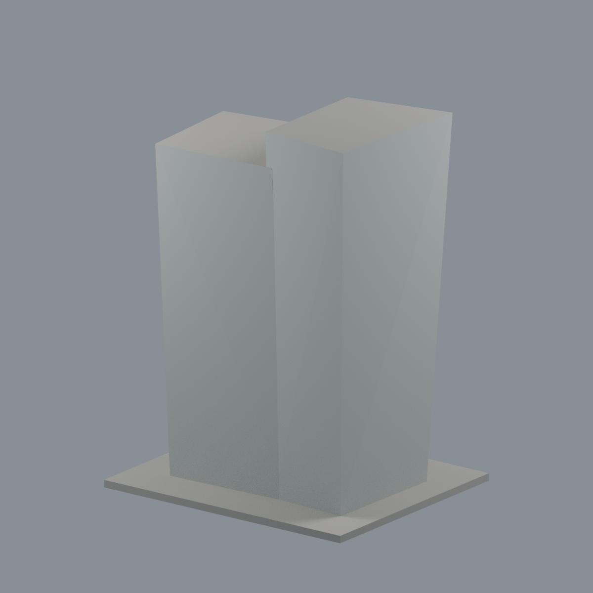

## 本次左背折面殼補色（同構件推估）

本版新增15個原中性完整三角，分布於原兩個凸殼的6個左側／後側微傾斜外邊界平面，延用正面及右側既有清水混凝土代理 `#B9BFBB`。從原build_model.py上下輪廓頂點重算凸殼平面，只選三頂點全部共面的原面，不用面心或粗略區塊挑面。未選窗洞接面、玻璃背、頂面或底座。

**新增左背色是同構件材質延續推估，沒有新左側／後側照片定位證據，不稱2026現況。** 原320面／162頂點、座標、面序及折角完全保留，其餘305面材質不變，不新增面或分界。原比例／開窗簡化照舊，不補低連接屋頂、相鄰舊館或設備。未實體試印。

本版稽核 `appearance/qa-continuous-walls/`；原 `qa/` 及下方描述是歷史紀錄，中性範圍僅改上述15面。由模型根目錄執行重建 `python appearance/source/build_continuous_walls.py`；交換 `python appearance/source/verify_continuous_exchange.py`；四原視角／場景 `blender -b --python appearance/source/render_continuous_walls.py`；回讀 `blender -b --python appearance/source/verify_continuous_scene.py`。舊build_appearance.py不能替代新命令。ZIP無第三方照片。

## 原版歷史說明（下方統計為前版；本次只新增十五個左背折面殼面）

# 國立成功大學｜C-Hub成大創意基地高量體

## 模型預覽

| 模型預覽 | 模型預覽 | 模型預覽 |
| :---: | :---: | :---: |
| 正面與來源支持區域  | 未見外側背面中性  |  |

## 3 材質外觀版（2026-10-21）

[來源界線與四視角](appearance/README.md) · [表面色 3MF](appearance/nckuchub-appearance.3mf) · [可編輯場景](appearance/scene.blend)

僅高折面量體的已註冊正面／右側清水混凝土及原窗背代理；未知後側屋頂中性，不含低連接屋頂，也不新增板模線或細鋁框。 原 STL 與歷史 QA 不變；這是外觀改善，不是新增幾何。原單色正面（歷史檔案留存，不作本頁預覽）／原單色背面（歷史檔案留存，不作本頁預覽）

第十三批；光復校區。校方GIS A042，財產校碼R1J-2-0。尺寸約 112 × 94 × 150 mm，含底座最長邊150 mm，各件獨立比例。

## 棟別範圍與近似

只做GIS A042數位設計教學大樓中可由實拍確認的清水混凝土高量體；它的較高/較低折面為相連外殼，不能算兩棟。排除低層連接屋面與相鄰既有館舍，不能宣稱整筆R1J-2-0或整個C-Hub空間完成。校方素材網實拍可見不同高度頂緣、微外傾折面、不規則窗孔及底層斜邊玻璃開口；外傾角度、折線深度與未見背面估計，沒有內部樓層或設施。GIS A042唯一舊圖及素材網photo2皆為效果圖，均排除不用。

只做公開外觀，不含室內、設備、管線、安全配置、人物或周遭藝術品。窗凹口不是穿入室內的實測空間；細框、屋簷、百葉與樓板唇部按迷你比例加粗。正背預覽為便於觀察外形的相機方向，不代表地理南北。

## 列印與支撐

高量體以底座平放；底層斜邊玻璃凹口上方及較深窗洞可能需支撐。150 mm最長邊在高度方向，基座112×94 mm；需按切片器檢查附著與重心。

未實體試印，未切片驗證。截面閉合與0.8 mm薄篩都是輔助幾何檢查，不是全部壁厚、支撐或列印成功保證。

## 公開來源

- [校方GIS建物身分與外框](https://nckumap.ncku.edu.tw/map.php)：光復校區A042公開外觀及外部輪廓；不使用室內/設備圖層，不轉載地圖原圖。
- [校方財產清冊2026-01-30](https://prop-oga.ncku.edu.tw/var/file/59/1059/img/4743/218075103.pdf)：名稱、校區及R1J-2-0校碼交叉核對；不是以財產筆數當獨立建物數。
- [校方虛擬校園C-Hub](https://virtualcampustour.ossd.ncku.edu.tw/index.php?id=9&inter=detail)：C-Hub名稱與校區核對。
- [已檢視像素的校方素材網外觀實拍 photo 3004](https://material.ncku.edu.tw/picture.php?/3004)：僅外觀；照片版權仍歸原權利人，原圖不放公開包。上傳日期不當作拍攝或現況驗證日期。
- [已檢視像素的校方素材網外觀實拍 photo 3108](https://material.ncku.edu.tw/picture.php?/3108)：僅外觀；照片版權仍歸原權利人，原圖不放公開包。上傳日期不當作拍攝或現況驗證日期。
- [已檢視像素的校方素材網外觀實拍 photo 3111](https://material.ncku.edu.tw/picture.php?/3111)：僅外觀；照片版權仍歸原權利人，原圖不放公開包。上傳日期不當作拍攝或現況驗證日期。
- [已檢視像素的校方素材網外觀實拍 photo 3113](https://material.ncku.edu.tw/picture.php?/3113)：僅外觀；照片版權仍歸原權利人，原圖不放公開包。上傳日期不當作拍攝或現況驗證日期。
- [已檢視像素的校方素材網外觀實拍 photo 3114](https://material.ncku.edu.tw/picture.php?/3114)：僅外觀；照片版權仍歸原權利人，原圖不放公開包。上傳日期不當作拍攝或現況驗證日期。
- [已檢視像素的校方素材網外觀實拍 photo 3212](https://material.ncku.edu.tw/picture.php?/3212)：僅外觀；照片版權仍歸原權利人，原圖不放公開包。上傳日期不當作拍攝或現況驗證日期。
- [已檢視像素的校方素材網外觀實拍 photo 3214](https://material.ncku.edu.tw/picture.php?/3214)：僅外觀；照片版權仍歸原權利人，原圖不放公開包。上傳日期不當作拍攝或現況驗證日期。
- [已檢視像素的校方素材網外觀實拍 photo 3216](https://material.ncku.edu.tw/picture.php?/3216)：僅外觀；照片版權仍歸原權利人，原圖不放公開包。上傳日期不當作拍攝或現況驗證日期。
- [排除的效果圖](https://material.ncku.edu.tw/picture.php?/2)：非竣工實拍，不採為模型證據。

## 檔案與重驗

- [STL](model.stl)、[可編輯 Blender](scene.blend)、[結構化來源與照片直接網址](sources.json)
- 正面原圖（歷史檔案留存，不作本頁預覽）、背面原圖（歷史檔案留存，不作本頁預覽）、立面（歷史檔案留存，不作本頁預覽），均由實際 STL 產生
- 安裝 `requirements.txt` 後執行 `python build_model.py` 重建 STL
- `blender -b -t 2 -P render_preview.py` 重建 Blender 與預覽
- `python validate_model.py` 檢查原始法線、封閉性、邊/頂點流形、單一連通表面、無額外內部空腔殼、正體積、乾淨重建雜湊與 Blender 幾何一致性；見 [validation.json](validation.json)
- `python validate_sections.py` 使用固定共同邊方向插值，檢查每0.2 mm水平截面輪廓閉合；見 [cross_sections.json](cross_sections.json)
- `python check_thin.py` 每1 mm取樣，先確認閉合/有效輪廓，再做0.8 mm形態開運算；見 [thin-feature-check.json](thin-feature-check.json)

任一原始驗證false、程式非零退出碼或資產雜湊不一致都不可封版。沒有窮盡自交檢測，也不以報告代替實體列印。原始參考照片和地圖不隨公開包散布。
