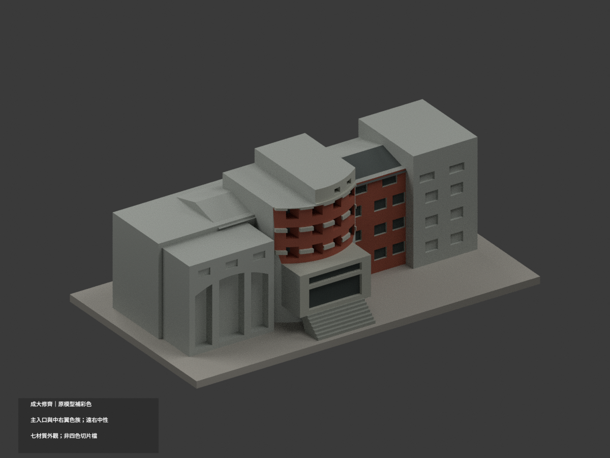
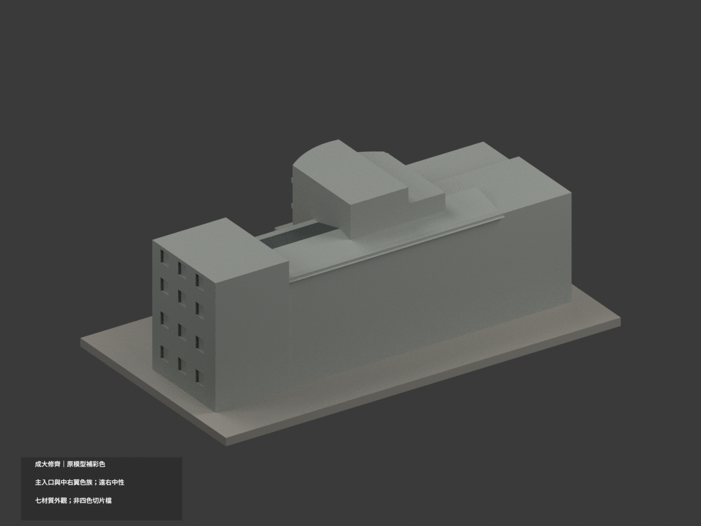
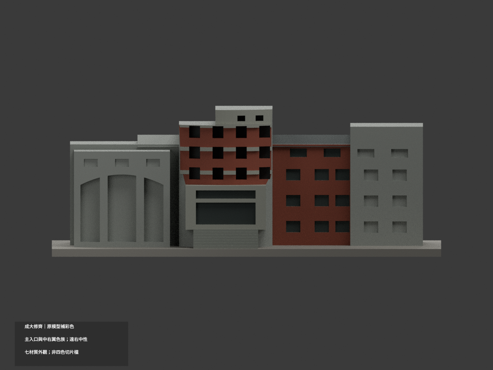
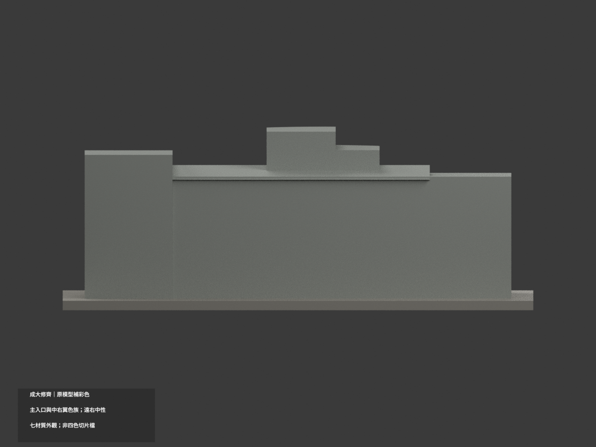
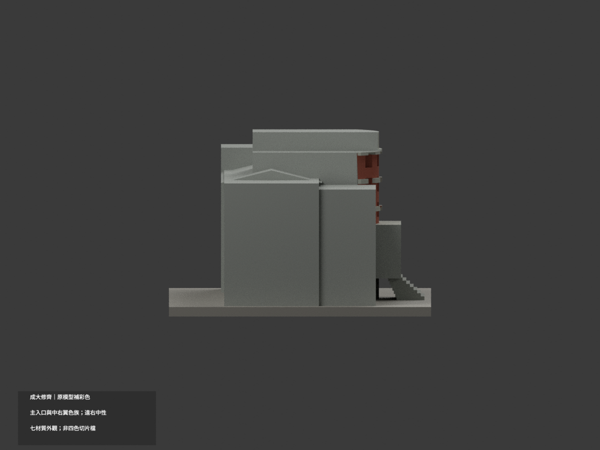
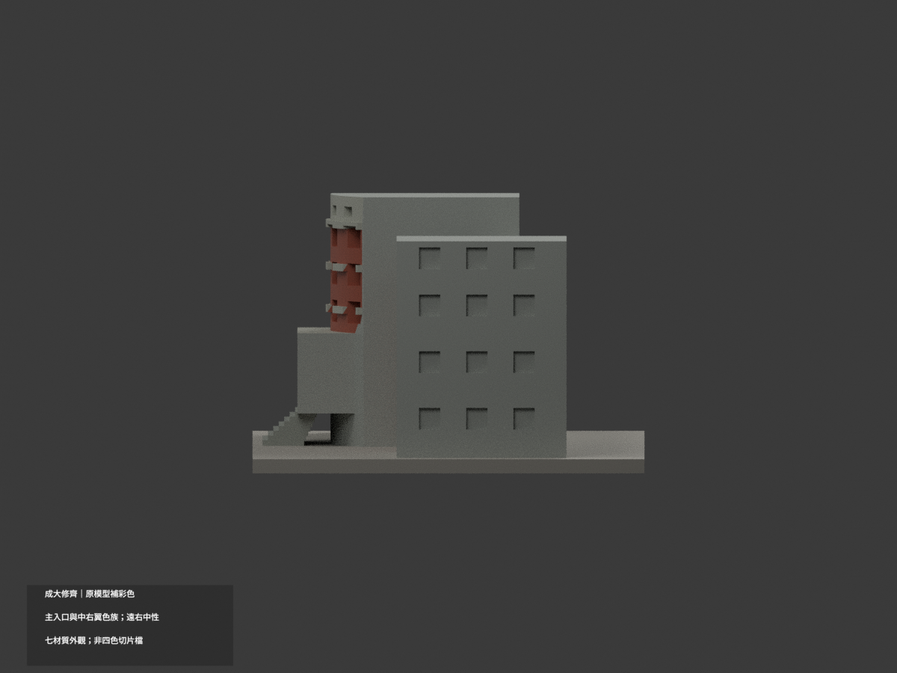
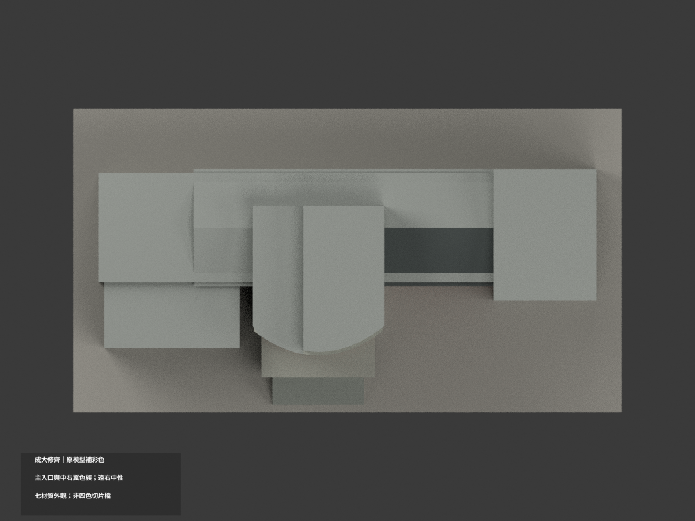
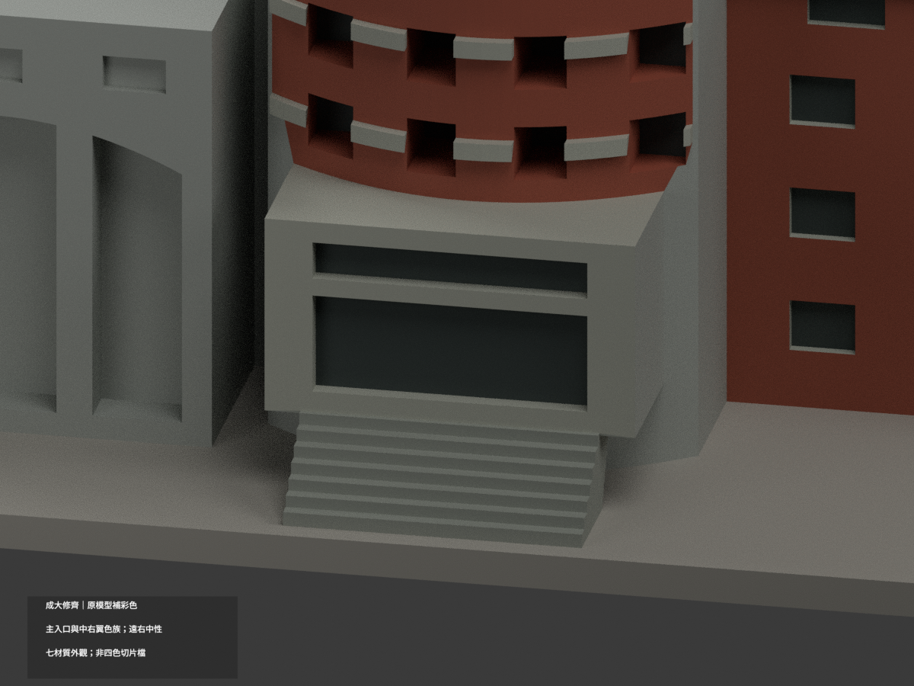
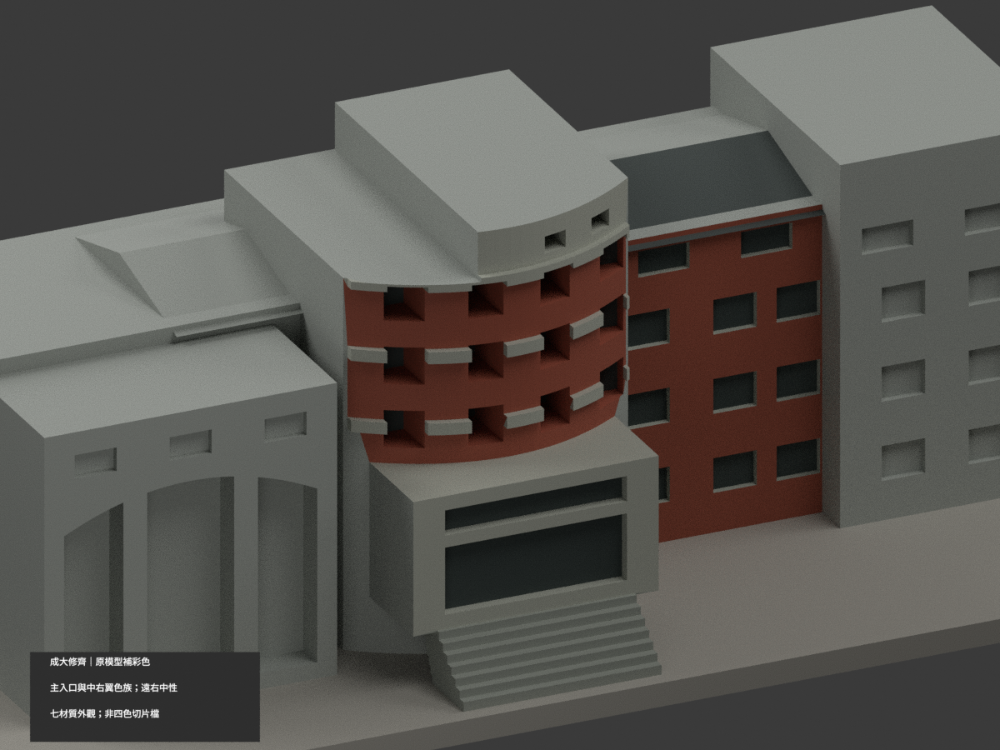
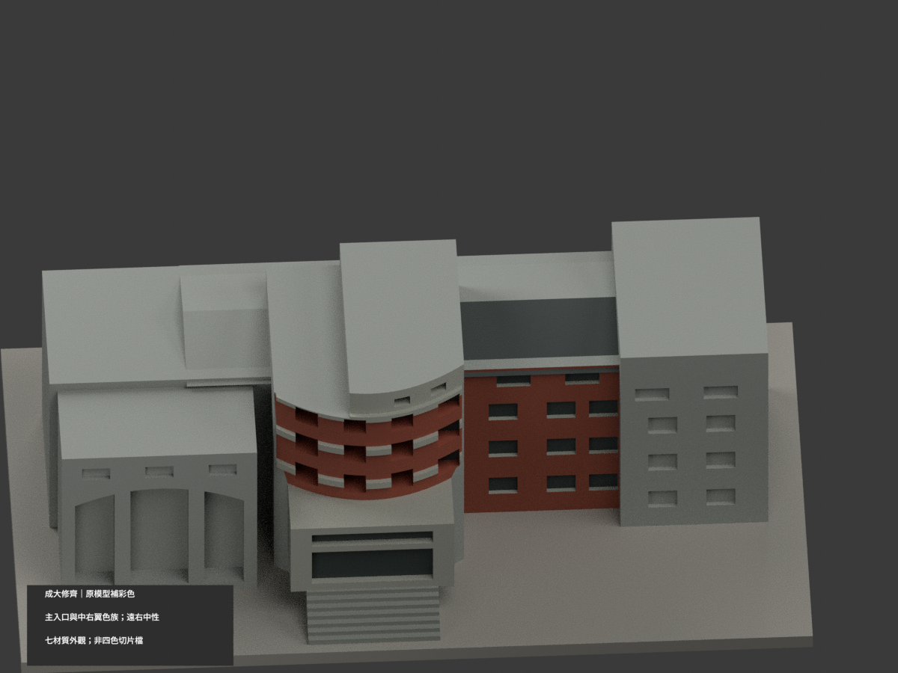

# 成大修齊大樓｜原模型有界補彩

## 彩色模型預覽

本次只更新原有模型的材質與渲染，**原 2104 三角形／STL 不變，同項目更新、不增加套數**。有證主入口與右翼採紅磚／灰框色族；左大拱、最右高端塊、後側與未見面保持中性。不是新測繪或 2026 現況色彩復原。

| 模型預覽 | 模型預覽 | 模型預覽 |
|---|---|---|
|  |  |  |
|  |  |  |
|  |  |  |
|  | | |

## 材色範圍與限制

- 官方成大素材網與外文系正面照片支持主塔磚紅、灰色頂層／橫帶、入口灰框、右翼紅磚與深灰斜屋面。色碼是低飽和展示近似，非儀器色票或修復色號。
- 最右高端塊未能與官方正照唯一對位，整個前皮與窗凹都保中性；只中段右翼採有證磚色。原模型弧塔半徑、樓帶與開口仍是舊版粗化；本次照片**不重新證明這些幾何準確**。街側多拱實景不能直接套到模型左邊單一大拱，該區保中性。
- 既有三角面沒有全部真實塗裝邊界；不切面、不增構件。入口外框採整面灰，未精確重現紅磚柱腹；右翼窗帶與主塔橫帶亦沿既有面粗化，不代表每一塊灰面都是實景灰漆。
- 凹底深灰只顯示陰影，不宣稱所有洞口是玻璃。照片原有字樣、磚縫、欄杆與石碑不新增。
- 平屋頂、背側、未證端牆等中性不是現地色彩。正面有證斜屋面深灰，未知屋背不推定。
- 照片上傳年份不是拍攝年份；官方資料含不同時期外觀與整修訊息，不拼稱某一年精確竣工色。

## 檔案與重現

彩色外觀：[appearance.3mf](appearance.3mf)、[scene.blend](scene.blend)。STL 本身不含顏色；原 [model.stl](model.stl) 與 [build_model.py](build_model.py) 字節保留。原包沒有 OBJ，不宣稱保留不存在的原 OBJ。

依原 requirements 安裝後：

```sh
python colorize_model.py
python export_appearance.py
python validate_color.py
blender -b -t 2 -P render_color.py
blender -b --python-exit-code 1 -P verify_color_scene.py
```

保留的 `previews/`、`render_preview.py`、原 `validation.json` 等為**舊單色版本歷程**，不是本次彩色結果或新材色 QA。新檔由 `COLOR-FORMAT-GEOMETRY-QA.json`、`SCENE-QA.json`、`DELIVERY-QA.json` 與獨立視覺審核綁定。隔離重建目錄保留，不自動刪檔。

## 列印限制

七材質外觀 3MF 不是已驗證的四色耗材切片專案。未實際列印、未切片驗證；原支撐、薄件及近似幾何限制繼續適用，材色不改善原幾何精度。尺寸約 150 × 83 × 55.9 mm，獨立縮尺，不作工程依據。

## 色彩來源與權利

- [成大素材網入口實景](https://material.ncku.edu.tw/picture.php?/139)
- [成大素材網街側對照](https://material.ncku.edu.tw/picture.php?/3587)
- [外文系沿革正面實景](https://flld.ncku.edu.tw/p/412-1165-31511.php?Lang=zh-tw)

成大素材網標示非商業使用及署名要求，來源 credit：**成大素材網**；系所照片未確認 CC 授權。照片、原頁、裁圖只作私人參考，不隨模型公開、不作紋理。模型套件的授權不涵蓋照片權利，也不保證商用。完整來源角色與限制見 `COLOR-SOURCE-REGISTER.json`。

原幾何為成大光復校區修齊大樓（文學院暨語言中心），校方 GIS A022／R1A-47-0；舊 scene 模板物件名稱錯留 student-activity-center 已在新色版更正，但這不是另一棟建築或新增套數。
