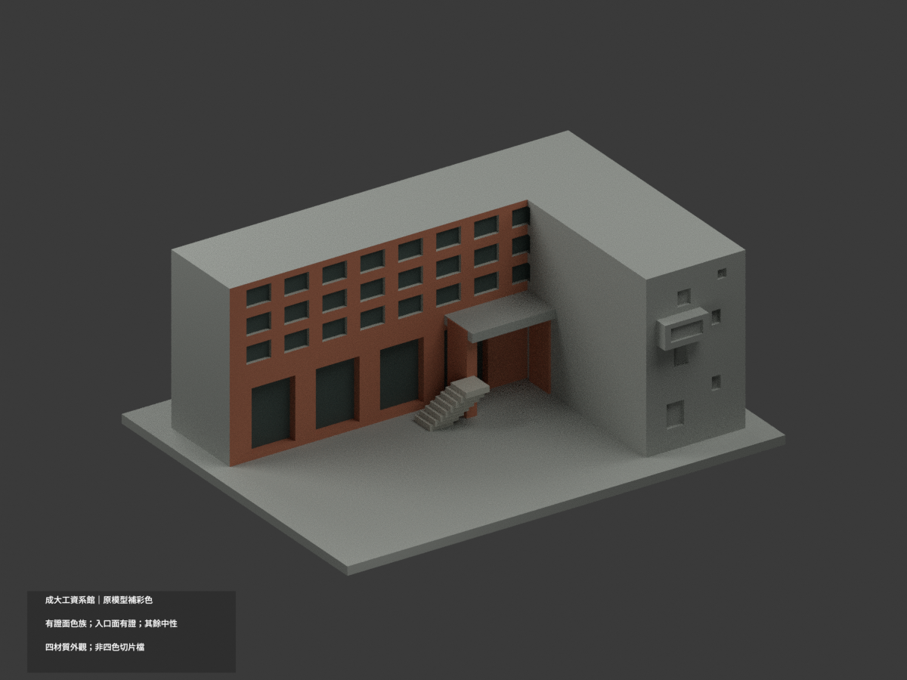
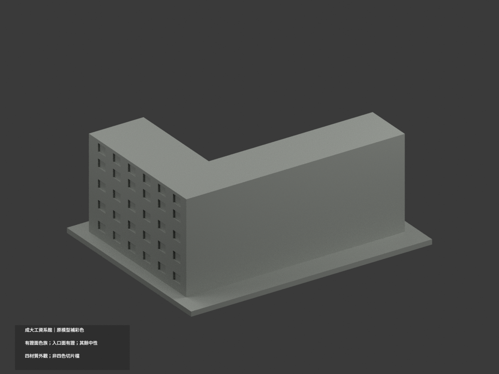
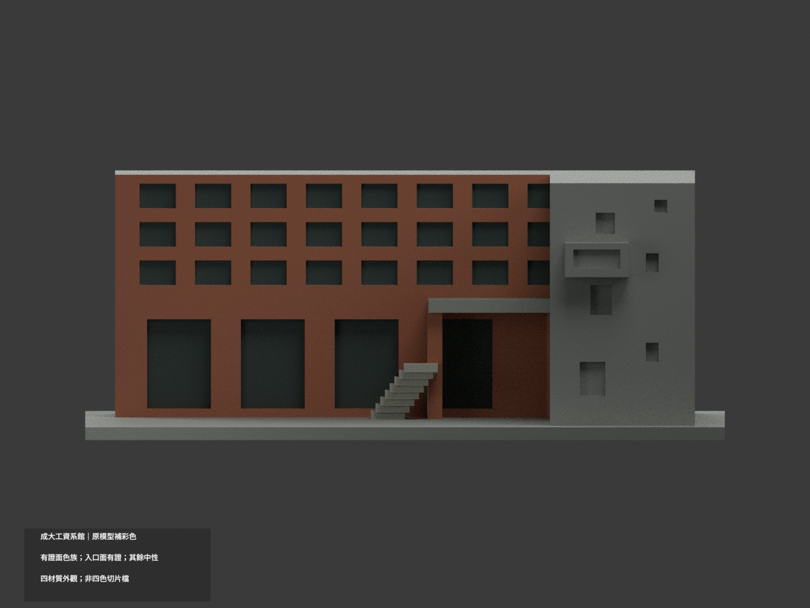
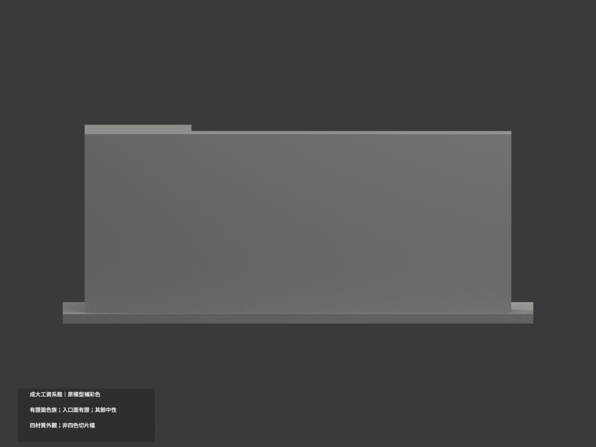
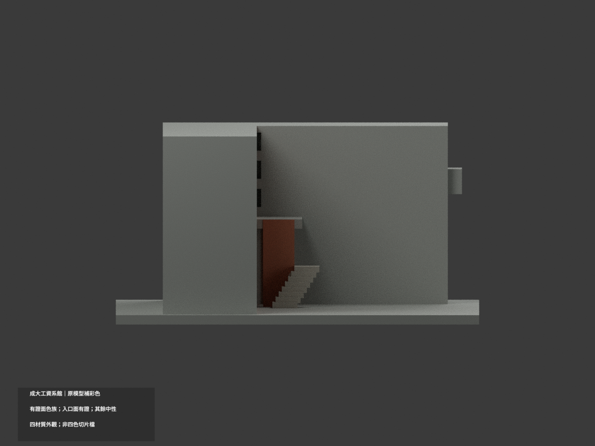
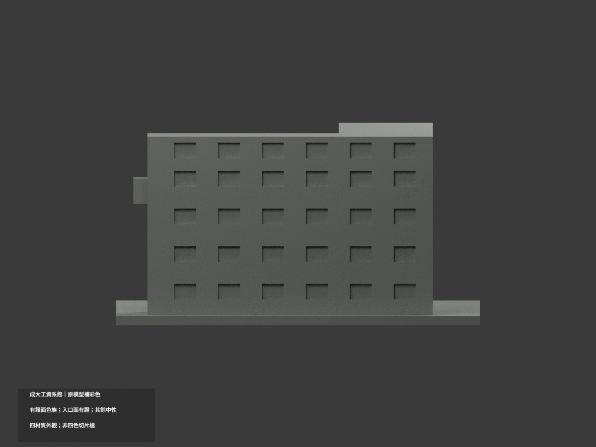
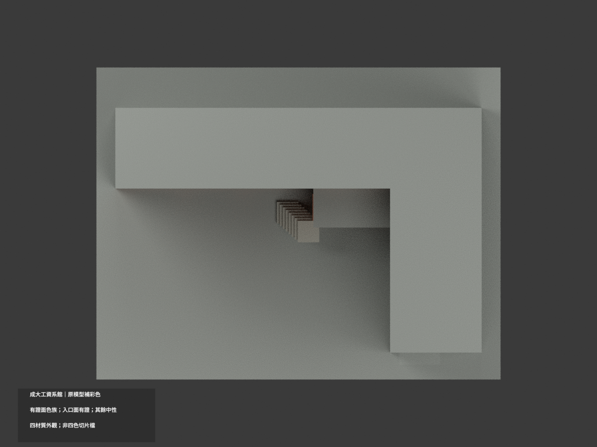
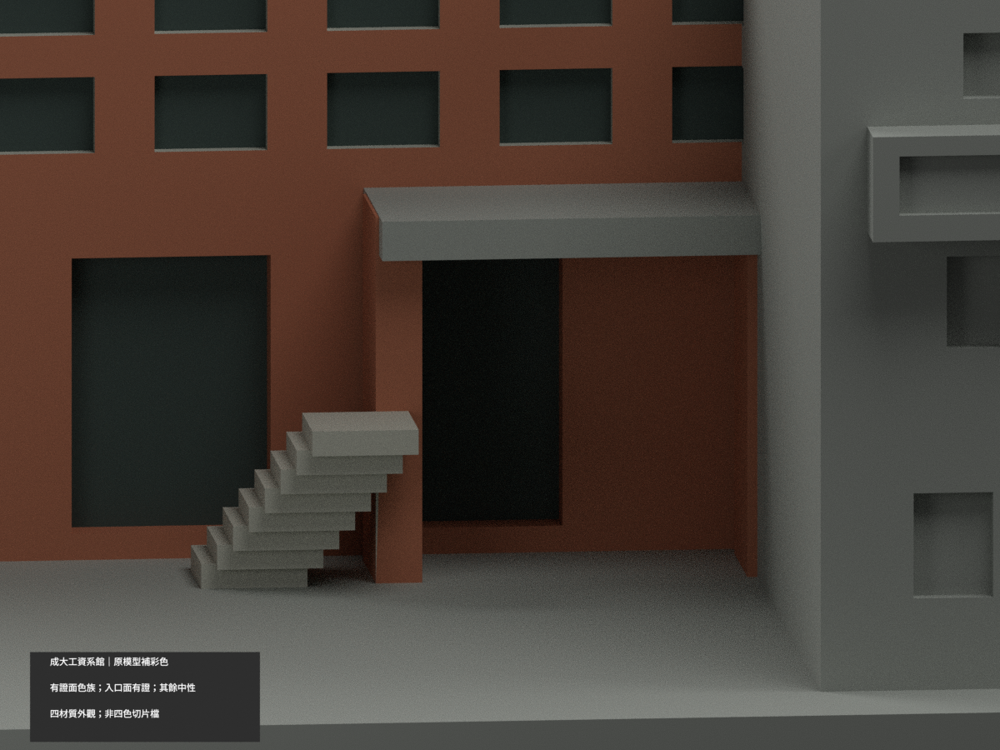
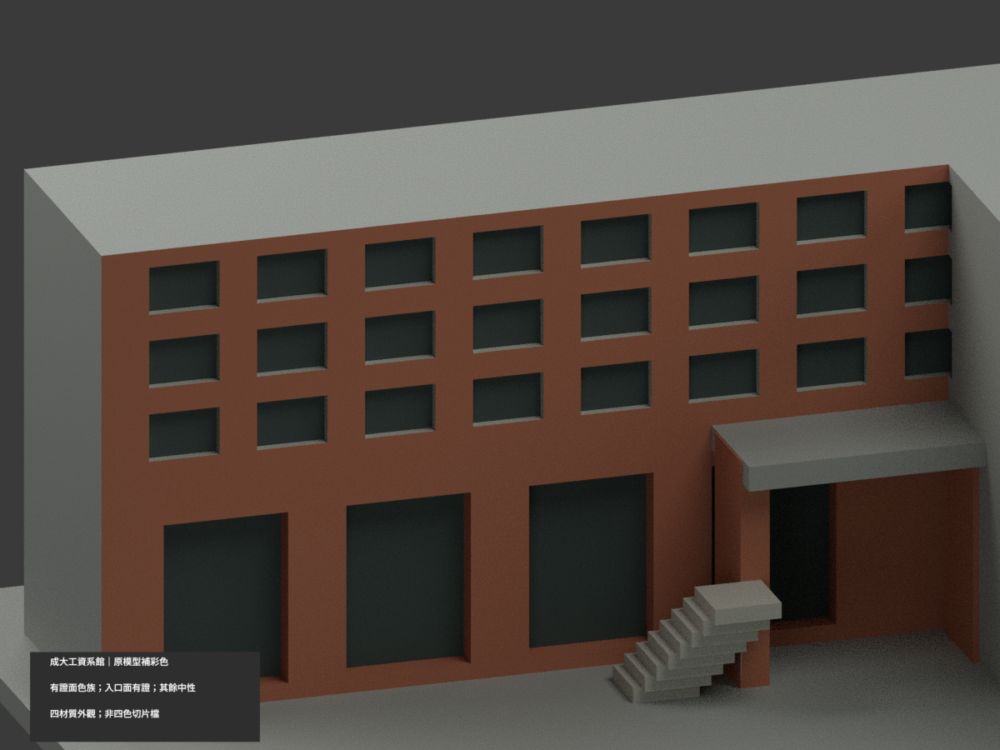
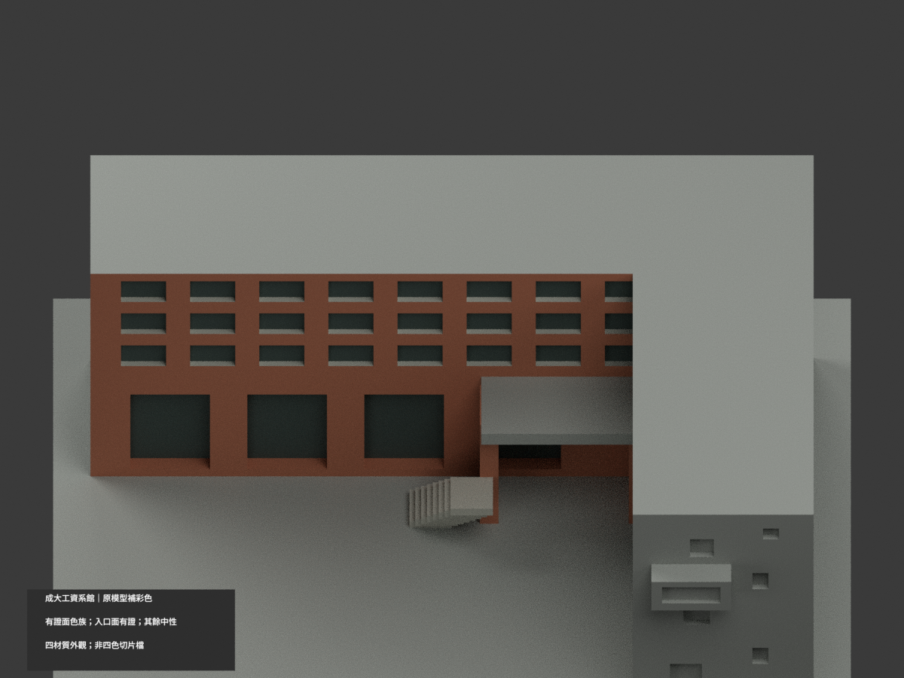

# 成大工業與資訊管理系館 A039｜有證入口面補彩

## 彩色模型預覽

**同項目 count_delta = 0；原1394三角形、STL及建模程式不變。** 僅入口長面依照片分色，未證短端、外側、背面及屋頂保持中性；不包含相鄰A040管院或A038會計棟，不稱全館精確現況復原。

| 整體 | 後斜 | 正面 |
|---|---|---|
|  |  |  |
|  |  |  |
|  |  |  |
|  | | |

## 材色範圍

- 兩張官照均是入口長面及斜角，支持磚紅／橘主牆與**兩支高磚柱**，不因此推定短端、外長側及後面每一窗的顏色。
- 原上三列凹窗背底採深灰，既有凹邊採灰色族；沒有新增外擴窗框、玻璃條或細磚縫。下部高凹口以深陰影表示，不把整個入口凹面說成玻璃或室內復原。
- 實照同時有高位磚邊懸挑及較低的灰小簷。原模型高portal無法唯一證明等於低灰簷，故**只有底面淺灰，邊緣與頂面中性**；不因程式命名portal就整塊染灰，也不新增低簷。原外階採灰色族，欄杆與金字未建不補。
- 色碼是未校色照片近似，非材料檢驗或修復色號。素材2025-02-05上傳日不等攝影日期，亦非2026精確現況。
- 原簡化L形、窗列／樓層／深度仍是舊模型近似；補彩不是幾何精度背書。跨界大三角不切新面，未知面中性不代表真實灰漆。

## 格式、重現與限制

[appearance.3mf](appearance.3mf) 是毫米四基本材質逐面指派，[scene.blend](scene.blend) 保存同網格與實際材質。原 [model.stl](model.stl) bytes不變、STL不含顏色；原包無OBJ，不假稱有原OBJ。

四材質外觀**不是已驗證四色耗材切片專案**；未實際列印，未測換色、支撐及耗材對應。原薄件與估算比例限制仍適用。

```sh
python build_model.py
python colorize_model.py
python export_appearance.py
python validate_color.py
blender -b -t 2 -P render_color.py
blender -b --python-exit-code 1 -P verify_color_scene.py
```

格式／重建／實際shader重開／十圖與獨立視覺檢查見本次QA。隔離重建目錄保留，不刪檔。[原單色說明](ORIGINAL-MONOCHROME-README.md)、previews/、render_preview.py、舊validation為歷程，不能代替本次材色QA；舊renderer會覆寫新場景，勿混用。模型各件原比例獨立，不能當等比例校園拼接。

## 來源與權利

實看成大素材網 [3316](https://material.ncku.edu.tw/picture.php?/3316)、[3318](https://material.ncku.edu.tw/picture.php?/3318)。署名**成大素材網、外國語文學系－蔡美慧**，保留非商業利用與署名條件。原照／頁面僅私人參考，不隨模型公開、不作貼圖；專案授權不重新授權來源或保證第三方設計商用權利。公開只有來源連結與獨立概化材色。
