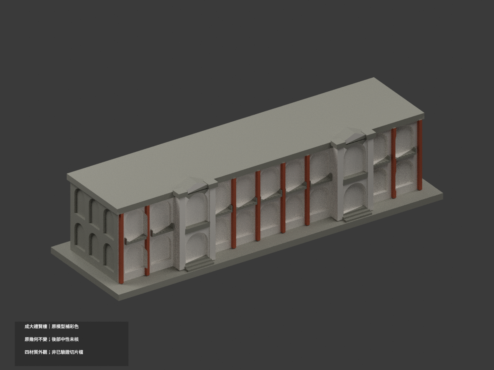
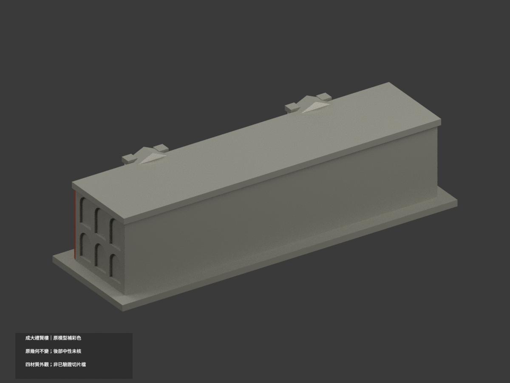
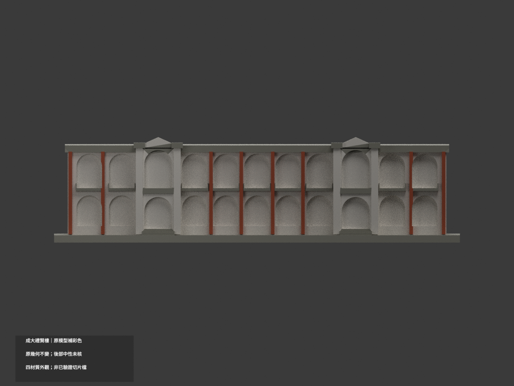
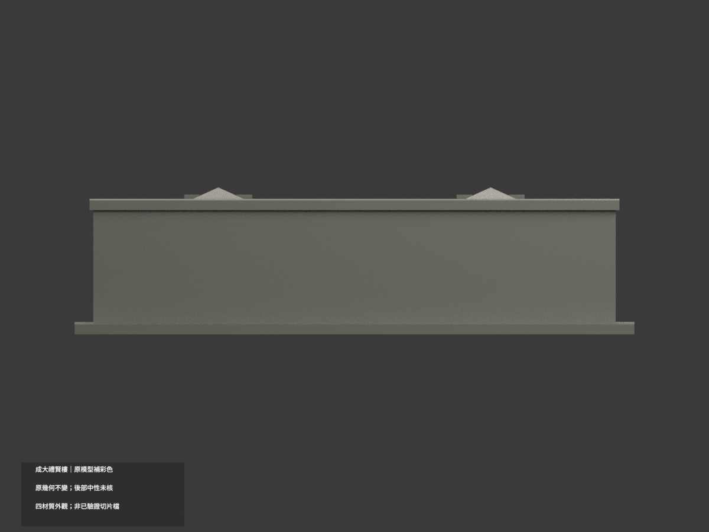
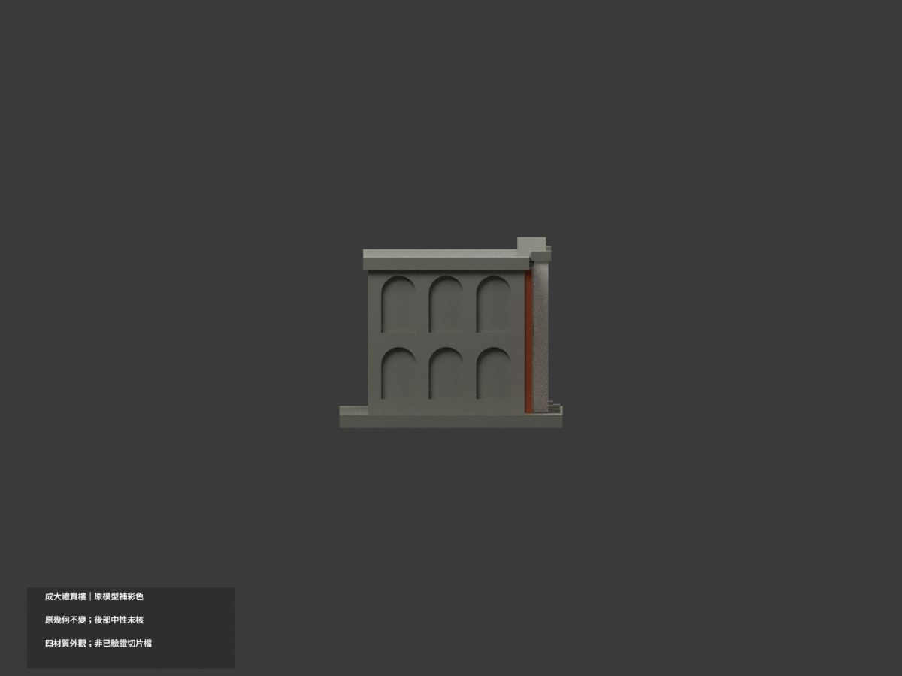
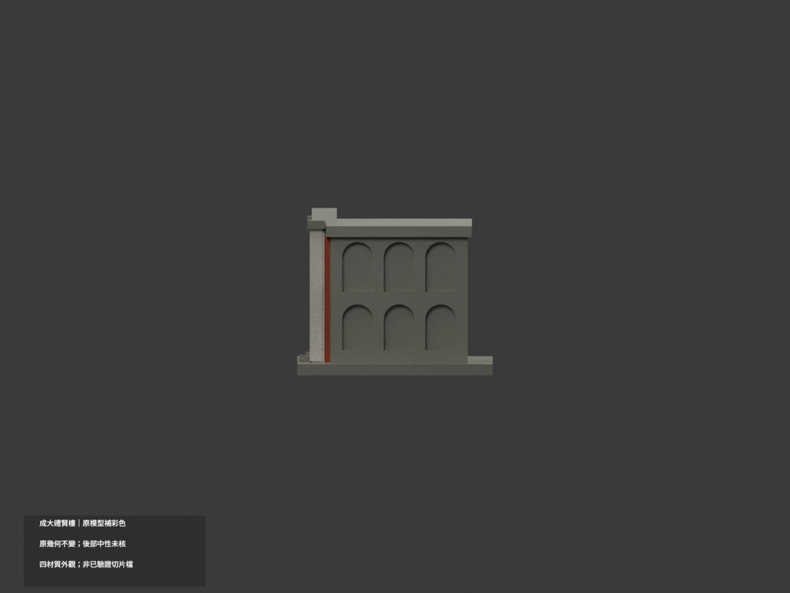
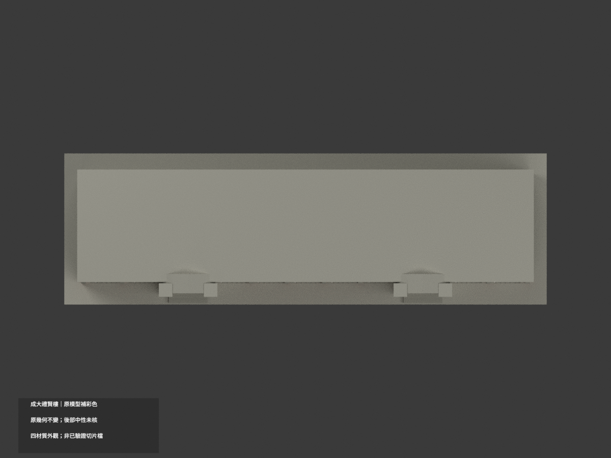
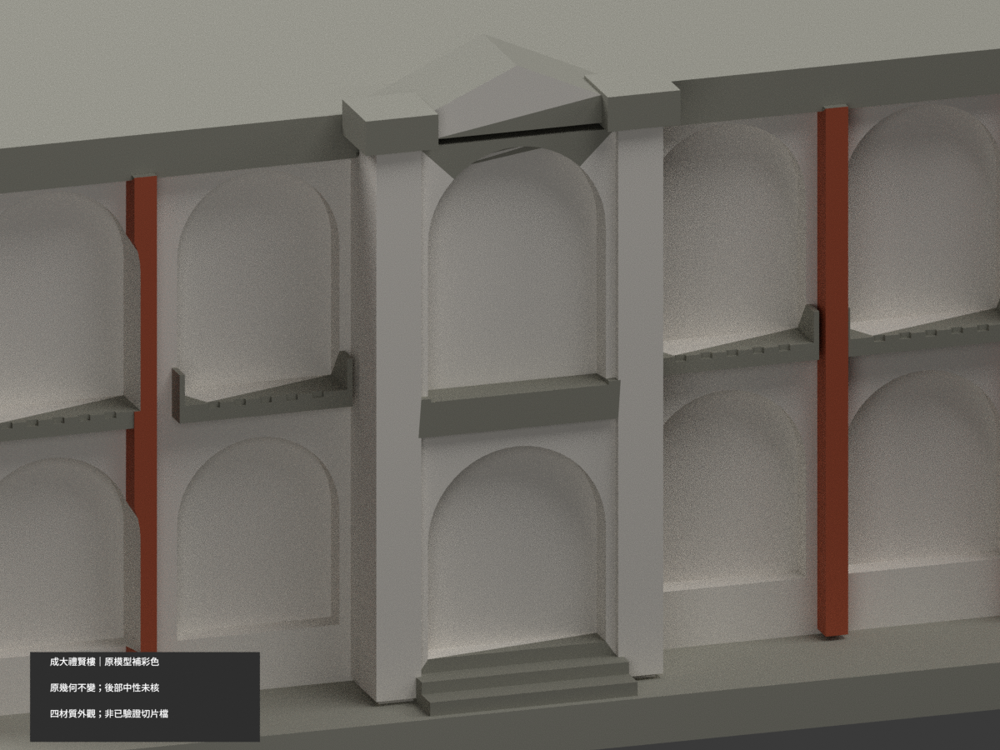
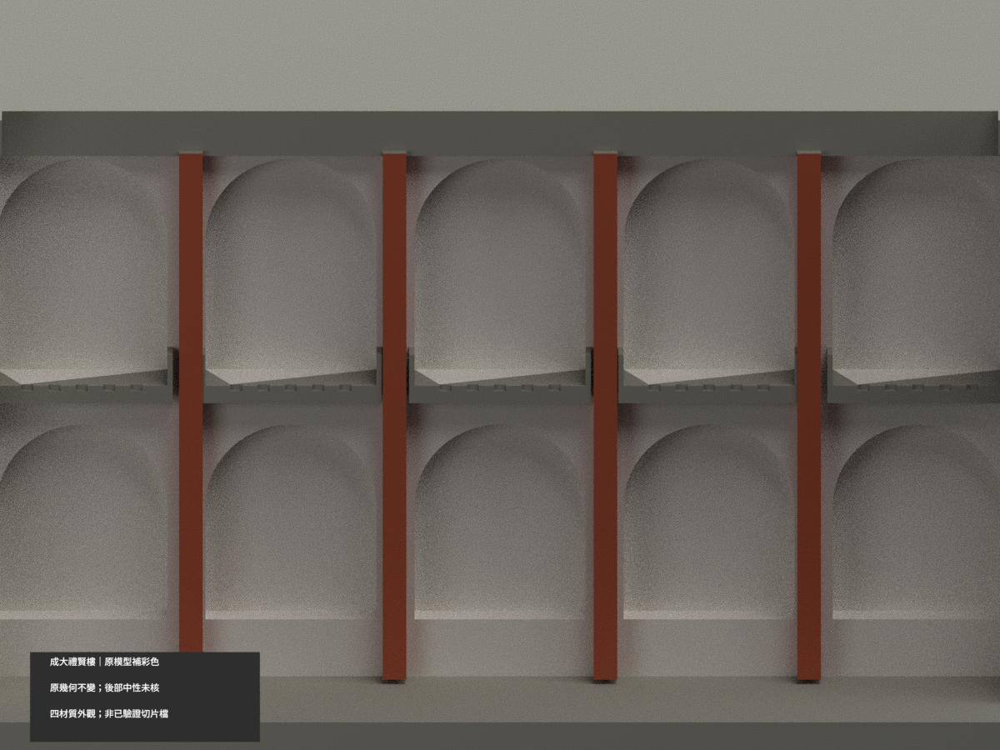
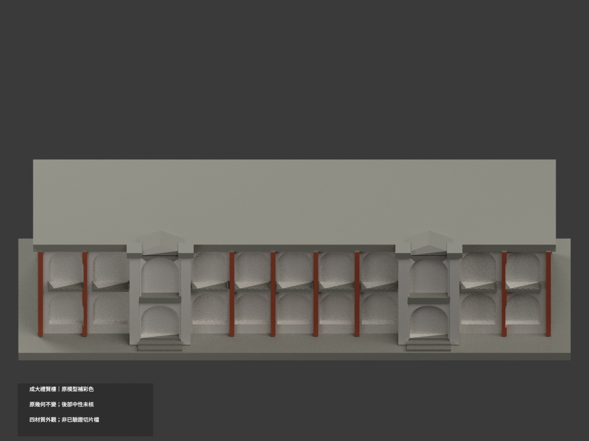

# 國立成功大學禮賢樓｜同項目彩色更新

## 彩色模型預覽

**原幾何不變：150 × 47 × 38.8 mm、5376 三角面，原 STL 位元組保留；count_delta = 0。** 這是既有粗化外觀模型補材色，不是重新測繪或提升建築幾何精度。依 2022 年 12 月修復完成、2023 年 1 月官方照片近似分色，不主張 1912 原漆或 2026 即時現況。

| 整體 | 反向／未核後部 | 正向 |
|---|---|---|
|  |  |  |
|  |  |  |
|  |  |  |
|  |  |  |

## 分色範圍與重要限制

- 普通前柱腹近似紅橘磚；入口高柱、山牆填面與原有拱洞內表面暖白；欄板、入口水平帶、帽及階梯灰米；未核的兩端、後背、大片平屋頂及展示底座保持中性。
- **原網格沒有獨立白色前拱圈環**，亦有跨多個真實材色區的平面三角形。本次不切分、不增面、不加裝飾；無法穩定對應的拱間紅磚三角填面／白圈邊界以暖白概化。紅柱不等於全部真實磚面的精確復原。
- 原模型沒有照片中的退入木門扇與木窗框，**未將整個拱洞染棕冒充木窗**；洞內暖白及陰影由現有表面與渲染照明產生。未貼官方照片。
- 官照主要顯示其中一入口，第二入口採同類構件分色解讀，不聲稱兩處均有獨立照片核對。側背與屋頂不是已核全方位配色。
- HEX 為展示近似，非色度量測或現場色票；原始粗化幾何及背面資料不足限制仍有效。

## 彩色檔案與列印

- [appearance.3mf](appearance.3mf)：毫米單位、四個基本材質逐面指派；[appearance-materials.json](appearance-materials.json) 記錄材色與面數。
- [scene.blend](scene.blend)：實際彩色 Blender 場景，與原 STL 同三角幾何。原 `build_model.py` 不變，`colorize_model.py` 只指派現有面材質。
- [model.stl](model.stl) 保持原檔；**STL 本身沒有顏色**。彩色預覽不等於 STL 含彩色。
- 四個外觀標籤 **不等於已驗證的四色耗材切片檔**；未驗切片器材質匯入、耗材映射、支撐／換色及實際列印。本件未實際列印。

## 可重現與 QA

依原 requirements 安裝環境後：`python build_model.py`、`python colorize_model.py`、`python export_appearance.py`；`blender -b -P render_color.py` 產生十圖及彩色場景；`python validate_color.py`、`blender -b -P verify_color_scene.py` 查格式、原幾何、隔離重建及場景重開。隔離資料保留，不自動刪除。

本次證據為 `COLOR-ASSIGNMENT-QA.json`、`COLOR-FORMAT-GEOMETRY-QA.json`、`SCENE-QA.json`、`FRAMING-QA.json`、`DELIVERY-QA.json`。舊 `previews/`、`validation.json`、薄壁／截面檔仍保存，但不是本次色彩或四色列印驗證；舊 `render_preview.py` 會產生單色場景，請勿誤覆本次場景。

## 色彩來源與權利

採[成大新聞中心 2023-01-11 禮賢樓修復慶成報導](https://web.ncku.edu.tw/p/404-1000-248681.php?Lang=zh-tw)，文陳意安、圖蘇弘毅；三張正面／典禮／廊內照片交叉檢視。不是修復前側照，也不把廊內照當後立面證明。

原照片、裁圖與私人審核原件不隨模型公開、不作紋理貼圖。未查得可據以再授權的 CC 許可；公開可看不等於商用授權。第三方照片與建築設計權利仍屬權利人，本次原創材質分配與渲染不重新授權該素材，也不保證商業使用權。詳 `COLOR-SOURCE-REGISTER.json`。

## 原模型幾何說明與限制（繼續有效）

# 國立成功大學｜禮賢樓

## 模型預覽

| 模型預覽 | 模型預覽 | 模型預覽 |
| :---: | :---: | :---: |
|  |  |  |

首批代表建築外觀近似模型；僅此一棟，並非全校完成。校區：光復校區。查核與建模日期：2026-10-13。

尺寸（含底座）：150 × 47 × 38.8 mm。


## 來源與像素觀察

- [校方修復慶成報導，2023-01-11](https://web.ncku.edu.tw/p/404-1000-248681.php?Lang=zh-tw)：已檢視修復後正面外觀照片像素：雙層廊道、上層半圓拱、入口高柱與山牆、欄板及屋簷水平帶。
- [成大素材網：禮賢樓側端照片](https://material.ncku.edu.tw/picture.php?/184)：已檢視照片像素：短邊三開間雙層拱廊，照片早於2022年修復，僅作結構節奏參考。
- [校方虛擬校園：禮賢樓](https://virtualcampustour.ossd.ncku.edu.tw/index.php?id=8&inter=detail)：確認連續拱廊及位置。
- [原日軍臺灣步兵第二聯隊營舍公開條目](https://zh.wikipedia.org/wiki/原日軍臺灣步兵第二聯隊營舍)：補充長邊兩個入口、入口間五拱及兩側兩拱的配置文字；沒有把文字當作照片像素檢視。

## 本件保留與近似

保留兩層連續拱廊、長邊雙入口與入口山牆、加粗欄板、短邊三開間與水平屋簷。實際廊道改成約1–2 mm可見深度的淺凹，不製作中空室內。低層實際拱形較平緩，模型統一半圓近似；沒有複製精細徽飾。兩入口長邊全景、屋頂俯視及後立面缺完整照片，因此總寬、間距、平屋頂與後牆均為近似；後立面保留實牆，不捏造窗門細節。

## 交付與重建

- `model.stl`：毫米單位，與底座合成的單一實體。最長邊為 150 mm（含底座）；各棟獨立縮放，不適合直接拼成等比例校園。
- `build_model.py`：完整可攜參數化原始程式，無外部貼圖、私有路徑或參考照片依賴。
- `scene.blend`：由交付 STL 匯入，只有一個建築網格，可在 Blender 編輯頂點；細部參數請修改 Python 後重建。
- `previews/front.png`、`rear.png`、`elevation.png`：由實際交付 STL 產生。
- `validate_model.py`、`validation.json`：可重跑的幾何與重建驗證。

建議 Python 3.12，在虛擬環境執行：

```sh
python -m pip install -r requirements.txt
python build_model.py
blender -b -t 2 -P render_preview.py
python validate_model.py
```

已使用 Blender 4.3.2。驗證器在獨立臨時目錄重建 STL 並比較 SHA-256，讀取 Blender 場景的網格後比較三角形幾何。它檢查原始二進位 STL 儲存法線、面積、封閉性、邊恰有兩面、頂點連結為單一環、表面只有一個連通分量、正體積、底面位於 Z=0、最長邊 150 mm。單一封閉表面也排除獨立藏在內部的空腔殼；沒有宣稱完成所有自交的窮舉檢測。

## 製作原則與限制

這是依公開照片觀察製作的外觀近似收藏模型，不是測繪、修復、工程或精確 BIM 資料。牆身為實體，門窗、拱廊通常改成淺凹浮雕；不含室內、設備或安全配置。屋頂、深度、窗距及後側比例沒有測量基準，不能視為實際尺寸。原始參考照片未收錄、未重新授權或隨套件發布。來源權利屬原作者／校方；原創模型與程式可沿用儲存庫授權，不涵蓋外部參考照片。

## 列印說明

底座平貼平台，Z 軸向上。可從 0.4 mm 噴嘴、0.16–0.20 mm 層高、3 道外牆與 12–18% 填充開始試切片；這是設定建議，並非已測參數。小於約 0.8 mm 的淺浮雕可能因噴嘴或縮放消失。STL 是封閉實體，切片器仍會依填充率產生內部填充。

未實體試印、未執行切片器列印驗證，沒有保證免支撐。請依下列模型特有支撐需求檢查切片預覽。

拱頂、入口帽檐與水平屋簷為局部懸垂。因廊道採淺凹，支撐需求比貫通廊道低，但仍應在切片器逐層檢查；尤其兩入口突出帽檐可能需要局部支撐。


## 整合版截面與薄特徵補充驗證

本整合版使用固定共同邊方向後插值的 `validate_sections.py` 與 [0.2 mm 截面結果](cross_sections.json)，避免同一邊浮點方向差異造成假斷環。原始 STL 幾何未修改。舊截面程式有閉合斷言，既有通過結果不代表曾有破面；此處以新版重跑結果為準。

另提供 `check_thin.py` 與 [新增 0.8 mm 薄特徵輔助篩查](thin-feature-check.json)：每 1 mm 水平取樣，先確認輪廓閉合與有效，再作半徑 0.4 mm 形態開運算。這不是切片器、完整壁厚分析或實體試印，尖屋頂、銳角也會造成損失，不能據此宣稱無支撐或列印成功。執行前請安裝 requirements.txt。
