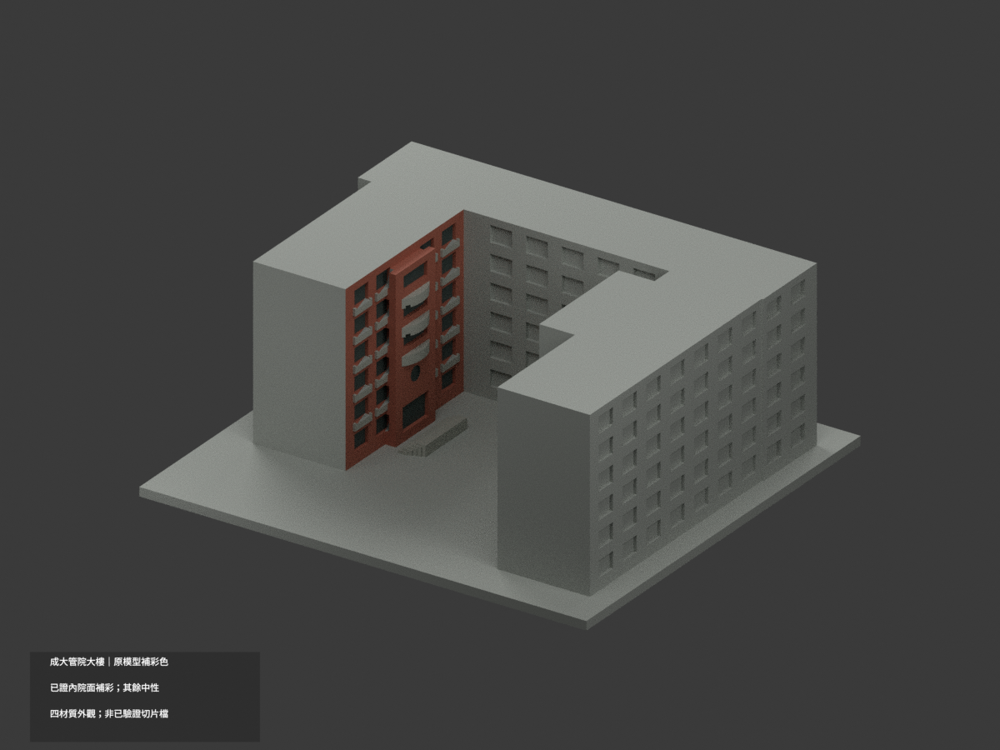
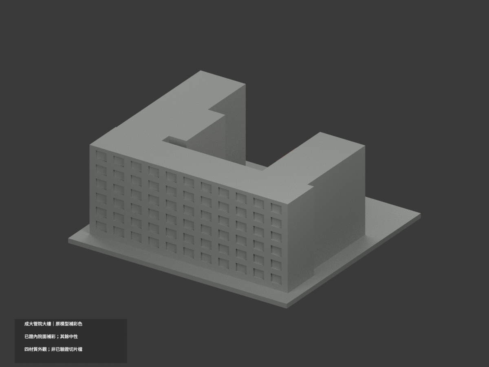
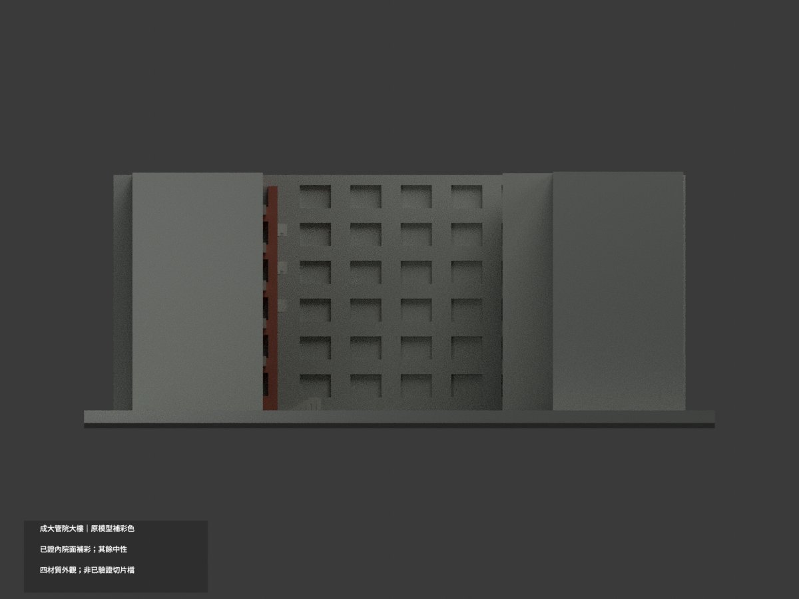
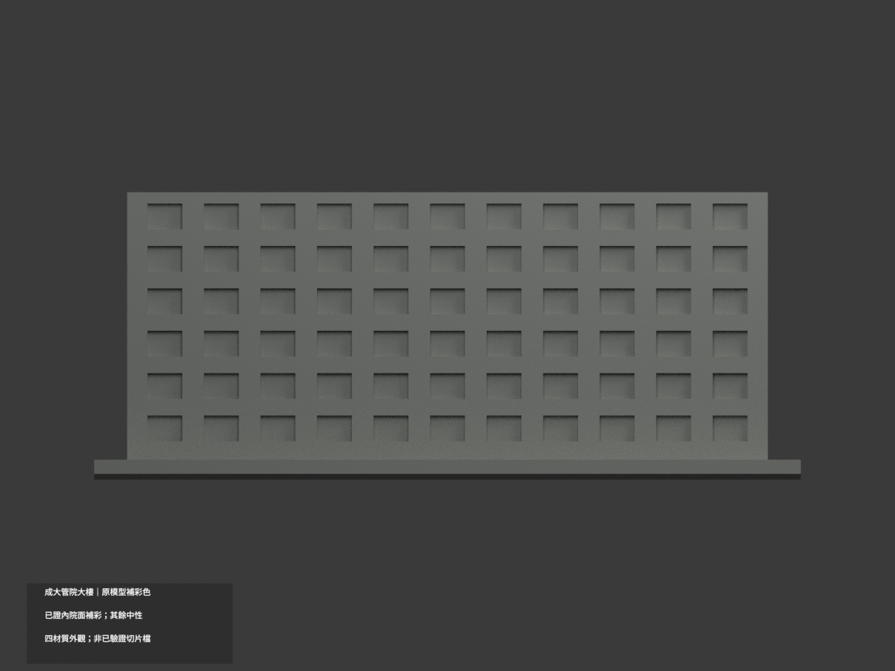
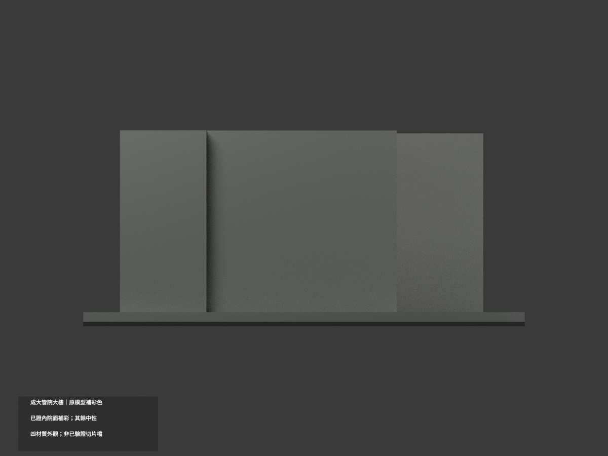
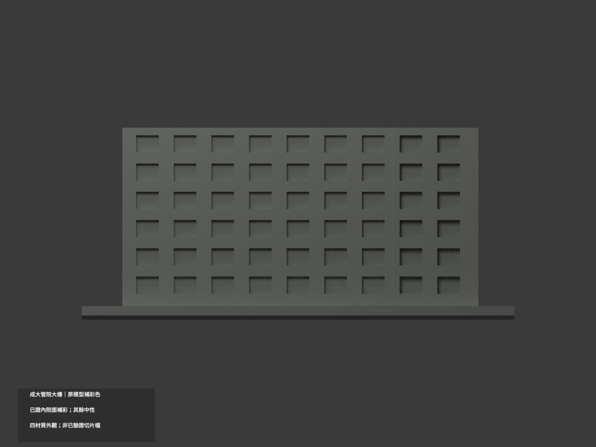
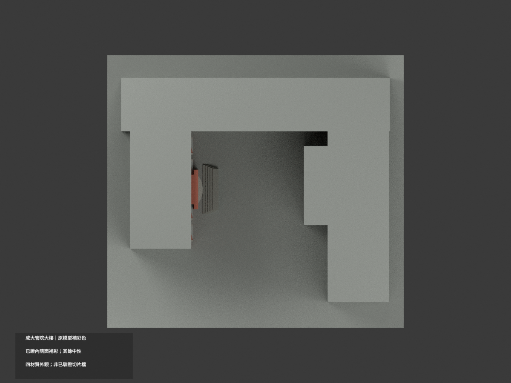
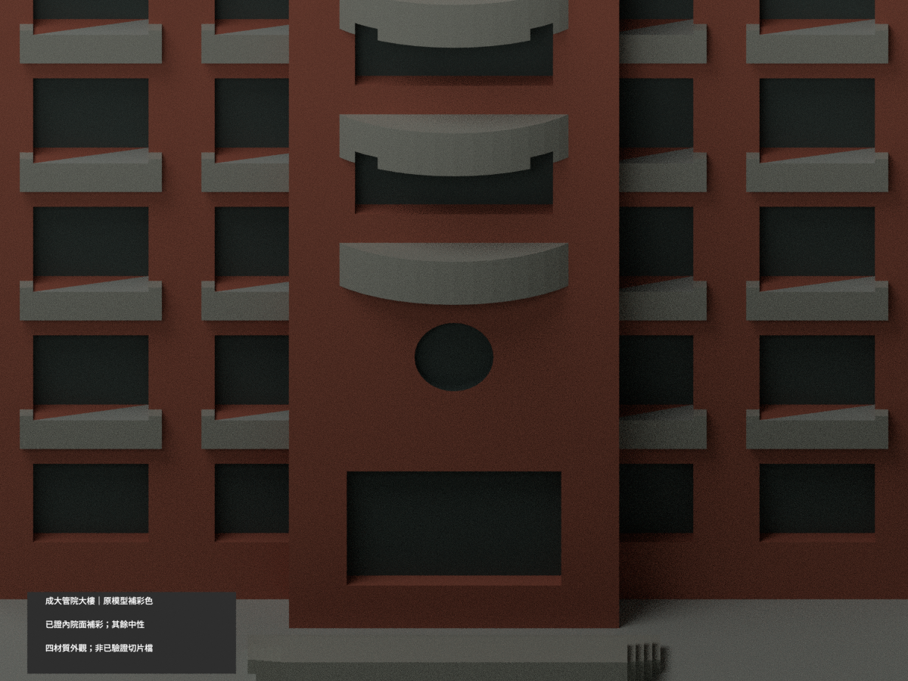
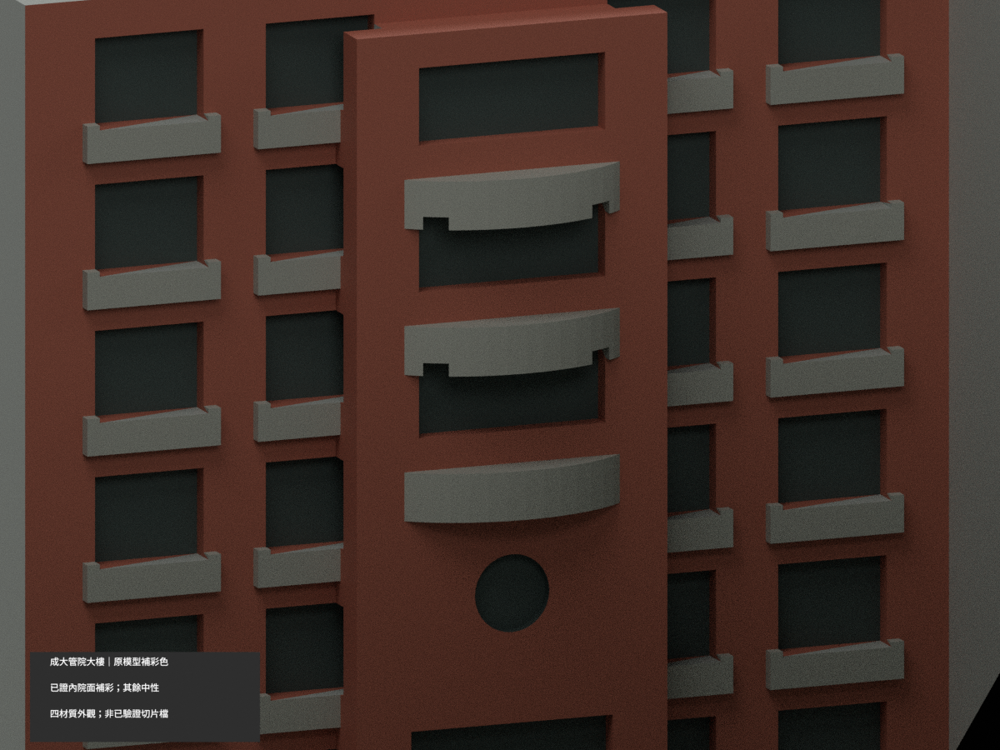
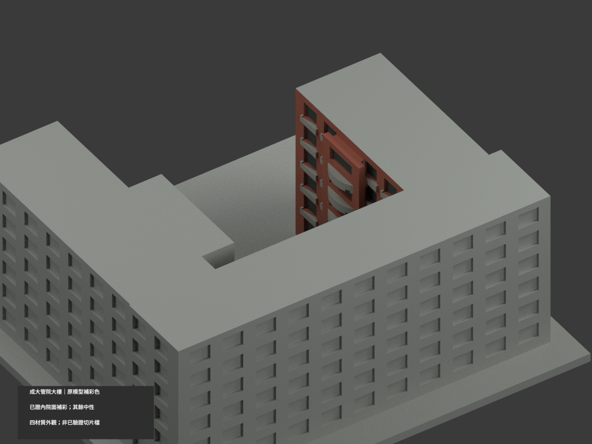

# 成大管理學院綜合大樓 A040｜既有模型有證面補彩

## 彩色模型預覽

**count_delta = 0；原 STL／建模程式位元組與 3894 三角面不變，150 × 138 × 59.9 mm。只為照片能唯一對位的三弧陽台內院面補彩，其他未證外面／北面／屋頂保持中性，並非整棟精確實色復原。** 原模型很簡化；色彩不替其幾何、門窗與尺寸精度背書。不含相鄰 A039。

| 整體 | 後向 | 正向 |
|---|---|---|
|  |  |  |
|  |  |  |
|  |  |  |
|  |  |  |

## 材質範圍與限制

- 3290 官照的三個弧形陽台、圓形特徵與入口能和原碼內院面對位：既有牆／柱採紅褐磚色族，既有三弧陽台與欄板採灰色。原碼雖稱白色板，實照片偏風化灰，本次不依程式註解硬染純白。
- **灰板逐 bay 對應原突出片，不能跨過磚柱塗成連續灰帶。** 原弧台與中央壁部分共面／合併，僅以完整原三角域概化，不能切面補足實景每條磚灰界線，也不宣稱所有欄框比例已精確復原。
- 原凹窗及入口洞底是深灰示意；**圓孔不是玻璃**，只是既有淺凹特徵。沒有增添門扇、玻璃圓片、入口金字、標牌、磚縫或冷氣設備。
- 3296 另照支持外側紅磚／灰凹框色族，卻不足以唯一證明原粗模每一個方位面。**本次不憑外觀色族直接將東外側、北後及平端牆全染紅**；不確定面及屋頂／底座保持中性，中性不是其實際灰漆證據。
- 素材上傳日 2025-02-05 不是已確認拍攝日；不宣稱 2025 精確漆色或 2026 即時現況。HEX 為未校色照片近似，非工程色票。

## 格式與列印

[appearance.3mf](appearance.3mf) 是毫米單位四個基本材質逐面指派；[scene.blend](scene.blend) 實際保存材質。原 [model.stl](model.stl) 位元組不變，STL 本身不含顏色；原包未提供 OBJ，不宣稱保存原 OBJ。

四個外觀標籤**不等於已驗證四色耗材切片專案**；切片器匯入、耗材對應、支撐、換色未測，本件**未實際列印**。原模型列印與幾何限制繼續有效。

## 重建與 QA

依原 requirements：`python build_model.py`、`python colorize_model.py`、`python export_appearance.py`；`blender -b -P render_color.py` 產生十圖與場景；`python validate_color.py` 與 `blender -b -P verify_color_scene.py` 驗原檔、三角、3MF、隔離重建及實際 shader／場景重開。重建資料保留，不自動刪除。

入口細景相機修正後單獨重渲；其餘九圖的原碼只差該入口相機設定、圖檔位元組未動，以 RENDER-REVISION-QA 明列版本與 hash，不聲稱九圖由最後版程式重新渲染。

本次證據為 COLOR-ASSIGNMENT-QA、COLOR-FORMAT-GEOMETRY-QA、COLOR-FACE-DOMAIN-QA、SCENE-QA、FRAMING-QA、SOURCE-VISUAL-QA、DELIVERY-QA。原 previews／validation／thin-feature-check／cross_sections／sources 留存作舊模型歷程，不代替本次彩材或實印驗證。舊 render_preview.py 仍為單色入口，不應覆寫彩色場景。

## 來源與權利

成大素材網 [3290 正面](https://material.ncku.edu.tw/picture.php?/3290)、[3296 外側](https://material.ncku.edu.tw/picture.php?/3296)，作者／提供者 **外國語文學系－蔡美慧**。網站載非成大人員非商業利用得下載、須標示成大素材網；本案保留來源條件與署名。

原照、頁面及裁圖只私人研究，不公開、不貼圖、不重新套用專案開源授權。公開僅來源連結與獨立概化材色解讀，不保證商用或已獲建築設計相關權利。詳 COLOR-SOURCE-REGISTER.json。

## 原模型說明與限制（仍有效）

# 國立成功大學｜管理學院綜合大樓

## 模型預覽

| 模型預覽 | 模型預覽 | 模型預覽 |
| :---: | :---: | :---: |
|  |  |  |

第十二批；光復校區。校方GIS A040，財產校碼R1A-34-0。尺寸約 150 × 138 × 59.9 mm，含底座最長邊150 mm，各件獨立比例。

## 建模範圍與近似

模型僅A040：北長翼與兩端不等長回翼形成開口院落。南側相接的A039工業與資訊管理系館是另一棟、另一財產，明確排除；不能說整個管理學院群棟已完成。保留六層節奏、內向入口三段弧形陽臺、圓形牆面開口、入口階梯與柱樑窗帶。主立面與長側面依三張實拍；回翼深度和連接位置依校方外框。未見屋頂採平頂；其餘未見的內向外牆窗格按可見層次概化，並非逐窗核實。

只建公開外觀，不包含室內、設備、安全配置。厚窗框、窗凹口、遮陽構件和小屋簷均為適應迷你比例的概化；不是文資修復或工程測繪資料。預覽方位為方便看到主要立面的相機角度，不代表地理正南/正北。

## 列印與支撐

弧形陽臺下方、門口及窗凹槽上緣可能需要支撐；底座平放列印，不能保證免支撐。

未實體試印，未切片驗證。0.8 mm薄特徵篩查只作水平幾何輔助，不是全部壁厚或噴嘴路徑分析；尖角面積損失不直接等於列印失敗，數值低也不能保證成功。

## 來源

- [校方公共GIS名稱、外觀照片及建物外框](https://nckumap.ncku.edu.tw/map.php)：僅公開外觀與外部輪廓；不採室內/樓層/設備圖層。地圖原圖不公開轉載。
- [校方財產清冊2026-01-30](https://prop-oga.ncku.edu.tw/var/file/59/1059/img/4743/218075103.pdf)：光復校區、校碼R1A-34-0名稱對照；財產筆數非獨立建物棟數。
- [校方建物名稱與背景](https://management.ncku.edu.tw/p/412-1017-27017.php?Lang=zh-tw)：名稱、校區或同一棟範圍核對；不使用內部配置。
- [已檢視像素的校方實拍](https://db.nckumap.ncku.edu.tw/nckugis/public/uploadfiles.htm?action=listImg&q=38145)：公開可見建築外觀；原照片不納入公開套件。
- [已檢視像素的校方實拍](https://db.nckumap.ncku.edu.tw/nckugis/public/uploadfiles.htm?action=listImg&q=36386)：公開可見建築外觀；原照片不納入公開套件。
- [已檢視像素的校方實拍](https://db.nckumap.ncku.edu.tw/nckugis/public/uploadfiles.htm?action=listImg&q=36385)：公開可見建築外觀；原照片不納入公開套件。

## 檔案與重建

- [模型 STL](model.stl)、[可編輯 Blender](scene.blend)
- [正面原圖](previews/front.png)、[背面原圖](previews/rear.png)、[立面圖](previews/elevation.png)，均從實際 STL 產生
- `pip install -r requirements.txt` 後執行 `python build_model.py`
- `blender -b -t 2 -P render_preview.py` 重建 Blender 與預覽
- `python validate_model.py` 重驗原始 STL 法線、邊/頂點流形、封閉、單一連通表面、無額外內部空腔殼、正體積、乾淨重建雜湊與 Blender 幾何一致性
- `python validate_sections.py` 執行固定共同邊方向0.2 mm截面閉合檢查；拒絕不閉合／退化輪廓
- `python check_thin.py` 執行每1 mm取樣、0.8 mm形態開運算薄特徵輔助篩查
- [原始驗證](validation.json)、[截面結果](cross_sections.json)、[薄特徵結果](thin-feature-check.json)、[結構化來源](sources.json)

| 模型預覽 | 模型預覽 | 模型預覽 |
| :---: | :---: | :---: |
| 立面圖  |  |  |

任一原始驗證false或程式非零退出碼，整批均不可封版；沒有窮盡自交檢測或實體列印保證。原始參考照片與地圖只供內部核對，不放公開包。
