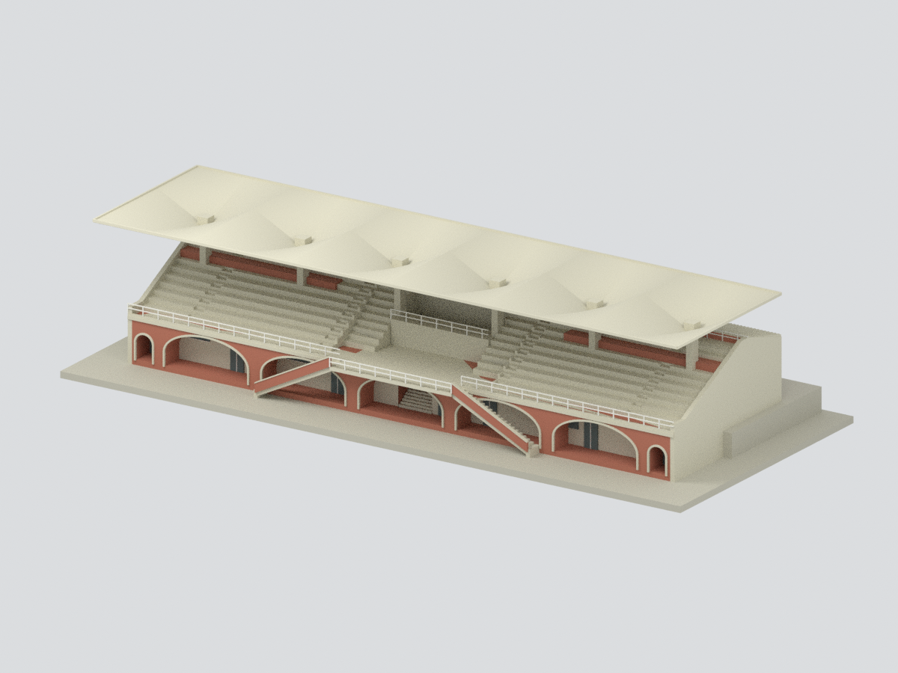
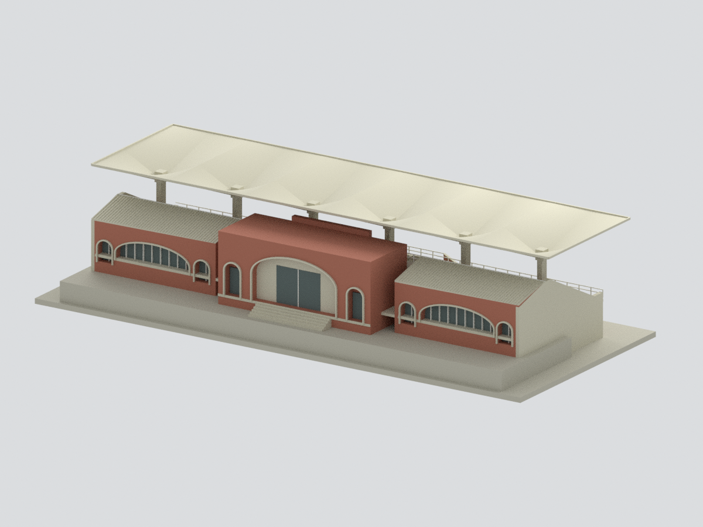
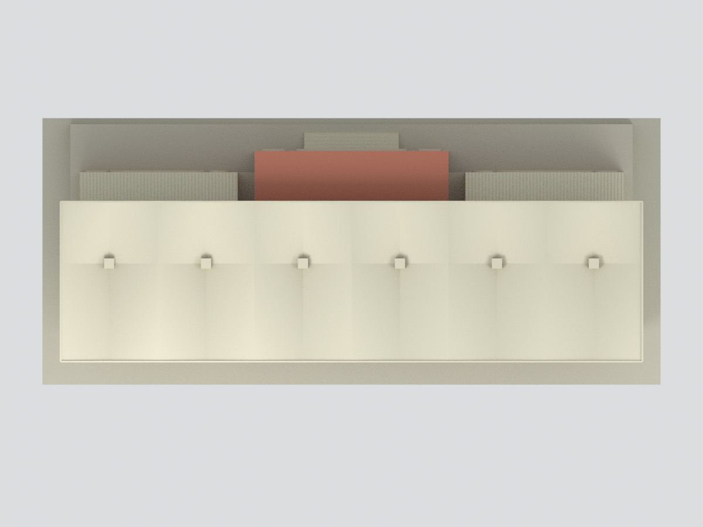

# NCKU Guangfu Sports Field Viewing Platform

> **Archival source-image label: CC BY-NC (attribution / non-commercial; version unspecified). This label is not presented as a blanket non-commercial licence for the entire model package.** [Original rights label](https://collections.culture.tw/Object?RNO=Q1dNSDI2NDIzMDA5&SYSUID=31). Designer and source attribution are retained; unrestricted commercial-use rights are not claimed.

**1981 original-drawing exterior reconstruction — not an as-built survey or the 2026 condition.**

## Files
[Color 3MF](model.3mf) · [STL](model.stl) · [Editable compressed Blender scene](scene.blend) · [Generator](build_model.py) · [Parameters](parameters.json) · [QA](QA.json)

Nominal **1:200**, **255 × 110 × 56.9 mm** including authored support. Model coordinates are millimetres. Blender 4.3 opens the native compressed scene; its visible mesh matches the print exports and hidden components remain editable.

## Evidence and scope
[NCKU’s official virtual campus](https://virtualcampustour.ossd.ncku.edu.tw/index.php?id=1&inter=detail) identifies the east-side platform as a 1981 university-games project by **M.H. Wu & Associates**. The [National Taiwan Museum architectural collection](https://collections.culture.tw/docomomo_collectionsweb/Collection?GID=0WM4MZ0AMB) supplies three floor plans, roof plan, four elevations, sections and HP-shell structural details. See [source proof](SOURCE-PROOF.json).

The official panorama metadata lists 2021-10-19. It supports the principal silhouette, six canopy units, stairs and arches; later wall infill, altered doors and equipment are not imported into the original-drawing reconstruction. The original sheets do not carry an as-built approval: exact historical execution is not claimed.

Six 8m-spaced supports carry 24 bilinear hyperbolic-paraboloid patches. The 48m canopy is 8.1m west and 5.1m east of its support line. Stepped seating, projecting platforms, twin open-underneath stairs, recessed arcades and lower east roof wings are represented.

**Shell curvature and control heights are interpreted approximations, not certified structural geometry.** Shell thickness is increased for the model scale. Rails, sash layouts and tile rhythm are simplified; glazing is opaque. No hidden interiors, foundations, neighbouring open stands, opposite torch platform, invented inscriptions, flags or undocumented equipment are included. The plinth/raised rear support is authored, not surveyed terrain.

Mesh, export equivalence, procedural rebuild, compressed scene reopening and actual render binding are tested. **No physical test print**; evaluate supports for the cantilever canopy, stairs and railings.

## Attribution and restrictions
Drawing author: M.H. Wu & Associates. Custodian: National Taiwan Museum, Taiwan modern architectural drawings / Ministry of Culture. Source images are marked **CC BY-NC**. Designer and source attribution are retained. The archival image licence and the rights in the authored geometry are described separately: no blanket non-commercial model licence is inferred, and unrestricted commercial-use rights are not claimed. Original images/panorama are not redistributed. [Rights note](SOURCE-RIGHTS.md).
