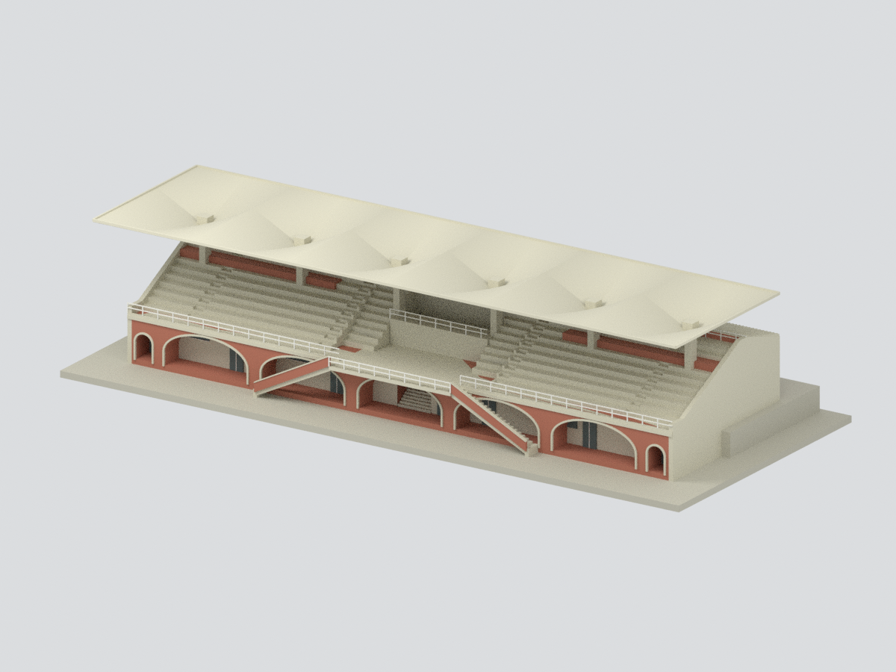
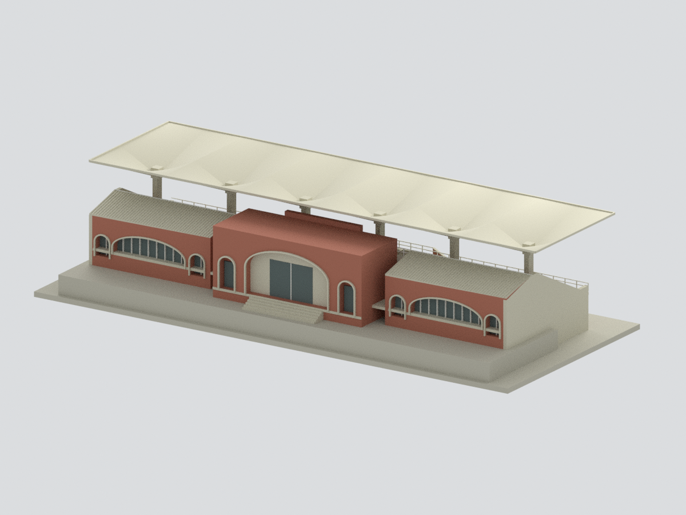
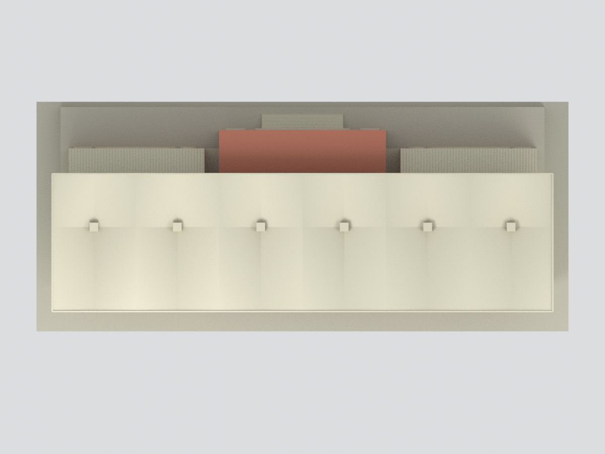

# 國立成功大學 光復操場司令台

> **原典藏圖像標示：CC BY-NC（姓名標示／非商業；來源未列版本）。這是原圖像標示，不概括為整包模型的非商業授權。** [原授權標示](https://collections.culture.tw/Object?RNO=Q1dNSDI2NDIzMDA5&SYSUID=31)。本包保留設計者與來源；不宣稱取得不限用途商用權利。

**1981 原建築圖外觀重建｜非竣工測繪、非 2026 現況。**

|  |  |  |
| :---: | :---: | :---: |
|  |  |  |
| 西側整體模型 | 東側入口模型 | 屋頂模型 |

## 下載與使用
- [彩色 3MF](model.3mf)、[單色 STL](model.stl)、[可編輯 Blender 場景](scene.blend)。
- 原生壓縮 `.blend` 可用 Blender 4.3 開啟；可見物件是與 STL／3MF 同一網格，隱藏集合保留建構零件。
- 比例 **1:200**，模型約 **255 × 110 × 56.9 mm**（含自製底座）；檔案單位 mm。
- [建模程式](build_model.py)、[參數](parameters.json)、[幾何檢查](QA.json)、[來源證據](SOURCE-PROOF.json)。

## 來源與年代
[成大官方虛擬校園](https://virtualcampustour.ossd.ncku.edu.tw/index.php?id=1&inter=detail)的司令台說明指出，為 1981 年全國大專青年運動會，在光復操場東側興建體育組辦公室及司令台，由吳明修建築事務所設計。原圖來自[臺博館建築圖典藏](https://collections.culture.tw/docomomo_collectionsweb/Collection?GID=0WM4MZ0AMB)，核對一至三層平面、屋頂、四向立面、剖面及 HP 結構圖。

公開全景的圖像中繼資料記載 2021/10/19；僅用於核對主體形貌，**沒有將後加白牆、門窗或設備混成 1981 外觀**。原圖無竣工核章，本模型不能證明每一細節實際落成時完全如此。

## 已重建與限制
- 六個柱距 8m 的傘狀單元，共 24 片雙曲鞍面；棚長 48m、前後深度 8.1+5.1m。
- 10 級看台座階、中央平台、雙跑外梯、退縮拱廊、東側高入口及兩翼斜瓦屋頂。
- **HP 曲率為參數化近似，不是原結構精密曲面。** 屋頂控制高度由不同圖面綜合解讀；薄殼厚度為列印尺度加厚，不可拿去施工計算。
- 拱廊內保留退縮實牆、分散門窗與中央樓梯，不將大拱誤作落地玻璃幕牆。小尺度窗框、欄杆及屋瓦節奏為簡化。
- 不建地下構造、隱藏房間、鄰接露天看台或操場另一側聖火台；題字、旗幟與設備未臆造。
- 自製底座與東側高差支承不等於測量地形；玻璃使用不透明背板。

## 檢查與列印
幾何、STL／3MF 同源、重新建模、壓縮 Blender 重開與實際渲染對應皆有 QA 紀錄。**未實體試印**；懸挑薄殼、欄杆與外梯需自行檢視切片支撐，不保證免支撐。

## 來源權利
吳明修建築師／國立臺灣博物館建築圖，典藏圖像標示 **CC BY-NC**。本包保留設計者與來源。原圖像授權與自建幾何的權利分開說明，不自動將整個模型一概限制為非商業，也不宣稱取得不限用途商用權利；原始照片、圖紙和全景均未重新散布。參見 [來源權利](SOURCE-RIGHTS.md)。
