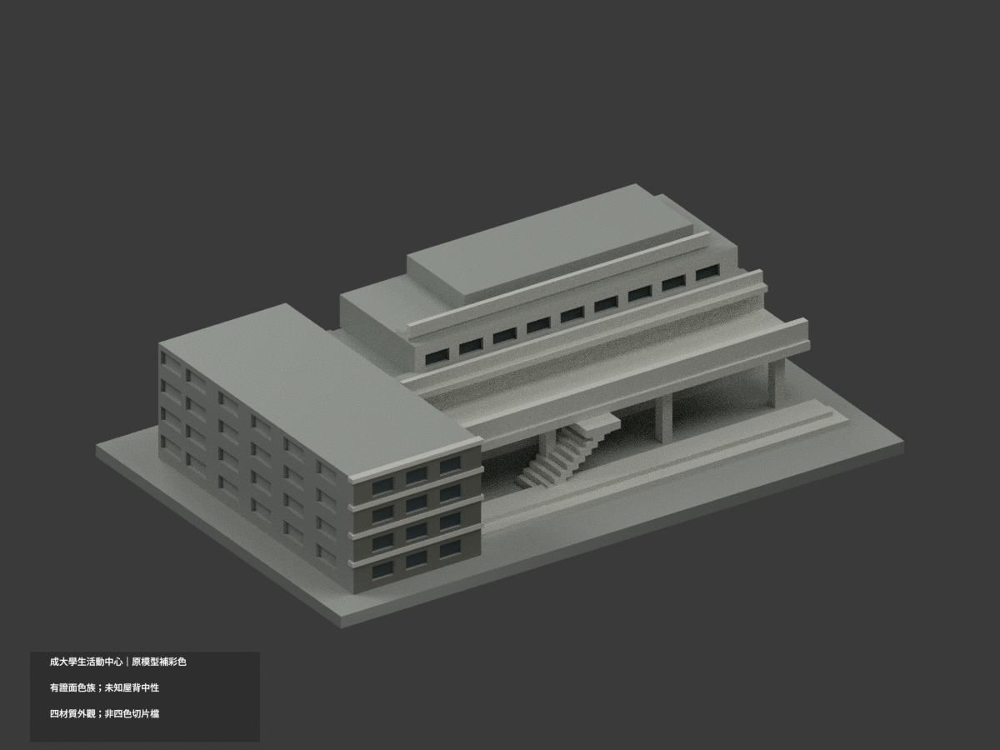
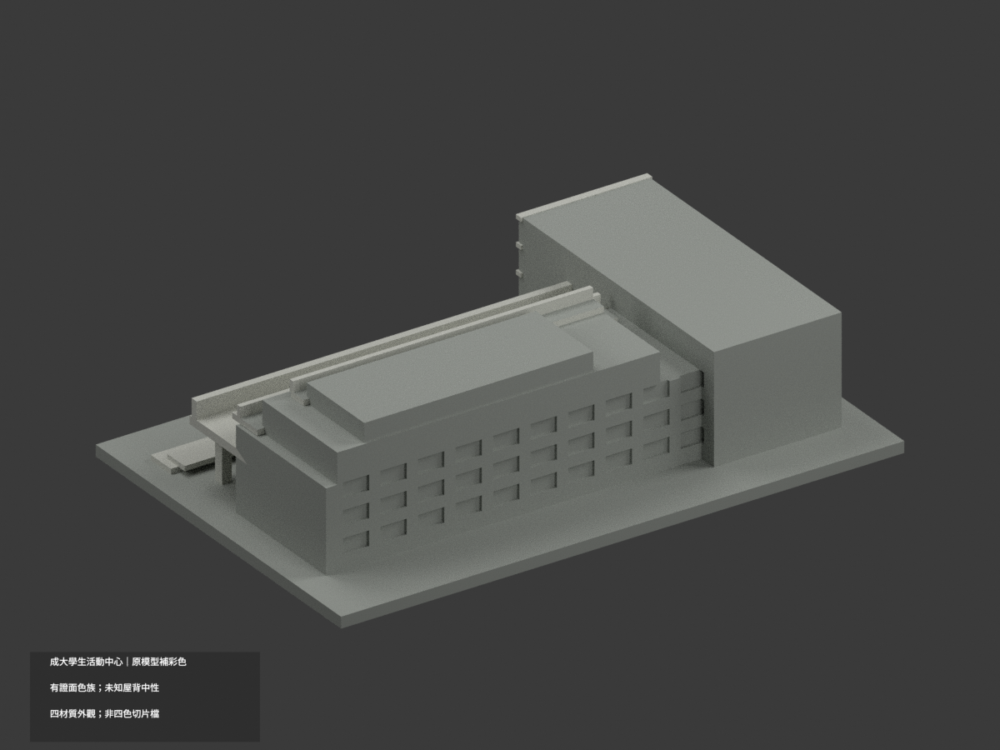
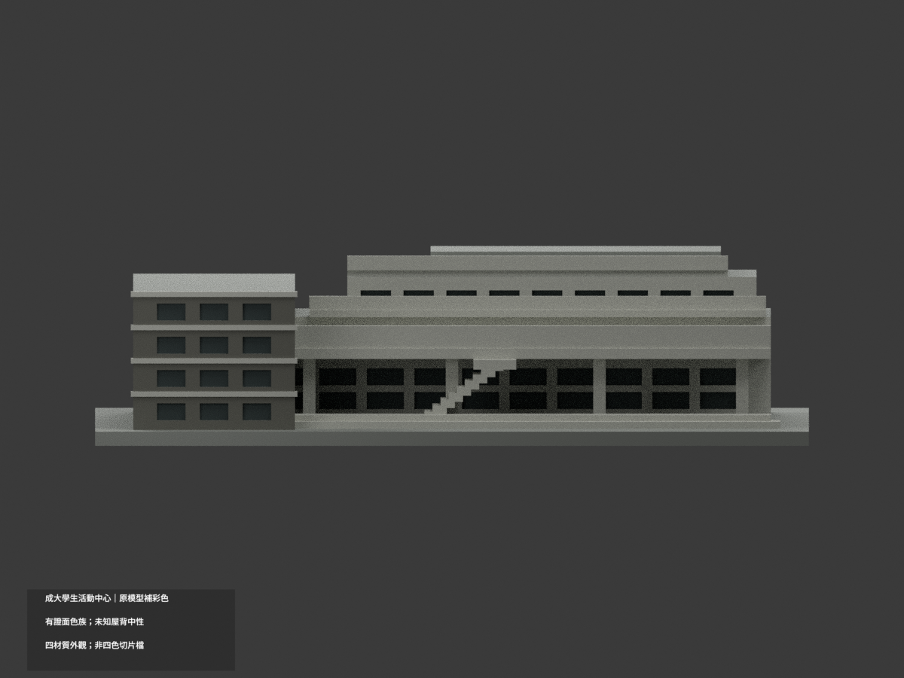
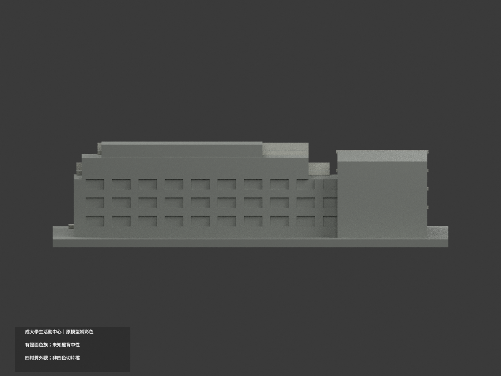
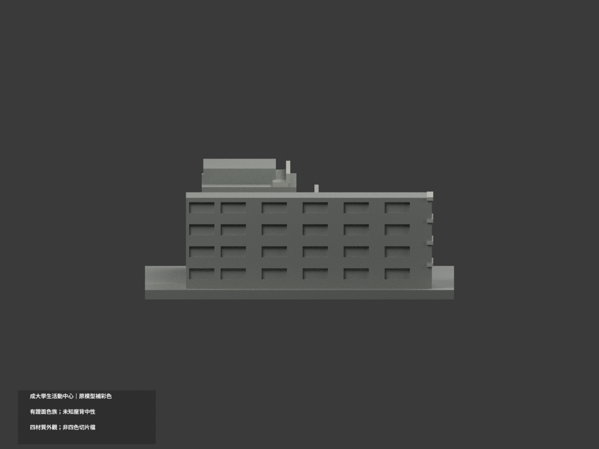
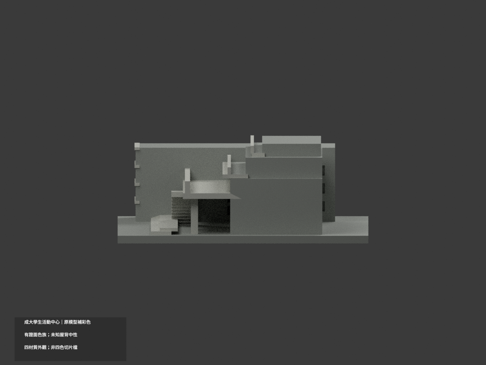
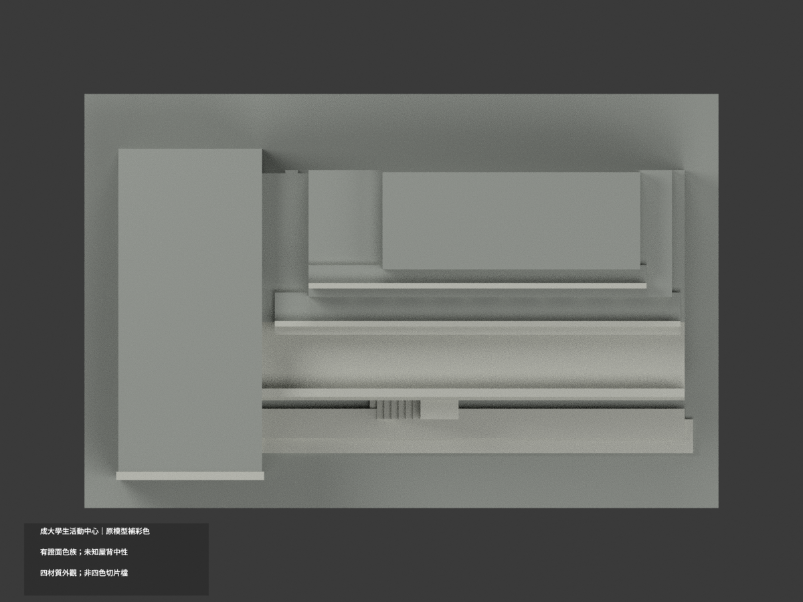
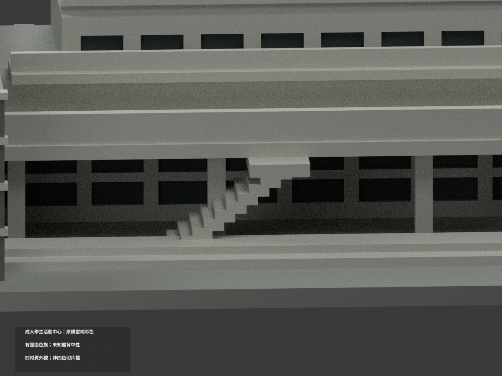
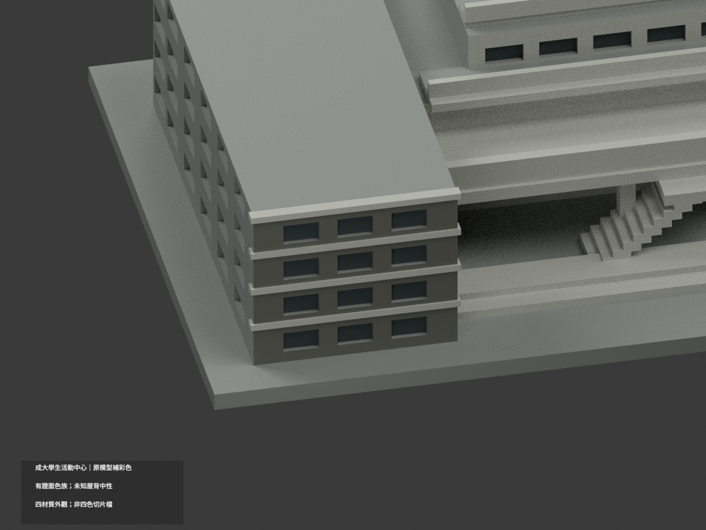
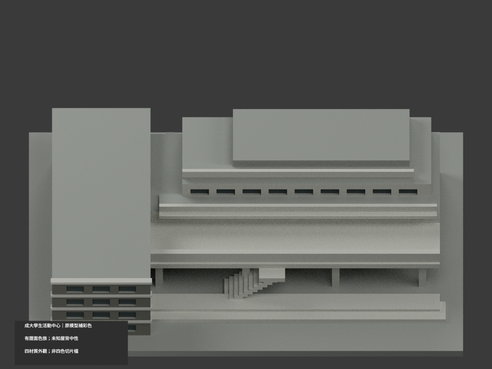

# 成大學生活動中心 A018｜原模型材色更新

## 彩色模型預覽

**同項目 count_delta = 0；原2284三角面、STL與建模程式不變。** 保留原L形簡化模型，只補有證材色。未知西側長牆、背面與屋頂中性；照片中的黃色小板與精細金屬網沒有對應面域，不虛構貼色格。

| 整體 | 後斜 | 正面 |
|---|---|---|
|  |  |  |
|  |  |  |
|  |  |  |
|  | | |

## 材色範圍

- 3373官方實拍支持主廊柱、階梯、露台框與前粗帶為淺灰／暖白色族。舊模型粗帶不是實景金屬網細格，本次不新增面、不畫零星黃色格板。
- 3358成功廳正面深灰褐網與白灰細邊，僅對應既有西翼前平面與凸出水平細帶。原四層盒／窗列仍高度概化，不宣稱照片驗證其層數或幾何精度。
- 成功廳灰藍入口柱在舊模型沒有唯一對應元件，**不移套到右側主廊白灰柱**。招牌、文字及未建門扇不新增。
- 既有淺凹背底以深灰陰影示意；照片混有窗門與開廊，故不把整條廊道說成藍玻璃或通透空間復原。
- 未證西側長牆、背面與廣大水平屋頂保中性。色碼為日照照片色族近似，未校色；2025-02-05是上傳日，不是確證攝影日或2026現況。

## 彩色格式與重現

[appearance.3mf](appearance.3mf) 為毫米、四個基本材質逐面指派；[scene.blend](scene.blend) 保存實際材質。原 [model.stl](model.stl) bytes不變，STL自身不含色。原包沒有OBJ，不假稱有原OBJ交付。

四個外觀材質**不等於已驗證四色耗材切片專案**。未實際列印、未測切片匯入與耗材對應，支撐及原薄件限制仍有效。

```sh
python build_model.py
python colorize_model.py
python export_appearance.py
python validate_color.py
blender -b -t 2 -P render_color.py
blender -b --python-exit-code 1 -P verify_color_scene.py
```

新版QA為COLOR-FORMAT-GEOMETRY-QA、SCENE-QA、FRAMING-QA、DELIVERY-QA及獨立視覺審核。隔離重建目錄保留、不刪檔。[原單色說明](ORIGINAL-MONOCHROME-README.md)、舊previews/、render_preview.py、validation.json等是原單色歷程，不代替新版材色證據；不要用舊renderer覆寫新場景。

## 來源與權利

實看成大素材網官方照片 [3373全貌](https://material.ncku.edu.tw/picture.php?/3373)、[3358成功廳正面](https://material.ncku.edu.tw/picture.php?/3358)。來源署名**成大素材網；外國語文學系－蔡美慧**。保留素材網非商業利用及署名條款。原照／頁面僅私人研究、不隨模型公開、不作紋理；專案授權不重新授權原素材，不保證商用或第三方建築設計權利。

原外觀模型是照片估計收藏模型，非測繪、工程或精確BIM；門窗為淺凹浮雕，不含內部。比例各棟獨立、不能據此拼接校園。補彩不提高原幾何的量測可信度。
