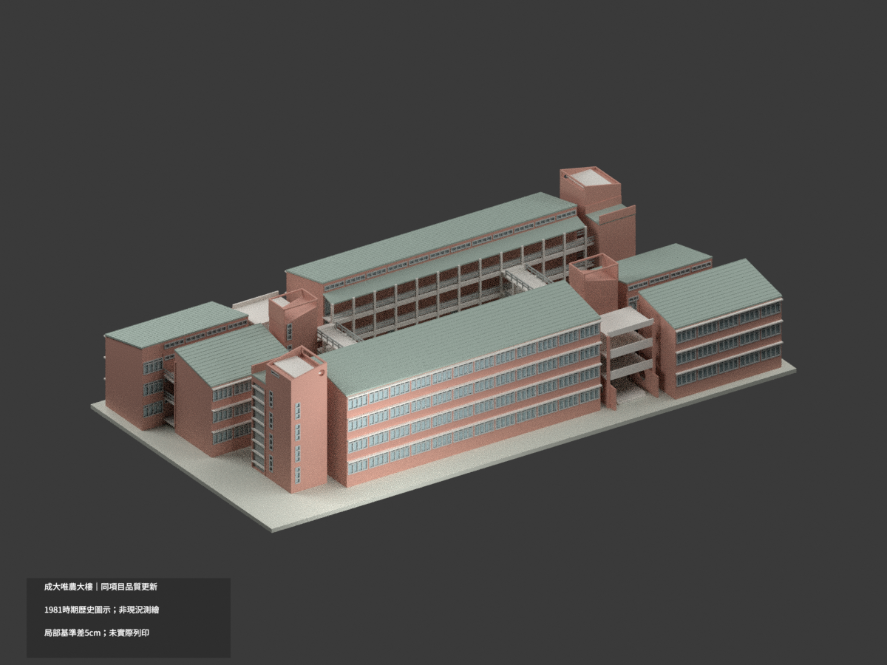
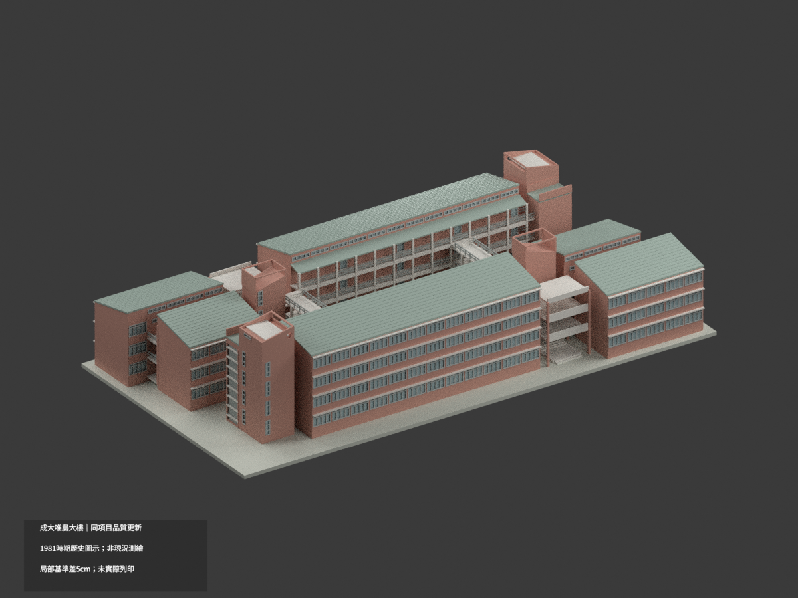
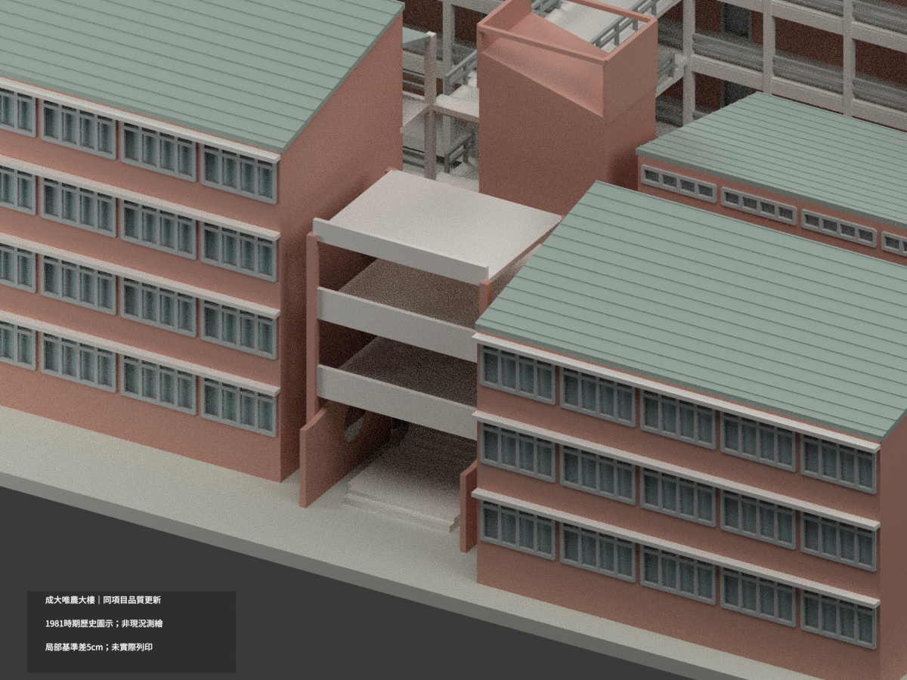
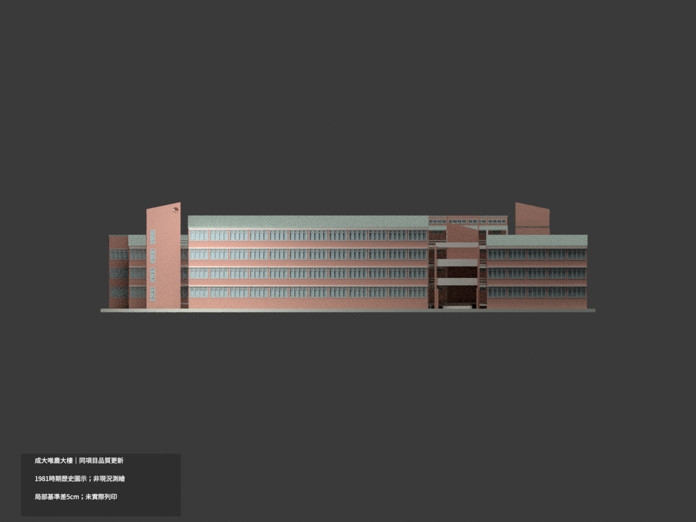
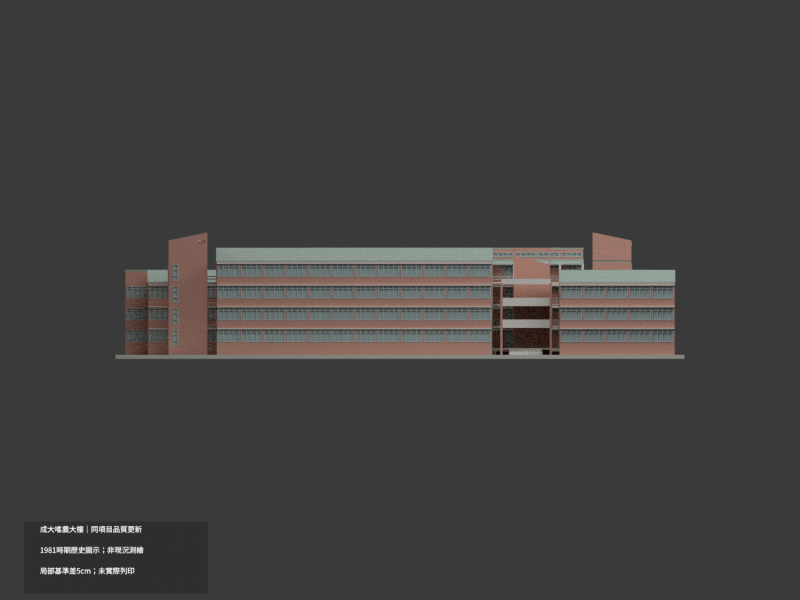
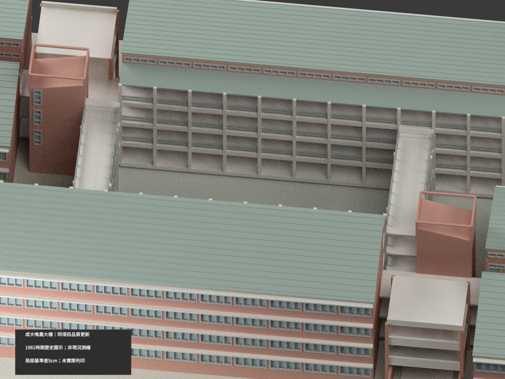
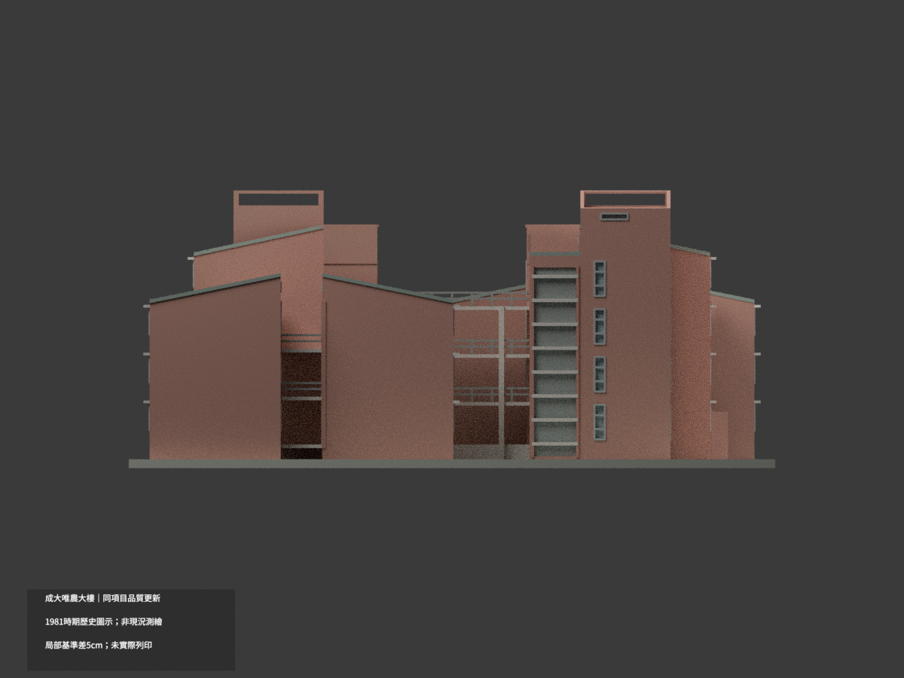
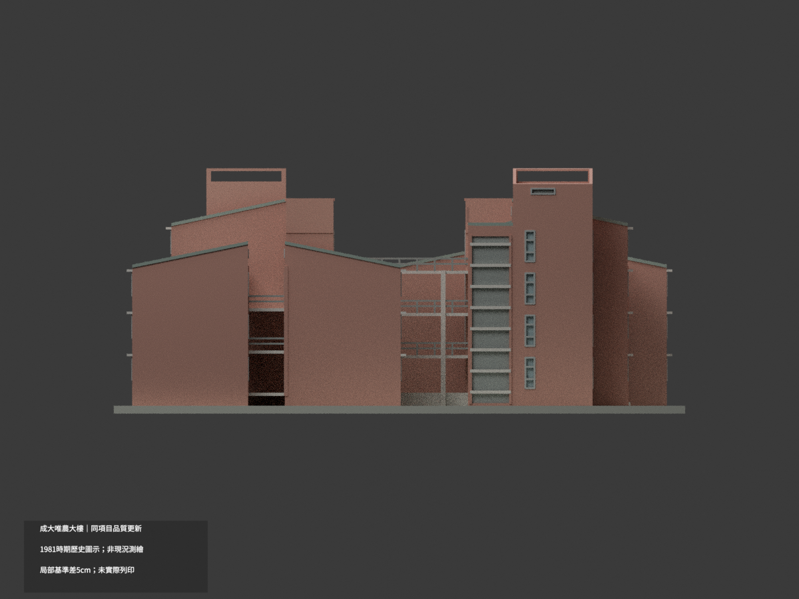
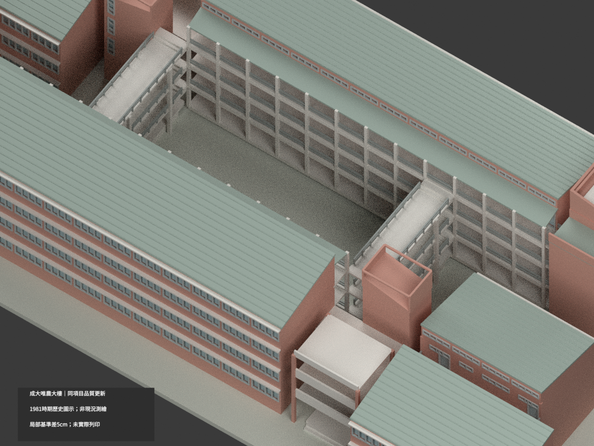
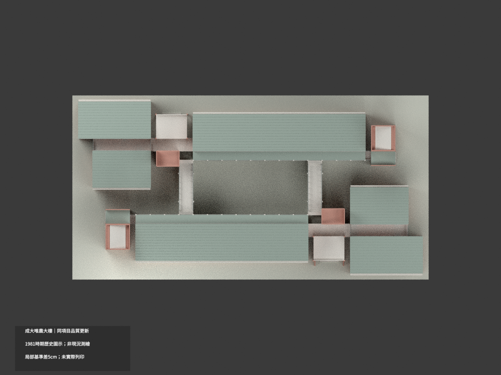

# 成大唯農大樓｜同項目品質更新

## 模型預覽與範圍

本次更新既有 `wei-nong-building`，不新增建築或變體套數。依 1981 時期歷史設計圖示重建，官方照片僅確認部分外觀，非現況精密測繪。

| 整體 | 立面 | 細部 |
|---|---|---|
|  |  |  |
|  |  |  |
|  |  |  |
|  |  |  |

## 來源控制

國立成功大學光復校區唯農大樓；吳明修設計。81.60 × 40.80 m 是軸域，不是整塊建築外框。兩列錯位的四層主翼各有向外下降的單坡屋面，四個短翼為三層，保留開放連廊與中庭。不能把整棟擠成同高平盒。

主剖名義 1FL +1.00 m、層距3.24 m，主屋低／高緣13.96／15.86 m；短翼10.77／12.57 m；塔頂18.16 m。A15、A17 局部入口基準+0.95 m，與主剖1.00 m差5cm保留，不聲稱已證實為粉刷或完成層。A17 外／中／內平台為+0.05／+0.41／+0.95 m。

沒有取得獨立建築首層原頁，首層可見外牆依 E7 公開建築底圖、S3 輪廓、四立面與入口／中庭詳圖交叉核定；不重建電氣、隱蔽內部、保全或鋼筋。

C 窗3.04×1.74 m、窗台0.90 m；B1／B2／B3與D高窗不可混作大C窗。局部窗框、欄杆細件圖量並做列印加厚，非施工復原。

## 已揭露的局部解讀

- 房間樓面4.24／7.48／10.72 m，內廊4.19／7.43／10.67 m，各有原圖 spot；不是同一位置高程互相平均。院橋3.83／7.07／10.31 m，較廊低36 cm；兩級18 cm為推導，踏面跑距圖量±0.15 m，不冒稱已取得橋專詳。
- B2 窗台為 **3.84 m**（撤回早期2.84誤讀），24扇主翼＋16扇短翼；地下B3不搬到上層。F窄窗70×234 cm、窗台30 cm，共22組。首層C表45扇中44扇可定位，另1扇位置未由現存建築平面確認，未為湊數臆加；不稱每個開口均精確復原。
- 入口R100圓孔在 x56.10／62.90 m **內側屏牆**，不切高室翼。圓心GL1.95 m／y5.50 m及牆端圖量±0.15 m；左孔由剖向、右孔由同形平面互證。不複製無直接證據的另一端孔。上平台採剖面95 cm；平面75／95字形若為75則可能差20 cm，保留未解。
- 四核高低段、斜實牆與空框分開；內核13.40～14.75 m為圖量±0.15 m，水箱局部蓋16.96 m是有界協調，不是另有完整水箱剖面直標。隱蔽水箱內部不建。外核低梯面只重建原立面可見的退面與半層分節，非玻璃幕牆或內梯完整模型；高水平小孔尺寸約1.8×0.4 m為圖量±0.15 m。
- 本次為 **same-item / count0** 更新，保留舊包歷史；非另增歷史變體套。

## 比例與製作

1:350；`build_model.py` + `geometry_helpers.py` 為完整幾何輸入；STL／3MF 使用 mm。底座是展示支座，不是實測地形。**未實際列印**，薄件、懸挑與支撐需自行試印評估。

## 權利與公私分離

國立臺灣博物館 CWMH275 館藏原圖個別標示 CC BY-NC，原圖與私人核圖裁切不隨模型公開。官方照片版權仍屬原權利人。僅公開自製幾何、程式、渲染與文字審核，保留署名及來源限制，不以專案授權覆蓋來源權利，**不保證商用權利**。
