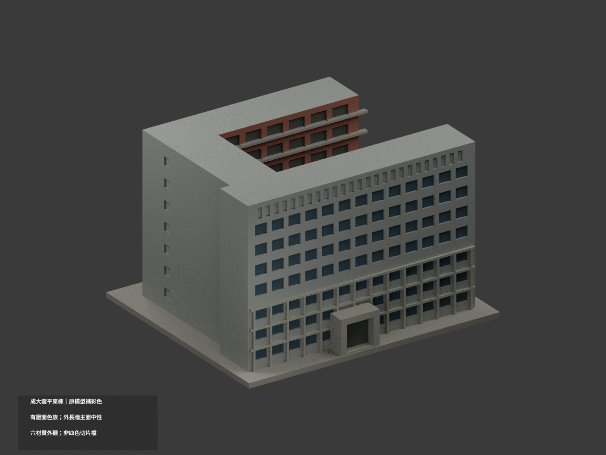
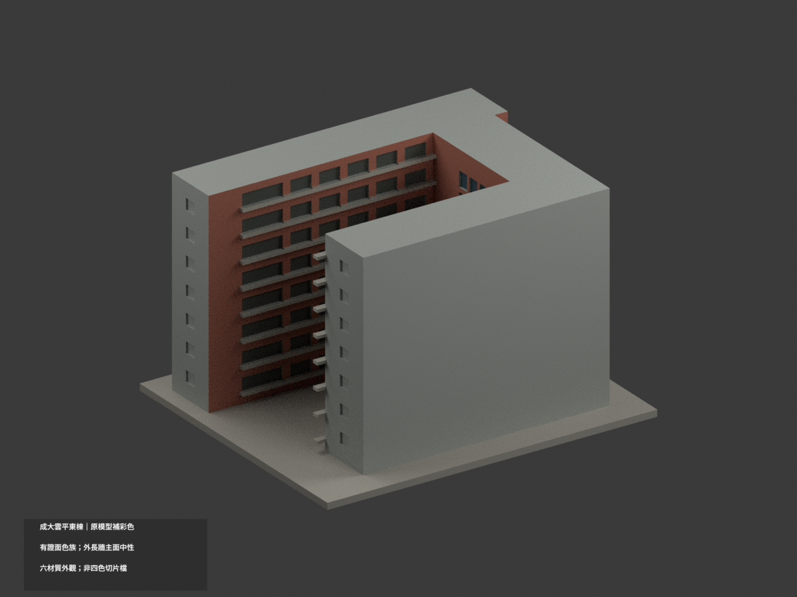
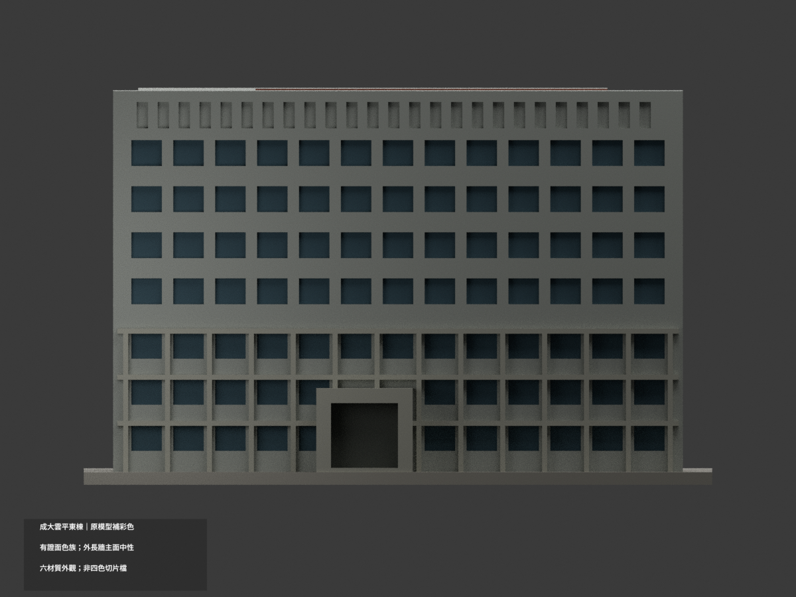
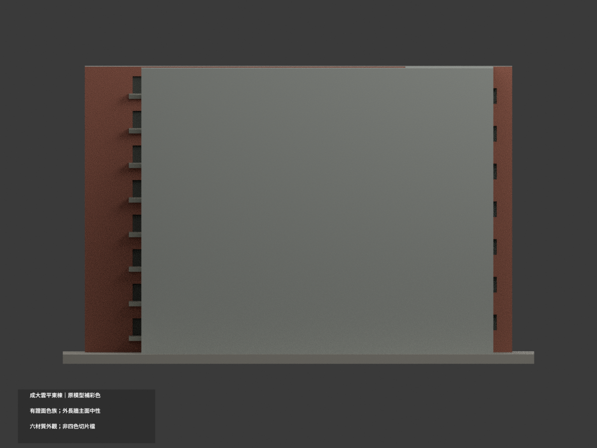
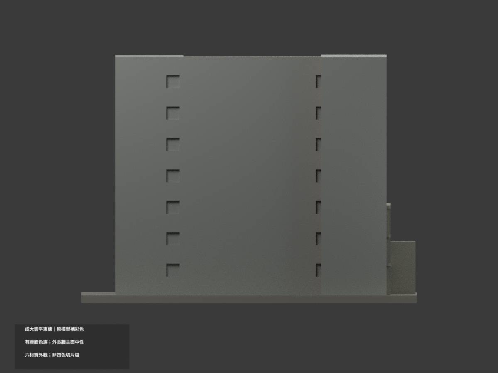
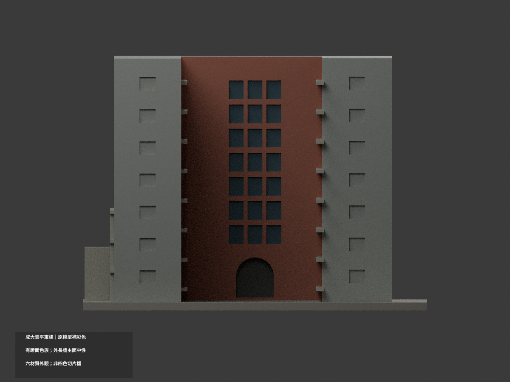
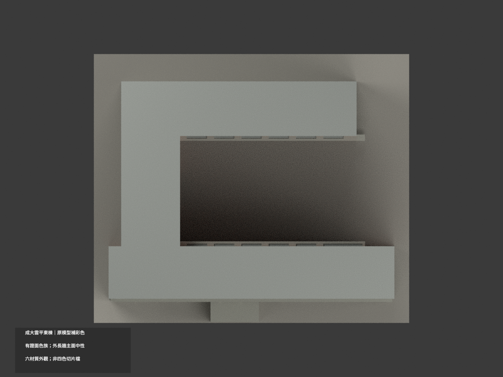
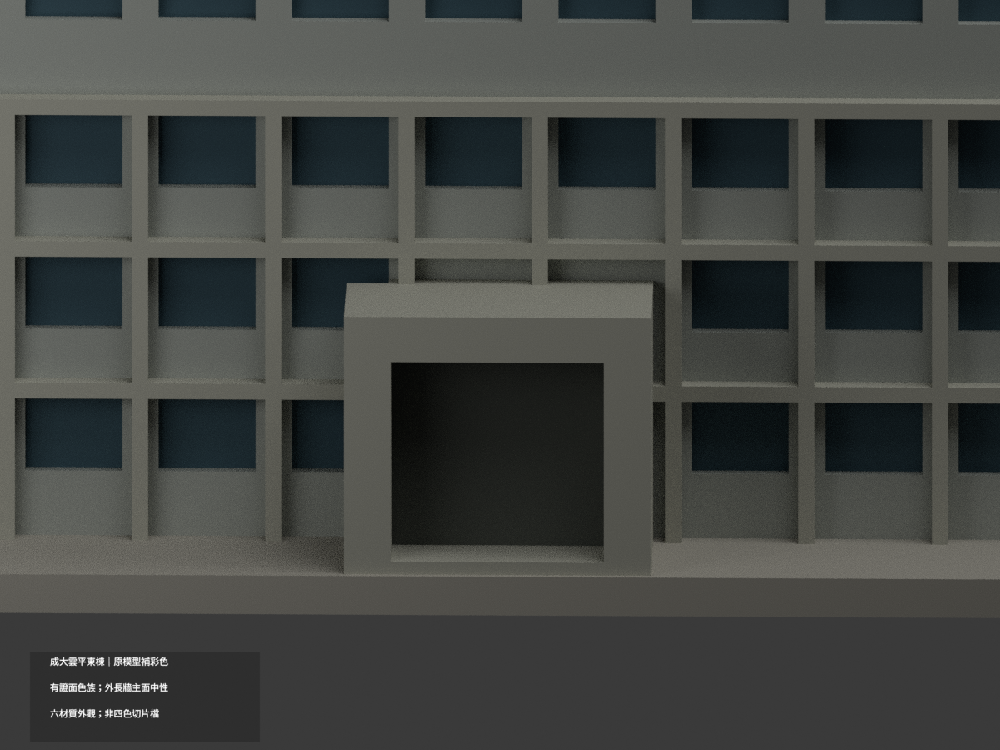
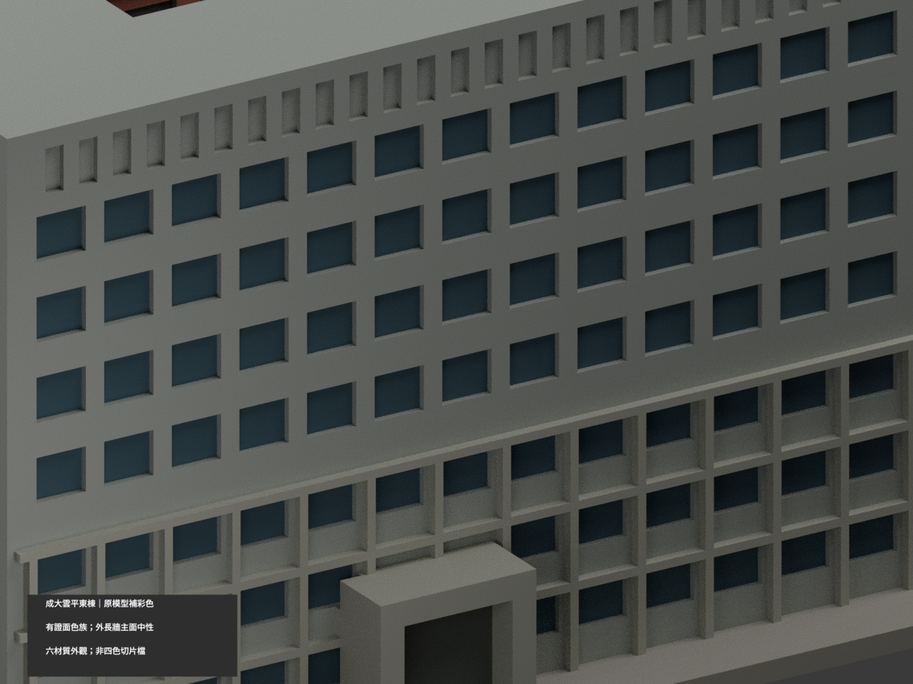
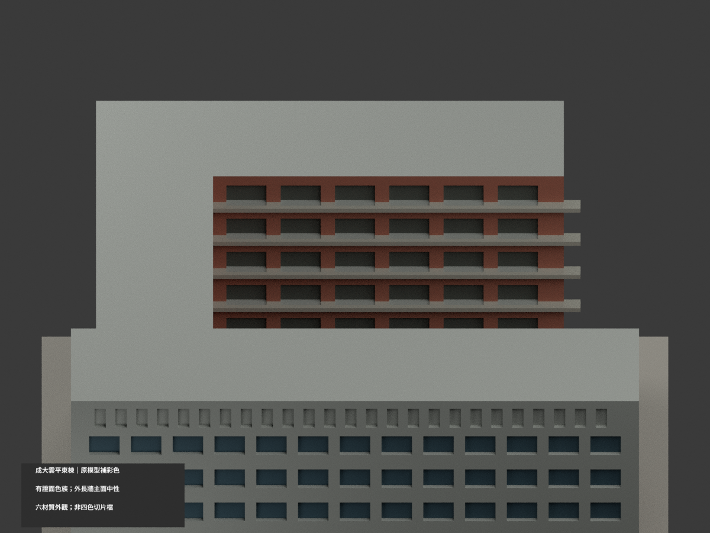

# 成大雲平東棟｜原模型有界補彩

## 彩色模型預覽

原 **6576 三角形、STL 與建模程式不變；同 slug 更新，count_delta = 0**。只為既有 C 形近似外觀補色，不與雲平西棟拼接或重新計數。照片來源有證面分色，未見面中性；不宣稱精確現況或修復色號。

| 整體 | 背斜 | 正面 |
|---|---|---|
|  |  |  |
|  |  |  |
|  |  |  |
|  | | |

## 材色範圍

- 官方3684實景支持外長面上段磚紅、下三層灰RC，但原三角面跨越此材色界線，不能不改幾何而乾淨分開。故**外長面整個主牆平面保中性**，只保留原凸出灰框與窗凹色；不是聲稱實景整面灰。放棄窄帶分色，避免大三角形成假斜漆。
- 內庭可辨磚牆與灰色樓板邊；原淺凹開廊以深灰陰影表示，**不是整片玻璃或通透空間復原**。內端真玻璃帶在舊模型只做離散凹格，本次僅凹格背底暗灰藍，不能把其間磚牆染藍冒充不存在的連續玻璃。
- 舊模型 C 形體量、窗列、入口和細部仍為概化；補彩不重新證明幾何精度。屋頂水平面、未證外側與北側保持中性，不冒稱灰漆已被照片證明。
- 色碼是日照照片中的色族近似；素材網2025-02-05上傳日不是確證拍攝日，不稱2025或2026全館精確原貌。照片中冷氣、文字、樹木、磚縫和未建欄件不新增。

## 彩色檔與重現

[appearance.3mf](appearance.3mf) 為毫米六基本材質分配；[scene.blend](scene.blend) 使用同一原三角網格。原 [model.stl](model.stl) 保留且自身不含顏色；原包沒有 OBJ，不宣稱保留不存在的原 OBJ。

```sh
python colorize_model.py
python export_appearance.py
python validate_color.py
blender -b -t 2 -P render_color.py
blender -b --python-exit-code 1 -P verify_color_scene.py
```

舊 `previews/`、`render_preview.py`、`validation.json` 等留存單色歷程，非本次彩色檔；舊renderer會覆寫單色場景，請勿混用。本次QA為COLOR-FORMAT-GEOMETRY-QA、SCENE-QA、DELIVERY-QA與獨立視覺審核；隔離重建保留不刪。

## 列印與權利

六材質外觀**不等於已驗證四色耗材切片專案**。未實際列印、未測切片匯入/換色/支撐；原薄件和估算尺寸限制不因補彩改變。各棟原模型獨立縮尺，不能直接和西棟比例拼接。

實看[成大素材網3684外長面](https://material.ncku.edu.tw/picture.php?/3684)、[3709內端](https://material.ncku.edu.tw/picture.php?/3709)、[3693內庭](https://material.ncku.edu.tw/picture.php?/3693)。來源 credit：**成大素材網**，其非商業使用及署名條款保留；原照片、原頁、裁圖僅私人參考，不公開、不作紋理。模型授權不包含原照片或第三方設計權利、不保證商用。完整來源角色見 COLOR-SOURCE-REGISTER.json。
