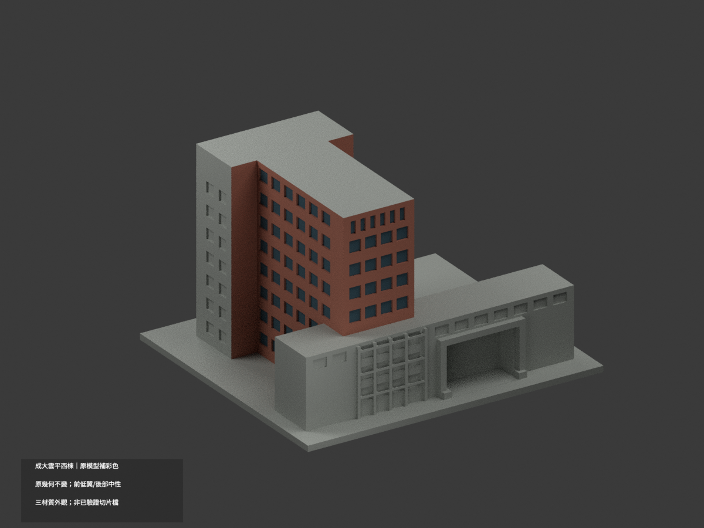
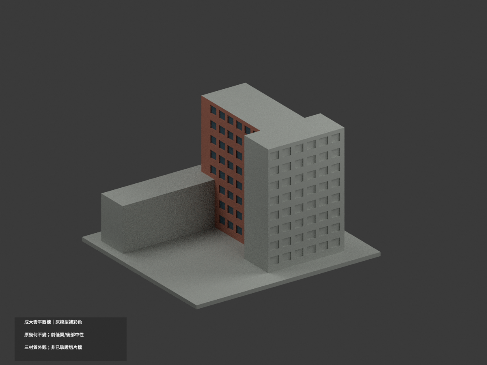
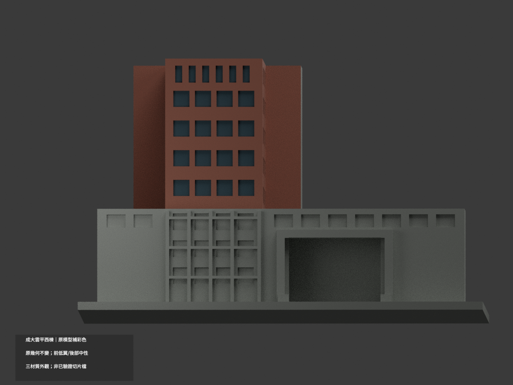
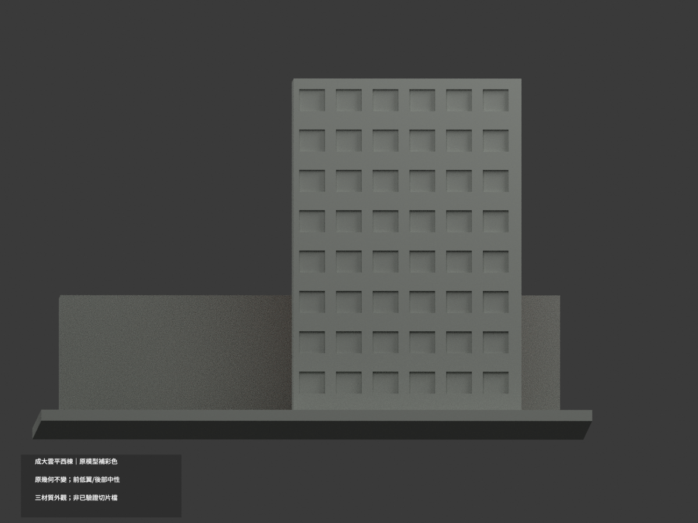
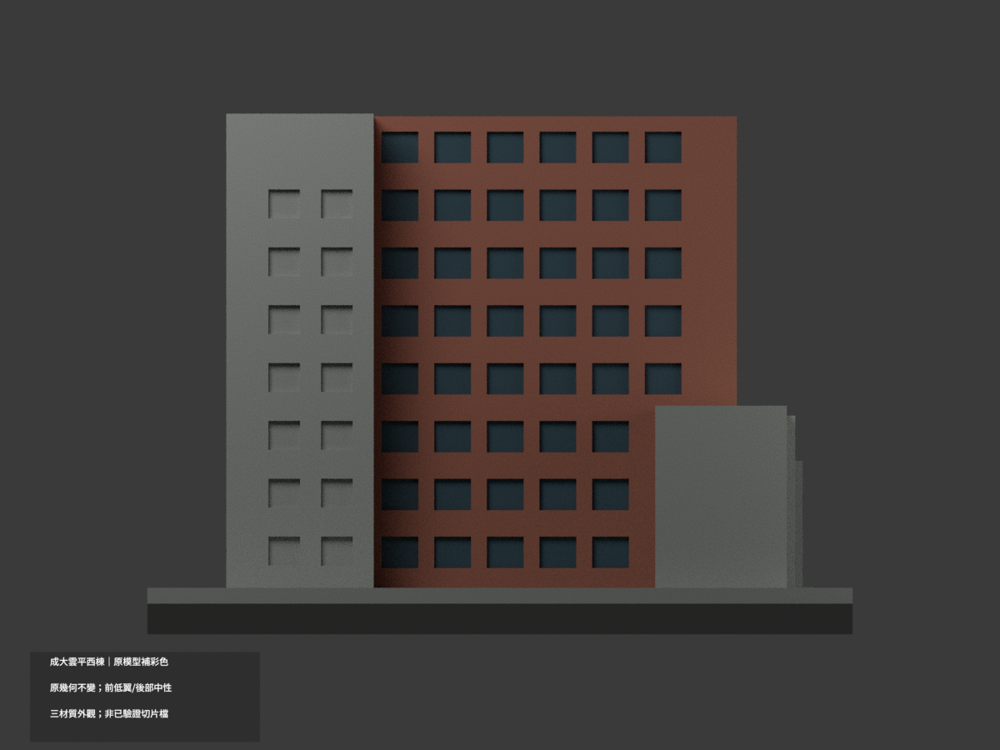
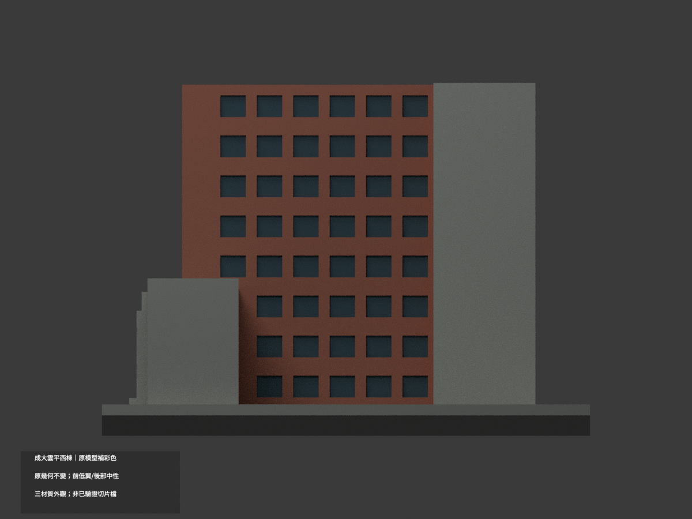
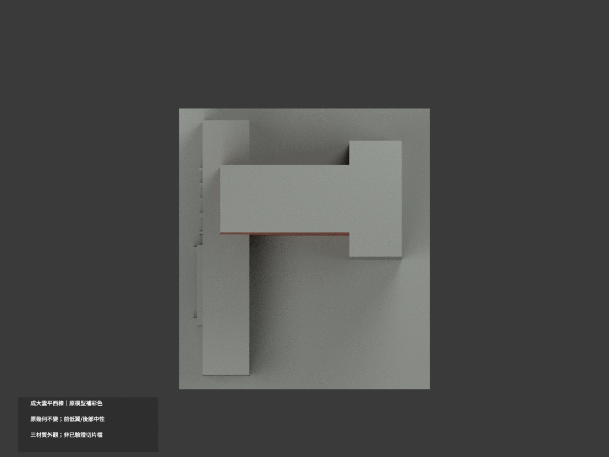
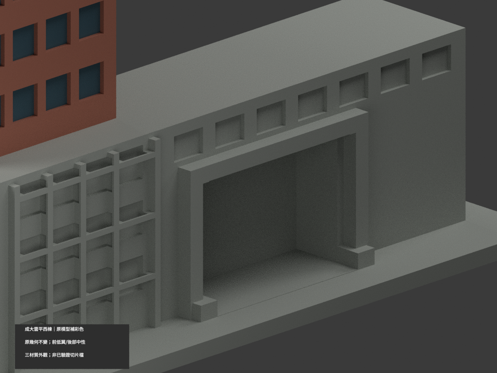
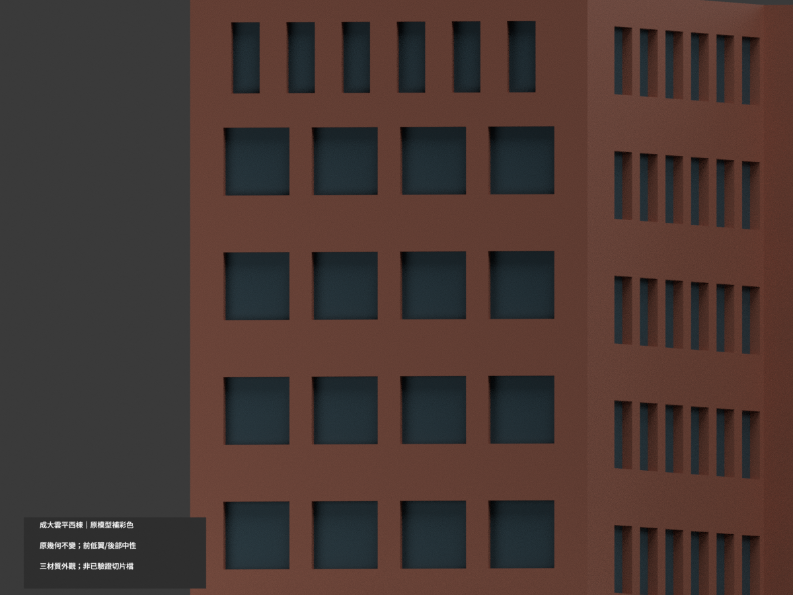
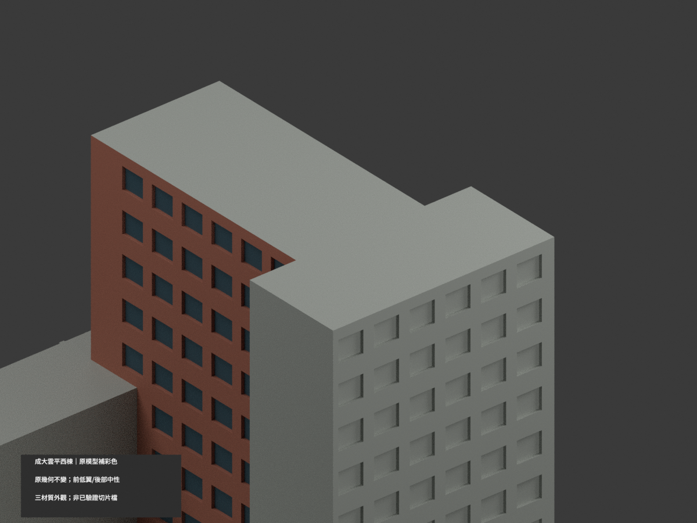

# 成大雲平大樓西棟 A028｜原模型材色更新

## 彩色模型預覽

**同項目 count_delta = 0；原 3822 三角面、150 × 134 × 93.9 mm 與原 STL／建模程式不變。** 本件只更新既有高度簡化幾何的材色，不以新照片宣稱原體量、門窗或現況精度提升。東西棟原模型各自獨立縮放，不拼成共同尺度場景。**低前橫翼與大門框因照片無唯一對位，保中性未核，並非已完成全棟精確配色。**

| 整體 | 後向 | 正向 |
|---|---|---|
|  |  |  |
|  |  |  |
|  |  |  |
|  |  |  |

## 材質範圍與限制

- 官方 3650／3664 照片支持高主體磚紅／褐色族；僅將可對應既有主體垂直牆面概化分色。色碼未校色，不是材料檢驗、修復漆號或精確年代色復原。
- 既有可辨凹窗背面近似暗灰藍。**原模型沒有照片中連續高玻璃條帶的拓撲，本次不新增連續玻璃、不把整面實牆塗藍冒充玻璃**；窗格、磚縫與設備均不新增，凹窗幾何仍高度概化。
- **低前橫翼與大門框／portal 在兩照中無唯一完整對位，全部保持中性未核**。不挪用東棟色彩，不把未核大門洞宣稱玻璃或已證灰混凝土；凹洞深暗來自渲染陰影。
- 未證北面、外端面、水平屋頂、低翼與底座保持中性色，不表示照片證明其真漆色。原頂部與陽台細節缺相應分面，沒有為貼色切三角或增加構造；完整同平面材色優先於斜三角假界線。
- 原圖於 2025-02-05 上傳，但未註個別拍攝日；不把上傳日期當攝影日期，也不稱 2026 現況測繪。

## 格式與列印

[appearance.3mf](appearance.3mf) 為毫米單位三個基本材質逐面指派；[scene.blend](scene.blend) 實際保存三色材質。原 [model.stl](model.stl) 位元組不變，STL 不包含顏色。原包沒有 OBJ，本次不聲稱保存或交付原 OBJ。

三個外觀材質標籤**不等於已驗證四色耗材切片專案**。切片器匯入、耗材對應、換色、支撐未測，本件**未實際列印**。原始幾何與列印限制不因渲染改善而取消。

## 重建與 QA

`python build_model.py` 重建原 STL；`python colorize_model.py`、`python export_appearance.py` 分色與輸出；`blender -b -P render_color.py` 生成十圖與場景。`python validate_color.py` 與 `blender -b -P verify_color_scene.py` 檢查原檔、三角座標、3MF、隔離重建、實際 shader 及場景重開。重建目錄保留，不自動刪除。

本次彩色證據為 COLOR-ASSIGNMENT-QA、COLOR-FORMAT-GEOMETRY-QA、COLOR-FACE-DOMAIN-QA、SCENE-QA、FRAMING-QA、SOURCE-VISUAL-QA、DELIVERY-QA。舊 previews、validation、thin-feature-check、cross_sections 與 sources 保留作原模型歷程，不代替本次色材 QA 或實印驗證。舊 render_preview.py 是單色入口，勿覆寫彩色場景。

## 來源與權利

成大素材網，[照片3650](https://material.ncku.edu.tw/picture.php?/3650)、[照片3664](https://material.ncku.edu.tw/picture.php?/3664)，作者／提供者為**外國語文學系－蔡美慧**。頁面載非成大人員非商業利用可下載、須標示成大素材網；本案保留此來源條件與署名。

原照及頁面只私人研究，不隨模型公開、不貼圖、不以專案開源授權重新授權原素材。公開只保來源連結及獨立概化材色；不保證商用，也不保證取得建築設計相關權利。詳 COLOR-SOURCE-REGISTER.json。

## 原模型說明與限制（仍有效）

# 國立成功大學｜雲平大樓西棟

## 模型預覽

| 模型預覽 | 模型預覽 | 模型預覽 |
| :---: | :---: | :---: |
|  |  |  |

第七批；光復校區。尺寸 150 × 134 × 93.9 mm，最長邊150 mm含底座，各件比例獨立。


## 公開來源及像素檢視

- [校方GIS：西棟外觀照片](https://db.nckumap.ncku.edu.tw/nckugis/public/uploadfiles.htm?action=listImg&q=36364)：檢視高低量體、底層外框、上部窄窗與低橫棟大矩形入口。
- [校方素材網：西棟轉角](https://material.ncku.edu.tw/picture.php?/3650)：檢視高棟側向窗廊與背向玻璃帶；原檔標題帶西棟A028辨識碼。
- [校方素材網：西棟另一角](https://material.ncku.edu.tw/picture.php?/3664)：檢視立面凹凸與高玻璃帶，未使用室內或告示牌配置。
- [校方公開GIS建物範圍圖](https://nckumap.ncku.edu.tw/map.php)：只使用外部輪廓圖層gis_base及公開建物識別A028；未使用樓層室內平面或設備資料。
- [2026/1/30校方財產清冊](https://prop-oga.ncku.edu.tw/var/file/59/1059/img/4743/218075103.pdf)：交叉核對校區與財產碼R1A-27-0，財產筆數不等於完整單棟數。

## 建模範圍與近似

本件只作西棟。校方GIS的建物範圍圖將西、東棟分開；西棟約為低橫向量體加高T形主體，不能用單片長樓替代。保留低前棟大入口、高棟前方下部外框與上部窄窗列。兩棟接合處依公開外框分界截斷，不附東棟；模型各自獨立比例，不能直接拼合。外框小折角、側向玻璃帶及陽臺深度簡化；各窗距、層高與屋面高差是照片估計，不是實測。地面廣場、雕塑與室內空間省略。

## 交付與重建

- `model.stl`：毫米單位，與底座合成的單一實體。最長邊為 150 mm（含底座）；各棟獨立縮放，不適合直接拼成等比例校園。
- `build_model.py`：完整可攜參數化原始程式，無外部貼圖、私有路徑或參考照片依賴。
- `scene.blend`：由交付 STL 匯入，只有一個建築網格，可在 Blender 編輯頂點；細部參數請修改 Python 後重建。
- `previews/front.png`、`rear.png`、`elevation.png`：由實際交付 STL 產生。
- `validate_model.py`、`validation.json`：可重跑的幾何與重建驗證。

建議 Python 3.12，在虛擬環境執行：

```sh
python -m pip install -r requirements.txt
python build_model.py
blender -b -t 2 -P render_preview.py
python validate_model.py
```

已使用 Blender 4.3.2。驗證器在獨立臨時目錄重建 STL 並比較 SHA-256，讀取 Blender 場景的網格後比較三角形幾何。它檢查原始二進位 STL 儲存法線、面積、封閉性、邊恰有兩面、頂點連結為單一環、表面只有一個連通分量、正體積、底面位於 Z=0、最長邊 150 mm。單一封閉表面也排除獨立藏在內部的空腔殼；沒有宣稱完成所有自交的窮舉檢測。

## 製作原則與限制

這是依公開照片觀察製作的外觀近似收藏模型，不是測繪、修復、工程或精確 BIM 資料。牆身為實體，門窗、拱廊通常改成淺凹浮雕；不含室內、設備或安全配置。屋頂、深度、窗距及後側比例沒有測量基準，不能視為實際尺寸。原始參考照片未收錄、未重新授權或隨套件發布。來源權利屬原作者／校方；原創模型與程式可沿用儲存庫授權，不涵蓋外部參考照片。

## 列印說明

底座平貼平台，Z 軸向上。可從 0.4 mm 噴嘴、0.16–0.20 mm 層高、3 道外牆與 12–18% 填充開始試切片；這是設定建議，並非已測參數。小於約 0.8 mm 的淺浮雕可能因噴嘴或縮放消失。STL 是封閉實體，切片器仍會依填充率產生內部填充。

未實體試印、未執行切片器列印驗證，沒有保證免支撐。請依下列模型特有支撐需求檢查切片預覽。

低橫棟入口深凹上方、外框水平帶及小窗凹頂部可能需要局部支撐。

## 截面閉合檢查

`validate_sections.py` 以0.20 mm間距抽樣實際STL水平截面，檢查閉合、節點度數及零長線段。結果見 `cross_sections.json`，不能當成切片路徑、支撐效果或實體試印驗證。

查核日期：2026-10-13。


## 整合版截面與薄特徵補充驗證

本整合版使用固定共同邊方向後插值的 `validate_sections.py` 與 [0.2 mm 截面結果](cross_sections.json)，避免同一邊浮點方向差異造成假斷環。原始 STL 幾何未修改。舊截面程式有閉合斷言，既有通過結果不代表曾有破面；此處以新版重跑結果為準。

另提供 `check_thin.py` 與 [新增 0.8 mm 薄特徵輔助篩查](thin-feature-check.json)：每 1 mm 水平取樣，先確認輪廓閉合與有效，再作半徑 0.4 mm 形態開運算。這不是切片器、完整壁厚分析或實體試印，尖屋頂、銳角也會造成損失，不能據此宣稱無支撐或列印成功。執行前請安裝 requirements.txt。
