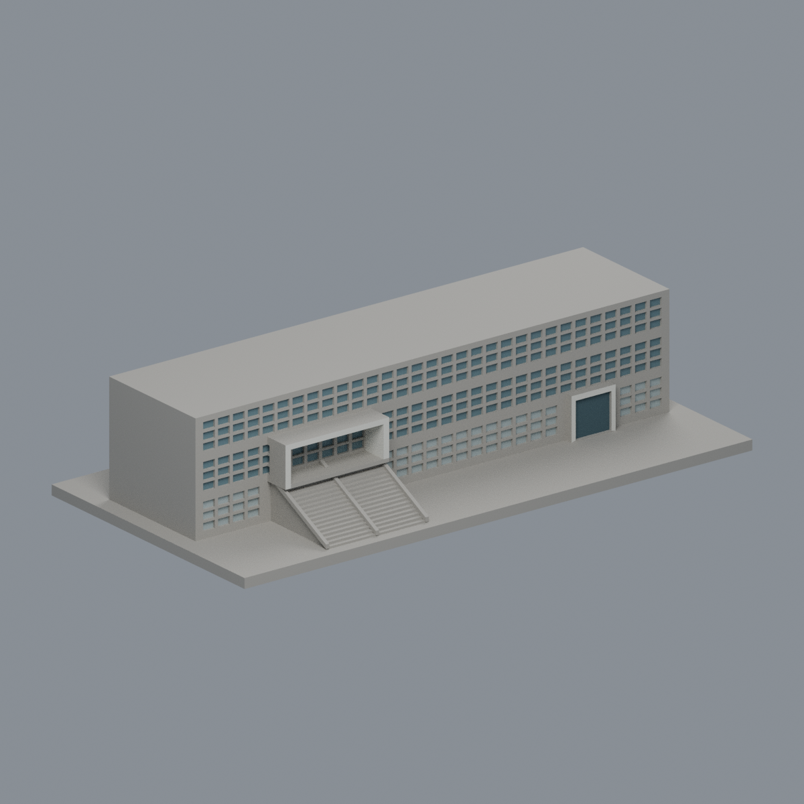
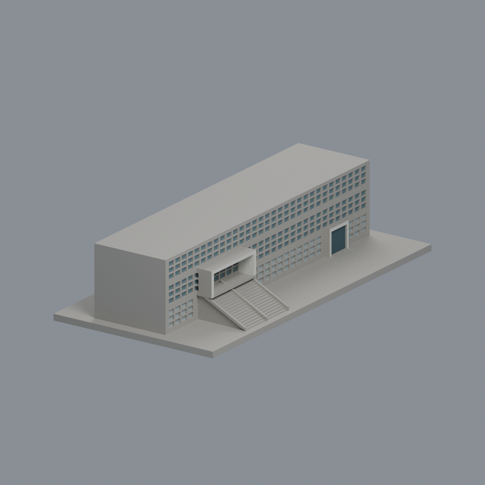
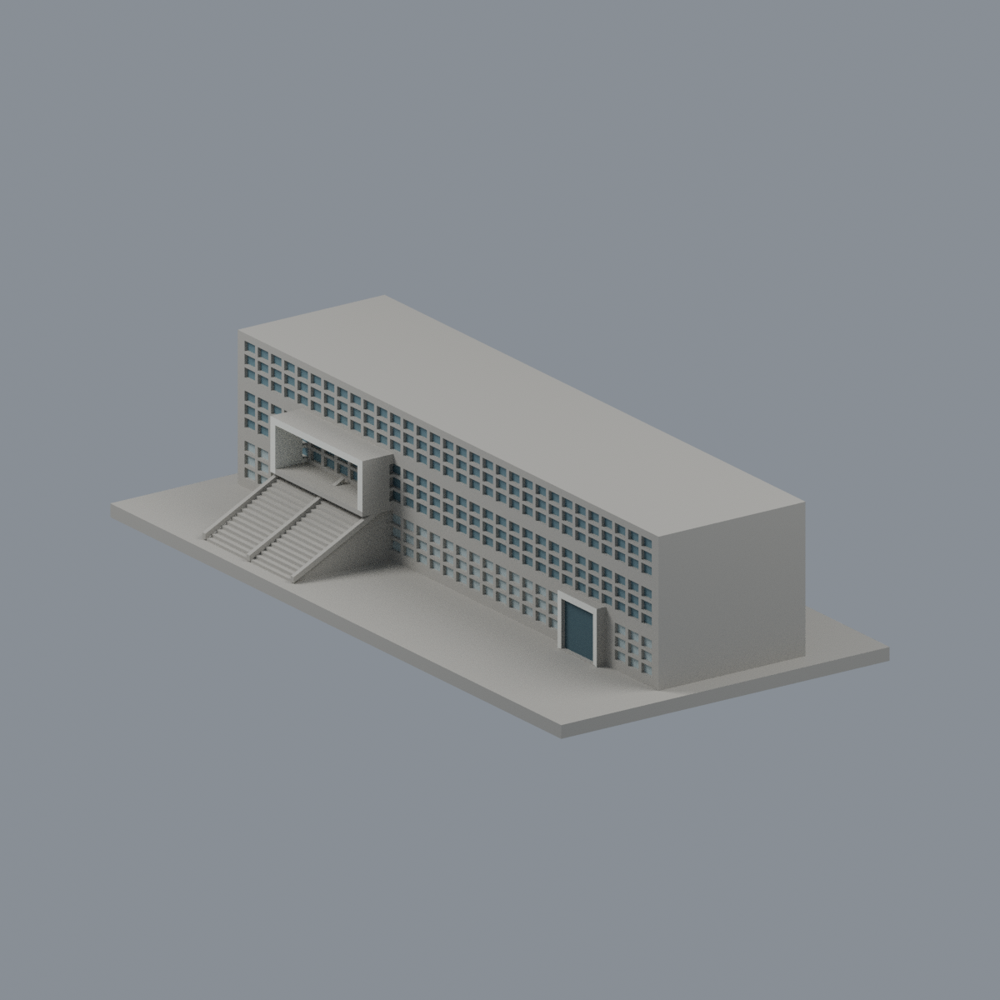
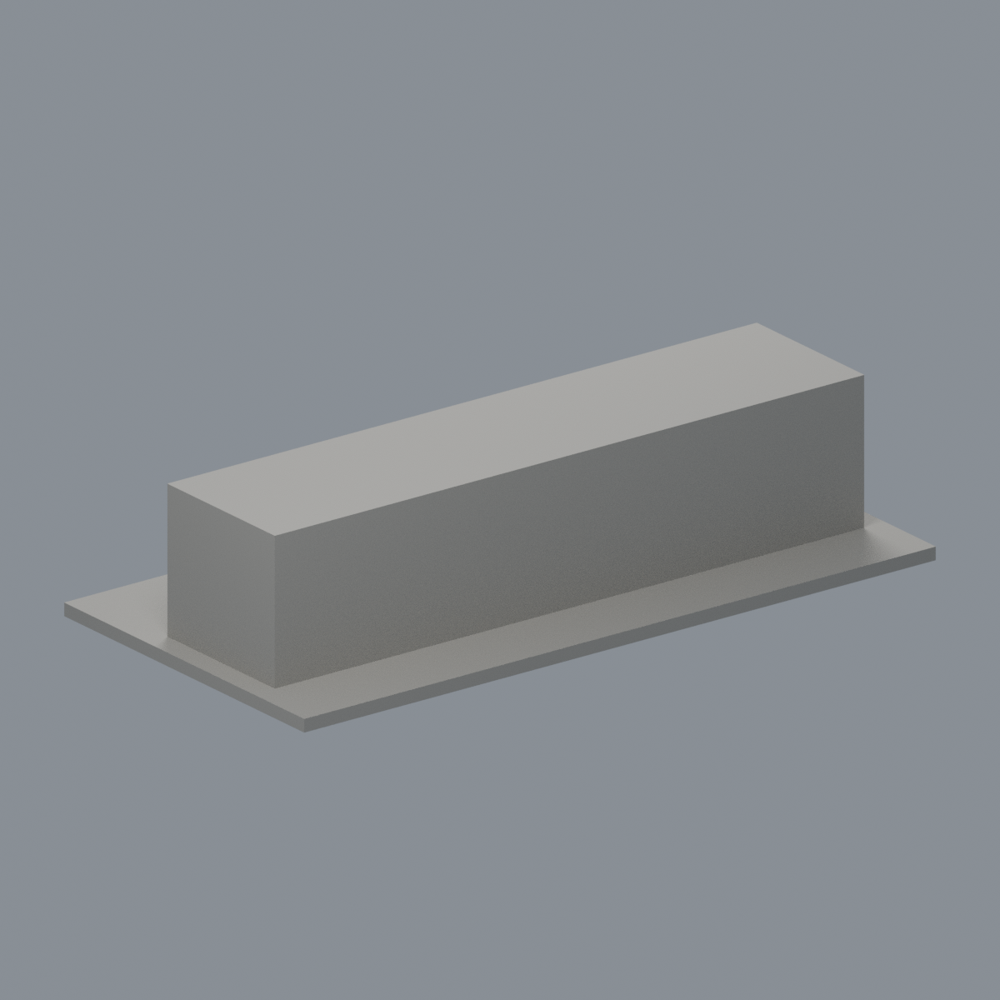
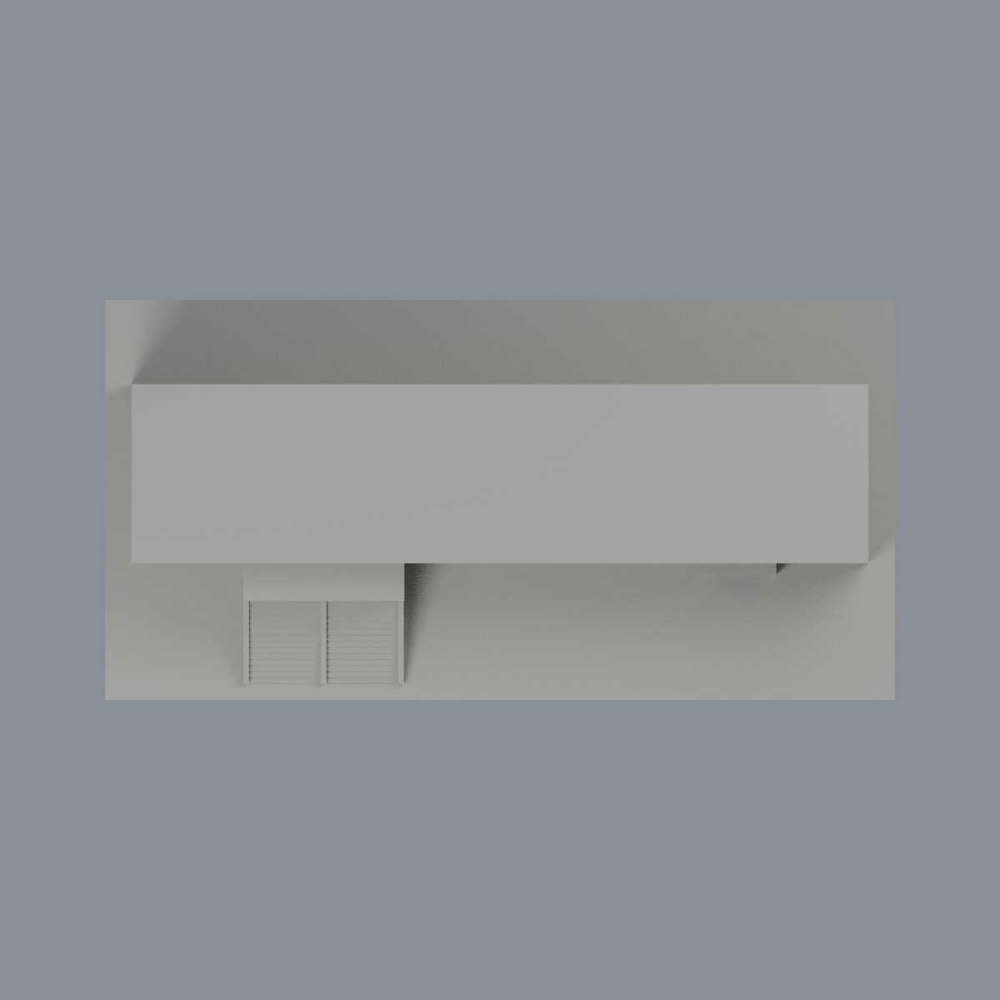

# 國立成功大學｜未來館前棟（舊總圖書館前棟）

## 模型預覽

| 新版模型預覽 | 新版模型預覽 | 新版模型預覽 |
| :---: | :---: | :---: |
|  |  |  |
|  |  |  |

第二批獨立外觀模型；校區：勝利校區。不是全校完成。尺寸含底座：150 × 76 × 34 mm；最長邊150 mm，各件獨立比例。

## 來源及實際像素觀察

- [校方素材網：成大未來館（2024年）](https://material.ncku.edu.tw/picture.php?/3058)：已檢視斜正面照片像素：三條大面積窗帶、偏心二樓入口、外部大樓梯、白色矩形門框。
- [校方素材網：成大未來館（2024年另一張）](https://material.ncku.edu.tw/picture.php?/3057)：已檢視較正向的全幅外觀像素，以確認入口相對位置與整體長寬比。
- [校方博物館圖組報導及現況照片](https://web.ncku.edu.tw/p/404-1000-293070.php?Lang=zh-tw)：已檢視現況正面照片及公開南北外立面圖像素；歷史立面圖只作比例交叉比對，不當作現況背立面測繪。
- [校方虛擬校園：未來館](https://virtualcampustour.ossd.ncku.edu.tw/index.php?id=32&inter=detail)：確認前棟與歷史後棟區分。
- [校方校園規劃會議資料（2020）](https://main-oga.ncku.edu.tw/var/file/60/1060/img/2806/419404439.pdf)：說明中、後棟增建部分於旺宏館案配合拆除，不在本件中復原成舊T形。

## 本件範圍、保留與近似

只建現存未來館前棟，不包含已拆除的中後棟、舊書庫、旺宏館及連接設施，也不宣稱完成整個舊總圖建築群。保留三層玻璃格網、偏左的大樓梯和矩形入口框。窗格用約0.9 mm豎框與0.6 mm橫檔加粗；樓梯為實心階梯，細欄杆改成實心斜條，樓梯底部不鏤空。樓梯遮住的底層窗格省略，避免形成封閉內腔。正面與歷史南北外立面已見，但現況後側及短端缺足夠照片，採簡化實牆；深度、屋頂、窗格數與樓梯步數均為近似。

## 現版交付與離線重建

- [STL](model.stl) · [材色 3MF](appearance/ncku-future-venue-front-appearance.3mf) · [Blender](appearance/scene.blend) · [完整離線重建 ZIP](appearance/rebuild-source.zip) · [現版校驗](PUBLIC-MODEL-SHA256SUMS)
- [原角度渲染與技術 PNG 證據](render-proof.json)；公開畫廊與點開的大圖皆為無失真 WebP。
- 以 Blender 4.3.2 和 ZIP 內依賴重建；不需私人照片或網路來源。詳見[重建方式](appearance/README.md)。
- [原單色模型與幾何驗證封存](https://github.com/hplin50643/taiwan-buildings-3d/blob/5a4721e1d1244679d6f0d1c40095ce96131455c7/%E5%9C%8B%E7%AB%8B%E6%88%90%E5%8A%9F%E5%A4%A7%E5%AD%B8/%E5%8B%9D%E5%88%A9%E6%A0%A1%E5%8D%80/buildings/future-venue-front/README.md)；不是現版外觀驗證或試印證明。[原外觀版校驗](https://github.com/hplin50643/taiwan-buildings-3d/blob/aedc01f56772525b942a46a0cf63eee23adee46e/%E5%9C%8B%E7%AB%8B%E6%88%90%E5%8A%9F%E5%A4%A7%E5%AD%B8/%E5%8B%9D%E5%88%A9%E6%A0%A1%E5%8D%80/buildings/future-venue-front/appearance/SHA256SUMS.txt)只供歷史檢查。

## 製作原則與限制

這是依公開照片觀察製作的外觀近似收藏模型，不是測繪、修復、工程或精確 BIM 資料。牆身為實體，門窗、拱廊通常改成淺凹浮雕；不含室內、設備或安全配置。屋頂、深度、窗距及後側比例沒有測量基準，不能視為實際尺寸。原始參考照片未收錄、未重新授權或隨套件發布。來源權利屬原作者／校方；原創模型與程式可沿用儲存庫授權，不涵蓋外部參考照片。

## 列印說明

底座平貼平台，Z 軸向上。可從 0.4 mm 噴嘴、0.16–0.20 mm 層高、3 道外牆與 12–18% 填充開始試切片；這是設定建議，並非已測參數。小於約 0.8 mm 的淺浮雕可能因噴嘴或縮放消失。STL 是封閉實體，切片器仍會依填充率產生內部填充。

未實體試印、未執行切片器列印驗證，沒有保證免支撐。請依下列模型特有支撐需求檢查切片預覽。

樓梯已加實心底，外部矩形入口框頂部仍有約28 mm跨距，建議入口框下方配置支撐。玻璃格網凹紋較小，0.4 mm噴嘴可能簡化部分橫檔；務必先檢查切片。

查核日期：2026-10-13。

## 整合版截面與薄特徵補充驗證

本整合版使用固定共同邊方向後插值的 `validate_sections.py` 與 [0.2 mm 截面結果](cross_sections.json)，避免同一邊浮點方向差異造成假斷環。原始 STL 幾何未修改。舊截面程式有閉合斷言，既有通過結果不代表曾有破面；此處以新版重跑結果為準。

另提供 `check_thin.py` 與 [新增 0.8 mm 薄特徵輔助篩查](thin-feature-check.json)：每 1 mm 水平取樣，先確認輪廓閉合與有效，再作半徑 0.4 mm 形態開運算。這不是切片器、完整壁厚分析或實體試印，尖屋頂、銳角也會造成損失，不能據此宣稱無支撐或列印成功。執行前請安裝 requirements.txt。

## 現存前棟限域外觀層

現版（2026-11-14）共 529 面有來源支持的外觀代理、4,515 面保持未查證中性。此次只把既有入口內側左 14、右 2、上內側 2 面改為既有淺灰白材質，未改入口底面、階梯、側後牆或屋頂。5044 三角面幾何與 STL 完全不變；不復原已拆 T 形後翼，不代表全樓上色、實地現況或列印驗證。[來源、限制與重建](appearance/README.md)
